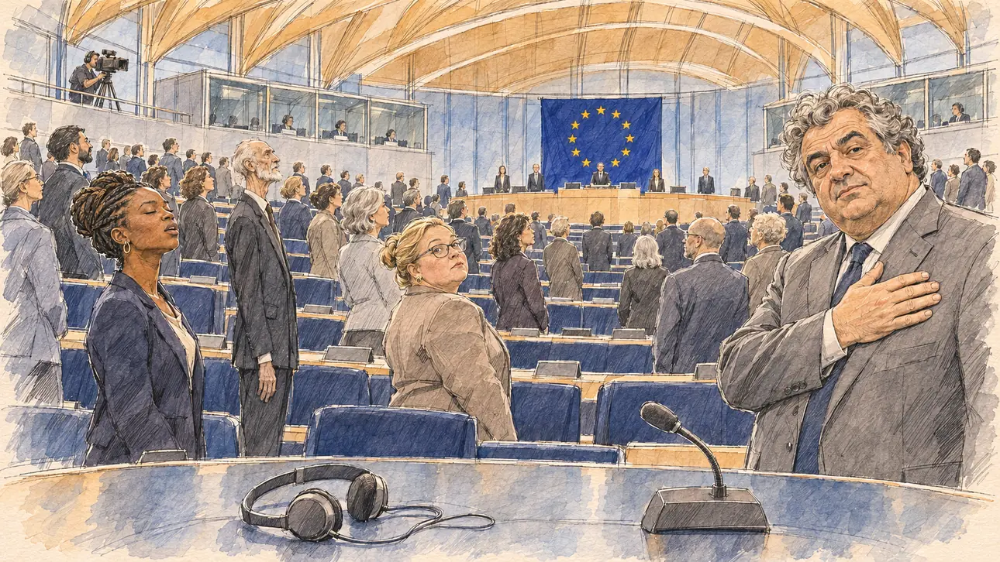

# `anthemStrasbourg` · L'hymne de Strasbourg

**Retenue par le PO le 15/11/2026**, au premier essai. Elle sert telle quelle en clair et en sombre.



| Champ | Valeur |
| --- | --- |
| Carte | `anthemStrasbourg`, catégorie `abroad` (International), poids 0,1, toute semaine ; un geste au bord de l'axe de l'Europe, côté intégration (Mitchnsun/moi-president, PO, 14/11/2026) |
| Style | Reportage dessiné |
| Ton | Solennel et légèrement ironique |
| Date | 2026-11-15 |
| Outil | ChatGPT Images, modèle GPT 6.2 (effort à compléter) |
| Conversation | À compléter |
| Format rendu | 1672 × 941 (16:9) : export en 1290 × 726 px, WebP de qualité 75, 215 Ko, sans recadrage, fait depuis le PNG d'origine |
| Fichier d'origine | À compléter (hors du dépôt) |
| Première édition | À compléter |

## Texte de la carte

> **L'hymne de Strasbourg**
>
> Le Parlement européen vous reçoit pour un débat solennel, et l'hymne européen retentit. Les députés se lèvent, et les caméras vous cherchent.

## Le moment choisi

L'hémicycle du Parlement européen à Strasbourg, un matin de mars, pendant l'hymne : gradins bleus, voûte de bois clair, cabines des interprètes, le drapeau européen derrière la présidence, tous les députés debout. Le candidat est à sa place d'invité, hors champ : seuls son casque d'interprétation et un micro éteint, sur le pupitre. Le député qui l'a invité, la main sur le cœur, lui jette un regard : vous chantez ? Une jeune députée chante les yeux fermés, un vieux député reste debout sans chanter, une autre députée se retourne, curieuse ; un caméraman filme depuis la tribune de presse. Les précédents sont la marche du Louvre sur l'Hymne à la joie (7 mai 2017) et le drapeau européen sous l'Arc de Triomphe (janvier 2022) : personne n'y ressemble à un député européen ou à un responsable politique réel.

## Prompt complet

Dans une nouvelle conversation, avec [`primeTime.webp`](../../illustrations/media/primeTime.webp) comme seule image de référence :

```
Use the attached image as the style reference and copy its drawing: a realistic reportage drawing made on the spot for a newspaper, with quick, nervous pencil lines, often drawn twice, ink hatching in the shadows, transparent watercolour washes that spill a little over the lines, and the warm paper showing through. Not the same scene and not the same people: never reuse the face or the hair of the woman in the reference.
Like in the reference, the setting can be full when the story needs it, with the things that say where we are and what is happening, but each one is sketched with a few pencil lines and a light wash, never rendered or finished, and the drawing gets looser and paler towards the edges until it fades into the bare paper.
This must look like a drawing made by hand on paper by a press illustrator, halfway between a quick sketch and a realistic picture: never a photograph, a film poster or a digital painting, and never a cartoon, a comic strip, a caricature or a children's book illustration. Continuous lines, never dotted or dashed outlines; no uniform texture, speckles or hatching filter laid over the picture; no glossy highlights, no smooth gradients, in the sky and on the walls too. Colour can be rich in places, on a piece of clothing, a light or a flag, but it stays transparent and within the palette below. The fade into the paper at the edges stays narrow, without a wide white margin. No blur and no depth-of-field effect: everything, the foreground included, is drawn sharp, like a sketch made on the spot.
People are drawn from life with realistic anatomy and proportions, like in the reference: faces shaped with pencil lines, hatching and light washes, a little more finished than the background but never photographic (no photographic skin, no airbrushed or digital-painting look). Expressions stay natural and restrained, even in laughter or tears: no exaggerated grins, no wide-open mouths full of teeth, no rubbery or cartoonish faces.

Editorial illustration, landscape 16:9 (1536 × 864 px), the scene filling the frame, with only a light fade into the paper at the edges. The hemicycle of the European Parliament in Strasbourg, on a morning in March 2027, during a solemn debate, as the European anthem plays: the curved rows of blue seats, the great vault of light wood, the glass booths of the interpreters high up, the European flag behind the presidency's rostrum; all the members are standing. The player's candidate stands at a guest's seat and stays off-camera: in the foreground, only the candidate's interpretation headset lying on the desk beside a switched-off microphone. In the right third, the member who invited the candidate, a heavy-set man in his fifties of Greek descent with curly grey hair, in a grey suit, standing with his hand on his heart, glances at the viewer as if asking whether the viewer will sing, his face above mid-height. In the rows: a young member of Nigerian descent with her braids pinned up sings with her eyes closed; a very tall, thin elderly member with a trimmed white beard stands without singing, arms by his sides; a short, round member in her forties with blond hair in a bun and glasses turns towards the viewer with curiosity. High up, in the press gallery, a camera operator points his lens. Only the member who invited the candidate and the blond member look at the viewer. Nothing on the desks, the nameplates, the screens, the booths or the camera is readable.

Style: Reportage drawing made on the spot, like a press illustrator or courtroom sketch artist: pencil and ink with loose watercolour washes, lively unfinished lines, white paper showing through.

Palette: navy #13203F, vellum #F5EFE1, gold #A9802A, brick #B5523B, ochre #D9A441, sage #8FA58A, slate #5E7186, sand #DCC8A4, warm grey #8C8279; use 4 to 6 of them, subtle warm paper grain.

Tone: solemn and slightly ironic, the clear, even light of the hemicycle, the blue of the flag and of the seats as the strong note of the picture, the gold of its stars.

Constraints: realistic proportions, natural expressions, never cartoonish or caricatured faces, drawn like the rest of the illustration and never photographic; people of varied ages, genders, origins and body types (heavy, stocky, round, tall, short, wiry, not only slim), each with a distinct face and haircut (no two people alike), drawn with respect and never as a joke; each person's age, build and look plausible for their job and the scene (working people of working age), no stereotype tying an origin or a gender to a role, and no person of colour shown alone in a featured service or deferential role; anatomically correct hands with exactly five fingers, few hands visible, the others in pockets, behind objects or out of frame; no readable text anywhere (the desks, the nameplates, the screens, the booths and the camera stay unreadable, no names, no country names, no numbers); no captions or speech bubbles; no logos, no European Parliament logo, no television channel logo, no political party colours, no flags other than the European flag; no recognisable real person, no lookalike of a real member of the European Parliament, of its president or of a real politician; no explicit violence; no photographic rendering, no blur or bokeh, every outline a continuous pencil or ink line with no dotted or dashed outlines, no mottled, crackled or speckled texture over the faces, the clothes, the seats or the vault, no hatching filter over the picture, no oil-paint texture, no glow or halo, no wide white margin or frame (a light fade into the paper at the edges is fine).

Format: if 16:9 is not available, make 1536 × 1024 and keep the top 80 px and the bottom 80 px free of anything important (faces, hands, the main action): they will be cropped.
```

## Décisions prises sur cette image

Retenue telle quelle par le PO (15/11/2026). Le drapeau européen a ses douze étoiles, la dernière cachée par la présidente de séance.

## Essais écartés

Aucun.

## Retouches

Aucune.

## Relecture

Faite le 15/11/2026, à confirmer par le PO.

- [x] Aucun texte lisible : chevalets et pupitres blancs ; rien sur les cabines, les écrans ni la caméra.
- [x] Aucun sosie d'une personne réelle.
- [x] Le candidat du joueur est hors champ : seuls son casque et le micro, sur le pupitre.
- [x] Mains et visages sans défaut visible à 343 px de large : la main sur le cœur du député (cinq doigts), les bras le long du corps du vieux député.
- [x] Aucune couleur, aucun logo ni aucun drapeau de parti ; seul le drapeau européen. Des personnes variées par l'âge, le corps, l'origine et la coiffure.
- [x] En 16:9 : pas de recadrage.
- [ ] Lisible sur la page de l'événement, en clair et en sombre : à vérifier dans l'app, une fois la carte publiée.
