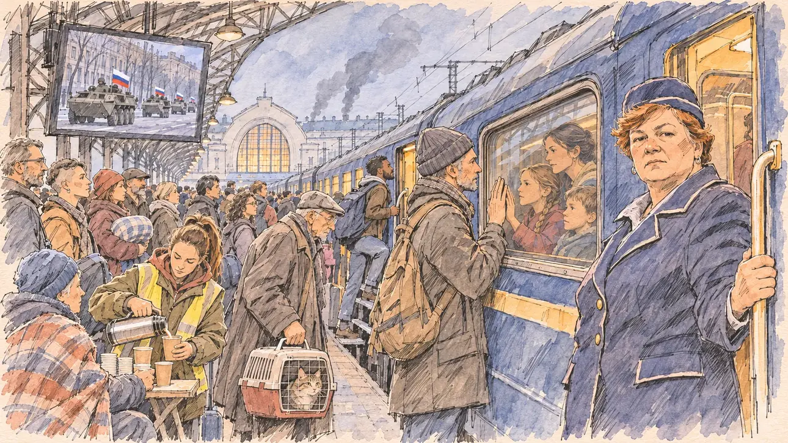

# `capitalFalls` · Une capitale tombe

**Validée par le PO le 10/11/2026**, au premier essai. Elle sert telle quelle en clair et en sombre.



| Champ | Valeur |
| --- | --- |
| Carte | `capitalFalls`, catégorie `abroad` (International), poids 0,05, toute semaine, jamais dans la même partie que [`peaceAccord`](peaceAccord.md) |
| Style | Reportage dessiné |
| Ton | Sobre et grave, aube grise |
| Date | 2026-11-10 |
| Outil | ChatGPT Images, à compléter (modèle et effort) |
| Conversation | À compléter |
| Format rendu | 1672 × 941 (16:9) : export en 1290 × 726 px, WebP de qualité 75, 237 Ko, sans recadrage, fait depuis la copie WebP de la conversation (à refaire depuis le PNG d'origine) |
| Fichier d'origine | À compléter (hors du dépôt) |
| Première édition | À compléter |

## Texte de la carte

> **Une capitale tombe**
>
> Aux portes de l'Union, l'armée russe entre dans Kiev, après des années de guerre. Des centaines de milliers de personnes fuient vers l'ouest ; les dirigeants européens se réunissent cette nuit.

## Le moment choisi

Le quai de la gare centrale de Kiev, à l'aube grise du jour où l'armée russe entre dans la ville, au départ d'un train bondé vers l'ouest : au bout du quai, la façade claire de la gare et sa grande baie en arc ; au loin, de la fumée grise au-dessus des toits, sans flammes. Sur un écran fixé sous l'auvent, le direct montre une colonne de blindés sous des drapeaux russes, sans aucun texte. La cheffe de wagon, à la porte de sa voiture, regarde le spectateur, grave. Un père reste sur le quai, la main contre la vitre, celle de sa fille contre la sienne de l'autre côté : en 2022, les hommes de 18 à 60 ans n'avaient pas le droit de quitter le pays. Autour, un vieil homme et son chat dans sa caisse, une bénévole qui sert du thé, un étudiant nigérian qui monte dans le train : des milliers d'étudiants étrangers ont fui eux aussi en 2022.

**La même exception au gabarit que [`peaceAccord`](peaceAccord.md), acceptée par le PO** : l'événement se passe à l'étranger, sans le candidat du joueur, donc sans objet à lui au premier plan.

## Prompt complet

Dans une nouvelle conversation, avec [`primeTime.webp`](../../illustrations/media/primeTime.webp) comme seule image de référence :

```
Use the attached image as the style reference and copy its drawing: a realistic reportage drawing made on the spot for a newspaper, with quick, nervous pencil lines, often drawn twice, ink hatching in the shadows, transparent watercolour washes that spill a little over the lines, and the warm paper showing through. Not the same scene and not the same people: never reuse the face or the hair of the woman in the reference.
Like in the reference, the setting can be full when the story needs it, with the things that say where we are and what is happening, but each one is sketched with a few pencil lines and a light wash, never rendered or finished, and the drawing gets looser and paler towards the edges until it fades into the bare paper.
This must look like a drawing made by hand on paper by a press illustrator, halfway between a quick sketch and a realistic picture: never a photograph, a film poster or a digital painting, and never a cartoon, a comic strip, a caricature or a children's book illustration. Continuous lines, never dotted or dashed outlines; no uniform texture, speckles or hatching filter laid over the picture; no glossy highlights, no smooth gradients, in the sky and on the walls too. Colour can be rich in places, on a piece of clothing, a light or a flag, but it stays transparent and within the palette below. The fade into the paper at the edges stays narrow, without a wide white margin. No blur and no depth-of-field effect: everything, the foreground included, is drawn sharp, like a sketch made on the spot.
People are drawn from life with realistic anatomy and proportions, like in the reference: faces shaped with pencil lines, hatching and light washes, a little more finished than the background but never photographic (no photographic skin, no airbrushed or digital-painting look). Expressions stay natural and restrained, even in laughter or tears: no exaggerated grins, no wide-open mouths full of teeth, no rubbery or cartoonish faces.

Editorial illustration, landscape 16:9 (1536 × 864 px), the scene filling the frame, with only a light fade into the paper at the edges. A long platform of the central railway station in Kyiv, at a grey dawn in March 2027, the day the invading army enters the city after years of war: a crowded passenger train leaving for the west, its windows lit in warm yellow, people with suitcases, bags and blankets, and at the far end of the platform the pale façade of the station with its great arched window. Far away above the roofs, a few columns of grey smoke, with no flames. On a large screen fixed under the platform canopy, the live news shows a column of armoured vehicles driving into a city avenue under white, blue and red flags, with no text, no letters and no symbols on the screen or on the vehicles. In the right third, the train's carriage attendant, a heavy-set woman in her fifties with short dyed auburn hair, in a navy railway uniform and cap, holds the door of her carriage and looks at the viewer, grave and steady, her face above mid-height. Next to her, a father in his forties, tall, with grey stubble and a woollen hat, stays on the platform with his palm against a train window; behind the glass, his wife and their two children, his daughter's hand pressed against his from the other side. Behind them, an old man in his seventies, thin and stooped, carries a cat in a plastic travel crate; a volunteer in her twenties with a high ponytail and a high-visibility vest over her parka pours tea from a thermos into paper cups; a Nigerian student in his twenties, with a short beard and a backpack, climbs into the next carriage. Only the carriage attendant looks at the viewer. Nothing on the train, the screen, the luggage, the station or the signs is readable.

Style: Reportage drawing made on the spot, like a press illustrator or courtroom sketch artist: pencil and ink with loose watercolour washes, lively unfinished lines, white paper showing through.

Palette: navy #13203F, vellum #F5EFE1, gold #A9802A, brick #B5523B, ochre #D9A441, sage #8FA58A, slate #5E7186, sand #DCC8A4, warm grey #8C8279; use 4 to 6 of them, subtle warm paper grain.

Tone: sober and grave, cold blue-grey dawn light, the warm yellow of the train windows as the only warmth, the small white, blue and red flags on the screen as a cold reminder.

Constraints: realistic proportions, natural expressions, never cartoonish or caricatured faces, drawn like the rest of the illustration and never photographic; people of varied ages, genders, origins and body types (heavy, stocky, round, tall, short, wiry, not only slim), each with a distinct face and haircut (no two people alike), drawn with respect and never as a joke; no stereotype tying an origin or a gender to a role, and no person of colour shown alone in a featured service or deferential role; anatomically correct hands with exactly five fingers, few hands visible, the others in pockets, behind objects or out of frame; no readable text anywhere (the train, the screen, the luggage, the station and the signs stay unreadable, no departure board); no captions or speech bubbles; no logos, no railway company name or logo, no political party colours; the only flags are the small ones on the vehicles of the screen; no "Z" or "V" symbol or any letter on the vehicles; no weapons in anyone's hands, no soldiers on the platform, no wounded, no explicit violence, no flames, no ruins; no recognisable real person, no lookalike of a real politician or head of state; no photographic rendering, no blur or bokeh, every outline a continuous pencil or ink line with no dotted or dashed outlines, no mottled, crackled or speckled texture over the faces, the clothes or the walls, no hatching filter over the picture, no oil-paint texture, no glow or halo around the windows or the screen, no wide white margin or frame (a light fade into the paper at the edges is fine).

Format: if 16:9 is not available, make 1536 × 1024 and keep the top 80 px and the bottom 80 px free of anything important (faces, hands, the main action): they will be cropped.
```

## Décisions prises sur cette image

Validée telle quelle par le PO (10/11/2026).

- **L'écran du quai est une liberté** : les quais de la gare de Kiev n'en ont pas, mais c'est le seul endroit où la référence à la Russie se lit à la taille de la carte. Les drapeaux russes n'apparaissent que là, sur les blindés du direct ; aucun « Z » ni « V », aucun texte.
- **La fumée** monte juste derrière la gare et peut évoquer des cheminées ; à côté de l'écran, elle se lit comme la fumée de la ville. Gardée.
- **Le train bleu à bande jaune** rappelle les trains ukrainiens, sans nom ni logo.

## Essais écartés

Aucun.

## Retouches

Aucune.

## Relecture

Faite et validée par le PO le 10/11/2026.

- [x] Aucun texte lisible : ni sur l'écran, ni sur le train, ni sur la gare ; aucun tableau des départs.
- [x] Aucun sosie d'une personne réelle.
- [x] Le candidat du joueur n'apparaît pas, et la scène n'a pas d'objet à lui : l'exception notée plus haut.
- [x] Aucun « Z » ni « V », aucune lettre sur les blindés ; aucune arme brandie, aucun soldat sur le quai, aucun blessé, aucune flamme.
- [x] Mains et visages sans défaut visible à 343 px de large : la main de la cheffe de wagon sur la poignée (cinq doigts), celles du père et de sa fille de part et d'autre de la vitre, le thermos et le gobelet de la bénévole, la caisse du chat.
- [x] Aucune couleur ni aucun logo de parti. Des personnes variées par l'âge, le corps, l'origine et la coiffure.
- [x] En 16:9 : pas de recadrage.
- [ ] Lisible sur la page de l'événement, en clair et en sombre : à vérifier dans l'app, une fois la carte publiée.
