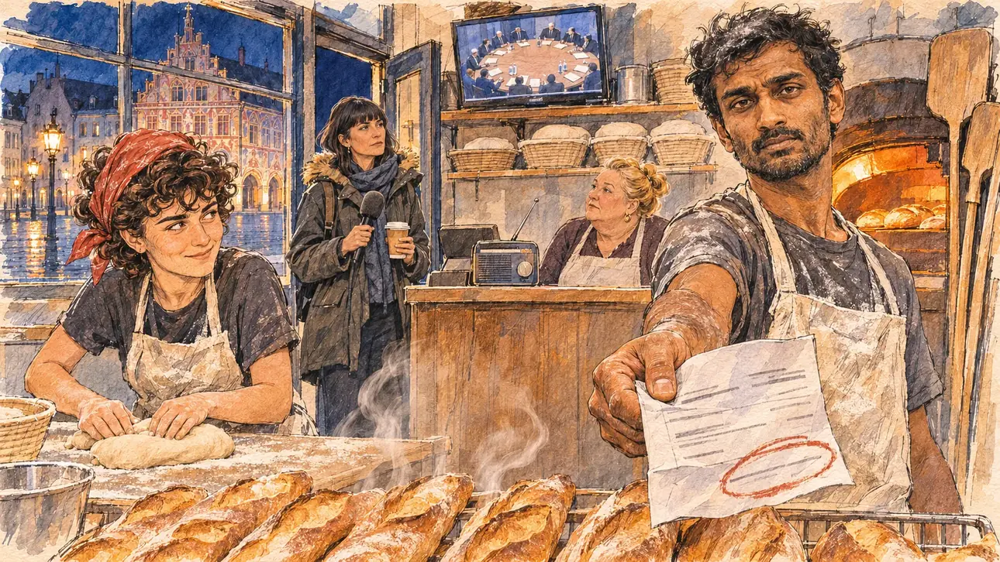

# `euSummit` · Un sommet européen extraordinaire

**Validée par le PO le 06/11/2026**, au premier essai, avec `primeTime.webp` comme référence. Elle sert telle quelle en clair et en sombre.



| Champ | Valeur |
| --- | --- |
| Carte | `euSummit`, catégorie `abroad` (International), carte ajoutée par la PR #297 de l'app |
| Style | Reportage dessiné, trait de `primeTime` |
| Ton | Tendu et concret |
| Date | 2026-11-06 |
| Outil | ChatGPT Images |
| Conversation | À remplir (le lien ne s'ouvre qu'avec le compte qui l'a créée) |
| Format rendu | 1672 × 941 (16:9) : export en 1290 × 726 px, WebP de qualité 75, 243 Ko, sans recadrage |
| Fichier d'origine | Image de ChatGPT, chez le PO. L'export du dépôt a été fait depuis la copie partagée dans la conversation avec Claude |
| Première édition | La prochaine Release qui suit le merge de la PR #297 de l'app |

## Texte de la carte

> **Un sommet européen extraordinaire**
>
> Les chefs d'État européens se réunissent à Bruxelles en urgence sur le prix de l'énergie. Vous n'avez pas d'invitation, mais les journalistes cherchent des voix qui comptent pour commenter la nuit de négociation.

## Le moment choisi

Le fournil d'une boulangerie de Mulhouse, à cinq heures du matin, après la nuit de négociation à Bruxelles, vu depuis le comptoir où le candidat (hors champ) arrive pour une visite : au premier plan, une grille de baguettes qui sortent du four. Le boulanger, tablier enfariné, tend au candidat sa facture d'électricité, le total entouré de rouge. Autour : le four allumé, à gauche, une jeune apprentie au bandana rouge qui façonne les pâtons en souriant, la boulangère qui écoute la radio, une petite télévision qui montre la grande table ronde du sommet au petit matin, et sur le pas de la porte une journaliste de radio qui attend avec son micro. Par la vitrine : la place de la Réunion encore dans la nuit et l'hôtel de ville peint de Mulhouse.

## Prompt complet

Dans une nouvelle conversation, avec deux images jointes, dans cet ordre : [`primeTime.webp`](../../illustrations/media/primeTime.webp) pour le style, puis le portrait dessiné fourni par le PO pour la ressemblance de la jeune apprentie. Le portrait n'est pas dans ce dépôt.

```
Use the first attached image as the style reference and copy its drawing: a realistic reportage drawing made on the spot for a newspaper, with quick, nervous pencil lines, often drawn twice, ink hatching in the shadows, transparent watercolour washes that spill a little over the lines, and the warm paper showing through. Not the same scene and not the same people: never reuse the face or the hair of the woman in the reference.
Like in the reference, the setting can be full when the story needs it, with the things that say where we are and what is happening, but each one is sketched with a few pencil lines and a light wash, never rendered or finished, and the drawing gets looser and paler towards the edges until it fades into the bare paper.
Use the second attached image, a drawn portrait, only as the likeness reference for the young apprentice: give her this woman's features, her short, thick, very curly dark-brown hair, her brown eyes, her straight dark eyebrows and her small, mischievous half-smile, at the same age as in the portrait, and draw her face with the same pencil lines and washes as the other people in the scene. Keep the likeness through the drawing, never through photographic detail. Do not reuse the red polo-neck of the portrait: she wears the clothes of the scene.
This must look like a drawing made by hand on paper by a press illustrator, halfway between a quick sketch and a realistic picture: never a photograph, a film poster or a digital painting, and never a cartoon, a comic strip, a caricature or a children's book illustration. Continuous lines, never dotted or dashed outlines; no uniform texture, speckles or hatching filter laid over the picture; no glossy highlights, no smooth gradients, in the sky and on the walls too. Colour can be rich in places, on a piece of clothing, a light or a flag, but it stays transparent and within the palette below. The fade into the paper at the edges stays narrow, without a wide white margin. No blur and no depth-of-field effect: everything, the foreground included, is drawn sharp, like a sketch made on the spot.
People are drawn from life with realistic anatomy and proportions, like in the reference: faces shaped with pencil lines, hatching and light washes, a little more finished than the background but never photographic (no photographic skin, no airbrushed or digital-painting look). Expressions stay natural and restrained, even in laughter or tears: no exaggerated grins, no wide-open mouths full of teeth, no rubbery or cartoonish faces.

Editorial illustration, landscape 16:9 (1536 × 864 px), the scene filling the frame, with only a light fade into the paper at the edges. The bakehouse of a bakery in Mulhouse, in southern Alsace, at five in the morning in early 2027, after a night of emergency negotiation in Brussels: the European heads of state have met in urgency on energy prices, the player's candidate was not invited, and journalists are looking for voices that count to comment on the night of talks. The scene is seen from the shop counter where the candidate arrives for a dawn visit, who stays off-camera: in the foreground, only a rack of baguettes just out of the oven, steam rising. In the right third, the baker, a man in his thirties of Sri Lankan Tamil origin, wiry, with short black hair dusted with flour, a short beard and a flour-covered apron over a T-shirt, holds out towards the viewer his folded electricity bill, a big total circled in red, with a tired, concrete, questioning look, his face above mid-height. Around him, sketched in pencil and light washes: the big bread oven glowing orange behind its open door, wooden peels and baskets of dough; in the left third, the young apprentice, the woman from the portrait, in her early twenties, with a red bandana tied over her short dark curls, which escape from it on every side, and a flour-dusted apron over a dark T-shirt, shaping a loaf at the floured table and glancing up towards the baker with the small, mischievous half-smile of the portrait, her face clearly visible above mid-height; the baker's wife, a round woman in her fifties with a blonde bun, listening to a small radio by the till; a small television on a shelf showing, at dawn, the big round table of the summit seen from high up, with tiny figures, papers and water bottles, no flags and no recognisable face; in the doorway, a radio journalist in her forties of Bosnian origin, tall, with a dark fringe and a parka, waiting with her plain foam microphone and a coffee. Through the shop window, the place de la Réunion still in the dark, the street lamps on the cobbles, and the painted Renaissance town hall of Mulhouse with its colourful trompe-l'œil façade. Only the baker looks straight at the viewer. Nothing on the bill, the radio, the television, the till, the price boards or the shop front is readable, and no flag of a real country and no logo of a real energy company, radio or TV channel appears.

Style: Reportage drawing made on the spot, like a press illustrator or courtroom sketch artist: pencil and ink with loose watercolour washes, lively unfinished lines, white paper showing through.

Palette: navy #13203F, vellum #F5EFE1, gold #A9802A, brick #B5523B, ochre #D9A441, sage #8FA58A, slate #5E7186, sand #DCC8A4, warm grey #8C8279; use 4 to 6 of them, subtle warm paper grain.

Tone: tense and concrete, the deep blue of the hour before dawn outside, the orange glow of the oven and the warm light of the bakehouse, the white flour, and the red circle on the bill as the sharp note.

Constraints: realistic proportions, natural expressions, never cartoonish or caricatured faces, drawn like the rest of the illustration and never photographic; people of varied ages, genders, origins and body types (heavy, stocky, round, tall, short, wiry, not only slim), each with a distinct face and haircut (no two people alike), drawn with respect and never as a joke; anatomically correct hands with exactly five fingers, few hands visible, the others in pockets, behind objects or out of frame; no readable text anywhere (the bill, the radio, the television, the till, the price boards and the shop front stay unreadable); no captions or speech bubbles; no logos or political party colours; apart from the apprentice, no recognisable real person, no lookalike of a real politician, and no flag of a real country and no logo of a real energy company, radio or TV channel; no explicit violence; no photographic rendering, no blur or bokeh, no dotted outlines, no texture or hatching filter over the picture, no oil-paint texture, no wide white margin or frame (a light fade into the paper at the edges is fine).

Format: if 16:9 is not available, make 1536 × 1024 and keep the top 80 px and the bottom 80 px free of anything important (faces, hands, the main action): they will be cropped.
```

## Décisions prises sur cette image

- **La jeune apprentie reprend les traits d'un portrait dessiné fourni par le PO** (06/11/2026) : ses cheveux bruns courts, épais et très bouclés, ses yeux bruns, ses sourcils droits et son petit sourire en coin. Elle garde le bandana rouge du premier prompt (PO), pas le col roulé rouge du portrait, et passe au tiers gauche, le visage bien visible, pour que la ressemblance se lise. L'accord de la personne est à confirmer par le PO avant la validation de l'image. Le portrait n'est pas dans ce dépôt, et la fiche ne nomme personne.

## Essais écartés

Aucun.

## Retouches

Aucune.

## Relecture

Faite et validée par le PO le 06/11/2026.

- [x] Aucun texte lisible : la facture n'a que des lignes grises et le cercle rouge ; rien n'est lisible sur la radio, la caisse, les étiquettes ni la vitrine, et une minuscule plaque sous la télévision reste illisible à la taille de l'app.
- [x] Aucun sosie d'une personne réelle autre que la ressemblance voulue de la jeune apprentie, d'après un portrait dessiné fourni par le PO ; l'accord de la personne reste à confirmer par le PO. Les chefs d'État de la télévision sont des silhouettes génériques en costume, sans drapeau ni visage reconnaissable, une vingtaine de pixels à la taille de l'app.
- [x] Le candidat du joueur est hors champ.
- [x] Mains, visages et foules sans défaut visible à 343 px de large.
- [x] Aucune couleur ni aucun logo de parti. Des personnes variées par l'âge, le corps, l'origine et la coiffure.
- [x] En 3:2 : sans objet, l'image est en 16:9.
- [x] Lisible sur la page de l'événement, en clair et en sombre.

Ce que la relecture a accepté : la table du sommet est vue de plus près que demandé, les silhouettes un peu plus grandes ; l'hôtel de ville peint est vu au bord d'une place mouillée.
