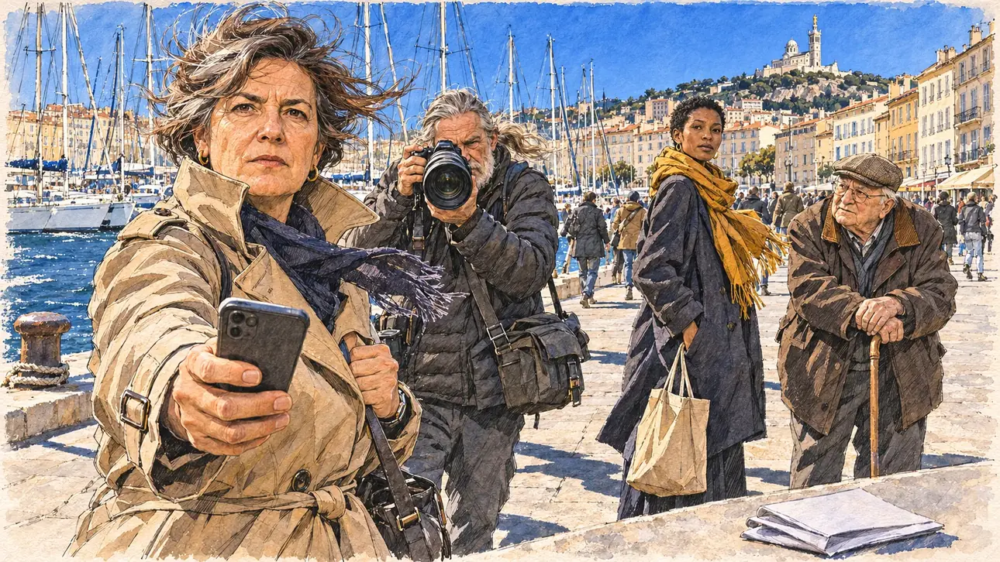

# `genocideQuestion` · Est-ce un génocide ?

**Validée par le PO le 27/11/2026**, au premier essai. Elle sert telle quelle en clair et en sombre.



| Champ | Valeur |
| --- | --- |
| Carte | `genocideQuestion`, catégorie `abroad` (International), poids 0,15 ; carte ajoutée avec Gaza dans la campagne (Mitchnsun/moi-president#563) |
| Style | Reportage dessiné, trait et texture de `primeTime` |
| Ton | Tendu, midi d'hiver, mistral |
| Date | 2026-11-27 |
| Outil | ChatGPT Images |
| Format rendu | 1672 × 941 (16:9) : export en 1290 × 726 px, WebP de qualité 75, 239 Ko, sans recadrage |
| Fichier d'origine | Image de ChatGPT, chez le PO. L'export du dépôt a été fait depuis la copie partagée dans la conversation avec Claude |
| Première édition | La prochaine Release qui suit le merge de Mitchnsun/moi-president#563 |

## Texte de la carte

> **Est-ce un génocide ?**
>
> À Gaza, le cessez-le-feu tient mal et la reconstruction n'a pas commencé. La commission d'enquête de l'ONU parle de génocide, Israël rejette le terme, et la Cour internationale de justice ne tranchera pas avant des années. Au sortir d'un meeting, une journaliste vous demande : « Est-ce un génocide ? »

Ses réponses : employer le mot, comme la commission d'enquête de l'ONU ; parler de crimes de guerre et laisser la justice trancher ; rappeler le 7 octobre, les otages et le droit d'Israël à se défendre ; ne pas se prononcer sur une qualification juridique.

## Le moment choisi

Le quai du Vieux-Port de Marseille à midi, un jour de mistral, après un meeting : les mâts des voiliers, les façades ocre et Notre-Dame-de-la-Garde sur sa colline. Le candidat du joueur est hors champ, la scène vue de sa place : ses tracts, illisibles. La journaliste lui tend son téléphone qui enregistre et le regarde, grave ; derrière elle, un photographe le vise ; deux passants s'arrêtent pour écouter. L'image ne montre rien de Gaza, ni drapeau, ni symbole, ni image de guerre : la question est toute la scène, et le narrateur ne prend pas parti.

## Prompt complet

Dans une nouvelle conversation, avec [`primeTime.webp`](../../illustrations/media/primeTime.webp) comme seule image de référence :

```
Use the attached image as the style reference and copy its drawing: a realistic reportage drawing made on the spot for a newspaper, with quick, nervous pencil lines, often drawn twice, ink hatching in the shadows, transparent watercolour washes that spill a little over the lines, and the warm paper showing through. Take from the reference its line, its washes and its paper, not the finish of the presenter's face, which is the most finished and almost photographic part of it: every face here stays a drawing. Not the same scene and not the same people: never reuse the face or the hair of the woman in the reference.
Like in the reference, the setting can be full when the story needs it, with the things that say where we are and what is happening, but each one is sketched with a few pencil lines and a light wash, never rendered or finished, and the drawing gets looser and paler towards the edges until it fades into the bare paper.
This must look like a drawing made by hand on paper by a press illustrator, halfway between a quick sketch and a realistic picture: never a photograph, a film poster or a digital painting, and never a cartoon, a comic strip, a caricature or a children's book illustration. Continuous lines, never dotted or dashed outlines; the fine mottled grain of the reference is welcome, as long as the pencil lines and the washes stay clearly visible under it, but never a heavy texture, an oil-paint look or a hatching filter laid over a finished picture; no glossy highlights, no smooth gradients, in the sky and on the walls too. Colour can be rich in places, on a piece of clothing, a light or a flag, but it stays transparent and within the palette below. The fade into the paper at the edges stays narrow, without a wide white margin. No blur and no depth-of-field effect: everything, the foreground included, is drawn sharp, like a sketch made on the spot.
People are drawn from life with realistic anatomy and proportions: each face is drawn with the same visible pencil and ink lines, hatching and transparent washes as the clothes and the room, looser and sketchier than the presenter's face in the reference, with realistic features but never photographic (no photographic skin, no smooth shading, no airbrushed or digital-painting look). Expressions stay natural and restrained, even in laughter or tears: no exaggerated grins, no wide-open mouths full of teeth, no rubbery or cartoonish faces.

Editorial illustration, landscape 16:9 (1536 × 864 px), the scene filling the frame, with only a light fade into the paper at the edges. Noon on a windy winter day in 2027 on the quay of the Vieux-Port in Marseille, France, just after a campaign rally: the masts of moored sailing boats, ochre and cream façades along the quay, and on the hill behind, the basilica of Notre-Dame-de-la-Garde sketched against a hard blue sky. The player's candidate stays off-camera, the scene seen from where they stand: in the bottom-right foreground, only a few folded campaign leaflets held at waist height, unreadable. In the left third, the main character, a journalist in her early fifties, white, stocky, short brown hair streaked with grey blown by the wind, a beige trench coat with the collar up, holds out her phone, recording, towards the viewer and looks straight at the viewer, serious and waiting for an answer, her face above mid-height. Just behind her, a press photographer in his sixties, white, a long grey ponytail and a trimmed beard, a dark padded jacket, aims a camera with a long lens at the viewer. In the middle ground on the right, two passers-by have stopped to listen: a tall woman in her thirties of Cape Verdean origin, close-cropped hair, a mustard scarf, holding a shopping bag, looking at the viewer; and a short round man in his seventies, white, a flat cap, leaning on a cane, looking at the journalist. No flag, no symbol and no image of war anywhere: the question is the whole scene. Nothing on the phone, the leaflets, the boats or the façades is readable.

Style: Reportage drawing made on the spot, like a press illustrator or courtroom sketch artist: pencil and ink with loose watercolour washes, lively unfinished lines, white paper showing through.

Palette: navy #13203F, vellum #F5EFE1, gold #A9802A, brick #B5523B, ochre #D9A441, sage #8FA58A, slate #5E7186, sand #DCC8A4, warm grey #8C8279; use 4 to 6 of them, subtle warm paper grain.

Tone: tense, hard winter noon light, the mistral blowing hair and coats, sharp shadows.

Constraints: realistic proportions, natural expressions, never cartoonish or caricatured faces, drawn like the rest of the illustration and never photographic; people of varied ages, genders, origins and body types (heavy, stocky, round, tall, short, wiry, not only slim), each with a distinct face and haircut (no two people alike), drawn with respect and never as a joke; each person's age, build and look plausible for their job and the scene (working people of working age), no stereotype tying an origin or a gender to a role, and no person of colour shown alone in a featured service or deferential role; anatomically correct hands with exactly five fingers, few hands visible, the others in pockets, behind objects or out of frame; no readable text anywhere (the phone, the leaflets, the boats and the façades stay unreadable); no captions or speech bubbles; no logos or political party colours; no flags, no keffiyeh, no religious or national symbol; no recognisable real person, no lookalike of a real politician or of a known journalist; no explicit violence, no image of war; no photographic rendering, no blur or bokeh, no dotted outlines, no heavy texture or hatching filter over a finished picture (the fine grain of the reference is fine), no oil-paint texture, no wide white margin or frame (a light fade into the paper at the edges is fine).

Format: if 16:9 is not available, make 1536 × 1024 and keep the top 80 px and the bottom 80 px free of anything important (faces, hands, the main action): they will be cropped.
```

## Décisions prises sur cette image

- Les tracts du candidat sont posés sur le parapet de pierre au premier plan, et non tenus à hauteur de taille comme le demandait le prompt : gardé, le candidat reste hors champ.

## Essais écartés

Aucun.

## Retouches

Aucune.

## Relecture

Faite par Claude le 27/11/2026 et validée par le PO le même jour.

- [x] Aucun texte lisible : le téléphone (vu de dos), les tracts, les bateaux, les façades.
- [x] Aucun sosie d'une personne réelle relevé.
- [x] Le candidat du joueur est hors champ ; seuls ses tracts sont au premier plan.
- [x] Mains sans défaut visible (le téléphone, l'appareil photo, la canne).
- [x] Aucun drapeau, aucun symbole religieux ou national, aucune couleur de parti, aucune image de guerre. Des personnes variées par l'âge, le corps, l'origine et la coiffure.
- [x] En 16:9 : pas de recadrage.
- [ ] Lisible sur la page de l'événement, en clair et en sombre : à voir dans l'app.
