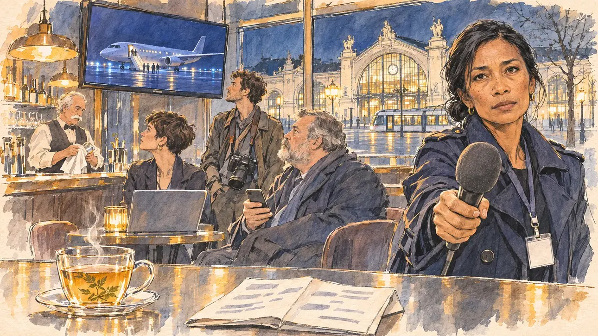

# `hostageFreed` · Une otage française libérée

**À générer.** Prompt prêt le 05/11/2026, pas encore d'image validée.



| Champ | Valeur |
| --- | --- |
| Carte | `hostageFreed`, catégorie `abroad` (International), carte ajoutée par la PR #297 de l'app |
| Style | Reportage dessiné, trait de `primeTime` |
| Ton | Grave et ému |
| Date | À remplir |
| Outil | ChatGPT Images |
| Conversation | À remplir (le lien ne s'ouvre qu'avec le compte qui l'a créée) |
| Format rendu | À remplir |
| Fichier d'origine | À remplir |
| Première édition | À remplir |

## Texte de la carte

> **Une otage française libérée**
>
> Après dix-huit mois de captivité, une humanitaire française est libérée et rentre en France. L'Élysée annonce son arrivée dans la nuit ; toutes les rédactions attendent la réaction des candidats.

## Le moment choisi

Le bar d'un hôtel près de la gare de Tours, tard dans la nuit, après un meeting, vu depuis le comptoir où le candidat (hors champ) s'est arrêté : au premier plan, une tisane et le programme du lendemain plié sur le comptoir. Une journaliste politique qui suit la campagne tend son micro au candidat, l'air grave, attendant sa réaction. Autour : les autres journalistes de la caravane, téléphones à la main, un photographe, le barman qui essuie un verre, tous tournés vers la télévision : un avion qui se pose sur une piste de nuit, de minuscules silhouettes au pied de la passerelle. Par la vitrine : la façade de pierre de la gare de Tours illuminée et un tramway.

## Prompt complet

Dans une nouvelle conversation, avec [`primeTime.webp`](../../illustrations/media/primeTime.webp) comme seule image de référence.

```
Use the attached image as the style reference and copy its drawing: a realistic reportage drawing made on the spot for a newspaper, with quick, nervous pencil lines, often drawn twice, ink hatching in the shadows, transparent watercolour washes that spill a little over the lines, and the warm paper showing through. Not the same scene and not the same people: never reuse the face or the hair of the woman in the reference.
Like in the reference, the setting can be full when the story needs it, with the things that say where we are and what is happening, but each one is sketched with a few pencil lines and a light wash, never rendered or finished, and the drawing gets looser and paler towards the edges until it fades into the bare paper.
This must look like a drawing made by hand on paper by a press illustrator, halfway between a quick sketch and a realistic picture: never a photograph, a film poster or a digital painting, and never a cartoon, a comic strip, a caricature or a children's book illustration. Continuous lines, never dotted or dashed outlines; no uniform texture, speckles or hatching filter laid over the picture; no glossy highlights, no smooth gradients, in the sky and on the walls too. Colour can be rich in places, on a piece of clothing, a light or a flag, but it stays transparent and within the palette below. The fade into the paper at the edges stays narrow, without a wide white margin. No blur and no depth-of-field effect: everything, the foreground included, is drawn sharp, like a sketch made on the spot.
People are drawn from life with realistic anatomy and proportions, like in the reference: faces shaped with pencil lines, hatching and light washes, a little more finished than the background but never photographic (no photographic skin, no airbrushed or digital-painting look). Expressions stay natural and restrained, even in laughter or tears: no exaggerated grins, no wide-open mouths full of teeth, no rubbery or cartoonish faces.

Editorial illustration, landscape 16:9 (1536 × 864 px), the scene filling the frame, with only a light fade into the paper at the edges. The bar of a hotel near the railway station of Tours, in the Loire valley, late at night after a campaign rally, in early 2027: after eighteen months in captivity, a French aid worker has been freed and is flying home, the Élysée has announced her arrival during the night, and every newsroom is waiting for the candidates' reactions. The scene is seen from the bar counter where the player's candidate has stopped, who stays off-camera: in the foreground, only a cup of herbal tea and the next day's schedule folded on the counter. In the right third, a political journalist who follows the campaign, a woman in her forties of Malagasy origin, small and slim, with long black hair in a low knot, a dark trench coat and a press badge on a lanyard with no readable words, holds out a microphone with a plain foam cover towards the viewer, with a grave, moved, attentive look, waiting for the reaction, her face above mid-height. Around her, sketched in pencil and light washes: the other journalists of the campaign press pack, tired, phones in hand, a heavy-set reporter in his fifties with a grey beard, a young woman with a pixie cut and a laptop open on a table, a lanky photographer with a camera round his neck; the barman, an older man with a white moustache, drying a glass; all of them half turned towards a television above the bar showing, at night, a plane landing on a lit runway and tiny distant silhouettes at the foot of the aircraft steps, with no recognisable face. Through the big window, the stone façade of the Tours railway station lit up at night, with its tall arched glass windows and its statues, and a tram gliding past in the empty square. Only the journalist with the microphone looks straight at the viewer. Nothing on the television, the badge, the schedule, the laptop, the phones or the bottles is readable, and no logo of a real TV channel, airline or company appears.

Style: Reportage drawing made on the spot, like a press illustrator or courtroom sketch artist: pencil and ink with loose watercolour washes, lively unfinished lines, white paper showing through.

Palette: navy #13203F, vellum #F5EFE1, gold #A9802A, brick #B5523B, ochre #D9A441, sage #8FA58A, slate #5E7186, sand #DCC8A4, warm grey #8C8279; use 4 to 6 of them, subtle warm paper grain.

Tone: grave and moved, the warm, dim amber light of the bar at night, the blue glow of the television and of the runway lights, and the lit stone of the station outside.

Constraints: realistic proportions, natural expressions, never cartoonish or caricatured faces, drawn like the rest of the illustration and never photographic; people of varied ages, genders, origins and body types (heavy, stocky, round, tall, short, wiry, not only slim), each with a distinct face and haircut (no two people alike), drawn with respect and never as a joke; anatomically correct hands with exactly five fingers, few hands visible, the others in pockets, behind objects or out of frame; no readable text anywhere (the television, the badge, the schedule, the laptop, the phones and the bottles stay unreadable); no captions or speech bubbles; no logos or political party colours; no recognisable real person, no lookalike of a real politician, and no logo of a real TV channel, airline or company; no explicit violence; no photographic rendering, no blur or bokeh, no dotted outlines, no texture or hatching filter over the picture, no oil-paint texture, no wide white margin or frame (a light fade into the paper at the edges is fine).

Format: if 16:9 is not available, make 1536 × 1024 and keep the top 80 px and the bottom 80 px free of anything important (faces, hands, the main action): they will be cropped.
```

## Décisions prises sur cette image

Aucune pour l'instant.

## Essais écartés

Aucun pour l'instant.

## Retouches

Aucune.

## Relecture

À faire sur l'image validée.
