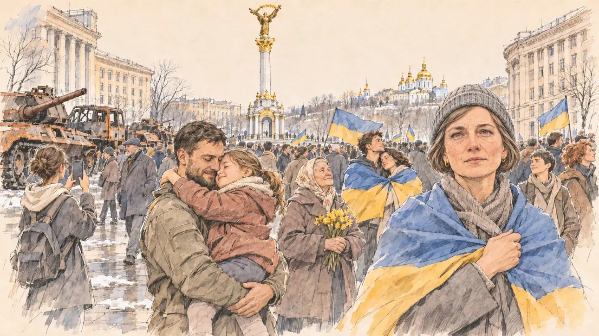

# `peaceAccord` · La paix signée aux portes de l'Union

**Validée par le PO le 10/11/2026**, au deuxième essai, après un message de correction de la coiffure dans la même conversation. Elle sert telle quelle en clair et en sombre.



| Champ | Valeur |
| --- | --- |
| Carte | `peaceAccord`, catégorie `abroad` (International), poids 0,05, toute semaine, jamais dans la même partie que [`capitalFalls`](capitalFalls.md) |
| Style | Reportage dessiné |
| Ton | Ému et calme, matin froid de printemps |
| Date | 2026-11-10 |
| Outil | ChatGPT Images, à compléter (modèle et effort) |
| Conversation | À compléter |
| Format rendu | 1672 × 941 (16:9) : export en 1290 × 726 px, WebP de qualité 75, 147 Ko, sans recadrage, fait depuis la copie WebP de la conversation (à refaire depuis le PNG d'origine) |
| Fichier d'origine | À compléter (hors du dépôt) |
| Première édition | À compléter |

## Texte de la carte

> **La paix signée aux portes de l'Union**
>
> Après des années de guerre aux portes de l'Union, un accord de paix est signé : l'Ukraine recouvre ses frontières et demande à entrer dans l'Union au plus vite. Les rédactions attendent la réaction des candidats.

## Le moment choisi

La place de l'Indépendance (Maïdan), à Kiev, le lendemain de la signature, par un matin froid et lumineux de mars : la colonne de l'Indépendance et sa statue dorée, les coupoles dorées d'un monastère sur la colline, une foule calme aux drapeaux bleu et jaune. En bord de place, la rangée de chars brûlés et rouillés exposée comme à Kiev en 2022 rappelle l'invasion russe, sans marquage, ni lettre, ni drapeau. Dans le tiers droit, une enseignante, le drapeau sur les épaules, regarde le spectateur avec des larmes de soulagement retenues ; à côté d'elle, un soldat de retour, sans arme, serre sa petite fille ; derrière, une vieille dame aux jonquilles, un jeune couple sous un même drapeau, une étudiante qui filme.

**Une exception au gabarit, acceptée par le PO** : l'événement se passe à l'étranger, sans le candidat du joueur. Il n'y a donc pas d'objet à lui au premier plan, comme pour [`stateAlgorithm`](../farFetched/stateAlgorithm.md) : la scène est vue comme la montre le reportage. [`capitalFalls`](capitalFalls.md), l'autre fin de cette guerre, suit la même exception.

## Prompt complet

Dans une nouvelle conversation, avec [`primeTime.webp`](../../illustrations/media/primeTime.webp) comme seule image de référence. Le prompt proposé disait d'abord « the invaded country regains its borders » ; la carte nommant désormais l'Ukraine, le PO pouvait y mettre « Ukraine », comme ci-dessous.

```
Use the attached image as the style reference and copy its drawing: a realistic reportage drawing made on the spot for a newspaper, with quick, nervous pencil lines, often drawn twice, ink hatching in the shadows, transparent watercolour washes that spill a little over the lines, and the warm paper showing through. Not the same scene and not the same people: never reuse the face or the hair of the woman in the reference.
Like in the reference, the setting can be full when the story needs it, with the things that say where we are and what is happening, but each one is sketched with a few pencil lines and a light wash, never rendered or finished, and the drawing gets looser and paler towards the edges until it fades into the bare paper.
This must look like a drawing made by hand on paper by a press illustrator, halfway between a quick sketch and a realistic picture: never a photograph, a film poster or a digital painting, and never a cartoon, a comic strip, a caricature or a children's book illustration. Continuous lines, never dotted or dashed outlines; no uniform texture, speckles or hatching filter laid over the picture; no glossy highlights, no smooth gradients, in the sky and on the walls too. Colour can be rich in places, on a piece of clothing, a light or a flag, but it stays transparent and within the palette below. The fade into the paper at the edges stays narrow, without a wide white margin. No blur and no depth-of-field effect: everything, the foreground included, is drawn sharp, like a sketch made on the spot.
People are drawn from life with realistic anatomy and proportions, like in the reference: faces shaped with pencil lines, hatching and light washes, a little more finished than the background but never photographic (no photographic skin, no airbrushed or digital-painting look). Expressions stay natural and restrained, even in laughter or tears: no exaggerated grins, no wide-open mouths full of teeth, no rubbery or cartoonish faces.

Editorial illustration, landscape 16:9 (1536 × 864 px), the scene filling the frame, with only a light fade into the paper at the edges. Independence Square (Maidan) in Kyiv, on a cold, bright morning in March 2027, the day after a peace agreement is signed and Ukraine regains its borders: the tall white Independence Monument column with its gilded statue on top, the golden domes of a monastery on the hill behind, the curved buildings around the square, patches of melting snow. A large, quiet crowd fills the square with blue and yellow Ukrainian flags. On one side of the square, a row of burned-out, rusted tanks and armoured vehicles left on display, as Kyiv exhibited them in 2022, with no markings, no letters, no symbols and no flags on them; people walk past them without looking. In the right third, a schoolteacher in her forties, Ukrainian, sturdy, with a blond braid wound around her head, a long grey coat and a blue and yellow flag over her shoulders, looks at the viewer with restrained tears of relief, her face above mid-height. Next to her, a soldier back from the front, a wiry man in his thirties with a short dark beard and a faded uniform, with no weapon, holds his little daughter of six in his arms, her cheek against his; behind them, an old woman in a headscarf with a bunch of yellow flowers, a young couple wrapped in one flag, a student filming with her phone. Only the schoolteacher looks at the viewer. Nothing on the flags, the phones, the vehicles, the buildings or the monument is readable.

Style: Reportage drawing made on the spot, like a press illustrator or courtroom sketch artist: pencil and ink with loose watercolour washes, lively unfinished lines, white paper showing through.

Palette: navy #13203F, vellum #F5EFE1, gold #A9802A, brick #B5523B, ochre #D9A441, sage #8FA58A, slate #5E7186, sand #DCC8A4, warm grey #8C8279; use 4 to 6 of them, subtle warm paper grain; the flags in a transparent blue and ochre yellow.

Tone: moving and quiet, relief more than celebration, cold bright spring light, the gold of the statue and the domes, the rust of the tanks as a sober reminder.

Constraints: realistic proportions, natural expressions, never cartoonish or caricatured faces, drawn like the rest of the illustration and never photographic; people of varied ages, genders and body types (heavy, stocky, round, tall, short, wiry, not only slim), each with a distinct face and haircut (no two people alike), drawn with respect and never as a joke; anatomically correct hands with exactly five fingers, few hands visible, the others in pockets, behind objects or out of frame; no readable text anywhere (the flags, the phones, the vehicles, the buildings and the monument stay unreadable); no captions or speech bubbles; no logos, no political party colours; no Russian flag, no "Z" or "V" symbol or any letter on the vehicles; no weapons in anyone's hands, no wounded, no explicit violence, no ruins in flames; no recognisable real person, no lookalike of a real politician or head of state; no photographic rendering, no blur or bokeh, every outline a continuous pencil or ink line with no dotted or dashed outlines, no mottled, crackled or speckled texture over the faces, the clothes or the walls, no hatching filter over the picture, no oil-paint texture, no glow or halo, no wide white margin or frame (a light fade into the paper at the edges is fine).

Format: if 16:9 is not available, make 1536 × 1024 and keep the top 80 px and the bottom 80 px free of anything important (faces, hands, the main action): they will be cropped.
```

### Message de correction, dans la même conversation

Une seule modification, la coiffure de l'enseignante :

```
Keep the same scene, the same square, the same people and the same poses, with the same rendering. One change only: the schoolteacher in the right third no longer has a braid around her head; give her short ash-brown hair in a simple bob under a knitted grey beanie, the same face, the same tears, the same flag on her shoulders. Everything else stays the same: nothing readable, no symbols or letters on the vehicles, exactly five fingers on every visible hand.
```

## Décisions prises sur cette image

- **L'enseignante n'a plus de tresse enroulée autour de la tête** (10/11/2026). Le premier prompt la demandait : c'est la coiffure emblématique de Ioulia Timochenko, ancienne Première ministre ukrainienne, et dans une scène à Kiev elle y faisait aussitôt penser. Elle porte maintenant un carré châtain cendré sous un bonnet gris, avec le même visage.
- **La Russie n'est évoquée que par les chars rouillés**, exposés comme à Kiev en 2022 : ni drapeau russe, ni « Z », ni « V », ni lettre sur les véhicules.
- **La carte nomme l'Ukraine** à la demande du PO ; l'image la montre par le Maïdan et les drapeaux.

## Essais écartés

1. **Premier essai** (même conversation) : la scène, le rendu et les chars étaient justes, mais l'enseignante portait la tresse blonde enroulée demandée par le prompt (voir les décisions). Corrigé par le message ci-dessus.

## Retouches

Aucune.

## Relecture

Faite et validée par le PO le 10/11/2026.

- [x] Aucun texte lisible : ni sur les drapeaux, ni sur les téléphones, ni sur les bâtiments, ni sur la colonne.
- [x] Aucun sosie d'une personne réelle (voir les décisions pour la coiffure de l'enseignante).
- [x] Le candidat du joueur n'apparaît pas, et la scène n'a pas d'objet à lui : l'exception notée plus haut.
- [x] Aucun drapeau russe, aucun « Z » ni « V », aucun marquage sur les chars ; aucune arme en main, aucun blessé.
- [x] Mains et visages sans défaut visible à 343 px de large : le soldat qui serre sa fille, les fleurs de la vieille dame, le téléphone de l'étudiante.
- [x] Aucune couleur ni aucun logo de parti. Des personnes variées par l'âge, le corps et la coiffure.
- [x] En 16:9 : pas de recadrage.
- [ ] Lisible sur la page de l'événement, en clair et en sombre : à vérifier dans l'app, une fois la carte publiée.
