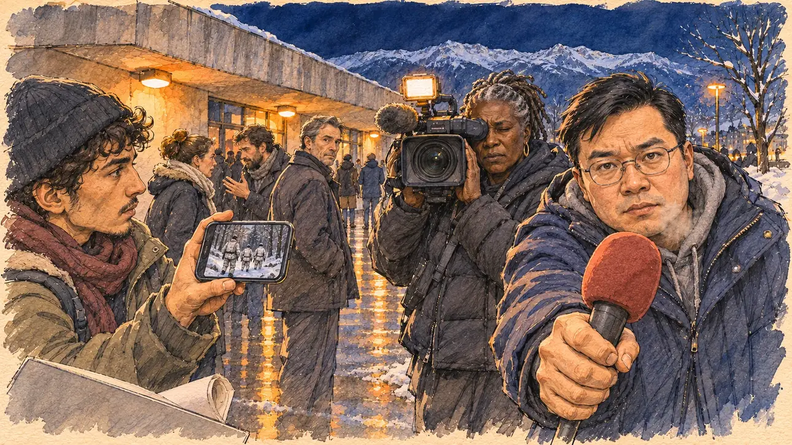

# `troopsQuestion` · Des soldats français au front ?

**Validée par le PO le 27/11/2026**, au premier essai, gardée telle quelle malgré la texture relevée plus bas. Elle sert telle quelle en clair et en sombre.



| Champ | Valeur |
| --- | --- |
| Carte | `troopsQuestion`, catégorie `abroad` (International), poids 0,15, jamais dans la même partie que [`peaceAccord`](peaceAccord.md) ; carte ajoutée pour Mitchnsun/moi-president#562 |
| Style | Reportage dessiné, trait de `primeTime` ; une texture marbrée sur toute l'image (voir « Décisions ») |
| Ton | Tendu, nuit d'hiver |
| Date | 2026-11-27 |
| Outil | ChatGPT Images |
| Conversation | À remplir (le lien ne s'ouvre qu'avec le compte qui l'a créée) |
| Format rendu | 1672 × 941 (16:9) : export en 1290 × 726 px, WebP de qualité 75, 215 Ko, sans recadrage |
| Fichier d'origine | Image de ChatGPT, chez le PO. L'export du dépôt a été fait depuis la copie partagée dans la conversation avec Claude |
| Première édition | La prochaine Release qui suit le merge de la PR de Mitchnsun/moi-president#562 |

## Texte de la carte

> **Des soldats français au front ?**
>
> Une enquête révèle que des soldats français sont déployés en secret dans le pays attaqué aux portes de l'Union. Le gouvernement se tait. Au sortir d'un meeting, un journaliste vous tend son micro : « Faut-il y envoyer nos soldats ? »

Ses réponses : assumer le soutien au pays attaqué, exiger un débat au Parlement, « Ce n'est pas notre guerre », ne pas commenter des opérations militaires.

## Le moment choisi

Un soir d'hiver, devant la porte latérale d'une salle de meeting à Grenoble, les montagnes enneigées au-dessus des toits. Le candidat du joueur est hors champ, la scène vue de sa place : au premier plan, le coin de la pochette qui tient son discours roulé. Dans le tiers droit, un journaliste lui tend un micro sans logo et le regarde ; derrière lui, une cadreuse filme. À gauche, un militant montre sur son téléphone des silhouettes de soldats dans une forêt enneigée, sans drapeau ni insigne : la révélation de la semaine. Le cas réel (la question posée à un candidat au congrès des maires, le 25/11/2026) est dans `docs/NEWS_SOURCES.md` de l'app ; l'image ne montre ni ce candidat, ni ce lieu.

## Prompt complet

Dans une nouvelle conversation, avec [`primeTime.webp`](../../illustrations/media/primeTime.webp) comme seule image de référence :

```
Use the attached image as the style reference and copy its drawing: a realistic reportage drawing made on the spot for a newspaper, with quick, nervous pencil lines, often drawn twice, ink hatching in the shadows, transparent watercolour washes that spill a little over the lines, and the warm paper showing through. Take from the reference its line, its washes and its paper, not the finish of the presenter's face, which is the most finished and almost photographic part of it: every face here stays a drawing. Not the same scene and not the same people: never reuse the face or the hair of the woman in the reference.
Like in the reference, the setting can be full when the story needs it, with the things that say where we are and what is happening, but each one is sketched with a few pencil lines and a light wash, never rendered or finished, and the drawing gets looser and paler towards the edges until it fades into the bare paper.
This must look like a drawing made by hand on paper by a press illustrator, halfway between a quick sketch and a realistic picture: never a photograph, a film poster or a digital painting, and never a cartoon, a comic strip, a caricature or a children's book illustration. Continuous lines, never dotted or dashed outlines; the paper grain is the paper itself, never a mottled texture, speckles or hatching filter laid over the picture; no glossy highlights, no smooth gradients, in the sky and on the walls too. Colour can be rich in places, on a piece of clothing, a light or a flag, but it stays transparent and within the palette below. The fade into the paper at the edges stays narrow, without a wide white margin. No blur and no depth-of-field effect: everything, the foreground included, is drawn sharp, like a sketch made on the spot.
People are drawn from life with realistic anatomy and proportions: each face is drawn with the same visible pencil and ink lines, hatching and transparent washes as the clothes and the room, looser and sketchier than the presenter's face in the reference, with realistic features but never photographic (no photographic skin, no smooth shading, no airbrushed or digital-painting look). Expressions stay natural and restrained, even in laughter or tears: no exaggerated grins, no wide-open mouths full of teeth, no rubbery or cartoonish faces.

Editorial illustration, landscape 16:9 (1536 × 864 px), the scene filling the frame, with only a light fade into the paper at the edges. A winter evening in 2027 outside the side door of a rally hall in Grenoble, France: a wet pavement under orange street lamps, a low modern concrete hall behind, and above the roofs the snowy mountains sketched pale against a dark blue sky. A press investigation has just revealed that French soldiers are secretly deployed in a country at war at the door of the European Union. The player's candidate stays off-camera, the scene seen from where they stand: in the bottom-left foreground, only the corner of a grey cardboard folder holding a rolled-up speech, held at chest height. In the right third, the main character, a reporter in his mid-thirties of Vietnamese French origin, stocky, round face, short black hair with a side parting, thin-rimmed glasses, a dark navy parka over a grey hoodie, steps forward and holds out a handheld microphone with a plain brick-red foam windscreen and no logo towards the viewer, looking straight at the viewer, insistent and serious, his face above mid-height, his breath visible in the cold air. Just behind him, a camerawoman in her fifties of West African origin, tall and broad-shouldered, grey locs tied back, a padded black jacket, films with a shoulder camera pointed at the viewer, her eye on the viewfinder. In the left third, a young supporter in his twenties of North African origin, wiry, curly hair, a beanie, holds up his phone towards the reporter to show him something, looking at the reporter: on the phone screen, small sketched silhouettes of soldiers in white camouflage in a snowy forest, with no flag, no insignia and no text. Behind them, two or three other supporters leave the hall in coats, one looking at the viewer, the others talking among themselves. Nothing on the phone, the folder, the hall or the street is readable.

Style: Reportage drawing made on the spot, like a press illustrator or courtroom sketch artist: pencil and ink with loose watercolour washes, lively unfinished lines, white paper showing through.

Palette: navy #13203F, vellum #F5EFE1, gold #A9802A, brick #B5523B, ochre #D9A441, sage #8FA58A, slate #5E7186, sand #DCC8A4, warm grey #8C8279; use 4 to 6 of them, subtle warm paper grain.

Tone: tense, winter night, cold blue shadows against the orange street lamps, hard shadows.

Constraints: realistic proportions, natural expressions, never cartoonish or caricatured faces, drawn like the rest of the illustration and never photographic; people of varied ages, genders, origins and body types (heavy, stocky, round, tall, short, wiry, not only slim), each with a distinct face and haircut (no two people alike), drawn with respect and never as a joke; each person's age, build and look plausible for their job and the scene (working people of working age), no stereotype tying an origin or a gender to a role, and no person of colour shown alone in a featured service or deferential role; anatomically correct hands with exactly five fingers, few hands visible, the others in pockets, behind objects or out of frame; no readable text anywhere (the phone screen, the folder, the camera, the hall and the street signs stay unreadable); no captions or speech bubbles; no logos or political party colours, no logo on the microphone or the camera; no flags, insignia or uniforms that name a country; no recognisable real person, no lookalike of a real politician or of a known television reporter; no explicit violence, no weapon in the foreground; no photographic rendering, no blur or bokeh, no dotted outlines, no texture or hatching filter over the picture, no oil-paint texture, no wide white margin or frame (a light fade into the paper at the edges is fine).

Format: if 16:9 is not available, make 1536 × 1024 and keep the top 80 px and the bottom 80 px free of anything important (faces, hands, the main action): they will be cropped.
```

## Décisions prises sur cette image

- Le premier essai a une texture marbrée sur toute l'image (les parkas, le ciel, le trottoir), des visages plus finis que demandé (le journaliste, le militant) et des couleurs plus saturées que `primeTime`. Claude a proposé le message de correction du gabarit ; le PO a gardé l'image telle quelle (27/11/2026).

## Essais écartés

Aucun.

## Retouches

Aucune.

## Relecture

Faite par Claude le 27/11/2026 et validée par le PO le même jour.

- [x] Aucun texte lisible : le téléphone, la pochette, la caméra, la salle.
- [x] Aucun sosie d'une personne réelle relevé.
- [x] Le candidat du joueur est hors champ ; seule sa pochette est au premier plan.
- [x] Mains sans défaut visible (le micro, le téléphone, la caméra).
- [x] Aucune couleur ni aucun logo de parti, aucun drapeau ni insigne. Des personnes variées par l'âge, le corps, l'origine et la coiffure.
- [x] En 16:9 : pas de recadrage.
- [ ] Lisible sur la page de l'événement, en clair et en sombre : à voir dans l'app.
