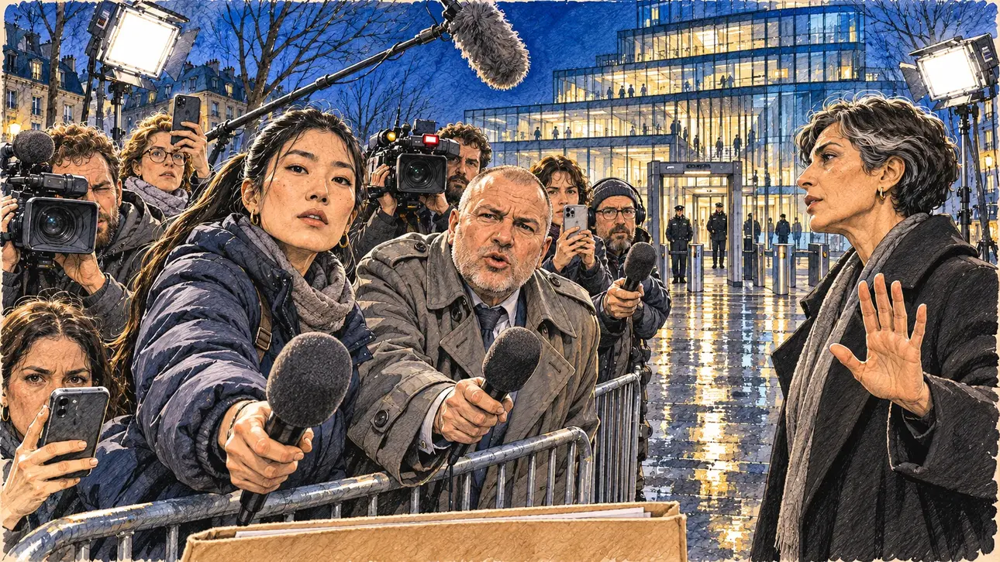

# `cheatIndictment` · Mise en examen

**Validée par le PO le 22/11/2026**, au premier essai. Elle sert telle quelle en clair et en sombre.



| Champ | Valeur |
| --- | --- |
| Carte | `cheatIndictment`, catégorie `affair` (Affaire), jamais tirée par son poids : la mise en examen, imposée deux semaines après la réponse à la révélation d'un meeting payé par le parti, des assistants parlementaires ou d'un parrainage acheté ; jamais entre les deux tours ; carte ajoutée par la PR #472 de l'app (Mitchnsun/moi-president#60) |
| Style | Reportage dessiné |
| Ton | Tendu, une sortie de tribunal la nuit |
| Date | 2026-11-22 |
| Outil | ChatGPT Images, modèle GPT 6.2 Astra, effort Light |
| Conversation | À compléter |
| Format rendu | 1672 × 941 (16:9) : export en 1290 × 726 px, WebP de qualité 75, 267 Ko, sans recadrage, fait depuis la copie WebP de la conversation |
| Fichier d'origine | Image de ChatGPT, chez le PO. L'export du dépôt a été fait depuis la copie partagée dans la conversation avec Claude |
| Première édition | À compléter |

## Texte de la carte

> **Mise en examen**
>
> Les juges vous mettent en examen. Rien ne vous oblige à retirer votre candidature : la loi vous laisse vous présenter.

## Le moment choisi

La sortie du tribunal judiciaire de Paris, aux Batignolles, la nuit : la tour de verre éclairée, la grille, et une meute de journalistes, caméras, perches et micros tendus vers le spectateur, c'est-à-dire vers le candidat qui sort. Au premier plan, seul le bord de son dossier. À côté, son avocate, en manteau, lève la main pour demander le calme. Le candidat est hors champ, la scène vue de sa place.

## Prompt complet

Dans une nouvelle conversation, avec [`primeTime.webp`](../../illustrations/media/primeTime.webp) comme seule image de référence :

```
Use the attached image as the style reference and copy its drawing: a realistic reportage drawing made on the spot for a newspaper, with quick, nervous pencil lines, often drawn twice, ink hatching in the shadows, transparent watercolour washes that spill a little over the lines, and the warm paper showing through. Not the same scene and not the same people: never reuse the face or the hair of the woman in the reference.
Like in the reference, the setting can be full when the story needs it, with the things that say where we are and what is happening, but each one is sketched with a few pencil lines and a light wash, never rendered or finished, and the drawing gets looser and paler towards the edges until it fades into the bare paper.
This must look like a drawing made by hand on paper by a press illustrator, halfway between a quick sketch and a realistic picture: never a photograph, a film poster or a digital painting, and never a cartoon, a comic strip, a caricature or a children's book illustration. Continuous lines, never dotted or dashed outlines; no uniform texture, speckles or hatching filter laid over the picture; no glossy highlights, no smooth gradients, in the sky and on the walls too. Colour can be rich in places, on a piece of clothing, a light or a flag, but it stays transparent and within the palette below. The fade into the paper at the edges stays narrow, without a wide white margin. No blur and no depth-of-field effect: everything, the foreground included, is drawn sharp, like a sketch made on the spot.
People are drawn from life with realistic anatomy and proportions, like in the reference: faces shaped with pencil lines, hatching and light washes, a little more finished than the background but never photographic (no photographic skin, no airbrushed or digital-painting look). Expressions stay natural and restrained, even in laughter or tears: no exaggerated grins, no wide-open mouths full of teeth, no rubbery or cartoonish faces.

Editorial illustration, landscape 16:9 (1536 × 864 px), the scene filling the frame, with only a light fade into the paper at the edges. The exit of the Paris courthouse at Batignolles, at night in March 2027: the tall stepped glass tower lit from inside, a security gate, wet paving stones reflecting the lights. The scene is seen from the place of the player's candidate, who has just come out: the candidate stays off-camera, and in the foreground there is only the edge of a thick cardboard folder held at chest height, with no hand visible. A crowd of journalists presses towards the viewer behind a low barrier: television cameras on shoulders with bright lamps, a boom microphone, several handheld microphones and smartphones held out, all aimed at the viewer. In the front row, a radio reporter, a tall young woman of Korean descent with a long black ponytail and a puffer jacket, holds out her microphone and looks at the viewer, her face above mid-height; next to her, a television reporter, a stout man in his fifties with a shaved head and a grey trench coat, shouts a question at the viewer. In the right third, standing beside the viewer and turned towards the crowd, the candidate's lawyer, a slim woman in her fifties of Lebanese descent with short dark hair streaked with grey and a long black coat, raises one open hand to ask for calm. The journalists look at the viewer; the lawyer looks at the crowd. Nothing on the microphones, the cameras, the folder or the building is readable, and no flag, logo or emblem appears.

Style: Reportage drawing made on the spot, like a press illustrator or courtroom sketch artist: pencil and ink with loose watercolour washes, lively unfinished lines, white paper showing through.

Palette: navy #13203F, vellum #F5EFE1, gold #A9802A, brick #B5523B, ochre #D9A441, sage #8FA58A, slate #5E7186, sand #DCC8A4, warm grey #8C8279; use 4 to 6 of them, subtle warm paper grain.

Tone: tense, night, cold blue light from the tower and harsh white camera lamps, hard shadows.

Constraints: realistic proportions, natural expressions, never cartoonish or caricatured faces, drawn like the rest of the illustration and never photographic; people of varied ages, genders, origins and body types (heavy, stocky, round, tall, short, wiry, not only slim), each with a distinct face and haircut (no two people alike), drawn with respect and never as a joke; each person's age, build and look plausible for their job and the scene (working people of working age), no stereotype tying an origin or a gender to a role, and no person of colour shown alone in a featured service or deferential role; anatomically correct hands with exactly five fingers, few hands visible, the others in pockets, behind objects or out of frame; no readable text anywhere (the microphones, the cameras, the folder and the building stay unreadable); no captions or speech bubbles; no logos or political party colours; no recognisable real person, no lookalike of a real politician or of a real lawyer or journalist; no explicit violence; no photographic rendering, no blur or bokeh, no dotted outlines, no texture or hatching filter over the picture, no oil-paint texture, no wide white margin or frame (a light fade into the paper at the edges is fine).

Format: if 16:9 is not available, make 1536 × 1024 and keep the top 80 px and the bottom 80 px free of anything important (faces, hands, the main action): they will be cropped.
```

## Décisions prises sur cette image

- **L'avocate ressemble à la journaliste de [`offBooksRalliesRevealed`](offBooksRalliesRevealed.md)** (PO, 22/11/2026) : même visage anguleux, mêmes cheveux bruns bouclés, mêmes créoles dorées, avec des mèches grises. Une correction qui lui donnait d'autres traits a été proposée ; le PO garde l'image telle quelle.
- **Une marque illisible sur le portique de sécurité**, en forme de lettres sans mot lisible, invisible à 343 px de large : gardée avec l'image.
- **Le premier plan** montre le bord d'un carton plutôt que d'un dossier, sans main visible : le candidat reste hors champ.
- **La tour des Batignolles** et des policiers devant l'entrée situent le tribunal de Paris : un monument réel, permis pour situer la scène.
- **Une texture mouchetée légère** couvre l'image, comme sur [`parliamentaryStaffRevealed`](parliamentaryStaffRevealed.md).

## Essais écartés

Aucun.

## Retouches

Aucune.

## Relecture

Faite et validée par le PO le 22/11/2026.

- [x] Aucun texte lisible : ni sur les micros, ni sur les caméras, ni sur le dossier, ni sur le bâtiment.
- [x] Aucun sosie d'une personne réelle.
- [x] Le candidat du joueur est hors champ ; toute image de lui (affiche, tract, double) n'a ni visage ni genre.
- [x] Mains, visages et foules sans défaut visible à 343 px de large.
- [x] Aucune couleur ni aucun logo de parti. Drapeaux, écharpes et Marianne seulement pour signaler un lieu ou un élu officiel. Des personnes variées par l'âge, le corps, l'origine et la coiffure.
- [x] En 3:2 : rien d'important dans les 80 px du haut et du bas.
- [x] Lisible sur la page de l'événement, en clair et en sombre.
