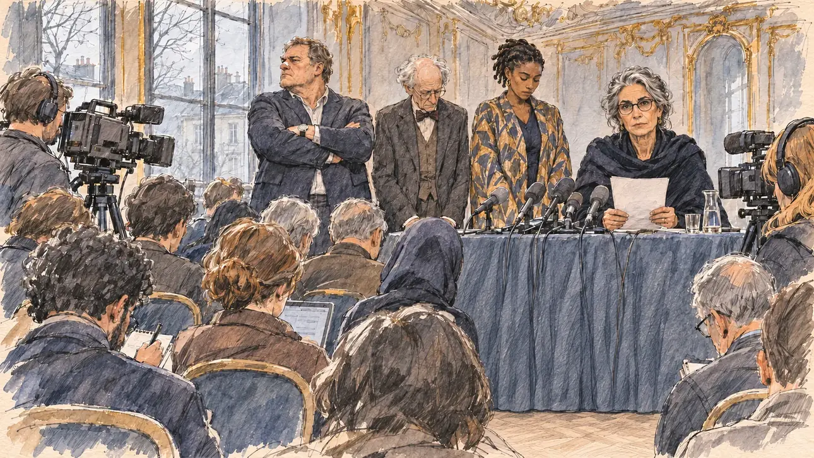

# `collectiveSuspends` · Un collectif vous lâche

**Validée par le PO le 10/11/2026**, au premier essai. Elle sert telle quelle en clair et en sombre.



| Champ | Valeur |
| --- | --- |
| Carte | `collectiveSuspends`, catégorie `affair` (Affaire), poids 0,15 (0,25 dans les deux premiers du sondage), plus fréquente avec une intégrité basse |
| Style | Reportage dessiné |
| Ton | Tendu, matin gris |
| Date | 2026-11-10 |
| Outil | ChatGPT Images, à compléter (modèle et effort) |
| Conversation | À compléter |
| Format rendu | 1672 × 941 (16:9) : export en 1290 × 726 px, WebP de qualité 75, 212 Ko, sans recadrage, fait depuis la copie WebP de la conversation (à refaire depuis le PNG d'origine) |
| Fichier d'origine | À compléter (hors du dépôt) |
| Première édition | À compléter |

## Texte de la carte

> **Un collectif vous lâche**
>
> Le collectif de personnalités qui soutenait votre candidature suspend sa participation et appelle votre camp à choisir quelqu'un d'autre.

## Le moment choisi

La conférence de presse du collectif, dans le vieux salon à moulures dorées d'un centre culturel, sans ville reconnaissable, un matin gris de mars, vue depuis le fond de la salle où se tient le candidat, hors champ. Derrière une table chargée de micros, la porte-parole lève les yeux de sa déclaration et regarde le spectateur, ferme et peinée ; autour d'elle, trois membres du collectif, des personnalités fictives : un ancien sportif massif, bras croisés, un vieux scientifique au nœud papillon, une jeune romancière tête baissée. Les journalistes et les caméras, de dos, occupent les premiers rangs.

## Prompt complet

Dans une nouvelle conversation, avec [`primeTime.webp`](../../illustrations/media/primeTime.webp) comme seule image de référence :

```
Use the attached image as the style reference and copy its drawing: a realistic reportage drawing made on the spot for a newspaper, with quick, nervous pencil lines, often drawn twice, ink hatching in the shadows, transparent watercolour washes that spill a little over the lines, and the warm paper showing through. Not the same scene and not the same people: never reuse the face or the hair of the woman in the reference.
Like in the reference, the setting can be full when the story needs it, with the things that say where we are and what is happening, but each one is sketched with a few pencil lines and a light wash, never rendered or finished, and the drawing gets looser and paler towards the edges until it fades into the bare paper.
This must look like a drawing made by hand on paper by a press illustrator, halfway between a quick sketch and a realistic picture: never a photograph, a film poster or a digital painting, and never a cartoon, a comic strip, a caricature or a children's book illustration. Continuous lines, never dotted or dashed outlines; no uniform texture, speckles or hatching filter laid over the picture; no glossy highlights, no smooth gradients, in the sky and on the walls too. Colour can be rich in places, on a piece of clothing, a light or a flag, but it stays transparent and within the palette below. The fade into the paper at the edges stays narrow, without a wide white margin. No blur and no depth-of-field effect: everything, the foreground included, is drawn sharp, like a sketch made on the spot.
People are drawn from life with realistic anatomy and proportions, like in the reference: faces shaped with pencil lines, hatching and light washes, a little more finished than the background but never photographic (no photographic skin, no airbrushed or digital-painting look). Expressions stay natural and restrained, even in laughter or tears: no exaggerated grins, no wide-open mouths full of teeth, no rubbery or cartoonish faces.

Editorial illustration, landscape 16:9 (1536 × 864 px), the scene filling the frame, with only a light fade into the paper at the edges. A press conference in the old salon of a cultural centre, with moulded ceilings and tall windows, in an ordinary French city, on a grey morning in March 2027: the collective of public figures who backed the player's candidacy announces that it suspends its support and calls on the player's camp to choose someone else. Behind a small table covered with microphones, the collective's spokesperson, a slim woman in her sixties of Iranian descent, with silver hair in a loose chignon, dark-rimmed glasses and a black shawl, looks up from her written statement and looks at the viewer at the back of the room, firm and pained, her face above mid-height, in the right third. Around her stand three members of the collective, fictional public figures: a heavy-set former athlete in his fifties, white, with a broken nose and a tight blazer, arms folded; an old scientist in his eighties, thin, with white hair and a bow tie, staring at the table; a young novelist in her thirties of Comorian descent, with short twists and a long patterned coat, looking down. In front of them, journalists and camera operators crowd the first rows, seen from behind. The player's candidate stays off-camera, at the back of the room: in the foreground, only a folded copy of the collective's old letter of support, its signatures unreadable, left on an empty chair. Only the spokesperson looks at the viewer. Nothing on the statement, the letter, the microphones, the cameras or the walls is readable.

Style: Reportage drawing made on the spot, like a press illustrator or courtroom sketch artist: pencil and ink with loose watercolour washes, lively unfinished lines, white paper showing through.

Palette: navy #13203F, vellum #F5EFE1, gold #A9802A, brick #B5523B, ochre #D9A441, sage #8FA58A, slate #5E7186, sand #DCC8A4, warm grey #8C8279; use 4 to 6 of them, subtle warm paper grain.

Tone: tense, cold grey morning light from the tall windows, the faded gold of the old salon.

Constraints: realistic proportions, natural expressions, never cartoonish or caricatured faces, drawn like the rest of the illustration and never photographic; people of varied ages, genders, origins and body types (heavy, stocky, round, tall, short, wiry, not only slim), each with a distinct face and haircut (no two people alike), drawn with respect and never as a joke; each person's age, build and look plausible for their job and the scene (working people of working age), no stereotype tying an origin or a gender to a role, and no person of colour shown alone in a featured service or deferential role; anatomically correct hands with exactly five fingers, few hands visible, the others in pockets, behind objects or out of frame; no readable text anywhere (the statement, the letter, the microphones, the cameras and the walls stay unreadable, no media logos on the microphones); no captions or speech bubbles; no logos, no political party colours; no recognisable real person, no lookalike of a real politician, athlete, scientist, writer or public figure; no explicit violence; no photographic rendering, no blur or bokeh, no dotted outlines, no texture or hatching filter over the picture, no oil-paint texture, no glow or halo around the lights, no wide white margin or frame (a light fade into the paper at the edges is fine).

Format: if 16:9 is not available, make 1536 × 1024 and keep the top 80 px and the bottom 80 px free of anything important (faces, hands, the main action): they will be cropped.
```

## Décisions prises sur cette image

Validée telle quelle par le PO (10/11/2026), avec deux points relevés à la relecture :

- l'exemplaire plié de l'ancienne tribune, sur une chaise vide, n'est pas venu : le bas de l'image n'est fait que des têtes des journalistes. La scène reste vue depuis le fond de la salle, à la place du candidat, sans objet à lui ;
- l'ancien sportif (carrure lourde, cheveux ondulés grisonnants, nez marqué d'une petite tache blanche) a un profil type qui peut faire penser à un acteur français connu ; ce n'est pas un portrait, et le PO n'y voit personne. Un message de correction (crâne rasé, barbe courte, nez droit) a été préparé, pas envoyé.

## Essais écartés

Aucun.

## Retouches

Aucune.

## Relecture

Faite et validée par le PO le 10/11/2026.

- [x] Aucun texte lisible : la déclaration est vierge, les micros n'ont pas de logo, l'ordinateur d'un journaliste n'affiche que des barres.
- [x] Aucun sosie d'une personne réelle (voir les décisions pour le profil de l'ancien sportif).
- [x] Le candidat du joueur est hors champ : la scène est vue depuis le fond de la salle ; son objet du premier plan manque (voir les décisions).
- [x] Mains et visages sans défaut visible à 343 px de large : les mains de la porte-parole sur sa déclaration, les bras croisés, la main qui écrit.
- [x] Aucune couleur ni aucun logo de parti. Des personnes variées par l'âge, le corps, l'origine et la coiffure.
- [x] En 16:9 : pas de recadrage.
- [ ] Lisible sur la page de l'événement, en clair et en sombre : à vérifier dans l'app, une fois la carte publiée.
