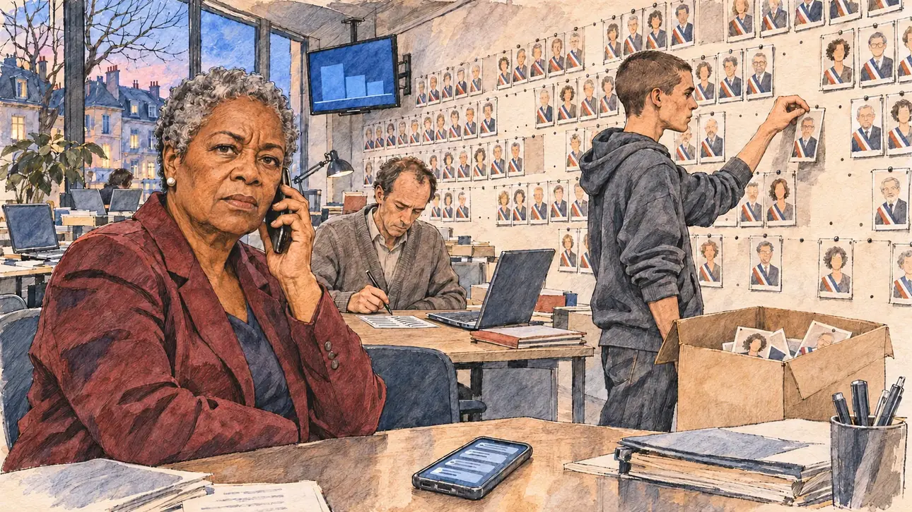

# `electedDesert` · Les élus vous lâchent

**Validée par le PO le 09/11/2026**, au premier essai. Elle sert telle quelle en clair et en sombre.



| Champ | Valeur |
| --- | --- |
| Carte | `electedDesert`, catégorie `affair` (Affaire), poids 0,2 (0,3 dans les deux premiers du sondage), plus fréquente avec une intégrité basse |
| Style | Reportage dessiné |
| Ton | Tendu, soirée au QG |
| Date | 2026-11-09 |
| Outil | ChatGPT Images, à compléter (modèle et effort) |
| Conversation | À compléter |
| Format rendu | 1672 × 941 (16:9) : export en 1290 × 726 px, WebP de qualité 75, 195 Ko, sans recadrage, fait depuis la copie WebP de la conversation (à refaire depuis le PNG d'origine) |
| Fichier d'origine | À compléter (hors du dépôt) |
| Première édition | À compléter |

## Texte de la carte

> **Les élus vous lâchent**
>
> Des doutes sur votre probité circulent depuis une semaine : des centaines d'élus locaux de votre camp retirent publiquement leur soutien. Les chaînes comptent les défections heure par heure.

## Le moment choisi

Le QG de campagne, en terrain neutre, un soir : au mur, le « mur des soutiens », des dizaines de portraits d'élus locaux en écharpe tricolore, où les trous apparaissent ; un bénévole en décroche les portraits et les range dans un carton ; une chaîne d'information affiche des barres qui baissent, sans chiffre. Le candidat reste hors champ : son téléphone sur la table, couvert de notifications illisibles. La responsable des relations avec les élus, une ancienne maire, au téléphone, regarde le spectateur, inquiète : encore trois. Un collaborateur barre des noms sur une liste.

## Prompt complet

Dans une nouvelle conversation, avec [`primeTime.webp`](../../illustrations/media/primeTime.webp) comme seule image de référence :

```
Use the attached image as the style reference and copy its drawing: a realistic reportage drawing made on the spot for a newspaper, with quick, nervous pencil lines, often drawn twice, ink hatching in the shadows, transparent watercolour washes that spill a little over the lines, and the warm paper showing through. Not the same scene and not the same people: never reuse the face or the hair of the woman in the reference.
Like in the reference, the setting can be full when the story needs it, with the things that say where we are and what is happening, but each one is sketched with a few pencil lines and a light wash, never rendered or finished, and the drawing gets looser and paler towards the edges until it fades into the bare paper.
This must look like a drawing made by hand on paper by a press illustrator, halfway between a quick sketch and a realistic picture: never a photograph, a film poster or a digital painting, and never a cartoon, a comic strip, a caricature or a children's book illustration. Continuous lines, never dotted or dashed outlines; no uniform texture, speckles or hatching filter laid over the picture; no glossy highlights, no smooth gradients, in the sky and on the walls too. Colour can be rich in places, on a piece of clothing, a light or a flag, but it stays transparent and within the palette below. The fade into the paper at the edges stays narrow, without a wide white margin. No blur and no depth-of-field effect: everything, the foreground included, is drawn sharp, like a sketch made on the spot.
People are drawn from life with realistic anatomy and proportions, like in the reference: faces shaped with pencil lines, hatching and light washes, a little more finished than the background but never photographic (no photographic skin, no airbrushed or digital-painting look). Expressions stay natural and restrained, even in laughter or tears: no exaggerated grins, no wide-open mouths full of teeth, no rubbery or cartoonish faces.

Editorial illustration, landscape 16:9 (1536 × 864 px), the scene filling the frame, with only a light fade into the paper at the edges. The player's campaign headquarters in an ordinary French city, on an evening in March 2027, after a week of doubts about the candidate's honesty, as hundreds of local elected officials withdraw their support: an open-plan office with desks and laptops, and on one long wall the "wall of support", dozens of small printed portraits of local mayors and councillors, many wearing a French tricolour sash, pinned in rows; gaps are already appearing in the rows. A young volunteer, a lanky white man in his twenties with a buzz cut and a hoodie, unpins the portraits one by one and drops them into a cardboard box. In a corner, a TV on a news channel shows a counter graphic with no readable number. The player's candidate stays off-camera: in the foreground, only a phone lying on a table, its screen lit with a stack of blurred, unreadable notifications. In the left third, the head of relations with elected officials, a sturdy woman in her sixties of Guadeloupean descent, a former mayor, with short grey natural hair, a tailored burgundy jacket and pearl earrings, holds a phone to her ear and looks at the viewer, worried, three more, her face above mid-height. At a desk behind her, a staffer, a thin white man in his forties with a receding hairline and a grey cardigan, crosses names off a printed list with a pen. Only the head of relations looks at the viewer. Nothing on the portraits, the list, the phone, the TV or the box is readable, and the portraits are tiny generic faces of no recognisable person.

Style: Reportage drawing made on the spot, like a press illustrator or courtroom sketch artist: pencil and ink with loose watercolour washes, lively unfinished lines, white paper showing through.

Palette: navy #13203F, vellum #F5EFE1, gold #A9802A, brick #B5523B, ochre #D9A441, sage #8FA58A, slate #5E7186, sand #DCC8A4, warm grey #8C8279; use 4 to 6 of them, subtle warm paper grain.

Tone: tense, evening, cold office light and the blue glow of the TV, the growing gaps in the wall of portraits.

Constraints: realistic proportions, natural expressions, never cartoonish or caricatured faces, drawn like the rest of the illustration and never photographic; people of varied ages, genders, origins and body types (heavy, stocky, round, tall, short, wiry, not only slim), each with a distinct face and haircut (no two people alike), drawn with respect and never as a joke; each person's age, build and look plausible for their job and the scene (working people of working age), no stereotype tying an origin or a gender to a role, and no person of colour shown alone in a featured service or deferential role; anatomically correct hands with exactly five fingers, few hands visible, the others in pockets, behind objects or out of frame; no readable text anywhere (the portraits, the list, the phone, the TV and the box stay unreadable, no numbers); no captions or speech bubbles; no logos, no TV channel name or logo, no political party colours; no recognisable real person among the portraits, no lookalike of a real politician or mayor; no explicit violence; no photographic rendering, no blur or bokeh, no dotted outlines, no texture or hatching filter over the picture, no oil-paint texture, no glow or halo around the screens, no wide white margin or frame (a light fade into the paper at the edges is fine).

Format: if 16:9 is not available, make 1536 × 1024 and keep the top 80 px and the bottom 80 px free of anything important (faces, hands, the main action): they will be cropped.
```

## Décisions prises sur cette image

Validée telle quelle par le PO (09/11/2026). Une plante de bureau, esquissée, est restée à gauche.

## Essais écartés

Aucun.

## Retouches

Aucune.

## Relecture

Faite et validée par le PO le 09/11/2026.

- [x] Aucun texte lisible : les notifications du téléphone ne sont que des barres, la liste et la télévision sont illisibles, aucun chiffre.
- [x] Aucun sosie d'une personne réelle : les portraits sont des visages génériques, certains à peine esquissés.
- [x] Le candidat du joueur est hors champ : seul son téléphone, sur la table.
- [x] Mains et visages sans défaut visible à 343 px de large : la main au téléphone, celle qui barre la liste, celle qui décroche un portrait.
- [x] Aucune couleur ni aucun logo de parti : les écharpes sont tricolores, ce que le gabarit permet pour un élu. Des personnes variées par l'âge, le corps, l'origine et la coiffure.
- [x] En 16:9 : pas de recadrage.
- [ ] Lisible sur la page de l'événement, en clair et en sombre : à vérifier dans l'app, une fois la carte publiée.
