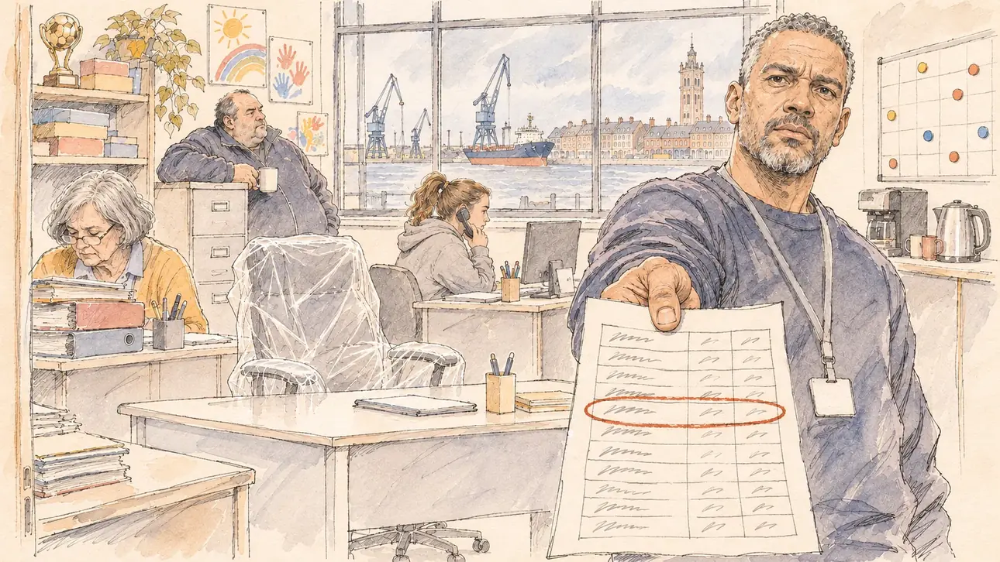

# `familyJob` · Un poste pour un proche

**Validée par le PO le 05/11/2026**, à l'essai 2, avec `primeTime.webp` comme référence. Elle sert telle quelle en clair et en sombre.



| Champ | Valeur |
| --- | --- |
| Carte | `familyJob`, catégorie `affair` (Affaire), carte ajoutée par la PR #297 de l'app |
| Style | Reportage dessiné, trait de `primeTime` |
| Ton | Ironique et amer |
| Date | 2026-11-05 |
| Outil | ChatGPT Images |
| Conversation | À remplir (le lien ne s'ouvre qu'avec le compte qui l'a créée) |
| Format rendu | 1672 × 941 (16:9) : export en 1290 × 726 px, WebP de qualité 75, 156 Ko, sans recadrage |
| Fichier d'origine | Image de ChatGPT, chez le PO. L'export du dépôt a été fait depuis la copie partagée dans la conversation avec Claude |
| Première édition | La prochaine Release qui suit le merge de la PR #297 de l'app |

## Texte de la carte

> **Un poste pour un proche**
>
> Un membre de votre famille est salarié d'une association que vous présidez. Un site d'information affirme qu'il a été embauché sans appel à candidatures, à un salaire bien au-dessus de la grille.

## Le moment choisi

Les locaux d'une association de quartier que préside le candidat, à Dunkerque, un matin gris, vus depuis la porte où le candidat (hors champ) arrive : au premier plan, un bureau neuf, avec un fauteuil encore sous plastique, au milieu des bureaux usés. Un animateur de l'association tend au candidat la grille des salaires imprimée, une ligne entourée en rouge, l'air blessé. Autour : les salariés qui font semblant de travailler en regardant le candidat, des dessins d'enfants et un planning d'activités au mur, une machine à café. Par la fenêtre : le port, les grues, la mer du Nord et le beffroi de brique.

## Prompt complet

Dans une nouvelle conversation, avec [`primeTime.webp`](../../illustrations/media/primeTime.webp) comme seule image de référence.

```
Use the attached image as the style reference and copy its drawing: a realistic reportage drawing made on the spot for a newspaper, with quick, nervous pencil lines, often drawn twice, ink hatching in the shadows, transparent watercolour washes that spill a little over the lines, and the warm paper showing through. Not the same scene and not the same people: never reuse the face or the hair of the woman in the reference.
Like in the reference, the setting can be full when the story needs it, with the things that say where we are and what is happening, but each one is sketched with a few pencil lines and a light wash, never rendered or finished, and the drawing gets looser and paler towards the edges until it fades into the bare paper.
This must look like a drawing made by hand on paper by a press illustrator, halfway between a quick sketch and a realistic picture: never a photograph, a film poster or a digital painting, and never a cartoon, a comic strip, a caricature or a children's book illustration. Continuous lines, never dotted or dashed outlines; no uniform texture, speckles or hatching filter laid over the picture; no glossy highlights, no smooth gradients, in the sky and on the walls too. Colour can be rich in places, on a piece of clothing, a light or a flag, but it stays transparent and within the palette below. The fade into the paper at the edges stays narrow, without a wide white margin. No blur and no depth-of-field effect: everything, the foreground included, is drawn sharp, like a sketch made on the spot.
People are drawn from life with realistic anatomy and proportions, like in the reference: faces shaped with pencil lines, hatching and light washes, a little more finished than the background but never photographic (no photographic skin, no airbrushed or digital-painting look). Expressions stay natural and restrained, even in laughter or tears: no exaggerated grins, no wide-open mouths full of teeth, no rubbery or cartoonish faces.

Editorial illustration, landscape 16:9 (1536 × 864 px), the scene filling the frame, with only a light fade into the paper at the edges. The premises of a neighbourhood association that the player's candidate chairs, in Dunkirk, on the North Sea, on a grey morning in early 2027: a news website claims that a member of the candidate's family, employed by the association, was hired with no call for applications, at a salary well above the pay scale. The scene is seen from the door where the candidate arrives, who stays off-camera: in the foreground, only a brand-new desk with an office chair still wrapped in plastic, standing out among the worn old desks. In the right third, a youth worker of the association, a man in his forties of Cape Verdean origin, tall and broad, with short greying hair and a short beard, in a sweatshirt with no writing and a lanyard, holds out towards the viewer the printed pay scale of the association with one line circled in red, with a hurt, bitter, questioning look, his face above mid-height. Around him, sketched in pencil and light washes: the other employees pretending to work while watching the viewer: an accountant in her sixties with a grey bob and reading glasses behind a pile of files; a young woman with a ponytail and a hoodie on the phone; a heavy-set man in his fifties in a fleece leaning on a filing cabinet with a mug; on the walls, children's drawings, a planning board of activities with only coloured magnets, a football trophy and a few board games on a shelf; a coffee machine and a kettle. Through the window, Dunkirk: the cranes of the port, a big cargo ship, the grey North Sea under a low sky, and the tall brick belfry of the town among the brick houses. Only the youth worker looks straight at the viewer. Nothing on the pay scale, the files, the planning board, the drawings, the lanyard or the ship is readable, and no logo of a real association, news website or company appears.

Style: Reportage drawing made on the spot, like a press illustrator or courtroom sketch artist: pencil and ink with loose watercolour washes, lively unfinished lines, white paper showing through.

Palette: navy #13203F, vellum #F5EFE1, gold #A9802A, brick #B5523B, ochre #D9A441, sage #8FA58A, slate #5E7186, sand #DCC8A4, warm grey #8C8279; use 4 to 6 of them, subtle warm paper grain.

Tone: ironic and bitter, the flat grey light of a North Sea morning, the warm colours of the children's drawings, and the shiny plastic-wrapped chair and the red circle on the pay scale as the sharp notes.

Constraints: realistic proportions, natural expressions, never cartoonish or caricatured faces, drawn like the rest of the illustration and never photographic; people of varied ages, genders, origins and body types (heavy, stocky, round, tall, short, wiry, not only slim), each with a distinct face and haircut (no two people alike), drawn with respect and never as a joke; anatomically correct hands with exactly five fingers, few hands visible, the others in pockets, behind objects or out of frame; no readable text anywhere (the pay scale, the files, the planning board, the drawings, the lanyard and the ship stay unreadable); no captions or speech bubbles; no logos or political party colours; no recognisable real person, no lookalike of a real politician, and no logo of a real association, news website or company; no explicit violence; no photographic rendering, no blur or bokeh, no dotted outlines, no texture or hatching filter over the picture, no oil-paint texture, no wide white margin or frame (a light fade into the paper at the edges is fine).

Format: if 16:9 is not available, make 1536 × 1024 and keep the top 80 px and the bottom 80 px free of anything important (faces, hands, the main action): they will be cropped.
```

## Décisions prises sur cette image

Aucune.

## Essais écartés

- Essai 1, le 05/11/2026 : la même scène, mais des contours en pointillés sur les bureaux, le fauteuil et la grille des salaires, et une texture tachetée posée sur les meubles, comme un filtre. Corrigé dans la même conversation par le message de correction du [gabarit](../gabarit.md#quand-le-rendu-dérive), avec une phrase de plus sur les contours continus et la texture ; la scène et les personnages n'ont pas bougé.

## Retouches

Aucune.

## Relecture

Faite et validée par le PO le 05/11/2026.

- [x] Aucun texte lisible : la grille des salaires n'a que des gribouillis, le planning que des aimants de couleur ; rien n'est lisible sur les dossiers, les dessins, le badge ni le cargo.
- [x] Aucun sosie d'une personne réelle.
- [x] Le candidat du joueur est hors champ.
- [x] Mains, visages et foules sans défaut visible à 343 px de large.
- [x] Aucune couleur ni aucun logo de parti. Des personnes variées par l'âge, le corps, l'origine et la coiffure.
- [x] En 3:2 : sans objet, l'image est en 16:9.
- [x] Lisible sur la page de l'événement, en clair et en sombre.

Ce que la relecture a accepté : l'animateur porte un sweat bleu marine plutôt qu'un sweat clair ; le trophée de football est doré, sans inscription.
