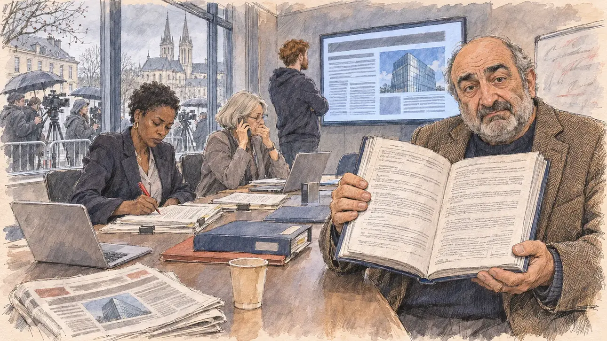

# `foreignLoan` · Un prêt d'une banque étrangère

**Validée par le PO le 05/11/2026**, au premier essai, avec `primeTime.webp` comme référence. Elle sert telle quelle en clair et en sombre.



| Champ | Valeur |
| --- | --- |
| Carte | `foreignLoan`, catégorie `affair` (Affaire), carte ajoutée par la PR #297 de l'app |
| Style | Reportage dessiné, trait de `primeTime` |
| Ton | Ironique et tendu |
| Date | 2026-11-05 |
| Outil | ChatGPT Images |
| Conversation | À remplir (le lien ne s'ouvre qu'avec le compte qui l'a créée) |
| Format rendu | 1672 × 941 (16:9) : export en 1290 × 726 px, WebP de qualité 75, 199 Ko, sans recadrage |
| Fichier d'origine | Image de ChatGPT, chez le PO. L'export du dépôt a été fait depuis la copie partagée dans la conversation avec Claude |
| Première édition | La prochaine Release qui suit le merge de la PR #297 de l'app |

## Texte de la carte

> **Un prêt d'une banque étrangère**
>
> Une enquête révèle que votre campagne a financé une partie de ses dépenses par un prêt consenti par une banque étrangère, à des conditions très avantageuses. Les contrats ne sont pas publics.

## Le moment choisi

La salle de réunion du QG de campagne à Caen, tôt le matin, vue depuis la porte où le candidat (hors champ) arrive : au premier plan, une pile de journaux du matin et un gobelet de café sur la table. Le mandataire financier de la campagne tend au candidat le contrat de prêt, épais et relié, l'air gêné. Autour : une avocate qui annote une copie, la trésorière au téléphone, un jeune chargé de communication devant l'enquête affichée sur un écran, avec la photo d'une tour de verre sans drapeau ni nom. Par la fenêtre : les journalistes qui attendent sur le trottoir avec caméras et micros, et derrière eux les flèches de l'abbaye aux Hommes en pierre de Caen.

## Prompt complet

Dans une nouvelle conversation, avec [`primeTime.webp`](../../illustrations/media/primeTime.webp) comme seule image de référence.

```
Use the attached image as the style reference and copy its drawing: a realistic reportage drawing made on the spot for a newspaper, with quick, nervous pencil lines, often drawn twice, ink hatching in the shadows, transparent watercolour washes that spill a little over the lines, and the warm paper showing through. Not the same scene and not the same people: never reuse the face or the hair of the woman in the reference.
Like in the reference, the setting can be full when the story needs it, with the things that say where we are and what is happening, but each one is sketched with a few pencil lines and a light wash, never rendered or finished, and the drawing gets looser and paler towards the edges until it fades into the bare paper.
This must look like a drawing made by hand on paper by a press illustrator, halfway between a quick sketch and a realistic picture: never a photograph, a film poster or a digital painting, and never a cartoon, a comic strip, a caricature or a children's book illustration. Continuous lines, never dotted or dashed outlines; no uniform texture, speckles or hatching filter laid over the picture; no glossy highlights, no smooth gradients, in the sky and on the walls too. Colour can be rich in places, on a piece of clothing, a light or a flag, but it stays transparent and within the palette below. The fade into the paper at the edges stays narrow, without a wide white margin. No blur and no depth-of-field effect: everything, the foreground included, is drawn sharp, like a sketch made on the spot.
People are drawn from life with realistic anatomy and proportions, like in the reference: faces shaped with pencil lines, hatching and light washes, a little more finished than the background but never photographic (no photographic skin, no airbrushed or digital-painting look). Expressions stay natural and restrained, even in laughter or tears: no exaggerated grins, no wide-open mouths full of teeth, no rubbery or cartoonish faces.

Editorial illustration, landscape 16:9 (1536 × 864 px), the scene filling the frame, with only a light fade into the paper at the edges. The meeting room of the campaign headquarters of the player's candidate in Caen, in Normandy, early in the morning in early 2027: an investigation has revealed that the campaign financed part of its spending with a loan from a foreign bank on very favourable terms, and the contracts are not public. The scene is seen from the door where the candidate arrives, who stays off-camera: in the foreground, only a pile of morning newspapers and a paper cup of coffee on the long table. In the right third, the campaign's financial agent, a man in his sixties of Armenian origin, stocky, with a grey beard, bushy eyebrows, a bald crown with grey hair on the sides and a tweed jacket over a dark jumper, holds out towards the viewer the thick bound loan contract, open on a page of dense clauses, with an embarrassed, uneasy look, his face above mid-height. Around him, sketched in pencil and light washes: a lawyer in her forties of Senegalese origin with short natural hair and a dark suit, annotating a copy of the contract with a red pen; the campaign treasurer, a thin woman in her sixties with a silver bob, on the phone, her hand over her mouth; a young communications officer with a red beard and a hoodie in front of a big wall screen showing the investigative article as grey blocks of text and a photo of a glass bank tower against a blue sky, with no flag, no name and no logo; folders and laptops on the table, a whiteboard wiped half clean. Through the big window, the journalists waiting on the pavement in the grey morning with cameras, microphones and umbrellas, and behind them the pale Caen-stone façade and the tall slender spires of the Abbaye aux Hommes. Only the financial agent looks straight at the viewer. Nothing on the contract, the newspapers, the screen, the folders or the whiteboard is readable, and no flag of a real country and no logo of a real bank, newspaper or TV channel appears.

Style: Reportage drawing made on the spot, like a press illustrator or courtroom sketch artist: pencil and ink with loose watercolour washes, lively unfinished lines, white paper showing through.

Palette: navy #13203F, vellum #F5EFE1, gold #A9802A, brick #B5523B, ochre #D9A441, sage #8FA58A, slate #5E7186, sand #DCC8A4, warm grey #8C8279; use 4 to 6 of them, subtle warm paper grain.

Tone: ironic and tense, the pale grey light of an early Norman morning, the cold glow of the wall screen with the glass tower, and the red pen of the lawyer as the one sharp note.

Constraints: realistic proportions, natural expressions, never cartoonish or caricatured faces, drawn like the rest of the illustration and never photographic; people of varied ages, genders, origins and body types (heavy, stocky, round, tall, short, wiry, not only slim), each with a distinct face and haircut (no two people alike), drawn with respect and never as a joke; anatomically correct hands with exactly five fingers, few hands visible, the others in pockets, behind objects or out of frame; no readable text anywhere (the contract, the newspapers, the screen, the folders and the whiteboard stay unreadable); no captions or speech bubbles; no logos or political party colours; no recognisable real person, no lookalike of a real politician, and no flag of a real country and no logo of a real bank, newspaper or TV channel; no explicit violence; no photographic rendering, no blur or bokeh, no dotted outlines, no texture or hatching filter over the picture, no oil-paint texture, no wide white margin or frame (a light fade into the paper at the edges is fine).

Format: if 16:9 is not available, make 1536 × 1024 and keep the top 80 px and the bottom 80 px free of anything important (faces, hands, the main action): they will be cropped.
```

## Décisions prises sur cette image

Aucune.

## Essais écartés

Aucun.

## Retouches

Aucune.

## Relecture

Faite et validée par le PO le 05/11/2026.

- [x] Aucun texte lisible : le contrat n'a que des lignes griffonnées, l'écran et les journaux des blocs gris et la photo d'une tour de verre sans drapeau ni nom ; rien n'est lisible sur les dossiers ni sur le tableau blanc.
- [x] Aucun sosie d'une personne réelle.
- [x] Le candidat du joueur est hors champ.
- [x] Mains, visages et foules sans défaut visible à 343 px de large.
- [x] Aucune couleur ni aucun logo de parti. Des personnes variées par l'âge, le corps, l'origine et la coiffure.
- [x] En 3:2 : sans objet, l'image est en 16:9.
- [x] Lisible sur la page de l'événement, en clair et en sombre.

Ce que la relecture a accepté : le mandataire tient le contrat ouvert devant lui plutôt qu'il ne le tend ; le chargé de communication est de dos, devant l'écran.
