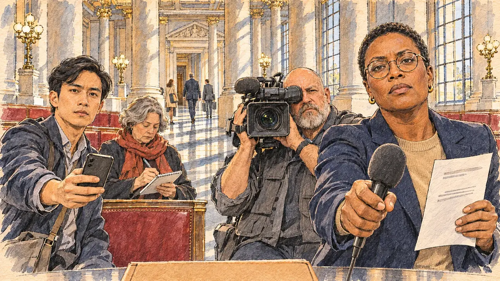

# `ghostAmendment` · Un amendement « travaillé avec » un cigarettier

**Validée par le PO le 24/11/2026**, au premier essai, dans le trait de `primeTime`, telle quelle malgré un rendu plus fini et texturé que la référence (voir « Décisions »). Elle sert telle quelle en clair et en sombre.



| Champ | Valeur |
| --- | --- |
| Carte | `ghostAmendment`, catégorie `affair` (Affaire), plus fréquente avec une intégrité basse ; carte ajoutée par la PR #510 de l'app |
| Style | Reportage dessiné, trait de `primeTime` |
| Ton | Tendu |
| Date | 2026-11-24 |
| Outil | ChatGPT Images |
| Format rendu | 1672 × 941 (16:9) : export en 1290 × 726 px depuis l'image partagée dans la conversation avec Claude, WebP de qualité 75, 238 Ko, sans recadrage |
| Fichier d'origine | Image de ChatGPT, chez le PO. L'export du dépôt a été fait depuis la copie partagée dans la conversation avec Claude |
| Première édition | `kit-france-2611-0004` |

## Texte de la carte

> **Un amendement « travaillé avec » un cigarettier**
>
> Un député de votre camp dépose un amendement contre la contrebande de tabac. Son exposé l'écrit noir sur blanc : il a été « travaillé avec » un géant du tabac. L'opposition parle de lobby à l'Assemblée, et les journalistes vous demandent si vous le soutenez.

Les réponses : faire retirer l'amendement et recadrer le député (sans jet) ; assumer, tout le monde rencontre l'industrie (sang-froid 12) ; adopter une charte de rencontres avec l'industrie « au strict nécessaire » et publiques (intégrité 14, le pari).

## Le moment choisi

La salle des Quatre Colonnes, en fin d'après-midi : les journalistes parlementaires arrêtent le candidat, hors champ, dont on ne voit que le bord du dossier cartonné. Une journaliste lui tend un micro et la feuille de l'amendement, sans texte lisible ; un caméraman, un jeune journaliste au téléphone et une journaliste plus âgée qui prend des notes. Au fond, le député s'éloigne avec deux collaborateurs, de dos, pour qu'aucun visage ne rappelle l'élu réel du cas (les amendements de 2026, sources dans `docs/NEWS_SOURCES.md` de l'app). Ni cigarette, ni paquet, ni marque.

## Prompt complet

Dans une nouvelle conversation, avec [`primeTime.webp`](../../illustrations/media/primeTime.webp) comme seule image de référence.

```
Use the attached image as the style reference and copy its drawing: a realistic reportage drawing made on the spot for a newspaper, with quick, nervous pencil lines, often drawn twice, ink hatching in the shadows, transparent watercolour washes that spill a little over the lines, and the warm paper showing through. Not the same scene and not the same people: never reuse the face or the hair of the woman in the reference.
Like in the reference, the setting can be full when the story needs it, with the things that say where we are and what is happening, but each one is sketched with a few pencil lines and a light wash, never rendered or finished, and the drawing gets looser and paler towards the edges until it fades into the bare paper.
This must look like a drawing made by hand on paper by a press illustrator, halfway between a quick sketch and a realistic picture: never a photograph, a film poster or a digital painting, and never a cartoon, a comic strip, a caricature or a children's book illustration. Continuous lines, never dotted or dashed outlines; no uniform texture, speckles or hatching filter laid over the picture; no glossy highlights, no smooth gradients, in the sky and on the walls too. Colour can be rich in places, on a piece of clothing, a light or a flag, but it stays transparent and within the palette below. The fade into the paper at the edges stays narrow, without a wide white margin. No blur and no depth-of-field effect: everything, the foreground included, is drawn sharp, like a sketch made on the spot.
People are drawn from life with realistic anatomy and proportions, like in the reference: faces shaped with pencil lines, hatching and light washes, a little more finished than the background but never photographic (no photographic skin, no airbrushed or digital-painting look). Expressions stay natural and restrained, even in laughter or tears: no exaggerated grins, no wide-open mouths full of teeth, no rubbery or cartoonish faces.

Editorial illustration, landscape 16:9 (1536 × 864 px), the scene filling the frame, with only a light fade into the paper at the edges. The Salle des Quatre Colonnes of the Assemblée nationale in Paris, on a late afternoon in 2027: tall pale stone columns, a high ceiling, a polished floor, soft light from tall windows, a few red leather benches against the walls. A deputy of the player's camp has just tabled an amendment against tobacco smuggling whose summary says it was "worked on with" a tobacco company, and parliamentary journalists stop the player's candidate as they cross the hall. The candidate stays off-camera: in the foreground, only the edge of the candidate's closed cardboard folder held at the bottom of the frame. In the right third, the main character, a parliamentary journalist in her forties of Senegalese descent, tall and solidly built, with short natural hair and round glasses, in a navy blazer over a sand-coloured jumper, holds out a microphone towards the viewer and in her other hand a printed page of the amendment, its lines only grey strokes; she looks at the viewer with a firm, questioning look, her face above mid-height. Beside her, a stocky cameraman in his fifties, white, bald with a grey beard, films the viewer with a shoulder camera; a young journalist in his twenties of Vietnamese descent, slim, with a side parting, holds out his phone to record, looking at the viewer; behind them, an older journalist, a round woman in her sixties with a grey bob and a brick-red scarf, takes notes in a notebook, eyes on her page. Far in the background, small and sketched between two columns, a deputy in a dark suit walks away with two aides, seen from behind only, his face never shown. Only the three journalists in front look at the viewer. Nothing on the page, the microphone, the camera, the phone or the notebook is readable.

Style: Reportage drawing made on the spot, like a press illustrator or courtroom sketch artist: pencil and ink with loose watercolour washes, lively unfinished lines, white paper showing through.

Palette: navy #13203F, vellum #F5EFE1, gold #A9802A, brick #B5523B, ochre #D9A441, sage #8FA58A, slate #5E7186, sand #DCC8A4, warm grey #8C8279; use 4 to 6 of them, subtle warm paper grain.

Tone: tense, late-afternoon light falling cold between the columns, hard shadows on the floor.

Constraints: realistic proportions, natural expressions, never cartoonish or caricatured faces, drawn like the rest of the illustration and never photographic; people of varied ages, genders, origins and body types (heavy, stocky, round, tall, short, wiry, not only slim), each with a distinct face and haircut (no two people alike), drawn with respect and never as a joke; each person's age, build and look plausible for their job and the scene (working people of working age), no stereotype tying an origin or a gender to a role, and no person of colour shown alone in a featured service or deferential role; anatomically correct hands with exactly five fingers, few hands visible, the others in pockets, behind objects or out of frame; no readable text anywhere (the page, the microphone, the camera, the phone and the notebook stay unreadable, no press badge with words); no captions or speech bubbles; no logos, no microphone flag with a channel name, no political party colours; no cigarettes, no cigarette packs and no tobacco brand; no recognisable real person, no lookalike of a real politician or of a known journalist, the deputy seen only from behind; no explicit violence; no photographic rendering, no blur or bokeh, every outline a continuous pencil or ink line with no dotted or dashed outlines, no mottled, crackled or speckled texture over the faces, the clothes, the stone or the floor, no hatching filter over the picture, no oil-paint texture, no glow or halo, no wide white margin or frame (a light fade into the paper at the edges is fine).

Format: if 16:9 is not available, make 1536 × 1024 and keep the top 80 px and the bottom 80 px free of anything important (faces, hands, the main action): they will be cropped.
```

## Décisions prises sur cette image

- Le PO garde le premier essai malgré son rendu : une peinture plus finie que la référence, avec une texture de hachures sur les vestes, les banquettes et le sol, et des visages proches de la photo. Le message de correction du gabarit lui a été proposé et n'a pas été envoyé.
- Le décor est plus orné que la salle des Quatre Colonnes réelle (lustres dorés, fronton au fond) ; les banquettes rouges sont des sièges d'hémicycle plutôt que des bancs contre les murs. Gardés : le lieu se lit comme l'Assemblée.
- Le caméraman filme à l'épaule, l'œil à la caméra : il ne regarde le spectateur qu'à travers elle.

## Essais écartés

Aucun.

## Retouches

Aucune.

## Relecture

Faite par Claude et validée par le PO le 24/11/2026.

- [x] Aucun texte lisible : la feuille ne porte que des barres grises, le micro, la caméra, le téléphone et le carnet n'ont aucune inscription.
- [x] Aucun sosie d'une personne réelle ; le député est de dos, petit, au fond.
- [x] Le candidat du joueur est hors champ (le bord de son dossier au premier plan).
- [x] Mains et visages sans défaut visible à 343 px de large ; cinq doigts sur chaque main visible.
- [x] Aucune couleur ni aucun logo de parti, aucune cigarette ni marque de tabac. Des personnes variées par l'âge, le corps, l'origine et la coiffure.
- [x] En 3:2 : sans objet, l'image est en 16:9.
- [x] Lisible sur la page de l'événement, en clair et en sombre.
