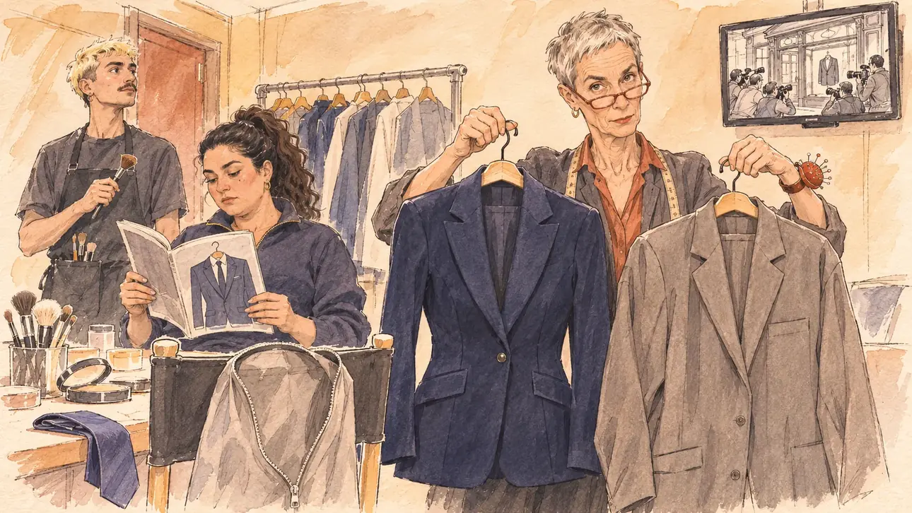

# `giftedSuits` · Les costumes offerts

**Validée par le PO le 10/11/2026**, au premier essai. Elle sert telle quelle en clair et en sombre.



| Champ | Valeur |
| --- | --- |
| Carte | `giftedSuits`, catégorie `affair` (Affaire), poids 0,1 (0,35 dans les deux premiers du sondage), plus fréquente avec une intégrité basse |
| Style | Reportage dessiné |
| Ton | Tendu sous l'ironie, fin d'après-midi |
| Date | 2026-11-10 |
| Outil | ChatGPT Images, à compléter (modèle et effort) |
| Conversation | À compléter |
| Format rendu | 1672 × 941 (16:9) : export en 1290 × 726 px, WebP de qualité 75, 144 Ko, sans recadrage, fait depuis la copie WebP de la conversation (à refaire depuis le PNG d'origine) |
| Fichier d'origine | À compléter (hors du dépôt) |
| Première édition | À compléter |

## Texte de la carte

> **Les costumes offerts**
>
> Un hebdomadaire révèle qu'un ami avocat, habitué des coulisses du pouvoir, vous a offert plusieurs costumes sur mesure, des milliers d'euros pièce. Le parquet se demande s'il y a eu des contreparties.

## Le moment choisi

La loge d'un studio de télévision à La Plaine Saint-Denis, une heure avant l'interview du candidat, le jour où sort l'hebdomadaire. Le candidat reste hors champ, au fauteuil de maquillage : sa housse à costume ouverte et vide pend au dossier d'une chaise, une cravate pliée sur la table. L'habilleuse de la chaîne tient un cintre dans chaque main, la veste sur mesure bleu marine et une veste grise de confection prise au portant, et regarde le spectateur par-dessus ses lunettes : laquelle, ce soir ? Derrière elle, l'attachée de presse lit le magazine, ouvert sur un dessin de costume ; le maquilleur attend, pinceau en main ; à l'écran, les photographes se pressent devant la vitrine d'un tailleur. Aucun miroir face au spectateur, pour que le candidat n'y apparaisse pas.

## Prompt complet

Dans une nouvelle conversation, avec [`primeTime.webp`](../../illustrations/media/primeTime.webp) comme seule image de référence :

```
Use the attached image as the style reference and copy its drawing: a realistic reportage drawing made on the spot for a newspaper, with quick, nervous pencil lines, often drawn twice, ink hatching in the shadows, transparent watercolour washes that spill a little over the lines, and the warm paper showing through. Not the same scene and not the same people: never reuse the face or the hair of the woman in the reference.
Like in the reference, the setting can be full when the story needs it, with the things that say where we are and what is happening, but each one is sketched with a few pencil lines and a light wash, never rendered or finished, and the drawing gets looser and paler towards the edges until it fades into the bare paper.
This must look like a drawing made by hand on paper by a press illustrator, halfway between a quick sketch and a realistic picture: never a photograph, a film poster or a digital painting, and never a cartoon, a comic strip, a caricature or a children's book illustration. Continuous lines, never dotted or dashed outlines; no uniform texture, speckles or hatching filter laid over the picture; no glossy highlights, no smooth gradients, in the sky and on the walls too. Colour can be rich in places, on a piece of clothing, a light or a flag, but it stays transparent and within the palette below. The fade into the paper at the edges stays narrow, without a wide white margin. No blur and no depth-of-field effect: everything, the foreground included, is drawn sharp, like a sketch made on the spot.
People are drawn from life with realistic anatomy and proportions, like in the reference: faces shaped with pencil lines, hatching and light washes, a little more finished than the background but never photographic (no photographic skin, no airbrushed or digital-painting look). Expressions stay natural and restrained, even in laughter or tears: no exaggerated grins, no wide-open mouths full of teeth, no rubbery or cartoonish faces.

Editorial illustration, landscape 16:9 (1536 × 864 px), the scene filling the frame, with only a light fade into the paper at the edges. A small dressing room behind the set of a television studio in La Plaine Saint-Denis, near Paris, in the late afternoon in February 2027, an hour before the player's candidate's interview, the day a weekly magazine reveals that a lawyer friend offered the candidate several made-to-measure suits worth thousands of euros each: a make-up table covered with brushes and powders, a clothes rail, a small monitor on the wall, and no mirror facing the viewer. The player's candidate stays off-camera, sitting in the make-up chair: in the foreground, only the candidate's garment bag, unzipped and empty, hanging on the back of the chair, and a folded tie on the edge of the make-up table. In the right third, the channel's wardrobe mistress, a tall, wiry white woman in her sixties with cropped grey hair, red-rimmed glasses pushed down her nose and a pincushion on her wrist, holds up two jackets on their hangers, one in each hand: a dark navy, beautifully cut made-to-measure jacket and a plain, slightly baggy grey off-the-rack jacket from the channel's rail; she looks at the viewer over her glasses with a wry, questioning look, which one tonight?, her face above mid-height. Behind her, the candidate's press officer, a stocky woman in her thirties of Lebanese descent with a thick dark ponytail and a quarter-zip jumper, reads the weekly magazine, whose cover shows only a big drawing of a made-to-measure suit on a hanger, with no words and no title. At the back, the make-up artist, a young man in his twenties with bleached hair, a thin moustache and a black apron, waits with a brush in his hand. On the wall monitor, the live news shows the shop window of an old tailor's shop with press photographers crowding in front of it. Only the wardrobe mistress looks at the viewer. Nothing on the magazine, the monitor, the garment bag, the labels or the walls is readable.

Style: Reportage drawing made on the spot, like a press illustrator or courtroom sketch artist: pencil and ink with loose watercolour washes, lively unfinished lines, white paper showing through.

Palette: navy #13203F, vellum #F5EFE1, gold #A9802A, brick #B5523B, ochre #D9A441, sage #8FA58A, slate #5E7186, sand #DCC8A4, warm grey #8C8279; use 4 to 6 of them, subtle warm paper grain.

Tone: tense under a wry surface, the warm light of the dressing room, the deep navy of the made-to-measure jacket against the dull grey of the other as the heart of the picture.

Constraints: realistic proportions, natural expressions, never cartoonish or caricatured faces, drawn like the rest of the illustration and never photographic; people of varied ages, genders, origins and body types (heavy, stocky, round, tall, short, wiry, not only slim), each with a distinct face and haircut (no two people alike), drawn with respect and never as a joke; each person's age, build and look plausible for their job and the scene (working people of working age), no stereotype tying an origin or a gender to a role, and no person of colour shown alone in a featured service or deferential role; anatomically correct hands with exactly five fingers, few hands visible, the others in pockets, behind objects or out of frame; no mirror facing the viewer and no reflection of anyone; no readable text anywhere (the magazine, the monitor, the garment bag, the labels and the walls stay unreadable, no titles, no prices, no numbers); no captions or speech bubbles; no logos, no magazine name, no tailor's name, no television channel logo, no political party colours; no recognisable real person, no lookalike of a real politician or lawyer; no explicit violence; no photographic rendering, no blur or bokeh, every outline a continuous pencil or ink line with no dotted or dashed outlines, no mottled, crackled or speckled texture over the faces, the clothes or the walls, no hatching filter over the picture, no oil-paint texture, no glow or halo around the lights or the monitor, no wide white margin or frame (a light fade into the paper at the edges is fine).

Format: if 16:9 is not available, make 1536 × 1024 and keep the top 80 px and the bottom 80 px free of anything important (faces, hands, the main action): they will be cropped.
```

## Décisions prises sur cette image

Validée telle quelle par le PO (10/11/2026), avec trois points relevés à la relecture :

- le rendu est un peu plus fini et plus chaud que celui des autres cartes, avec une texture feutrée sur les vestes, invisible à la taille de la carte ;
- sous l'écran, quelques signes minuscules évoquent une marque : illisibles, gardés, comme pour [`ransomware`](../team/ransomware.md) ;
- la veste sur mesure est cintrée, plutôt féminine, la grise coupée pour un homme : le candidat pouvant être l'un ou l'autre, gardé. Le magazine est ouvert sur une page intérieure plutôt que sur sa une, sans un mot.

## Essais écartés

Aucun.

## Retouches

Aucune.

## Relecture

Faite et validée par le PO le 10/11/2026.

- [x] Aucun texte lisible : le magazine ne montre qu'un dessin de costume, l'écran que la vitrine et les photographes ; aucun nom de tailleur, de magazine ni de chaîne.
- [x] Aucun sosie d'une personne réelle ; aucun miroir ni reflet.
- [x] Le candidat du joueur est hors champ : seules sa housse vide et sa cravate, au premier plan.
- [x] Mains et visages sans défaut visible à 343 px de large : celles de l'habilleuse sur les crochets des cintres, celles de l'attachée de presse sur le magazine, le pinceau du maquilleur.
- [x] Aucune couleur ni aucun logo de parti. Des personnes variées par l'âge, le corps, l'origine et la coiffure.
- [x] En 16:9 : pas de recadrage.
- [ ] Lisible sur la page de l'événement, en clair et en sombre : à vérifier dans l'app, une fois la carte publiée.
