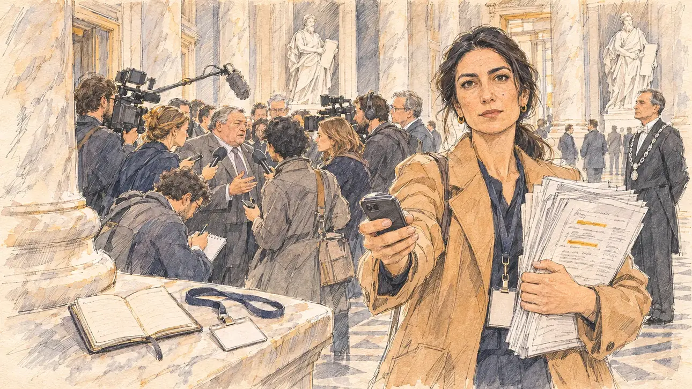

# `lobbyistBook` · Le carnet d'un lobbyiste

**Validée par le PO le 10/11/2026**, au premier essai du prompt revu (le premier, dans une voiture, a été remplacé avant génération). Elle sert telle quelle en clair et en sombre.



| Champ | Valeur |
| --- | --- |
| Carte | `lobbyistBook`, catégorie `affair` (Affaire), poids 0,1 (0,3 dans les deux premiers du sondage), plus fréquente avec une intégrité basse ; un pari gagné sur une faiblesse (ne connaître presque personne, sur un réseau faible) |
| Style | Reportage dessiné |
| Ton | Tendu, la chasse des couloirs |
| Date | 2026-11-10 |
| Outil | ChatGPT Images, à compléter (modèle et effort) |
| Conversation | À compléter |
| Format rendu | 1672 × 941 (16:9) : export en 1290 × 726 px, WebP de qualité 75, 209 Ko, sans recadrage, fait depuis la copie WebP de la conversation (à refaire depuis le PNG d'origine) |
| Fichier d'origine | À compléter (hors du dépôt) |
| Première édition | À compléter |

## Texte de la carte

> **Le carnet d'un lobbyiste**
>
> Le carnet d'adresses d'un lobbyiste fuite : des dizaines d'élus y figurent, dont plusieurs de vos proches. Les journalistes cherchent votre nom.

## Le moment choisi

La salle des Quatre-Colonnes de l'Assemblée nationale, un mardi en début d'après-midi de mars, juste avant les questions au gouvernement, quand la presse y attend les élus. Le candidat reste hors champ, de passage : son propre carnet d'adresses, mince et presque vide, ouvert sur le rebord de marbre d'une base de colonne, à côté de son badge de visiteur vierge ; le contraste se lit avant la réponse. Une journaliste parlementaire serre contre elle une épaisse liasse de photocopies du carnet du lobbyiste, des lignes surlignées, tend son téléphone et regarde le spectateur : vous y êtes ? Derrière elle, une nuée de micros encercle un député fictif dont le nom a été trouvé ; un huissier en habit noir à chaîne d'argent regarde, impassible.

## Prompt complet

Dans une nouvelle conversation, avec [`primeTime.webp`](../../illustrations/media/primeTime.webp) comme seule image de référence :

```
Use the attached image as the style reference and copy its drawing: a realistic reportage drawing made on the spot for a newspaper, with quick, nervous pencil lines, often drawn twice, ink hatching in the shadows, transparent watercolour washes that spill a little over the lines, and the warm paper showing through. Not the same scene and not the same people: never reuse the face or the hair of the woman in the reference.
Like in the reference, the setting can be full when the story needs it, with the things that say where we are and what is happening, but each one is sketched with a few pencil lines and a light wash, never rendered or finished, and the drawing gets looser and paler towards the edges until it fades into the bare paper.
This must look like a drawing made by hand on paper by a press illustrator, halfway between a quick sketch and a realistic picture: never a photograph, a film poster or a digital painting, and never a cartoon, a comic strip, a caricature or a children's book illustration. Continuous lines, never dotted or dashed outlines; no uniform texture, speckles or hatching filter laid over the picture; no glossy highlights, no smooth gradients, in the sky and on the walls too. Colour can be rich in places, on a piece of clothing, a light or a flag, but it stays transparent and within the palette below. The fade into the paper at the edges stays narrow, without a wide white margin. No blur and no depth-of-field effect: everything, the foreground included, is drawn sharp, like a sketch made on the spot.
People are drawn from life with realistic anatomy and proportions, like in the reference: faces shaped with pencil lines, hatching and light washes, a little more finished than the background but never photographic (no photographic skin, no airbrushed or digital-painting look). Expressions stay natural and restrained, even in laughter or tears: no exaggerated grins, no wide-open mouths full of teeth, no rubbery or cartoonish faces.

Editorial illustration, landscape 16:9 (1536 × 864 px), the scene filling the frame, with only a light fade into the paper at the edges. The Salle des Quatre-Colonnes of the Assemblée nationale in Paris, on a Tuesday early afternoon in March 2027, just before questions to the government, the day a lobbyist's address book has leaked with dozens of elected officials in it, several of them close to the player's candidate, and journalists are looking for the candidate's name: tall marble columns, white marble statues of ancient lawgivers between them, a patterned stone floor, soft daylight from above, and the crowd of parliamentary journalists that waits there for members of parliament. The player's candidate stays off-camera, passing through the hall: in the foreground, only the candidate's own small address book, thin and almost empty, lying open on the marble ledge of a column base, next to the candidate's blank visitor badge on its lanyard. In the right third, a parliamentary journalist, a tall woman in her thirties of Turkish descent with long dark hair in a low ponytail, a camel coat and a press badge with no writing, holds a thick stack of photocopied pages of the lobbyist's address book against her chest, a few lines highlighted in ochre, all unreadable, and holds out her phone to record; she looks at the viewer, direct and calm, are you in it?, her face above mid-height. Behind her, a crowd of microphones and cameras surrounds a fictional member of parliament whose name was found, a heavy-set man in his sixties in a grey suit, cornered, with a trapped look; at the side, an usher of the Assembly in a black tailcoat with a silver chain of office, a lean white man in his fifties, watches impassively. Only the journalist looks at the viewer. Nothing on the pages, the address book, the badges, the microphones, the cameras or the walls is readable.

Style: Reportage drawing made on the spot, like a press illustrator or courtroom sketch artist: pencil and ink with loose watercolour washes, lively unfinished lines, white paper showing through.

Palette: navy #13203F, vellum #F5EFE1, gold #A9802A, brick #B5523B, ochre #D9A441, sage #8FA58A, slate #5E7186, sand #DCC8A4, warm grey #8C8279; use 4 to 6 of them, subtle warm paper grain.

Tone: tense, the hunt of the corridors, the pale marble and soft daylight of the hall against the crowd of journalists, the thick stack of pages against the thin, nearly empty address book, the ochre highlighter strokes as the only bright marks.

Constraints: realistic proportions, natural expressions, never cartoonish or caricatured faces, drawn like the rest of the illustration and never photographic; people of varied ages, genders, origins and body types (heavy, stocky, round, tall, short, wiry, not only slim), each with a distinct face and haircut (no two people alike), drawn with respect and never as a joke; each person's age, build and look plausible for their job and the scene (working people of working age), no stereotype tying an origin or a gender to a role, and no person of colour shown alone in a featured service or deferential role; anatomically correct hands with exactly five fingers, few hands visible, the others in pockets, behind objects or out of frame; no readable text anywhere (the pages, the address book, the badges, the microphones, the cameras and the walls stay unreadable, no names, no letters on index tabs, no media logos on the microphones); no captions or speech bubbles; no logos, no political party colours; no recognisable real person, no lookalike of a real politician, journalist or lobbyist; no explicit violence; no photographic rendering, no blur or bokeh, every outline a continuous pencil or ink line with no dotted or dashed outlines, no mottled, crackled or speckled texture over the faces, the clothes, the marble or the walls, no hatching filter over the picture, no oil-paint texture, no glow or halo, no wide white margin or frame (a light fade into the paper at the edges is fine).

Format: if 16:9 is not available, make 1536 × 1024 and keep the top 80 px and the bottom 80 px free of anything important (faces, hands, the main action): they will be cropped.
```

## Décisions prises sur cette image

Validée telle quelle par le PO (10/11/2026), sans le message de correction proposé :

- **Le député encerclé** (forte carrure, visage lourd, cheveux gris rejetés en arrière) a un profil type qui peut évoquer des élus réels ; ce n'est pas un portrait, et le PO a gardé l'image. Le message préparé, pas envoyé : « Keep the same scene, the same hall, the same people and the same poses, with the same rendering. One change only: the cornered member of parliament in the middle of the microphones is now a thin, bald man in his fifties with round steel glasses and a short grey beard, in the same grey suit, with the same trapped look. Everything else stays the same: nothing readable, no logos on the microphones, exactly five fingers on every visible hand. »
- **Le lieu** : le premier prompt plaçait la scène sur la banquette arrière de la voiture de campagne, le chargé de presse retourné depuis le siège passager. Le PO l'a écarté avant génération, les scènes en voiture étant difficiles (surtout un passager avant qui se retourne), pour le Palais-Bourbon.

## Essais écartés

Aucune image écartée. Le premier prompt, remplacé avant génération :

```
Use the attached image as the style reference and copy its drawing: a realistic reportage drawing made on the spot for a newspaper, with quick, nervous pencil lines, often drawn twice, ink hatching in the shadows, transparent watercolour washes that spill a little over the lines, and the warm paper showing through. Not the same scene and not the same people: never reuse the face or the hair of the woman in the reference.
Like in the reference, the setting can be full when the story needs it, with the things that say where we are and what is happening, but each one is sketched with a few pencil lines and a light wash, never rendered or finished, and the drawing gets looser and paler towards the edges until it fades into the bare paper.
This must look like a drawing made by hand on paper by a press illustrator, halfway between a quick sketch and a realistic picture: never a photograph, a film poster or a digital painting, and never a cartoon, a comic strip, a caricature or a children's book illustration. Continuous lines, never dotted or dashed outlines; no uniform texture, speckles or hatching filter laid over the picture; no glossy highlights, no smooth gradients, in the sky and on the walls too. Colour can be rich in places, on a piece of clothing, a light or a flag, but it stays transparent and within the palette below. The fade into the paper at the edges stays narrow, without a wide white margin. No blur and no depth-of-field effect: everything, the foreground included, is drawn sharp, like a sketch made on the spot.
People are drawn from life with realistic anatomy and proportions, like in the reference: faces shaped with pencil lines, hatching and light washes, a little more finished than the background but never photographic (no photographic skin, no airbrushed or digital-painting look). Expressions stay natural and restrained, even in laughter or tears: no exaggerated grins, no wide-open mouths full of teeth, no rubbery or cartoonish faces.

Editorial illustration, landscape 16:9 (1536 × 864 px), the scene filling the frame, with only a light fade into the paper at the edges. The back seat of the player's campaign car in Paris, on a grey morning in March 2027, crossing the Pont de la Concorde, the day a lobbyist's address book has leaked with dozens of elected officials in it, several of them close to the candidate, and journalists are looking for the candidate's name: through the windscreen, the colonnade of the Palais Bourbon across the Seine under a low grey sky; alongside the car, two press photographers on scooters ride close, their long lenses aimed at the windows. The player's candidate stays off-camera, on the back seat: in the foreground, only the candidate's own small address book, thin and almost empty, lying on the seat next to a folded scarf. In the right third, the candidate's press officer, a stocky man in his forties of Cameroonian descent with a shaved head and round tortoiseshell glasses, turned round from the front passenger seat, holds up a thick stack of photocopied pages of the lobbyist's address book, a few lines highlighted, all unreadable; he looks at the viewer, tense and matter-of-fact, they are looking for your name, his face above mid-height. In front, the driver, a woman in her sixties with a long grey braid, is seen from behind, her eyes on the road; the rear-view mirror is turned away and reflects nothing. Only the press officer looks at the viewer. Nothing on the pages, the address book, the dashboard, the scooters, the cameras or the buildings is readable.

Style: Reportage drawing made on the spot, like a press illustrator or courtroom sketch artist: pencil and ink with loose watercolour washes, lively unfinished lines, white paper showing through.

Palette: navy #13203F, vellum #F5EFE1, gold #A9802A, brick #B5523B, ochre #D9A441, sage #8FA58A, slate #5E7186, sand #DCC8A4, warm grey #8C8279; use 4 to 6 of them, subtle warm paper grain.

Tone: tense and confined, the grey light of the morning through the car windows, the thick stack of pages against the thin, nearly empty address book as the heart of the picture, the ochre highlighter strokes as the only bright marks.

Constraints: realistic proportions, natural expressions, never cartoonish or caricatured faces, drawn like the rest of the illustration and never photographic; people of varied ages, genders, origins and body types (heavy, stocky, round, tall, short, wiry, not only slim), each with a distinct face and haircut (no two people alike), drawn with respect and never as a joke; each person's age, build and look plausible for their job and the scene (working people of working age), no stereotype tying an origin or a gender to a role, and no person of colour shown alone in a featured service or deferential role; no reflection of anyone in the mirrors or the windows; anatomically correct hands with exactly five fingers, few hands visible, the others in pockets, behind objects or out of frame; no readable text anywhere (the pages, the address book, the dashboard, the scooters, the cameras and the buildings stay unreadable, no names, no letters on the index tabs); no captions or speech bubbles; no logos, no car brand logo, no media logo, no political party colours; no recognisable real person, no lookalike of a real politician or lobbyist; no explicit violence; no photographic rendering, no blur or bokeh, every outline a continuous pencil or ink line with no dotted or dashed outlines, no mottled, crackled or speckled texture over the faces, the clothes, the seats or the sky, no hatching filter over the picture, no oil-paint texture, no glow or halo, no wide white margin or frame (a light fade into the paper at the edges is fine).

Format: if 16:9 is not available, make 1536 × 1024 and keep the top 80 px and the bottom 80 px free of anything important (faces, hands, the main action): they will be cropped.
```

## Retouches

Aucune.

## Relecture

Faite et validée par le PO le 10/11/2026.

- [x] Aucun texte lisible : les pages n'ont que des gribouillis et des surlignages, les badges sont vierges, aucun logo sur les micros.
- [x] Aucun sosie d'une personne réelle (voir les décisions pour le député encerclé).
- [x] Le candidat du joueur est hors champ : seuls son carnet et son badge, sur le rebord de marbre.
- [x] Mains et visages sans défaut visible à 343 px de large : les mains de la journaliste sur le téléphone et la liasse, celles qui tendent les micros, celle qui écrit.
- [x] Aucune couleur ni aucun logo de parti. Des personnes variées par l'âge, le corps, l'origine et la coiffure.
- [x] En 16:9 : pas de recadrage.
- [ ] Lisible sur la page de l'événement, en clair et en sombre : à vérifier dans l'app, une fois la carte publiée.
