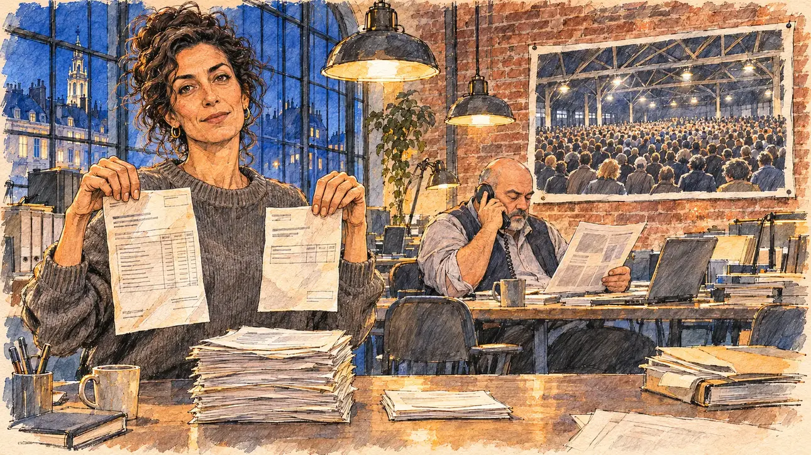

# `offBooksRalliesRevealed` · Des meetings hors des comptes

**Essai 1 retenu, en attente de la validation du PO.** Elle sert telle quelle en clair et en sombre.



| Champ | Valeur |
| --- | --- |
| Carte | `offBooksRalliesRevealed`, catégorie `affair` (Affaire), jamais tirée par son poids : la révélation de la triche « Meeting payé par le parti », imposée la semaine qui suit le tirage caché qui l'a découverte ; carte ajoutée par la PR #472 de l'app (Mitchnsun/moi-president#60) |
| Style | Reportage dessiné |
| Ton | Tendu, ironie sèche |
| Date | 2026-11-22 |
| Outil | ChatGPT Images (modèle à compléter) |
| Conversation | À compléter |
| Format rendu | 1672 × 941 (16:9) : export en 1290 × 726 px, WebP de qualité 75, 271 Ko, sans recadrage, fait depuis la copie WebP de la conversation (à refaire depuis le PNG d'origine) |
| Fichier d'origine | À compléter (hors du dépôt) |
| Première édition | À compléter |

## Texte de la carte

> **Des meetings hors des comptes**
>
> Un hebdomadaire révèle que votre parti a payé vos meetings sur de fausses factures, pour cacher le dépassement du plafond. Les dépenses reviennent dans votre compte de campagne.

## Le moment choisi

La rédaction d'un hebdomadaire d'investigation, à Lille, tard le soir, la veille du bouclage : sur une grande table, deux piles de factures pour le même meeting, l'une épaisse, l'autre mince, et une photo de la salle pleine épinglée au mur de brique. La journaliste qui a sorti l'affaire tient une facture dans chaque main et regarde le spectateur, calme, presque amusée ; le rédacteur en chef, au téléphone, relit une épreuve. Le candidat est hors champ. Une rédaction lilloise n'avait encore servi à aucune carte.

## Prompt complet

Dans une nouvelle conversation, avec [`primeTime.webp`](../../illustrations/media/primeTime.webp) comme seule image de référence :

```
Use the attached image as the style reference and copy its drawing: a realistic reportage drawing made on the spot for a newspaper, with quick, nervous pencil lines, often drawn twice, ink hatching in the shadows, transparent watercolour washes that spill a little over the lines, and the warm paper showing through. Not the same scene and not the same people: never reuse the face or the hair of the woman in the reference.
Like in the reference, the setting can be full when the story needs it, with the things that say where we are and what is happening, but each one is sketched with a few pencil lines and a light wash, never rendered or finished, and the drawing gets looser and paler towards the edges until it fades into the bare paper.
This must look like a drawing made by hand on paper by a press illustrator, halfway between a quick sketch and a realistic picture: never a photograph, a film poster or a digital painting, and never a cartoon, a comic strip, a caricature or a children's book illustration. Continuous lines, never dotted or dashed outlines; no uniform texture, speckles or hatching filter laid over the picture; no glossy highlights, no smooth gradients, in the sky and on the walls too. Colour can be rich in places, on a piece of clothing, a light or a flag, but it stays transparent and within the palette below. The fade into the paper at the edges stays narrow, without a wide white margin. No blur and no depth-of-field effect: everything, the foreground included, is drawn sharp, like a sketch made on the spot.
People are drawn from life with realistic anatomy and proportions, like in the reference: faces shaped with pencil lines, hatching and light washes, a little more finished than the background but never photographic (no photographic skin, no airbrushed or digital-painting look). Expressions stay natural and restrained, even in laughter or tears: no exaggerated grins, no wide-open mouths full of teeth, no rubbery or cartoonish faces.

Editorial illustration, landscape 16:9 (1536 × 864 px), the scene filling the frame, with only a light fade into the paper at the edges. The newsroom of an investigative weekly in Lille, late in the evening in March 2027, the night before the issue goes to print: exposed red-brick walls, tall industrial windows, a long table under hanging lamps. On the table, two piles of invoices for the same campaign rally, one very thick and one very thin, side by side, and a large photo of a packed rally hall pinned to the brick wall (the crowd is a blur of small figures, no faces, no banners). The player's candidate stays off-camera and does not appear in the photo. In the left third, the investigative journalist who found the story, a tall woman in her forties of Moroccan descent with curly dark hair tied up in a loose bun and a grey wool jumper, holds one invoice from each pile, one in each hand, and looks at the viewer, calm and dryly amused, her face above mid-height. Behind her, the editor-in-chief, a stocky bald man in his fifties with a short grey beard and rolled-up shirt sleeves, stands on the phone and reads a page proof, not looking at the viewer. Nothing on the invoices, the proof, the screens or the walls is readable.

Style: Reportage drawing made on the spot, like a press illustrator or courtroom sketch artist: pencil and ink with loose watercolour washes, lively unfinished lines, white paper showing through.

Palette: navy #13203F, vellum #F5EFE1, gold #A9802A, brick #B5523B, ochre #D9A441, sage #8FA58A, slate #5E7186, sand #DCC8A4, warm grey #8C8279; use 4 to 6 of them, subtle warm paper grain.

Tone: tense with a dry irony, warm lamplight on the table against the blue night in the windows.

Constraints: realistic proportions, natural expressions, never cartoonish or caricatured faces, drawn like the rest of the illustration and never photographic; people of varied ages, genders, origins and body types (heavy, stocky, round, tall, short, wiry, not only slim), each with a distinct face and haircut (no two people alike), drawn with respect and never as a joke; each person's age, build and look plausible for their job and the scene (working people of working age), no stereotype tying an origin or a gender to a role, and no person of colour shown alone in a featured service or deferential role; anatomically correct hands with exactly five fingers, few hands visible, the others in pockets, behind objects or out of frame; no readable text anywhere (the invoices, the page proof, the screens and the walls stay unreadable); no captions or speech bubbles; no logos or political party colours; no recognisable real person, no lookalike of a real politician or of a real journalist; no explicit violence; no photographic rendering, no blur or bokeh, no dotted outlines, no texture or hatching filter over the picture, no oil-paint texture, no wide white margin or frame (a light fade into the paper at the edges is fine).

Format: if 16:9 is not available, make 1536 × 1024 and keep the top 80 px and the bottom 80 px free of anything important (faces, hands, the main action): they will be cropped.
```

## Décisions prises sur cette image

- **Le beffroi et les façades flamandes de la Grand-Place** se voient par la fenêtre : un monument réel, permis pour situer Lille.
- **Une plante en pot** s'est ajoutée au fond, sans gêner la lecture : gardée.
- **La pile mince** est sur la table, au milieu, devant la pile épaisse : le contraste des deux piles se lit, moins fort que dans le prompt.

## Essais écartés

Aucun.

## Retouches

Aucune.

## Relecture

À faire par le PO.

- [ ] Aucun texte lisible : ni sur les factures, ni sur l'épreuve, ni sur les écrans.
- [ ] Aucun sosie d'une personne réelle.
- [ ] Le candidat du joueur est hors champ ; toute image de lui (affiche, tract, double) n'a ni visage ni genre.
- [ ] Mains, visages et foules sans défaut visible à 343 px de large.
- [ ] Aucune couleur ni aucun logo de parti. Drapeaux, écharpes et Marianne seulement pour signaler un lieu ou un élu officiel. Des personnes variées par l'âge, le corps, l'origine et la coiffure.
- [ ] En 3:2 : rien d'important dans les 80 px du haut et du bas.
- [ ] Lisible sur la page de l'événement, en clair et en sombre.
