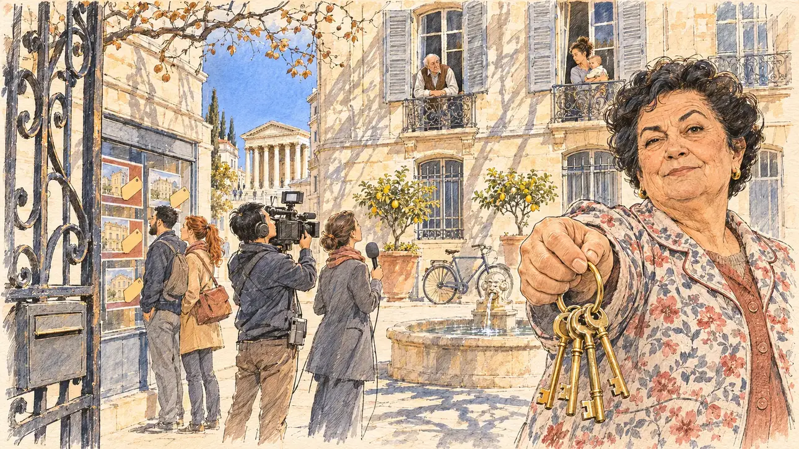

# `officialHousing` · Un logement de fonction

**Validée par le PO le 05/11/2026**, au premier essai, avec `primeTime.webp` comme référence. Elle sert telle quelle en clair et en sombre.



| Champ | Valeur |
| --- | --- |
| Carte | `officialHousing`, catégorie `affair` (Affaire), carte ajoutée par la PR #297 de l'app |
| Style | Reportage dessiné, trait de `primeTime` |
| Ton | Ironique |
| Date | 2026-11-05 |
| Outil | ChatGPT Images |
| Conversation | À remplir (le lien ne s'ouvre qu'avec le compte qui l'a créée) |
| Format rendu | 1672 × 941 (16:9) : export en 1290 × 726 px, WebP de qualité 75, 254 Ko, sans recadrage |
| Fichier d'origine | Image de ChatGPT, chez le PO. L'export du dépôt a été fait depuis la copie partagée dans la conversation avec Claude |
| Première édition | La prochaine Release qui suit le merge de la PR #297 de l'app |

## Texte de la carte

> **Un logement de fonction**
>
> On apprend que, dans un ancien poste, vous avez conservé un logement de fonction après la fin de vos fonctions, pour un loyer très inférieur à celui du marché.

## Le moment choisi

La cour d'un bel immeuble ancien de Nîmes, près des jardins de la Fontaine, un matin ensoleillé, vue depuis le porche où le candidat (hors champ) arrive : au premier plan, la grille en fer forgé entrouverte et une boîte aux lettres sans nom. La gardienne de l'immeuble tend au candidat un trousseau de clés, l'air ironique. Autour : une équipe de télévision qui filme la façade, des voisins aux fenêtres, un jeune couple devant la vitrine d'une agence immobilière aux annonces réduites à des pavés de couleur. Au bout de la rue : la Maison Carrée en pierre blonde sous le ciel bleu.

## Prompt complet

Dans une nouvelle conversation, avec [`primeTime.webp`](../../illustrations/media/primeTime.webp) comme seule image de référence.

```
Use the attached image as the style reference and copy its drawing: a realistic reportage drawing made on the spot for a newspaper, with quick, nervous pencil lines, often drawn twice, ink hatching in the shadows, transparent watercolour washes that spill a little over the lines, and the warm paper showing through. Not the same scene and not the same people: never reuse the face or the hair of the woman in the reference.
Like in the reference, the setting can be full when the story needs it, with the things that say where we are and what is happening, but each one is sketched with a few pencil lines and a light wash, never rendered or finished, and the drawing gets looser and paler towards the edges until it fades into the bare paper.
This must look like a drawing made by hand on paper by a press illustrator, halfway between a quick sketch and a realistic picture: never a photograph, a film poster or a digital painting, and never a cartoon, a comic strip, a caricature or a children's book illustration. Continuous lines, never dotted or dashed outlines; no uniform texture, speckles or hatching filter laid over the picture; no glossy highlights, no smooth gradients, in the sky and on the walls too. Colour can be rich in places, on a piece of clothing, a light or a flag, but it stays transparent and within the palette below. The fade into the paper at the edges stays narrow, without a wide white margin. No blur and no depth-of-field effect: everything, the foreground included, is drawn sharp, like a sketch made on the spot.
People are drawn from life with realistic anatomy and proportions, like in the reference: faces shaped with pencil lines, hatching and light washes, a little more finished than the background but never photographic (no photographic skin, no airbrushed or digital-painting look). Expressions stay natural and restrained, even in laughter or tears: no exaggerated grins, no wide-open mouths full of teeth, no rubbery or cartoonish faces.

Editorial illustration, landscape 16:9 (1536 × 864 px), the scene filling the frame, with only a light fade into the paper at the edges. The courtyard of a fine old building in Nîmes, in the South, near the Jardins de la Fontaine, on a sunny morning in early 2027: it has come out that in a former post the player's candidate kept an official flat after the job ended, for a rent far below the market rate. The scene is seen from the carriage entrance where the candidate arrives, who stays off-camera: in the foreground, only the half-open wrought-iron gate and a letterbox with no name on it. In the right third, the building's caretaker, a woman in her sixties of Spanish origin, short and round, with dyed black hair in a short perm, gold earrings and a flowered housecoat over a cardigan, holds out a heavy bunch of old keys towards the viewer at arm's length, with a sly, ironic look, one eyebrow raised, her face above mid-height. Around her, sketched in pencil and light washes: a TV crew filming the façade, a cameraman of Vietnamese origin with a camera on his shoulder and a reporter with a plain foam microphone; neighbours leaning out of the tall shuttered windows, an old man in a vest with his elbows on the sill, a young woman with a baby; a young couple, the man of Moroccan origin with a beard, the woman with a red ponytail, looking at the window of an estate agency where the flat adverts are only coloured blocks and price-tag shapes with no figures; a small fountain, potted lemon trees and a bicycle against the wall. The building: pale blond limestone, tall windows with grey-blue shutters, wrought-iron balconies; and at the end of the narrow street, the Roman temple of the Maison Carrée with its columns in honey-coloured stone under a deep blue sky. Only the caretaker looks straight at the viewer. Nothing on the letterbox, the estate agency window, the camera, the microphone or the shop fronts is readable, and no logo of a real TV channel, estate agency or company appears.

Style: Reportage drawing made on the spot, like a press illustrator or courtroom sketch artist: pencil and ink with loose watercolour washes, lively unfinished lines, white paper showing through.

Palette: navy #13203F, vellum #F5EFE1, gold #A9802A, brick #B5523B, ochre #D9A441, sage #8FA58A, slate #5E7186, sand #DCC8A4, warm grey #8C8279; use 4 to 6 of them, subtle warm paper grain.

Tone: ironic, the bright, hard winter sun of the South on the blond stone, sharp shadows in the courtyard, and the gold of the old keys as the bright note.

Constraints: realistic proportions, natural expressions, never cartoonish or caricatured faces, drawn like the rest of the illustration and never photographic; people of varied ages, genders, origins and body types (heavy, stocky, round, tall, short, wiry, not only slim), each with a distinct face and haircut (no two people alike), drawn with respect and never as a joke; anatomically correct hands with exactly five fingers, few hands visible, the others in pockets, behind objects or out of frame; no readable text anywhere (the letterbox, the estate agency window, the camera, the microphone and the shop fronts stay unreadable); no captions or speech bubbles; no logos or political party colours; no recognisable real person, no lookalike of a real politician, and no logo of a real TV channel, estate agency or company; no explicit violence; no photographic rendering, no blur or bokeh, no dotted outlines, no texture or hatching filter over the picture, no oil-paint texture, no wide white margin or frame (a light fade into the paper at the edges is fine).

Format: if 16:9 is not available, make 1536 × 1024 and keep the top 80 px and the bottom 80 px free of anything important (faces, hands, the main action): they will be cropped.
```

## Décisions prises sur cette image

Aucune.

## Essais écartés

Aucun.

## Retouches

Aucune.

## Relecture

Faite et validée par le PO le 05/11/2026.

- [x] Aucun texte lisible : les annonces de l'agence ne sont que des photos de façades et des étiquettes vides ; la boîte aux lettres n'a pas de nom ; rien n'est lisible sur la caméra, le micro ni les façades.
- [x] Aucun sosie d'une personne réelle.
- [x] Le candidat du joueur est hors champ.
- [x] Mains, visages et foules sans défaut visible à 343 px de large.
- [x] Aucune couleur ni aucun logo de parti. Des personnes variées par l'âge, le corps, l'origine et la coiffure.
- [x] En 3:2 : sans objet, l'image est en 16:9.
- [x] Lisible sur la page de l'événement, en clair et en sombre.

Ce que la relecture a accepté : le couple et l'équipe de télé sont dans la rue, devant l'agence, plutôt que dans la cour ; la Maison Carrée est au bout de la rue, avec un escalier.
