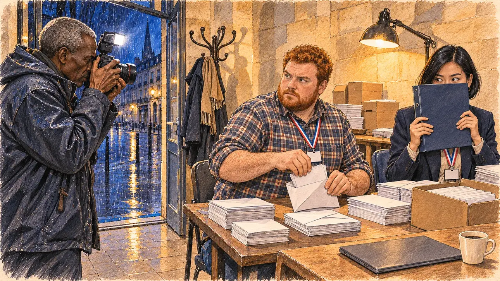

# `parliamentaryStaffRevealed` · Des assistants parlementaires dans l'équipe

**Validée par le PO le 22/11/2026**, au premier essai du second prompt. Elle sert telle quelle en clair et en sombre.



| Champ | Valeur |
| --- | --- |
| Carte | `parliamentaryStaffRevealed`, catégorie `affair` (Affaire), jamais tirée par son poids : la révélation de la triche « Faire appel aux assistants parlementaires », imposée la semaine qui suit le tirage caché qui l'a découverte ; carte ajoutée par la PR #472 de l'app (Mitchnsun/moi-president#60) |
| Style | Reportage dessiné |
| Ton | Tendu, une soirée de flash |
| Date | 2026-11-22 |
| Outil | ChatGPT Images, modèle GPT 6.2 Astra, effort Light |
| Format rendu | 1672 × 941 (16:9) : export en 1290 × 726 px, WebP de qualité 75, 252 Ko, sans recadrage, fait depuis la copie WebP de la conversation |
| Fichier d'origine | Image de ChatGPT, chez le PO. L'export du dépôt a été fait depuis la copie partagée dans la conversation avec Claude |
| Première édition | `kit-france-2611-0004` |

## Texte de la carte

> **Des assistants parlementaires dans l'équipe**
>
> Un hebdomadaire révèle que des assistants payés par l'Assemblée travaillaient pour votre campagne. Le parquet ouvre une enquête pour détournement de fonds publics.

## Le moment choisi

Le QG de campagne à Bordeaux, le soir, entre des murs de pierre blonde : deux assistants, leur badge de l'Assemblée encore au cou, mettent des tracts sous enveloppe. Un photographe de presse vient d'entrer par la porte restée ouverte, sans prévenir ; son flash éclaire la pièce. L'assistante se cache le visage derrière un classeur, l'assistant, figé, fixe le photographe. Le candidat est hors champ. Bordeaux n'avait encore servi à aucune carte.

## Prompt complet

Dans une nouvelle conversation, avec [`primeTime.webp`](../../illustrations/media/primeTime.webp) comme seule image de référence :

```
Use the attached image as the style reference and copy its drawing: a realistic reportage drawing made on the spot for a newspaper, with quick, nervous pencil lines, often drawn twice, ink hatching in the shadows, transparent watercolour washes that spill a little over the lines, and the warm paper showing through. Not the same scene and not the same people: never reuse the face or the hair of the woman in the reference.
Like in the reference, the setting can be full when the story needs it, with the things that say where we are and what is happening, but each one is sketched with a few pencil lines and a light wash, never rendered or finished, and the drawing gets looser and paler towards the edges until it fades into the bare paper.
This must look like a drawing made by hand on paper by a press illustrator, halfway between a quick sketch and a realistic picture: never a photograph, a film poster or a digital painting, and never a cartoon, a comic strip, a caricature or a children's book illustration. Continuous lines, never dotted or dashed outlines; no uniform texture, speckles or hatching filter laid over the picture; no glossy highlights, no smooth gradients, in the sky and on the walls too. Colour can be rich in places, on a piece of clothing, a light or a flag, but it stays transparent and within the palette below. The fade into the paper at the edges stays narrow, without a wide white margin. No blur and no depth-of-field effect: everything, the foreground included, is drawn sharp, like a sketch made on the spot.
People are drawn from life with realistic anatomy and proportions, like in the reference: faces shaped with pencil lines, hatching and light washes, a little more finished than the background but never photographic (no photographic skin, no airbrushed or digital-painting look). Expressions stay natural and restrained, even in laughter or tears: no exaggerated grins, no wide-open mouths full of teeth, no rubbery or cartoonish faces.

Editorial illustration, landscape 16:9 (1536 × 864 px), the scene filling the frame, with only a light fade into the paper at the edges. A campaign headquarters in a ground-floor shop in Bordeaux, in the evening in February 2027: blond limestone walls, long tables covered with stacks of leaflets and envelopes, cardboard boxes, a coat rack by the open front door, the dark street beyond it. A press photographer has just walked in through the door unannounced, and is inside the room. The player's candidate stays off-camera: in the foreground, only the corner of a desk with a closed laptop and a coffee cup. Two parliamentary assistants, each still wearing a lanyard with a tricolour ribbon and a blank badge around the neck, were putting leaflets into envelopes. In the right third, the first assistant, a young woman in her late twenties of Vietnamese descent with a straight black bob and a navy blazer, raises a ring binder in front of her face to hide from the camera, her eyes just visible above it, her face above mid-height. Next to her, the second assistant, a heavy-set man in his thirties with red hair, a short beard and a checked shirt, freezes with an envelope in his hand and stares at the photographer. In the left third, standing just inside the doorway and seen from the side, the photographer, a wiry man in his fifties of Senegalese descent with short grey hair and a rain jacket wet from the rain, holds a camera to his eye with both hands; its flash lights up the room with a cold white burst. Nobody looks at the viewer. Nothing on the leaflets, the envelopes, the boxes, the badges or the camera is readable.

Style: Reportage drawing made on the spot, like a press illustrator or courtroom sketch artist: pencil and ink with loose watercolour washes, lively unfinished lines, white paper showing through.

Palette: navy #13203F, vellum #F5EFE1, gold #A9802A, brick #B5523B, ochre #D9A441, sage #8FA58A, slate #5E7186, sand #DCC8A4, warm grey #8C8279; use 4 to 6 of them, subtle warm paper grain.

Tone: tense, cold white flash against the warm lamps of the room and the blue street at night through the open door, hard shadows.

Constraints: realistic proportions, natural expressions, never cartoonish or caricatured faces, drawn like the rest of the illustration and never photographic; people of varied ages, genders, origins and body types (heavy, stocky, round, tall, short, wiry, not only slim), each with a distinct face and haircut (no two people alike), drawn with respect and never as a joke; each person's age, build and look plausible for their job and the scene (working people of working age), no stereotype tying an origin or a gender to a role, and no person of colour shown alone in a featured service or deferential role; anatomically correct hands with exactly five fingers, few hands visible, the others in pockets, behind objects or out of frame; no readable text anywhere (the leaflets, the envelopes, the boxes, the badges and the camera stay unreadable); no captions or speech bubbles; no logos or political party colours; no recognisable real person, no lookalike of a real politician or of a real parliamentary assistant; no explicit violence; no photographic rendering, no blur or bokeh, no dotted outlines, no texture or hatching filter over the picture, no oil-paint texture, no wide white margin or frame (a light fade into the paper at the edges is fine).

Format: if 16:9 is not available, make 1536 × 1024 and keep the top 80 px and the bottom 80 px free of anything important (faces, hands, the main action): they will be cropped.
```

## Décisions prises sur cette image

- **Le rendu est gardé tel quel** (PO, 22/11/2026) : une texture mouchetée couvre l'image, surtout le blouson du photographe, la pluie et les murs, et le visage du photographe est plus fini que le reste. Un message de correction a été proposé pour revenir au dessin de la référence ; le PO a préféré garder l'image.
- **La flèche de la basilique Saint-Michel** se voit par la porte ouverte : un monument réel, permis pour situer Bordeaux.
- **Le photographe** paraît plus âgé que la cinquantaine du prompt.

## Essais écartés

- **Premier prompt** (22/11/2026) : le photographe était dehors, collé à la vitrine. Le générateur le rendait mal derrière la vitre : le PO a fait entrer le photographe dans la pièce, par la porte ouverte.

## Retouches

Aucune.

## Relecture

Faite et validée par le PO le 22/11/2026.

- [x] Aucun texte lisible : ni sur les tracts, ni sur les enveloppes, ni sur les badges, ni sur l'appareil photo.
- [x] Aucun sosie d'une personne réelle.
- [x] Le candidat du joueur est hors champ ; toute image de lui (affiche, tract, double) n'a ni visage ni genre.
- [x] Mains, visages et foules sans défaut visible à 343 px de large.
- [x] Aucune couleur ni aucun logo de parti. Drapeaux, écharpes et Marianne seulement pour signaler un lieu ou un élu officiel. Des personnes variées par l'âge, le corps, l'origine et la coiffure.
- [x] En 3:2 : rien d'important dans les 80 px du haut et du bas.
- [x] Lisible sur la page de l'événement, en clair et en sombre.
