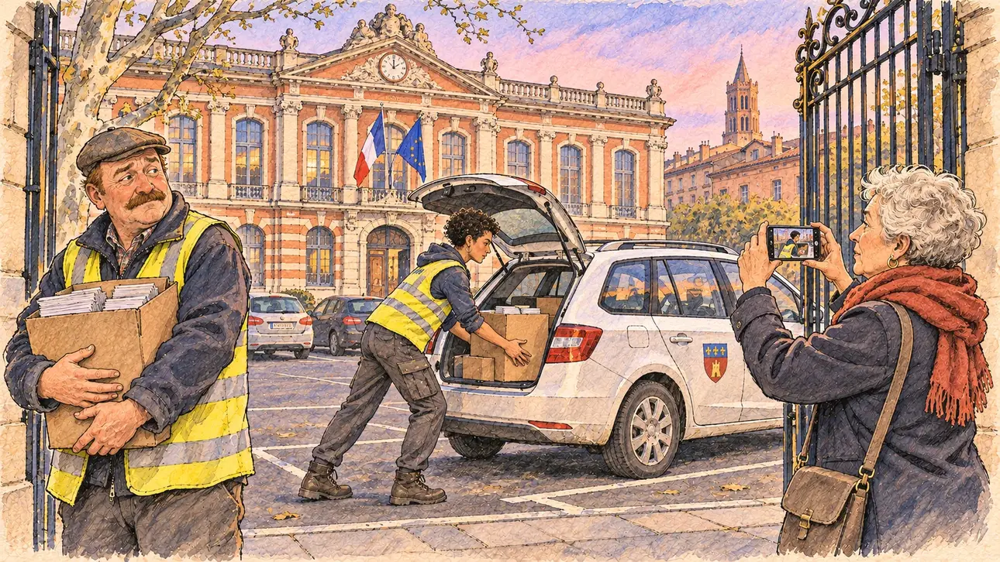

# `publicMeansRevealed` · Les moyens publics de la campagne

**Validée par le PO le 22/11/2026**, au premier essai. Elle sert telle quelle en clair et en sombre.



| Champ | Valeur |
| --- | --- |
| Carte | `publicMeansRevealed`, catégorie `affair` (Affaire), jamais tirée par son poids : la révélation de la triche « Utiliser les moyens publics », imposée la semaine qui suit le tirage caché qui l'a découverte ; carte ajoutée par la PR #472 de l'app (Mitchnsun/moi-president#60) |
| Style | Reportage dessiné |
| Ton | Ironique, un petit matin pris sur le fait |
| Date | 2026-11-22 |
| Outil | ChatGPT Images, modèle GPT 6.2 Astra, effort Light |
| Conversation | À compléter |
| Format rendu | 1672 × 941 (16:9) : export en 1290 × 726 px, WebP de qualité 75, 254 Ko, sans recadrage, fait depuis la copie WebP de la conversation |
| Fichier d'origine | Image de ChatGPT, chez le PO. L'export du dépôt a été fait depuis la copie partagée dans la conversation avec Claude |
| Première édition | À compléter |

## Texte de la carte

> **Les moyens publics de la campagne**
>
> La presse révèle que votre campagne a utilisé le personnel, les voitures et le courrier d'une collectivité. La Commission des comptes de campagne en réintègre la valeur dans vos dépenses.

## Le moment choisi

Le parking d'un hôtel de département à Toulouse, à l'aube, entre les murs de brique rose : deux agents chargent des cartons de tracts dans une voiture blanche de la collectivité, au blason sur la portière. Dans l'entrée ouverte du parking, une journaliste de la presse locale filme avec son téléphone. Un agent la voit et se fige, un carton dans les bras ; l'autre continue de charger sans rien remarquer. Personne ne regarde le spectateur, et le candidat est hors champ. Toulouse n'avait encore servi à aucune carte.

## Prompt complet

Dans une nouvelle conversation, avec [`primeTime.webp`](../../illustrations/media/primeTime.webp) comme seule image de référence :

```
Use the attached image as the style reference and copy its drawing: a realistic reportage drawing made on the spot for a newspaper, with quick, nervous pencil lines, often drawn twice, ink hatching in the shadows, transparent watercolour washes that spill a little over the lines, and the warm paper showing through. Not the same scene and not the same people: never reuse the face or the hair of the woman in the reference.
Like in the reference, the setting can be full when the story needs it, with the things that say where we are and what is happening, but each one is sketched with a few pencil lines and a light wash, never rendered or finished, and the drawing gets looser and paler towards the edges until it fades into the bare paper.
This must look like a drawing made by hand on paper by a press illustrator, halfway between a quick sketch and a realistic picture: never a photograph, a film poster or a digital painting, and never a cartoon, a comic strip, a caricature or a children's book illustration. Continuous lines, never dotted or dashed outlines; no uniform texture, speckles or hatching filter laid over the picture; no glossy highlights, no smooth gradients, in the sky and on the walls too. Colour can be rich in places, on a piece of clothing, a light or a flag, but it stays transparent and within the palette below. The fade into the paper at the edges stays narrow, without a wide white margin. No blur and no depth-of-field effect: everything, the foreground included, is drawn sharp, like a sketch made on the spot.
People are drawn from life with realistic anatomy and proportions, like in the reference: faces shaped with pencil lines, hatching and light washes, a little more finished than the background but never photographic (no photographic skin, no airbrushed or digital-painting look). Expressions stay natural and restrained, even in laughter or tears: no exaggerated grins, no wide-open mouths full of teeth, no rubbery or cartoonish faces.

Editorial illustration, landscape 16:9 (1536 × 864 px), the scene filling the frame, with only a light fade into the paper at the edges. The staff car park of a departmental council building in Toulouse, at dawn in March 2027, between walls of pink brick, with a French tricolour and a European flag on the façade above; the car park's gate onto the street stands wide open. Two council employees in high-visibility vests are loading cardboard boxes of campaign leaflets into the boot of a white council car with a small coat of arms on its door. The player's candidate stays off-camera and does not appear on the leaflets. In the left third, the first employee, a stout man in his fifties with a ruddy face, a grey moustache and a flat cap, has just noticed the journalist at the gate and freezes, a box in his arms, looking at her with an embarrassed expression, his face above mid-height. Next to the car, the second employee, a tall young woman of Algerian descent with short curly hair and a sporty build, keeps loading boxes without noticing. In the right third, standing in the open gateway on the pavement, nothing between her and the car, a local journalist, a small round woman in her sixties with short curly white hair and a red scarf, films the scene with her smartphone held up, seen from the side. Nobody looks at the viewer. Nothing on the boxes, the leaflets, the car, the coat of arms or the phone screen is readable.

Style: Reportage drawing made on the spot, like a press illustrator or courtroom sketch artist: pencil and ink with loose watercolour washes, lively unfinished lines, white paper showing through.

Palette: navy #13203F, vellum #F5EFE1, gold #A9802A, brick #B5523B, ochre #D9A441, sage #8FA58A, slate #5E7186, sand #DCC8A4, warm grey #8C8279; use 4 to 6 of them, subtle warm paper grain.

Tone: gently ironic, postures slightly exaggerated but never the faces, the pink brick glowing in the first light of dawn.

Constraints: realistic proportions, natural expressions, never cartoonish or caricatured faces, drawn like the rest of the illustration and never photographic; people of varied ages, genders, origins and body types (heavy, stocky, round, tall, short, wiry, not only slim), each with a distinct face and haircut (no two people alike), drawn with respect and never as a joke; each person's age, build and look plausible for their job and the scene (working people of working age), no stereotype tying an origin or a gender to a role, and no person of colour shown alone in a featured service or deferential role; anatomically correct hands with exactly five fingers, few hands visible, the others in pockets, behind objects or out of frame; no readable text anywhere (the boxes, the leaflets, the car, the coat of arms and the phone screen stay unreadable); no captions or speech bubbles; no logos or political party colours; no recognisable real person, no lookalike of a real politician or of a real local official; no explicit violence; no photographic rendering, no blur or bokeh, no dotted outlines, no texture or hatching filter over the picture, no oil-paint texture, no wide white margin or frame (a light fade into the paper at the edges is fine).

Format: if 16:9 is not available, make 1536 × 1024 and keep the top 80 px and the bottom 80 px free of anything important (faces, hands, the main action): they will be cropped.
```

## Décisions prises sur cette image

- **Avant la génération** : pas de grille entre la journaliste et la voiture, car un personnage derrière une vitre ou une grille sort mal ([`parliamentaryStaffRevealed`](parliamentaryStaffRevealed.md)). L'agent pris sur le fait n'est pas le seul personnage d'origine non européenne mis en avant : les origines sont réparties entre les deux agents.
- **Le Capitole et un blason proche de celui de Toulouse** (PO, 22/11/2026) : le générateur a dessiné l'hôtel de ville de Toulouse au lieu d'un hôtel de département, avec un clocher toulousain au fond, et sur la portière un blason aux fleurs de lys et à la tour dorée. Une correction qui les neutralisait a été proposée ; le PO garde l'image telle quelle.
- **L'agent à la moustache** jette un œil vers la gauche, pas vers la journaliste à droite : la scène se lit quand même.
- **Une texture mouchetée légère** couvre l'image, comme sur [`parliamentaryStaffRevealed`](parliamentaryStaffRevealed.md).

## Essais écartés

Aucun.

## Retouches

Aucune.

## Relecture

Faite et validée par le PO le 22/11/2026.

- [x] Aucun texte lisible : ni sur les cartons, ni sur les tracts, ni sur la voiture et son blason, ni sur l'écran du téléphone.
- [x] Aucun sosie d'une personne réelle.
- [x] Le candidat du joueur est hors champ ; toute image de lui (affiche, tract, double) n'a ni visage ni genre.
- [x] Mains, visages et foules sans défaut visible à 343 px de large.
- [x] Aucune couleur ni aucun logo de parti. Drapeaux, écharpes et Marianne seulement pour signaler un lieu ou un élu officiel. Des personnes variées par l'âge, le corps, l'origine et la coiffure.
- [x] En 3:2 : rien d'important dans les 80 px du haut et du bas.
- [x] Lisible sur la page de l'événement, en clair et en sombre.
