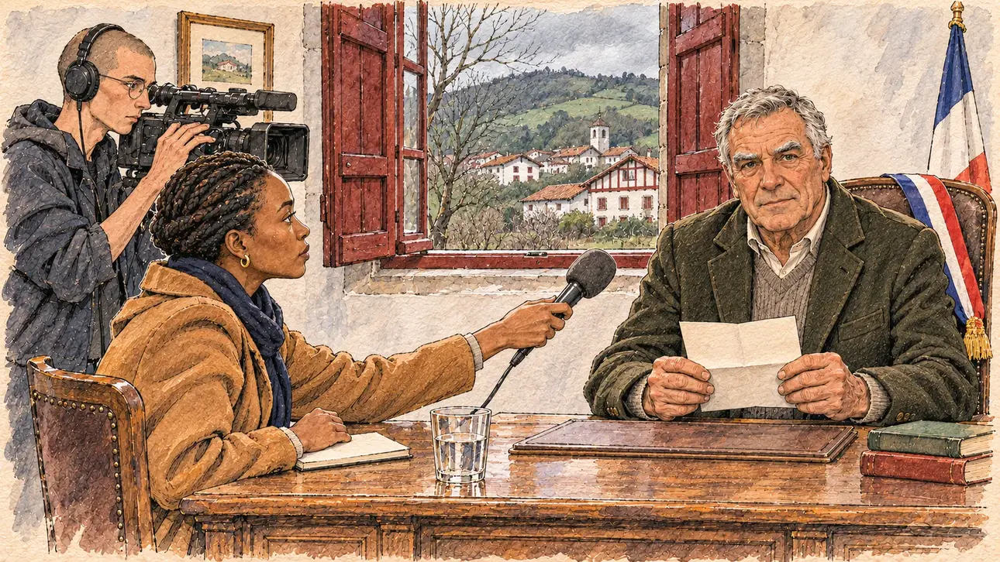

# `sponsorshipFavoursRevealed` · Des parrainages contre des subventions

**Validée par le PO le 22/11/2026**, au premier essai. Elle sert telle quelle en clair et en sombre.



| Champ | Valeur |
| --- | --- |
| Carte | `sponsorshipFavoursRevealed`, catégorie `affair` (Affaire), jamais tirée par son poids : la révélation de la triche « Promettre une subvention », imposée la semaine qui suit le tirage caché qui l'a découverte ; avant le dépôt de la semaine 7, les formulaires achetés sont retirés ; carte ajoutée par la PR #472 de l'app (Mitchnsun/moi-president#60) |
| Style | Reportage dessiné |
| Ton | Tendu, la gravité d'un aveu |
| Date | 2026-11-22 |
| Outil | ChatGPT Images, modèle GPT 6.2 Astra, effort Light |
| Conversation | À compléter |
| Format rendu | 1672 × 941 (16:9) : export en 1290 × 726 px, WebP de qualité 75, 247 Ko, sans recadrage, fait depuis la copie WebP de la conversation |
| Fichier d'origine | Image de ChatGPT, chez le PO. L'export du dépôt a été fait depuis la copie partagée dans la conversation avec Claude |
| Première édition | À compléter |

## Texte de la carte

> **Des parrainages contre des subventions**
>
> Un maire raconte qu'on lui a promis une subvention contre son parrainage. Le Conseil constitutionnel invalide les parrainages obtenus ainsi, et le parquet ouvre une enquête pour corruption.

## Le moment choisi

La mairie d'un village du Pays basque, maison blanche aux volets rouges : dans son bureau, le maire raconte face à une équipe de la télévision régionale. Il tient une lettre pliée, son écharpe tricolore posée sur le dossier de la chaise. Il regarde le spectateur, grave, presque soulagé d'avoir parlé ; la journaliste lui tend le micro, le cadreur filme. Le candidat est hors champ. Le Pays basque n'avait encore servi à aucune carte de parrainages.

## Prompt complet

Dans une nouvelle conversation, avec [`primeTime.webp`](../../illustrations/media/primeTime.webp) comme seule image de référence :

```
Use the attached image as the style reference and copy its drawing: a realistic reportage drawing made on the spot for a newspaper, with quick, nervous pencil lines, often drawn twice, ink hatching in the shadows, transparent watercolour washes that spill a little over the lines, and the warm paper showing through. Not the same scene and not the same people: never reuse the face or the hair of the woman in the reference.
Like in the reference, the setting can be full when the story needs it, with the things that say where we are and what is happening, but each one is sketched with a few pencil lines and a light wash, never rendered or finished, and the drawing gets looser and paler towards the edges until it fades into the bare paper.
This must look like a drawing made by hand on paper by a press illustrator, halfway between a quick sketch and a realistic picture: never a photograph, a film poster or a digital painting, and never a cartoon, a comic strip, a caricature or a children's book illustration. Continuous lines, never dotted or dashed outlines; no uniform texture, speckles or hatching filter laid over the picture; no glossy highlights, no smooth gradients, in the sky and on the walls too. Colour can be rich in places, on a piece of clothing, a light or a flag, but it stays transparent and within the palette below. The fade into the paper at the edges stays narrow, without a wide white margin. No blur and no depth-of-field effect: everything, the foreground included, is drawn sharp, like a sketch made on the spot.
People are drawn from life with realistic anatomy and proportions, like in the reference: faces shaped with pencil lines, hatching and light washes, a little more finished than the background but never photographic (no photographic skin, no airbrushed or digital-painting look). Expressions stay natural and restrained, even in laughter or tears: no exaggerated grins, no wide-open mouths full of teeth, no rubbery or cartoonish faces.

Editorial illustration, landscape 16:9 (1536 × 864 px), the scene filling the frame, with only a light fade into the paper at the edges. The mayor's office in the town hall of a small village in the French Basque Country, in the morning in February 2027: whitewashed walls, dark red wooden shutters open on a green hillside, a heavy oak desk, a French tricolour flag in the corner and the mayor's tricolour sash hanging over the back of his chair. A regional television crew interviews the mayor. The player's candidate stays off-camera and does not appear. In the right third, the mayor, a broad-shouldered man in his sixties with thick white eyebrows, a weathered face, short grey hair and a dark green wool jacket, sits at his desk holding a folded letter in both hands and looks at the viewer, grave, almost relieved to have spoken, his face above mid-height. Facing him, a television journalist, a woman in her thirties of Cameroonian descent with short braids and a camel coat, holds out a microphone, listening. Behind her, the camera operator, a lanky young man with a shaved head and round glasses, films from the shoulder. Only the mayor looks at the viewer. Nothing on the letter, the microphone, the camera or the papers on the desk is readable.

Style: Reportage drawing made on the spot, like a press illustrator or courtroom sketch artist: pencil and ink with loose watercolour washes, lively unfinished lines, white paper showing through.

Palette: navy #13203F, vellum #F5EFE1, gold #A9802A, brick #B5523B, ochre #D9A441, sage #8FA58A, slate #5E7186, sand #DCC8A4, warm grey #8C8279; use 4 to 6 of them, subtle warm paper grain.

Tone: tense and grave, soft grey morning light from the window, a quiet room.

Constraints: realistic proportions, natural expressions, never cartoonish or caricatured faces, drawn like the rest of the illustration and never photographic; people of varied ages, genders, origins and body types (heavy, stocky, round, tall, short, wiry, not only slim), each with a distinct face and haircut (no two people alike), drawn with respect and never as a joke; each person's age, build and look plausible for their job and the scene (working people of working age), no stereotype tying an origin or a gender to a role, and no person of colour shown alone in a featured service or deferential role; anatomically correct hands with exactly five fingers, few hands visible, the others in pockets, behind objects or out of frame; no readable text anywhere (the letter, the microphone, the camera and the papers on the desk stay unreadable); no captions or speech bubbles; no logos or political party colours; no recognisable real person, no lookalike of a real politician or of a real mayor; no explicit violence; no photographic rendering, no blur or bokeh, no dotted outlines, no texture or hatching filter over the picture, no oil-paint texture, no wide white margin or frame (a light fade into the paper at the edges is fine).

Format: if 16:9 is not available, make 1536 × 1024 and keep the top 80 px and the bottom 80 px free of anything important (faces, hands, the main action): they will be cropped.
```

## Décisions prises sur cette image

- **La journaliste est assise** au bureau, en face du maire, au lieu de se tenir debout ; ses tresses sont relevées en chignon. La scène se lit telle quelle.
- **Le village** se voit par la fenêtre : maisons blanches à colombages rouges et clocher, sans monument identifiable.
- **Une texture mouchetée légère** couvre l'image, comme sur [`parliamentaryStaffRevealed`](parliamentaryStaffRevealed.md).

## Essais écartés

Aucun.

## Retouches

Aucune.

## Relecture

Faite et validée par le PO le 22/11/2026.

- [x] Aucun texte lisible : ni sur la lettre, ni sur le micro, ni sur la caméra, ni sur les papiers du bureau.
- [x] Aucun sosie d'une personne réelle.
- [x] Le candidat du joueur est hors champ ; toute image de lui (affiche, tract, double) n'a ni visage ni genre.
- [x] Mains, visages et foules sans défaut visible à 343 px de large.
- [x] Aucune couleur ni aucun logo de parti. Drapeaux, écharpes et Marianne seulement pour signaler un lieu ou un élu officiel. Des personnes variées par l'âge, le corps, l'origine et la coiffure.
- [x] En 3:2 : rien d'important dans les 80 px du haut et du bas.
- [x] Lisible sur la page de l'événement, en clair et en sombre.
