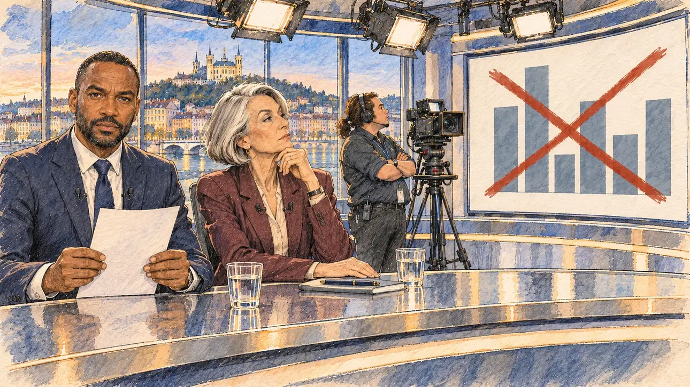

# `undeclaredPollRevealed` · Un sondage hors la loi

**Validée par le PO le 22/11/2026**, au premier essai. Elle sert telle quelle en clair et en sombre.



| Champ | Valeur |
| --- | --- |
| Carte | `undeclaredPollRevealed`, catégorie `affair` (Affaire), jamais tirée par son poids : la révélation de la triche « Publier un sondage maison », imposée la semaine qui suit le tirage caché qui l'a découverte ; carte ajoutée par la PR #472 de l'app (Mitchnsun/moi-president#60) |
| Style | Reportage dessiné |
| Ton | Ironique, une matinale |
| Date | 2026-11-22 |
| Outil | ChatGPT Images, modèle GPT 6.2 Astra, effort Light |
| Conversation | À compléter |
| Format rendu | 1672 × 941 (16:9) : export en 1290 × 726 px, WebP de qualité 75, 215 Ko, sans recadrage, fait depuis la copie WebP de la conversation (à refaire depuis le PNG d'origine) |
| Fichier d'origine | À compléter (hors du dépôt) |
| Première édition | À compléter |

## Texte de la carte

> **Un sondage hors la loi**
>
> La Commission des sondages découvre que votre campagne a publié un sondage sans en déposer la notice, comme la loi l'exige. Elle impose une mise au point dans la presse, et l'amende tombe : 75 000 €.

## Le moment choisi

Le plateau de la matinale d'une chaîne d'information, à Lyon : derrière le présentateur, l'écran géant affiche un graphique en barres barré d'une grande croix rouge. Le présentateur lit la mise au point imposée, le regard vers le spectateur, impassible ; la chroniqueuse à côté de lui lève un sourcil. Le candidat est hors champ et n'est pas sur l'écran. La présentatrice de la référence ne doit pas revenir : ici, un présentateur.

## Prompt complet

Dans une nouvelle conversation, avec [`primeTime.webp`](../../illustrations/media/primeTime.webp) comme seule image de référence :

```
Use the attached image as the style reference and copy its drawing: a realistic reportage drawing made on the spot for a newspaper, with quick, nervous pencil lines, often drawn twice, ink hatching in the shadows, transparent watercolour washes that spill a little over the lines, and the warm paper showing through. Not the same scene and not the same people: never reuse the face or the hair of the woman in the reference.
Like in the reference, the setting can be full when the story needs it, with the things that say where we are and what is happening, but each one is sketched with a few pencil lines and a light wash, never rendered or finished, and the drawing gets looser and paler towards the edges until it fades into the bare paper.
This must look like a drawing made by hand on paper by a press illustrator, halfway between a quick sketch and a realistic picture: never a photograph, a film poster or a digital painting, and never a cartoon, a comic strip, a caricature or a children's book illustration. Continuous lines, never dotted or dashed outlines; no uniform texture, speckles or hatching filter laid over the picture; no glossy highlights, no smooth gradients, in the sky and on the walls too. Colour can be rich in places, on a piece of clothing, a light or a flag, but it stays transparent and within the palette below. The fade into the paper at the edges stays narrow, without a wide white margin. No blur and no depth-of-field effect: everything, the foreground included, is drawn sharp, like a sketch made on the spot.
People are drawn from life with realistic anatomy and proportions, like in the reference: faces shaped with pencil lines, hatching and light washes, a little more finished than the background but never photographic (no photographic skin, no airbrushed or digital-painting look). Expressions stay natural and restrained, even in laughter or tears: no exaggerated grins, no wide-open mouths full of teeth, no rubbery or cartoonish faces.

Editorial illustration, landscape 16:9 (1536 × 864 px), the scene filling the frame, with only a light fade into the paper at the edges. The set of a morning show on a news channel in Lyon, at 7 a.m. in March 2027: a curved news desk, studio lights, and behind it a giant screen showing a simple bar chart of a poll, crossed out with a large red X. The player's candidate stays off-camera and is not on the screen: the bars have no faces and no names. In the left third, the presenter, a man in his forties of Ivorian descent with close-cropped hair, a neat beard and a navy suit, reads a correction from a sheet of paper and looks straight at the viewer, deadpan and impassive, his face above mid-height. Beside him at the desk, a political columnist, a slim woman in her sixties with a sharp silver bob and a burgundy jacket, raises one eyebrow and glances at the screen. In the background, a camera on a pedestal and a floor manager, a short round young man with a headset and a ponytail, watch the screen. Only the presenter looks at the viewer. Nothing on the screen, the sheet of paper, the desk or the channel's set is readable, and no channel logo appears.

Style: Reportage drawing made on the spot, like a press illustrator or courtroom sketch artist: pencil and ink with loose watercolour washes, lively unfinished lines, white paper showing through.

Palette: navy #13203F, vellum #F5EFE1, gold #A9802A, brick #B5523B, ochre #D9A441, sage #8FA58A, slate #5E7186, sand #DCC8A4, warm grey #8C8279; use 4 to 6 of them, subtle warm paper grain.

Tone: gently ironic, bright cold studio light, the red X as the only strong colour.

Constraints: realistic proportions, natural expressions, never cartoonish or caricatured faces, drawn like the rest of the illustration and never photographic; people of varied ages, genders, origins and body types (heavy, stocky, round, tall, short, wiry, not only slim), each with a distinct face and haircut (no two people alike), drawn with respect and never as a joke; each person's age, build and look plausible for their job and the scene (working people of working age), no stereotype tying an origin or a gender to a role, and no person of colour shown alone in a featured service or deferential role; anatomically correct hands with exactly five fingers, few hands visible, the others in pockets, behind objects or out of frame; no readable text anywhere (the screen, the bar chart, the sheet of paper, the desk and the set stay unreadable); no captions or speech bubbles; no logos or political party colours; no recognisable real person, no lookalike of a real politician or of a real television presenter; no explicit violence; no photographic rendering, no blur or bokeh, no dotted outlines, no texture or hatching filter over the picture, no oil-paint texture, no wide white margin or frame (a light fade into the paper at the edges is fine).

Format: if 16:9 is not available, make 1536 × 1024 and keep the top 80 px and the bottom 80 px free of anything important (faces, hands, the main action): they will be cropped.
```

## Décisions prises sur cette image

- **La basilique de Fourvière et la Saône** se voient par la baie du plateau : un monument réel, permis pour situer Lyon.
- **Le régisseur** n'a pas la silhouette ronde du prompt ; il regarde l'écran, bras croisés. La scène se lit telle quelle.
- **Une texture mouchetée légère** couvre l'image, comme sur [`parliamentaryStaffRevealed`](parliamentaryStaffRevealed.md).

## Essais écartés

Aucun.

## Retouches

Aucune.

## Relecture

Faite et validée par le PO le 22/11/2026.

- [x] Aucun texte lisible : ni sur l'écran et son graphique, ni sur la feuille, ni sur le décor de la chaîne.
- [x] Aucun sosie d'une personne réelle.
- [x] Le candidat du joueur est hors champ ; toute image de lui (affiche, tract, double) n'a ni visage ni genre.
- [x] Mains, visages et foules sans défaut visible à 343 px de large.
- [x] Aucune couleur ni aucun logo de parti. Drapeaux, écharpes et Marianne seulement pour signaler un lieu ou un élu officiel. Des personnes variées par l'âge, le corps, l'origine et la coiffure.
- [x] En 3:2 : rien d'important dans les 80 px du haut et du bas.
- [x] Lisible sur la page de l'événement, en clair et en sombre.
