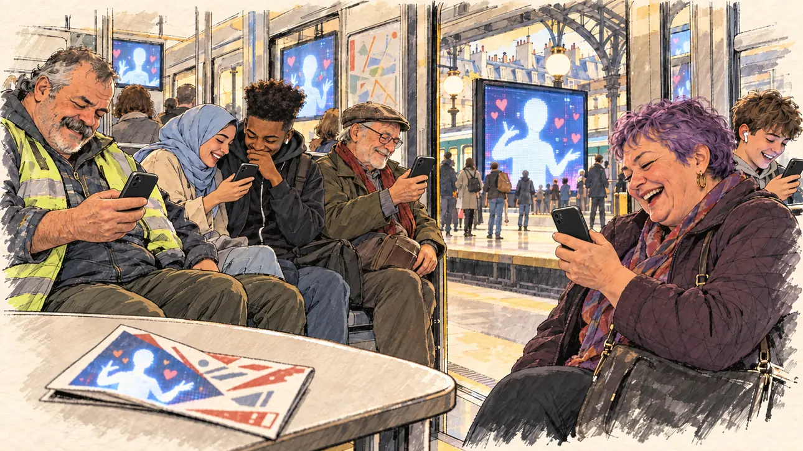

# `aiDouble` · Votre double numérique

**Validée par le PO le 01/11/2026**, au premier essai. Elle sert telle quelle en clair et en sombre.



| Champ | Valeur |
| --- | --- |
| Carte | `aiDouble`, catégorie `farFetched` (Incroyable) |
| Style | Reportage dessiné, façon carnet de croquis : le dessin s'efface légèrement dans le papier aux bords |
| Ton | Comique, avec un léger malaise |
| Date | 2026-11-01 |
| Outil | ChatGPT, ChatGPT Images 2.5 ; mode et effort : non précisés |
| Conversation | À remplir (le lien ne s'ouvre qu'avec le compte qui l'a créée) |
| Format rendu | 1672 × 941 (16:9) : export en 1290 × 726 px depuis le PNG d'origine, WebP de qualité 75, 161 Ko, sans recadrage |
| Fichier d'origine | PNG de ChatGPT, chez le PO, partagé aussi dans la conversation avec Claude |
| Première édition | À remplir |

## Texte de la carte

> **Votre double numérique**
>
> Un double de vous, généré par une IA, enchaîne les vidéos drôles et brillantes. Il compte déjà plus d'abonnés que vous.

## Le moment choisi

Une rame arrêtée en station, le matin. Le candidat y est assis, hors champ, et personne ne le remarque : tous les passagers rient devant leur téléphone, où leur fait signe son double numérique. Sur un grand panneau du quai, le même double, en très grand, entouré de cœurs. Au premier plan, un tract oublié.

## Prompt complet

Dans une nouvelle conversation, avec [`oldTweet.webp`](oldTweet.webp) comme seule image de référence :

```
Use the attached image as the style reference: the same pencil and ink drawing with loose watercolour washes and warm paper grain. Not the same scene.
This must look like a drawing made by hand on paper, never like a photograph or a film poster: the people are drawn with ink lines and flat washes, not modelled; the background is only suggested with a few pencil lines and light, transparent washes, so that the warm paper shows through; the drawing may fade lightly into the bare paper at the edges and in the corners, as on a sketchbook page, without a wide white margin. Lighter and less saturated than a painting: no dense colour, no glossy highlights, no hatching filter laid over a finished image.
Faces are drawn exactly like the clothes and the background: ink outlines, a few hatching strokes and flat watercolour washes for the skin, with the same level of detail as the rest of the drawing. No photographic skin, no realistic wrinkles or pores, no airbrushed or digital-painting look on the faces.

Editorial illustration, landscape 16:9 (1536 × 864 px), the scene filling the frame, with only a light fade into the paper at the edges. A Paris metro carriage in the morning in 2027, stopped at a station, its doors open. The player's candidate is in the carriage too and stays off-camera: in the foreground, only one of the candidate's campaign leaflets, folded and forgotten on a seat. Nobody notices the viewer: every passenger is watching the candidate's AI double on a phone and laughing. On every screen, the same figure: the AI double, drawn as a glowing, featureless silhouette made of soft light and tiny pixels, with no face, no hair and nothing that shows a gender, in a plain round-neck top, caught mid-gesture like a stand-up comedian. Through the open doors, on a large digital billboard on the platform, the same glowing silhouette, much bigger, surrounded by little floating hearts. In the right third, a stocky woman in her sixties with cropped hair dyed violet and a quilted jacket bursts out laughing at her phone, its screen half turned towards the viewer, her face above mid-height. Around her: a teenage boy with braces and earbuds grins at his screen; a young woman in a pale blue headscarf shows her phone to her friend, a lanky young man with a high-top fade, and both giggle; an elderly man in a flat cap holds his phone at arm's length, squinting, then smiling; a heavy-set construction worker with a grey moustache in a high-visibility vest chuckles, his phone in his big hand. Nothing on the phones, the billboard, the leaflet or the metro signs is readable.

Style: Reportage drawing made on the spot, like a press illustrator or courtroom sketch artist: pencil and ink with loose watercolour washes, lively unfinished lines, white paper showing through.

Palette: navy #13203F, vellum #F5EFE1, gold #A9802A, brick #B5523B, ochre #D9A441, sage #8FA58A, slate #5E7186, sand #DCC8A4, warm grey #8C8279; use 4 to 6 of them, subtle warm paper grain.

Tone: comic with a slight unease, the cold glow of the screens on the faces against the warm morning light of the station.

Constraints: realistic proportions, expressive but not caricatured faces, drawn like the rest of the illustration and never photographic; people of varied ages, genders, origins and body types (heavy, stocky, round, tall, short, wiry, not only slim), each with a distinct face and haircut (no two people alike), drawn with respect and never as a joke; the AI double never has a face, hair, a suit and tie, a dress or any feature that shows a gender; anatomically correct hands with exactly five fingers, few hands visible, the others in pockets, behind objects or out of frame; no readable text anywhere (phones, billboards, leaflets, metro maps and signs stay unreadable); no captions or speech bubbles; no logos or political party colours; no recognisable real person, no lookalike of a real politician; no explicit violence; no photographic rendering, no hatching filter over a finished digital painting, no oil-paint texture, no wide white margin or frame (a light fade into the paper at the edges is fine).

Format: if 16:9 is not available, make 1536 × 1024 and keep the top 80 px and the bottom 80 px free of anything important (faces, hands, the main action): they will be cropped.
```

## Décisions prises sur cette image

- **Le double n'a ni visage ni genre,** comme toute image du candidat (voir [`sloganMeme`](sloganMeme.md)) : une silhouette de lumière et de pixels, sans visage, sans cheveux, en haut à col rond.
- **Le tract oublié montre la même silhouette** que le double. On ne sait plus si c'est le tract du candidat ou celui du double : le PO le garde, la confusion sert le sujet de la carte.
- **La rame ressemble plus à un train sous une verrière de gare** qu'au métro : sans effet sur la lecture.

## Essais écartés

Aucun.

## Retouches

Aucune.

## Relecture

Faite et validée par le PO le 01/11/2026.

- [x] Aucun texte lisible : ni sur les téléphones, ni sur le panneau, ni sur le tract ; pas de plan de métro ni de nom de station.
- [x] Aucun sosie d'une personne réelle. Le double n'a ni visage ni genre.
- [x] Le candidat du joueur est hors champ.
- [x] Mains, visages et foules sans défaut visible à 343 px de large.
- [x] Aucune couleur de parti, aucun symbole officiel. Des personnes variées par l'âge, le corps, l'origine et la coiffure.
- [x] En 3:2 : rien d'important dans les 80 px du haut et du bas. Sans objet ici : l'image est en 16:9.
- [x] Lisible sur la page de l'événement, en clair et en sombre.
