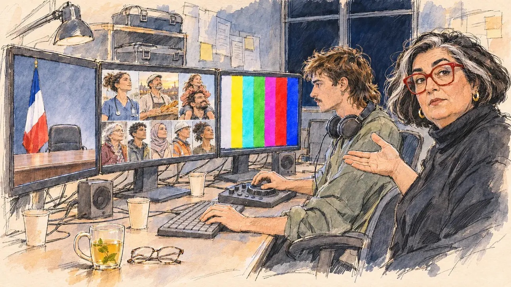

# `officialClip` · Le clip officiel

**Validée par le PO le 09/11/2026**, au premier essai. Elle sert telle quelle en clair et en sombre.



| Champ | Valeur |
| --- | --- |
| Carte | `officialClip`, catégorie `airtime` (Temps d'antenne), poids 0,6, du 5 au 16 avril 2027 |
| Style | Reportage dessiné |
| Ton | Gentiment ironique, tard le soir |
| Date | 2026-11-09 |
| Outil | ChatGPT Images, à compléter (modèle et effort) |
| Conversation | À compléter |
| Format rendu | 1672 × 941 (16:9) : export en 1290 × 726 px, WebP de qualité 75, 202 Ko, sans recadrage, fait depuis la copie WebP de la conversation (à refaire depuis le PNG d'origine) |
| Fichier d'origine | À compléter (hors du dépôt) |
| Première édition | À compléter |

## Texte de la carte

> **Le clip officiel**
>
> Les clips officiels de campagne passent ce soir sur les chaînes publiques, dans un ordre tiré au sort. Votre équipe vous propose trois versions.

## Le moment choisi

La petite salle de montage du QG, tard le soir, la veille de la diffusion, sans ville reconnaissable. Trois écrans montrent les trois versions : le clip classique (le bureau, le drapeau tricolore, le fauteuil vide), le clip émouvant (une mosaïque de visages du pays) et la fausse panne (une mire de barres de couleurs). Le candidat reste hors champ et n'apparaît sur aucun écran : sa tisane et ses lunettes au bord de la table. La réalisatrice montre les trois écrans et regarde le spectateur : laquelle ? Le jeune monteur attend, la main sur le clavier.

## Prompt complet

Dans une nouvelle conversation, avec [`primeTime.webp`](../../illustrations/media/primeTime.webp) comme seule image de référence :

```
Use the attached image as the style reference and copy its drawing: a realistic reportage drawing made on the spot for a newspaper, with quick, nervous pencil lines, often drawn twice, ink hatching in the shadows, transparent watercolour washes that spill a little over the lines, and the warm paper showing through. Not the same scene and not the same people: never reuse the face or the hair of the woman in the reference.
Like in the reference, the setting can be full when the story needs it, with the things that say where we are and what is happening, but each one is sketched with a few pencil lines and a light wash, never rendered or finished, and the drawing gets looser and paler towards the edges until it fades into the bare paper.
This must look like a drawing made by hand on paper by a press illustrator, halfway between a quick sketch and a realistic picture: never a photograph, a film poster or a digital painting, and never a cartoon, a comic strip, a caricature or a children's book illustration. Continuous lines, never dotted or dashed outlines; no uniform texture, speckles or hatching filter laid over the picture; no glossy highlights, no smooth gradients, in the sky and on the walls too. Colour can be rich in places, on a piece of clothing, a light or a flag, but it stays transparent and within the palette below. The fade into the paper at the edges stays narrow, without a wide white margin. No blur and no depth-of-field effect: everything, the foreground included, is drawn sharp, like a sketch made on the spot.
People are drawn from life with realistic anatomy and proportions, like in the reference: faces shaped with pencil lines, hatching and light washes, a little more finished than the background but never photographic (no photographic skin, no airbrushed or digital-painting look). Expressions stay natural and restrained, even in laughter or tears: no exaggerated grins, no wide-open mouths full of teeth, no rubbery or cartoonish faces.

Editorial illustration, landscape 16:9 (1536 × 864 px), the scene filling the frame, with only a light fade into the paper at the edges. The small editing room of a campaign headquarters, late at night in April 2027, on the eve of the broadcast of the official campaign clips: a long editing desk with a keyboard, a jog wheel, speakers, cables and empty coffee cups, three large monitors side by side, and a dark window with no recognisable city. The three monitors show the three versions of the clip: on the left, the classic version, a plain desk with a French tricolour flag and an empty chair, nobody in it; in the middle, the moving version, a mosaic of faces of the country, a nurse in her scrubs, a baker at dawn, a little girl on her father's shoulders; on the right, the fake-breakdown version, a television test card of vertical colour bars with no text. The player's candidate stays off-camera and appears on no screen: in the foreground, only a mug of herbal tea and a pair of glasses on the edge of the desk. In the right third, the campaign's video director, a heavy-set woman in her fifties of Armenian descent, with a thick black bob streaked with white and big red-framed glasses, a black turtleneck, points at the three screens with an open hand and looks at the viewer, which one, her face above mid-height. Next to her, the young editor, a slim white man in his twenties with a mullet, a wispy moustache and headphones around his neck, waits with one hand on the keyboard and the other on the jog wheel, his eyes on the screens. Only the director looks at the viewer. Nothing on the screens, the keyboard, the desk or the walls is readable.

Style: Reportage drawing made on the spot, like a press illustrator or courtroom sketch artist: pencil and ink with loose watercolour washes, lively unfinished lines, white paper showing through.

Palette: navy #13203F, vellum #F5EFE1, gold #A9802A, brick #B5523B, ochre #D9A441, sage #8FA58A, slate #5E7186, sand #DCC8A4, warm grey #8C8279; use 4 to 6 of them, subtle warm paper grain.

Tone: gently ironic, late night, the cool light of the three monitors on the faces, the bright stripes of the test card as the strongest colour of the picture.

Constraints: realistic proportions, natural expressions, never cartoonish or caricatured faces, drawn like the rest of the illustration and never photographic; people of varied ages, genders, origins and body types (heavy, stocky, round, tall, short, wiry, not only slim), each with a distinct face and haircut (no two people alike), drawn with respect and never as a joke; each person's age, build and look plausible for their job and the scene (working people of working age), no stereotype tying an origin or a gender to a role, and no person of colour shown alone in a featured service or deferential role; anatomically correct hands with exactly five fingers, few hands visible, the others in pockets, behind objects or out of frame; no readable text anywhere (the screens, the test card, the keyboard, the desk and the walls stay unreadable); no captions or speech bubbles; no logos, no television channel name or logo, no political party colours; the player's candidate appears on no screen, and the chair of the classic version stays empty; no recognisable real person, no lookalike of a real politician; no explicit violence; no photographic rendering, no blur or bokeh, no dotted outlines, no texture or hatching filter over the picture, no oil-paint texture, no glow or halo around the screens, no wide white margin or frame (a light fade into the paper at the edges is fine).

Format: if 16:9 is not available, make 1536 × 1024 and keep the top 80 px and the bottom 80 px free of anything important (faces, hands, the main action): they will be cropped.
```

## Décisions prises sur cette image

Validée telle quelle par le PO (09/11/2026). Les couleurs de la mire (cyan, magenta, vert) sortent de la palette : voulu, une mire n'existe pas sans elles, et le prompt en fait la couleur la plus forte de l'image. Les visages de la mosaïque sourient un peu plus franchement et sont plus finis que le reste : le ton d'un clip émouvant, dans un écran.

## Essais écartés

Aucun.

## Retouches

Aucune.

## Relecture

Faite et validée par le PO le 09/11/2026.

- [x] Aucun texte lisible : la mire n'a pas de texte, les papiers et post-it du mur ne portent que des traits, le clavier est vierge ; aucun nom ni logo de chaîne.
- [x] Aucun sosie d'une personne réelle, dans la mosaïque comprise.
- [x] Le candidat du joueur est hors champ et sur aucun écran : le fauteuil du clip classique est vide ; seules sa tisane et ses lunettes, au premier plan.
- [x] Mains et visages sans défaut visible à 343 px de large : la main ouverte de la réalisatrice (cinq doigts), celles du monteur sur le clavier et la molette.
- [x] Aucune couleur ni aucun logo de parti : le drapeau est tricolore. Des personnes variées par l'âge, le corps, l'origine et la coiffure, dans la salle et dans la mosaïque.
- [x] En 16:9 : pas de recadrage.
- [ ] Lisible sur la page de l'événement, en clair et en sombre : à vérifier dans l'app, une fois la carte publiée.
