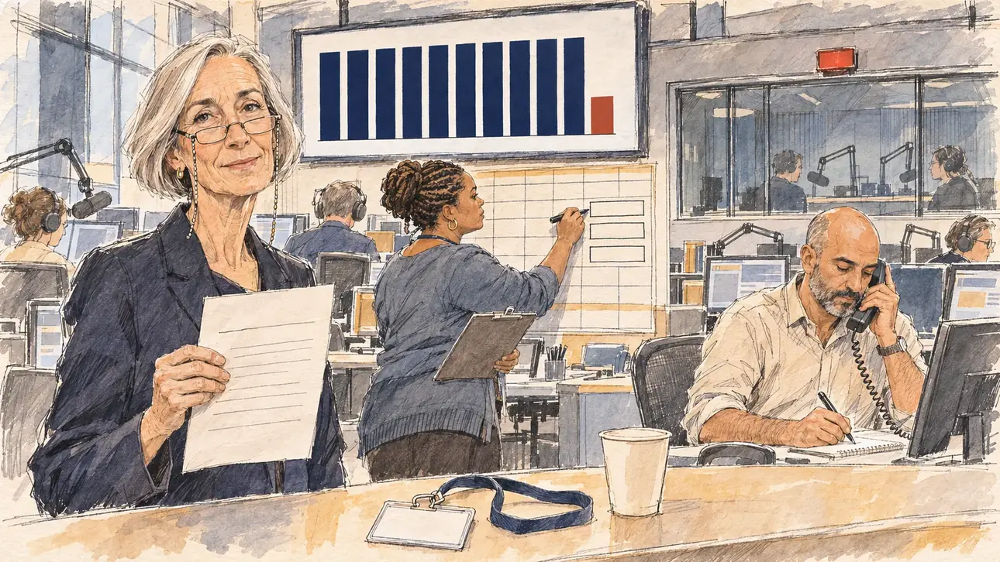

# `stationWarned` · Une radio rappelée à l'ordre

**Validée par le PO le 09/11/2026**, au premier essai. Elle sert telle quelle en clair et en sombre.



| Champ | Valeur |
| --- | --- |
| Carte | `stationWarned`, catégorie `airtime` (Temps d'antenne), poids 0,4, du 5 au 16 avril 2027 |
| Style | Reportage dessiné |
| Ton | Gentiment ironique |
| Date | 2026-11-09 |
| Outil | ChatGPT Images, à compléter (modèle et effort) |
| Conversation | À compléter |
| Format rendu | 1672 × 941 (16:9) : export en 1290 × 726 px, WebP de qualité 75, 173 Ko, sans recadrage, fait depuis la copie WebP de la conversation (à refaire depuis le PNG d'origine) |
| Fichier d'origine | À compléter (hors du dépôt) |
| Première édition | À compléter |

## Texte de la carte

> **Une radio rappelée à l'ordre**
>
> Le régulateur de l'audiovisuel met en demeure une grande radio : elle vous a donné moins de temps de parole qu'aux autres et doit rattraper son retard avant le premier tour.

## Le moment choisi

La rédaction d'une grande radio nationale, en fin de matinée, le jour de la mise en demeure, sans ville reconnaissable : sur un grand écran mural, un graphique du temps de parole, des barres bleu marine et une seule courte, rouge brique, sans nom ni chiffre. Le candidat reste hors champ, comme tout juste arrivé à la radio : un badge visiteur vierge et un gobelet sur le comptoir d'accueil. La directrice de la rédaction tient le courrier du régulateur et regarde le spectateur avec un sourire poli et un peu gêné : nous allons rattraper. Derrière elle, une programmatrice ajoute trois créneaux au planning ; un journaliste réserve une interview au téléphone.

## Prompt complet

Dans une nouvelle conversation, avec [`primeTime.webp`](../../illustrations/media/primeTime.webp) comme seule image de référence :

```
Use the attached image as the style reference and copy its drawing: a realistic reportage drawing made on the spot for a newspaper, with quick, nervous pencil lines, often drawn twice, ink hatching in the shadows, transparent watercolour washes that spill a little over the lines, and the warm paper showing through. Not the same scene and not the same people: never reuse the face or the hair of the woman in the reference.
Like in the reference, the setting can be full when the story needs it, with the things that say where we are and what is happening, but each one is sketched with a few pencil lines and a light wash, never rendered or finished, and the drawing gets looser and paler towards the edges until it fades into the bare paper.
This must look like a drawing made by hand on paper by a press illustrator, halfway between a quick sketch and a realistic picture: never a photograph, a film poster or a digital painting, and never a cartoon, a comic strip, a caricature or a children's book illustration. Continuous lines, never dotted or dashed outlines; no uniform texture, speckles or hatching filter laid over the picture; no glossy highlights, no smooth gradients, in the sky and on the walls too. Colour can be rich in places, on a piece of clothing, a light or a flag, but it stays transparent and within the palette below. The fade into the paper at the edges stays narrow, without a wide white margin. No blur and no depth-of-field effect: everything, the foreground included, is drawn sharp, like a sketch made on the spot.
People are drawn from life with realistic anatomy and proportions, like in the reference: faces shaped with pencil lines, hatching and light washes, a little more finished than the background but never photographic (no photographic skin, no airbrushed or digital-painting look). Expressions stay natural and restrained, even in laughter or tears: no exaggerated grins, no wide-open mouths full of teeth, no rubbery or cartoonish faces.

Editorial illustration, landscape 16:9 (1536 × 864 px), the scene filling the frame, with only a light fade into the paper at the edges. The open-plan newsroom of a big national radio station, late in the morning in April 2027, the day the broadcasting regulator orders it to make up the speaking time it owes the player before the first round: rows of desks with screens, headphones and microphones, a glass-walled studio at the back with its red on-air lamp, a dark window with no recognisable city. On a large wall screen, a simple bar chart of the candidates' speaking time: twelve bars of the same height except one clearly shorter, with no labels, numbers or names. The player's candidate stays off-camera, as if just arrived at the station: in the foreground, only a blank visitor badge on a lanyard lying on the reception counter, next to a paper cup. In the left third, the editor-in-chief, a tall, slim white woman in her sixties with a silver bob, reading glasses on a chain and a dark blazer, holds the regulator's formal letter in one hand and looks at the viewer with a slightly embarrassed, formal smile, we will make it up, her face above mid-height. Behind her, the programme scheduler, a stocky woman in her thirties of Cape Verdean descent, with braids gathered in a bun and a cardigan, adds three new slots to a wall planner with a marker; at a desk, a journalist in his forties of Moroccan descent, bald with a short grey beard and rolled-up sleeves, books an interview on the phone. Only the editor-in-chief looks at the viewer. Nothing on the letter, the badge, the planner, the screens or the chart is readable.

Style: Reportage drawing made on the spot, like a press illustrator or courtroom sketch artist: pencil and ink with loose watercolour washes, lively unfinished lines, white paper showing through.

Palette: navy #13203F, vellum #F5EFE1, gold #A9802A, brick #B5523B, ochre #D9A441, sage #8FA58A, slate #5E7186, sand #DCC8A4, warm grey #8C8279; use 4 to 6 of them, subtle warm paper grain.

Tone: gently ironic, late-morning daylight in the newsroom, the one short bar of the chart in brick red among the navy ones.

Constraints: realistic proportions, natural expressions, never cartoonish or caricatured faces, drawn like the rest of the illustration and never photographic; people of varied ages, genders, origins and body types (heavy, stocky, round, tall, short, wiry, not only slim), each with a distinct face and haircut (no two people alike), drawn with respect and never as a joke; each person's age, build and look plausible for their job and the scene (working people of working age), no stereotype tying an origin or a gender to a role, and no person of colour shown alone in a featured service or deferential role; anatomically correct hands with exactly five fingers, few hands visible, the others in pockets, behind objects or out of frame; no readable text anywhere (the letter, the badge, the planner, the screens, the on-air lamp and the chart stay unreadable, no names or numbers on the chart); no captions or speech bubbles; no logos, no radio station or regulator name or logo, no political party colours; no recognisable real person, no lookalike of a real politician or journalist; no explicit violence; no photographic rendering, no blur or bokeh, no dotted outlines, no texture or hatching filter over the picture, no oil-paint texture, no glow or halo around the lights or the screens, no wide white margin or frame (a light fade into the paper at the edges is fine).

Format: if 16:9 is not available, make 1536 × 1024 and keep the top 80 px and the bottom 80 px free of anything important (faces, hands, the main action): they will be cropped.
```

## Décisions prises sur cette image

Validée telle quelle par le PO (09/11/2026).

## Essais écartés

Aucun.

## Retouches

Aucune.

## Relecture

Faite et validée par le PO le 09/11/2026.

- [x] Aucun texte lisible : le courrier ne porte que des lignes, les écrans des aplats, le carnet des traits, le graphique ni nom ni chiffre, le voyant d'antenne pas de lettres ; aucun nom ni logo de station ou de régulateur.
- [x] Aucun sosie d'une personne réelle, journaliste compris.
- [x] Le candidat du joueur est hors champ : seuls le badge visiteur vierge et le gobelet, sur le comptoir.
- [x] Mains et visages sans défaut visible à 343 px de large : la main qui tient le courrier, celles du journaliste au téléphone et au stylo, celle de la programmatrice au feutre.
- [x] Aucune couleur ni aucun logo de parti. Des personnes variées par l'âge, le corps, l'origine et la coiffure.
- [x] En 16:9 : pas de recadrage.
- [ ] Lisible sur la page de l'événement, en clair et en sombre : à vérifier dans l'app, une fois la carte publiée.
