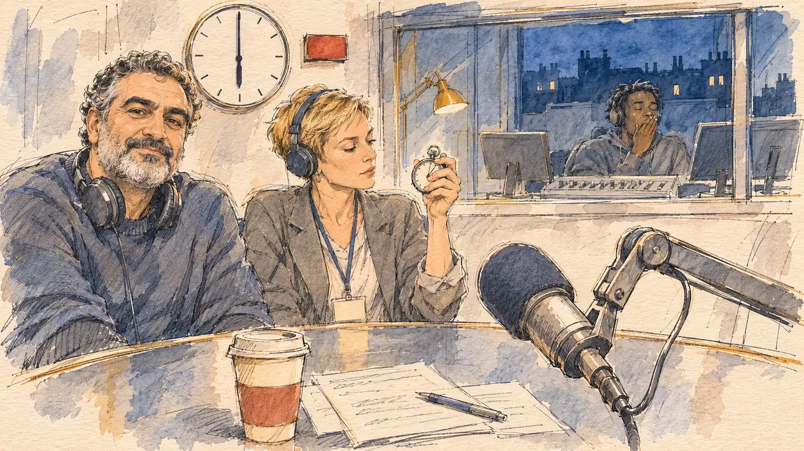

# `strictEquality` · L'égalité stricte

**Validée par le PO le 09/11/2026**, au premier essai. Elle sert telle quelle en clair et en sombre.



| Champ | Valeur |
| --- | --- |
| Carte | `strictEquality`, catégorie `airtime` (Temps d'antenne), poids 0,6, du 5 au 16 avril 2027 |
| Style | Reportage dessiné |
| Ton | Gentiment ironique, aube |
| Date | 2026-11-09 |
| Outil | ChatGPT Images, à compléter (modèle et effort) |
| Conversation | À compléter |
| Format rendu | 1672 × 941 (16:9) : export en 1290 × 726 px, WebP de qualité 75, 199 Ko, sans recadrage, fait depuis la copie WebP de la conversation (à refaire depuis le PNG d'origine) |
| Fichier d'origine | À compléter (hors du dépôt) |
| Première édition | À compléter |

## Texte de la carte

> **L'égalité stricte**
>
> La dernière ligne droite s'ouvre : radios et télévisions doivent donner à chaque candidature le même temps de parole. Une grande chaîne vous propose une tranche à six heures du matin.

## Le moment choisi

Un studio de radio nationale, à six heures du matin, en avril : par la fenêtre, la ville encore dans le bleu de l'aube. Le candidat reste hors champ : son gobelet de café, ses notes et le bras du micro tourné vers le spectateur. Le présentateur de la tranche matinale, casque autour du cou, regarde le spectateur avec un sourire ironique : six heures, c'est votre tranche ; la productrice tient un chronomètre, l'égalité du temps de parole se compte à la seconde ; derrière la vitre, le technicien bâille. L'horloge murale n'a que des traits, ses aiguilles sur six heures ; le voyant d'antenne est rouge, sans lettres. La première carte de la catégorie `airtime`.

## Prompt complet

Dans une nouvelle conversation, avec [`primeTime.webp`](../../illustrations/media/primeTime.webp) comme seule image de référence :

```
Use the attached image as the style reference and copy its drawing: a realistic reportage drawing made on the spot for a newspaper, with quick, nervous pencil lines, often drawn twice, ink hatching in the shadows, transparent watercolour washes that spill a little over the lines, and the warm paper showing through. Not the same scene and not the same people: never reuse the face or the hair of the woman in the reference.
Like in the reference, the setting can be full when the story needs it, with the things that say where we are and what is happening, but each one is sketched with a few pencil lines and a light wash, never rendered or finished, and the drawing gets looser and paler towards the edges until it fades into the bare paper.
This must look like a drawing made by hand on paper by a press illustrator, halfway between a quick sketch and a realistic picture: never a photograph, a film poster or a digital painting, and never a cartoon, a comic strip, a caricature or a children's book illustration. Continuous lines, never dotted or dashed outlines; no uniform texture, speckles or hatching filter laid over the picture; no glossy highlights, no smooth gradients, in the sky and on the walls too. Colour can be rich in places, on a piece of clothing, a light or a flag, but it stays transparent and within the palette below. The fade into the paper at the edges stays narrow, without a wide white margin. No blur and no depth-of-field effect: everything, the foreground included, is drawn sharp, like a sketch made on the spot.
People are drawn from life with realistic anatomy and proportions, like in the reference: faces shaped with pencil lines, hatching and light washes, a little more finished than the background but never photographic (no photographic skin, no airbrushed or digital-painting look). Expressions stay natural and restrained, even in laughter or tears: no exaggerated grins, no wide-open mouths full of teeth, no rubbery or cartoonish faces.

Editorial illustration, landscape 16:9 (1536 × 864 px), the scene filling the frame, with only a light fade into the paper at the edges. A national radio studio at six in the morning, in April 2027, during the last two weeks of the campaign when every candidate must get the same speaking time: a round studio table with microphones on articulated arms, headphones, a mixing desk behind a glass window, a plain wall clock with tick marks and no numbers, its hands at six o'clock, and a small red on-air lamp with no letters; through a window, the city's roofs still in the deep blue of dawn, with a few lit windows. The player's candidate stays off-camera: in the foreground, only a paper cup of coffee, a few pages of notes and the arm of a microphone turned towards the viewer. In the left third, the host of the early-morning slot, a broad-shouldered man in his fifties of Lebanese descent, with salt-and-pepper curly hair, a trimmed grey beard, headphones around his neck and a crumpled sweater, looks at the viewer with a gently ironic smile, six in the morning is your slot, his face above mid-height. Next to him, the producer, a short, energetic white woman in her thirties with a blond pixie cut and a lanyard, holds up a stopwatch, counting the speaking time to the second. Behind the glass, the sound technician, a lanky young man of Haitian descent with short twists and a hoodie, yawns behind his hand over the mixing desk. Only the host looks at the viewer. Nothing on the notes, the mixing desk, the screens, the lanyard or the walls is readable.

Style: Reportage drawing made on the spot, like a press illustrator or courtroom sketch artist: pencil and ink with loose watercolour washes, lively unfinished lines, white paper showing through.

Palette: navy #13203F, vellum #F5EFE1, gold #A9802A, brick #B5523B, ochre #D9A441, sage #8FA58A, slate #5E7186, sand #DCC8A4, warm grey #8C8279; use 4 to 6 of them, subtle warm paper grain.

Tone: gently ironic, the deep blue of dawn outside against the warm desk lamps of the studio and the small red dot of the on-air lamp.

Constraints: realistic proportions, natural expressions, never cartoonish or caricatured faces, drawn like the rest of the illustration and never photographic; people of varied ages, genders, origins and body types (heavy, stocky, round, tall, short, wiry, not only slim), each with a distinct face and haircut (no two people alike), drawn with respect and never as a joke; each person's age, build and look plausible for their job and the scene (working people of working age), no stereotype tying an origin or a gender to a role, and no person of colour shown alone in a featured service or deferential role; anatomically correct hands with exactly five fingers, few hands visible, the others in pockets, behind objects or out of frame; no readable text anywhere (the notes, the mixing desk, the screens, the lanyard, the on-air lamp and the walls stay unreadable, no numbers on the clock); no captions or speech bubbles; no logos, no radio station name or colours, no political party colours; no recognisable real person, no lookalike of a real politician or radio host; no explicit violence; no photographic rendering, no blur or bokeh, no dotted outlines, no texture or hatching filter over the picture, no oil-paint texture, no glow or halo around the lights, no wide white margin or frame (a light fade into the paper at the edges is fine).

Format: if 16:9 is not available, make 1536 × 1024 and keep the top 80 px and the bottom 80 px free of anything important (faces, hands, the main action): they will be cropped.
```

## Décisions prises sur cette image

Validée telle quelle par le PO (09/11/2026). La productrice porte un casque en plus du badge ; le cadran du chronomètre a de minuscules traits de graduation vers le haut, invisibles à la taille de la carte.

## Essais écartés

Aucun.

## Retouches

Aucune.

## Relecture

Faite et validée par le PO le 09/11/2026.

- [x] Aucun texte lisible : les notes ne portent que des gribouillis, l'horloge n'a pas de chiffres, le voyant d'antenne pas de lettres, la table de mixage et le badge sont vierges.
- [x] Aucun sosie d'une personne réelle, animateur radio compris ; aucun nom ni couleur de station.
- [x] Le candidat du joueur est hors champ : seuls son gobelet, ses notes et le micro tourné vers le spectateur.
- [x] Mains et visages sans défaut visible à 343 px de large : la main au chronomètre, celle du technicien devant sa bouche.
- [x] Aucune couleur ni aucun logo de parti. Des personnes variées par l'âge, le corps, l'origine et la coiffure.
- [x] En 16:9 : pas de recadrage.
- [ ] Lisible sur la page de l'événement, en clair et en sombre : à vérifier dans l'app, une fois la carte publiée.
