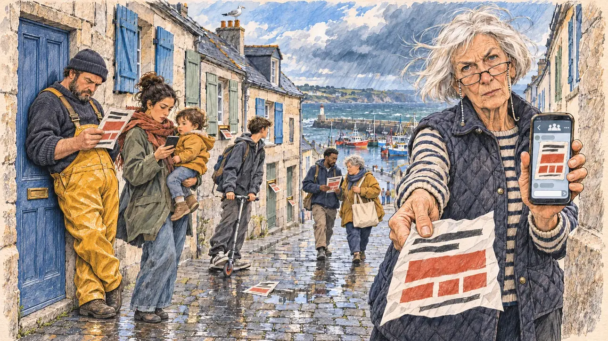

# `anonymousLeaflet` · Un tract anonyme sur votre programme

**Validée par le PO le 05/11/2026**, au premier essai, avec `primeTime.webp` comme référence. Elle sert telle quelle en clair et en sombre.



| Champ | Valeur |
| --- | --- |
| Carte | `anonymousLeaflet`, catégorie `attack` (Attaque), carte ajoutée par la PR #297 de l'app |
| Style | Reportage dessiné, trait de `primeTime` |
| Ton | Ironique et tendu |
| Date | 2026-11-05 |
| Outil | ChatGPT Images |
| Conversation | À remplir (le lien ne s'ouvre qu'avec le compte qui l'a créée) |
| Format rendu | 1671 × 941 (16:9) : export en 1290 × 726 px, WebP de qualité 75, 226 Ko, sans recadrage |
| Fichier d'origine | Image de ChatGPT, chez le PO. L'export du dépôt a été fait depuis la copie partagée dans la conversation avec Claude |
| Première édition | La prochaine Release qui suit le merge de la PR #297 de l'app |

## Texte de la carte

> **Un tract anonyme sur votre programme**
>
> Un tract sans signature circule dans les boîtes aux lettres et sur les messageries : il prête à votre programme des mesures que vous n'avez jamais proposées, chiffres fantaisistes à l'appui.

## Le moment choisi

Une rue en pente de Douarnenez, dans le Finistère, un matin de vent, vue depuis le pas de porte où le candidat (hors champ) fait du porte-à-porte : au premier plan, le seuil de granit et un paillasson mouillé. Une institutrice à la retraite tend au candidat le tract anonyme, chiffré en rouge, et de l'autre main son téléphone, où le même tract circule dans une messagerie. Autour : les voisins qui le lisent sur le pas de leur porte, le même tract qui dépasse des boîtes aux lettres et traîne dans une flaque, deux bénévoles du candidat qui font le porte-à-porte. Derrière : les maisons de granit aux toits d'ardoise et aux volets peints, une mouette sur une cheminée, et en bas le port et ses bateaux de pêche.

## Prompt complet

Dans une nouvelle conversation, avec [`primeTime.webp`](../../illustrations/media/primeTime.webp) comme seule image de référence.

```
Use the attached image as the style reference and copy its drawing: a realistic reportage drawing made on the spot for a newspaper, with quick, nervous pencil lines, often drawn twice, ink hatching in the shadows, transparent watercolour washes that spill a little over the lines, and the warm paper showing through. Not the same scene and not the same people: never reuse the face or the hair of the woman in the reference.
Like in the reference, the setting can be full when the story needs it, with the things that say where we are and what is happening, but each one is sketched with a few pencil lines and a light wash, never rendered or finished, and the drawing gets looser and paler towards the edges until it fades into the bare paper.
This must look like a drawing made by hand on paper by a press illustrator, halfway between a quick sketch and a realistic picture: never a photograph, a film poster or a digital painting, and never a cartoon, a comic strip, a caricature or a children's book illustration. Continuous lines, never dotted or dashed outlines; no uniform texture, speckles or hatching filter laid over the picture; no glossy highlights, no smooth gradients, in the sky and on the walls too. Colour can be rich in places, on a piece of clothing, a light or a flag, but it stays transparent and within the palette below. The fade into the paper at the edges stays narrow, without a wide white margin. No blur and no depth-of-field effect: everything, the foreground included, is drawn sharp, like a sketch made on the spot.
People are drawn from life with realistic anatomy and proportions, like in the reference: faces shaped with pencil lines, hatching and light washes, a little more finished than the background but never photographic (no photographic skin, no airbrushed or digital-painting look). Expressions stay natural and restrained, even in laughter or tears: no exaggerated grins, no wide-open mouths full of teeth, no rubbery or cartoonish faces.

Editorial illustration, landscape 16:9 (1536 × 864 px), the scene filling the frame, with only a light fade into the paper at the edges. A steep street of a fishing town in Finistère, in Brittany, Douarnenez, on a windy morning in early 2027: an unsigned leaflet is going round in letterboxes and on messaging apps, lending the player's candidate's programme measures the candidate never proposed, with fanciful figures to back them up. The scene is seen from the doorstep where the candidate, canvassing door to door, stands, who stays off-camera: in the foreground, only the granite doorstep and a wet doormat. In the right third, a retired schoolteacher in her seventies, tall and bony, with a white bob, glasses on a chain and a quilted vest over a striped jumper, holds out towards the viewer the cheap, crumpled leaflet, printed in black and red with big red blocks where the figures would be, and in her other hand her phone showing the same leaflet in a messaging group, with a sceptical, questioning look over her glasses, her face above mid-height. The leaflet has no face, no portrait and no photo of anyone, only shapes of headlines and red blocks. Around her, sketched in pencil and light washes: neighbours reading the same leaflet on their doorsteps: a fisherman in his forties, heavy-set, in yellow oilskin trousers and a wool cap, frowning at it; a young mother of Turkish origin with a toddler on her hip, looking at her phone; a lanky teenager on a scooter; the same leaflet sticking out of the letterboxes in the doors, and one lying in a puddle on the cobbles; further down the street, two volunteers of the candidate's team canvassing with a canvas bag, a young man of Haitian origin and a stocky woman in her fifties with short grey hair. Behind them, the steep street of grey granite houses with slate roofs and painted blue and green shutters, a seagull on a chimney, and at the bottom of the street the harbour with colourful fishing boats and the grey sea under a fast-moving sky with gusts of wind. Only the retired schoolteacher looks straight at the viewer. Nothing on the leaflet, the phone, the letterboxes, the canvas bag, the boats or the houses is readable, and no logo of a real company or messaging app appears.

Style: Reportage drawing made on the spot, like a press illustrator or courtroom sketch artist: pencil and ink with loose watercolour washes, lively unfinished lines, white paper showing through.

Palette: navy #13203F, vellum #F5EFE1, gold #A9802A, brick #B5523B, ochre #D9A441, sage #8FA58A, slate #5E7186, sand #DCC8A4, warm grey #8C8279; use 4 to 6 of them, subtle warm paper grain.

Tone: ironic and tense, the cold bright light of a windy Breton morning between two showers, the grey granite and slate, the red of the leaflet and the yellow oilskin as the bright patches.

Constraints: realistic proportions, natural expressions, never cartoonish or caricatured faces, drawn like the rest of the illustration and never photographic; people of varied ages, genders, origins and body types (heavy, stocky, round, tall, short, wiry, not only slim), each with a distinct face and haircut (no two people alike), drawn with respect and never as a joke; anatomically correct hands with exactly five fingers, few hands visible, the others in pockets, behind objects or out of frame; no readable text anywhere (the leaflet, the phone, the letterboxes, the canvas bag, the boats and the houses stay unreadable); no captions or speech bubbles; no logos or political party colours; no recognisable real person, no lookalike of a real politician, and no logo of a real company or messaging app; no explicit violence; no photographic rendering, no blur or bokeh, no dotted outlines, no texture or hatching filter over the picture, no oil-paint texture, no wide white margin or frame (a light fade into the paper at the edges is fine).

Format: if 16:9 is not available, make 1536 × 1024 and keep the top 80 px and the bottom 80 px free of anything important (faces, hands, the main action): they will be cropped.
```

## Décisions prises sur cette image

Aucune.

## Essais écartés

Aucun.

## Retouches

Aucune.

## Relecture

Faite et validée par le PO le 05/11/2026.

- [x] Aucun texte lisible : le tract n'a que des barres noires et des pavés rouges, la messagerie que des pictogrammes inventés (flèche, groupe, points) ; rien n'est lisible sur les boîtes aux lettres, le sac, les bateaux ni les maisons.
- [x] Aucun sosie d'une personne réelle.
- [x] Le candidat du joueur est hors champ.
- [x] Mains, visages et foules sans défaut visible à 343 px de large.
- [x] Aucune couleur ni aucun logo de parti. Des personnes variées par l'âge, le corps, l'origine et la coiffure.
- [x] En 3:2 : sans objet, l'image est en 16:9.
- [x] Lisible sur la page de l'événement, en clair et en sombre.

Ce que la relecture a accepté : au premier plan, les pavés mouillés à la place du seuil et du paillasson ; l'adolescent est sur une trottinette, et le pêcheur en salopette jaune ; le bénévole lit lui aussi le tract.
