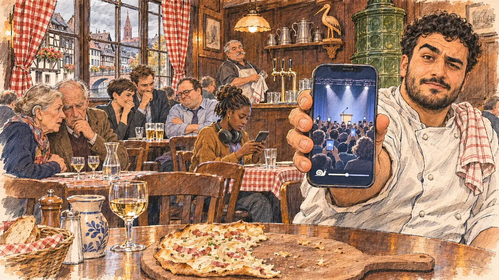

# `choppedVideo` · Une vidéo ralentie au montage

**Validée par le PO le 05/11/2026**, au premier essai, avec `primeTime.webp` comme référence. Elle sert telle quelle en clair et en sombre.



| Champ | Valeur |
| --- | --- |
| Carte | `choppedVideo`, catégorie `attack` (Attaque), carte ajoutée par la PR #297 de l'app |
| Style | Reportage dessiné, trait de `primeTime` |
| Ton | Ironique et tendu |
| Date | 2026-11-05 |
| Outil | ChatGPT Images |
| Conversation | À remplir (le lien ne s'ouvre qu'avec le compte qui l'a créée) |
| Format rendu | 1672 × 941 (16:9) : export en 1290 × 726 px, WebP de qualité 75, 253 Ko, sans recadrage |
| Fichier d'origine | Image de ChatGPT, chez le PO. L'export du dépôt a été fait depuis la copie partagée dans la conversation avec Claude |
| Première édition | La prochaine Release qui suit le merge de la PR #297 de l'app |

## Texte de la carte

> **Une vidéo ralentie au montage**
>
> Une vidéo de votre dernier meeting, ralentie et remontée, tourne sur les réseaux : votre voix y paraît pâteuse, vos phrases décousues, et certains se demandent si vous êtes en état de faire campagne.

## Le moment choisi

Une winstub de Strasbourg à l'heure du déjeuner, vue depuis la table où le candidat (hors champ) vient de s'asseoir pendant une visite : au premier plan, une tarte flambée entamée sur la table en bois. Un jeune cuisinier, torchon sur l'épaule, tend au candidat son téléphone : la vidéo ralentie du meeting ne montre que la scène de loin, un pupitre et un micro sous les projecteurs, l'orateur caché par les bras levés du public, et la barre de lecture. Autour : les clients penchés sur leurs propres téléphones, un vieux couple inquiet, des collègues de bureau qui se retiennent de rire, le patron derrière le comptoir. Derrière : les boiseries, les rideaux à carreaux rouges, un poêle en faïence, et par la fenêtre les maisons à colombages de la Petite France et la flèche de grès rose de la cathédrale.

## Prompt complet

Dans une nouvelle conversation, avec [`primeTime.webp`](../../illustrations/media/primeTime.webp) comme seule image de référence.

```
Use the attached image as the style reference and copy its drawing: a realistic reportage drawing made on the spot for a newspaper, with quick, nervous pencil lines, often drawn twice, ink hatching in the shadows, transparent watercolour washes that spill a little over the lines, and the warm paper showing through. Not the same scene and not the same people: never reuse the face or the hair of the woman in the reference.
Like in the reference, the setting can be full when the story needs it, with the things that say where we are and what is happening, but each one is sketched with a few pencil lines and a light wash, never rendered or finished, and the drawing gets looser and paler towards the edges until it fades into the bare paper.
This must look like a drawing made by hand on paper by a press illustrator, halfway between a quick sketch and a realistic picture: never a photograph, a film poster or a digital painting, and never a cartoon, a comic strip, a caricature or a children's book illustration. Continuous lines, never dotted or dashed outlines; no uniform texture, speckles or hatching filter laid over the picture; no glossy highlights, no smooth gradients, in the sky and on the walls too. Colour can be rich in places, on a piece of clothing, a light or a flag, but it stays transparent and within the palette below. The fade into the paper at the edges stays narrow, without a wide white margin. No blur and no depth-of-field effect: everything, the foreground included, is drawn sharp, like a sketch made on the spot.
People are drawn from life with realistic anatomy and proportions, like in the reference: faces shaped with pencil lines, hatching and light washes, a little more finished than the background but never photographic (no photographic skin, no airbrushed or digital-painting look). Expressions stay natural and restrained, even in laughter or tears: no exaggerated grins, no wide-open mouths full of teeth, no rubbery or cartoonish faces.

Editorial illustration, landscape 16:9 (1536 × 864 px), the scene filling the frame, with only a light fade into the paper at the edges. A winstub, a traditional wine tavern, in Strasbourg, in Alsace, at lunchtime on a grey weekday in early 2027: a video of the player's candidate's last rally, slowed down and re-edited, is going round on social media, the candidate's voice sounds slurred and the sentences disjointed, and some wonder whether the candidate is fit to campaign. The scene is seen from the table where the candidate has just sat down during a visit, who stays off-camera: in the foreground, only a half-eaten tarte flambée on a wooden board on the table. In the right third, a young cook in his twenties of Kurdish origin, stocky, with thick black eyebrows, short curly hair and a short beard, in a white cook's jacket with a tea towel over his shoulder, holds out his phone towards the viewer with an amused, doubtful look, one eyebrow raised, his face above mid-height. On the phone, the slowed-down video: the rally stage seen from far away at the back of the hall, a lectern and a microphone under the spotlights, the speaker completely hidden by the raised arms and phones of the audience in front, and at the bottom of the video a progress bar with a small snail icon; nobody is visible at the lectern, no silhouette, no hair, no clothes, nothing that shows a man or a woman. Around him, sketched in pencil and light washes: customers at the wooden tables leaning over their own phones: an elderly couple, the woman with a hearing aid leaning closer to hear, both looking worried; three office colleagues in their thirties, a woman with a pixie cut and a tall man in a jacket trying not to laugh, a round man with glasses shaking his head; a student of Malian origin with headphones round her neck watching it on her own phone; behind the counter, the heavy-set owner in his sixties with a grey moustache and an apron, drying a glass and looking up. The winstub: dark wood panelling, small red and white chequered curtains, a green tiled stove in the corner, pewter jugs and a carved wooden stork on a shelf, plain beer taps with no brand. Through the window, the half-timbered houses of the Petite France with their steep roofs and flower boxes, and above the roofs the single pink sandstone spire of Strasbourg cathedral under a grey sky. Only the young cook looks straight at the viewer. Nothing on the phones, the menus, the slate board, the bottles, the taps or the clothes is readable, and no logo of a real social network, brewery or company appears.

Style: Reportage drawing made on the spot, like a press illustrator or courtroom sketch artist: pencil and ink with loose watercolour washes, lively unfinished lines, white paper showing through.

Palette: navy #13203F, vellum #F5EFE1, gold #A9802A, brick #B5523B, ochre #D9A441, sage #8FA58A, slate #5E7186, sand #DCC8A4, warm grey #8C8279; use 4 to 6 of them, subtle warm paper grain.

Tone: ironic and tense, the warm amber light of the wood panelling, the cold blue glow of the phone screens on the faces, and the red of the chequered curtains as the bright patch.

Constraints: realistic proportions, natural expressions, never cartoonish or caricatured faces, drawn like the rest of the illustration and never photographic; people of varied ages, genders, origins and body types (heavy, stocky, round, tall, short, wiry, not only slim), each with a distinct face and haircut (no two people alike), drawn with respect and never as a joke; anatomically correct hands with exactly five fingers, few hands visible, the others in pockets, behind objects or out of frame; no readable text anywhere (the phones, the menus, the slate board, the bottles, the taps and the clothes stay unreadable); no captions or speech bubbles; no logos or political party colours; no recognisable real person, no lookalike of a real politician, and no logo of a real social network, brewery or company; no explicit violence; no photographic rendering, no blur or bokeh, no dotted outlines, no texture or hatching filter over the picture, no oil-paint texture, no wide white margin or frame (a light fade into the paper at the edges is fine).

Format: if 16:9 is not available, make 1536 × 1024 and keep the top 80 px and the bottom 80 px free of anything important (faces, hands, the main action): they will be cropped.
```

## Décisions prises sur cette image

Aucune.

## Essais écartés

Aucun.

## Retouches

Aucune.

## Relecture

Faite et validée par le PO le 05/11/2026.

- [x] Aucun texte lisible : la vidéo n'a qu'un escargot et une barre de lecture ; rien n'est lisible sur les téléphones, l'ardoise, les bouteilles, les tireuses (sans marque) ni les vêtements.
- [x] Aucun sosie d'une personne réelle.
- [x] Le candidat du joueur est hors champ.
- [x] Mains, visages et foules sans défaut visible à 343 px de large.
- [x] Aucune couleur ni aucun logo de parti. Des personnes variées par l'âge, le corps, l'origine et la coiffure.
- [x] En 3:2 : sans objet, l'image est en 16:9.
- [x] Lisible sur la page de l'événement, en clair et en sombre.

Ce que la relecture a accepté : le pupitre de la vidéo est vide ; sur les téléphones du public, dans la vidéo, une minuscule forme blanche, sans aucun indice de genre ; le cuisinier cligne d'un œil plutôt qu'il ne lève un sourcil.
