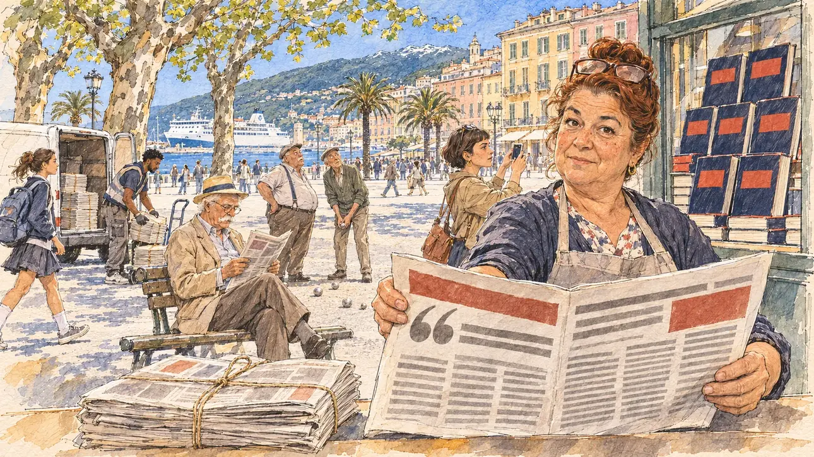

# `formerAideBook` · Un ancien collaborateur publie un livre

**À générer.** Prompt prêt le 05/11/2026, pas encore d'image validée.



| Champ | Valeur |
| --- | --- |
| Carte | `formerAideBook`, catégorie `attack` (Attaque), carte ajoutée par la PR #297 de l'app |
| Style | Reportage dessiné, trait de `primeTime` |
| Ton | Ironique et tendu |
| Date | À remplir |
| Outil | ChatGPT Images |
| Conversation | À remplir (le lien ne s'ouvre qu'avec le compte qui l'a créée) |
| Format rendu | À remplir |
| Fichier d'origine | À remplir |
| Première édition | À remplir |

## Texte de la carte

> **Un ancien collaborateur publie un livre**
>
> Un ancien collaborateur, parti en mauvais termes, publie un récit au vitriol de vos années de travail commun. Les extraits sont déjà dans la presse du matin.

## Le moment choisi

La place Saint-Nicolas, à Bastia, en Corse, un matin de fin mars, vue depuis le kiosque à journaux où le candidat (hors champ) s'arrête pendant une visite : au premier plan, une pile de journaux du matin encore ficelée sur le comptoir du kiosque. La marchande de journaux tend au candidat le journal ouvert sur la double page des extraits ; derrière elle, le livre de l'ancien collaborateur empilé en vitrine. Autour : un retraité qui lit les extraits sur un banc, une femme qui photographie la vitrine, un livreur qui décharge les paquets de journaux, des joueurs de boules qui lèvent la tête. Derrière : les palmiers et les platanes de la place, le port et un ferry blanc, les hautes façades ocre aux volets verts et la montagne enneigée derrière la ville.

## Prompt complet

Dans une nouvelle conversation, avec [`primeTime.webp`](../../illustrations/media/primeTime.webp) comme seule image de référence.

```
Use the attached image as the style reference and copy its drawing: a realistic reportage drawing made on the spot for a newspaper, with quick, nervous pencil lines, often drawn twice, ink hatching in the shadows, transparent watercolour washes that spill a little over the lines, and the warm paper showing through. Not the same scene and not the same people: never reuse the face or the hair of the woman in the reference.
Like in the reference, the setting can be full when the story needs it, with the things that say where we are and what is happening, but each one is sketched with a few pencil lines and a light wash, never rendered or finished, and the drawing gets looser and paler towards the edges until it fades into the bare paper.
This must look like a drawing made by hand on paper by a press illustrator, halfway between a quick sketch and a realistic picture: never a photograph, a film poster or a digital painting, and never a cartoon, a comic strip, a caricature or a children's book illustration. Continuous lines, never dotted or dashed outlines; no uniform texture, speckles or hatching filter laid over the picture; no glossy highlights, no smooth gradients, in the sky and on the walls too. Colour can be rich in places, on a piece of clothing, a light or a flag, but it stays transparent and within the palette below. The fade into the paper at the edges stays narrow, without a wide white margin. No blur and no depth-of-field effect: everything, the foreground included, is drawn sharp, like a sketch made on the spot.
People are drawn from life with realistic anatomy and proportions, like in the reference: faces shaped with pencil lines, hatching and light washes, a little more finished than the background but never photographic (no photographic skin, no airbrushed or digital-painting look). Expressions stay natural and restrained, even in laughter or tears: no exaggerated grins, no wide-open mouths full of teeth, no rubbery or cartoonish faces.

Editorial illustration, landscape 16:9 (1536 × 864 px), the scene filling the frame, with only a light fade into the paper at the edges. The place Saint-Nicolas in Bastia, in Corsica, on a bright morning at the end of March 2027, during the official campaign: a former aide of the player's candidate, who left on bad terms, has published a scathing account of their years of working together, and the extracts are already in the morning papers. The scene is seen from the newspaper kiosk where the candidate stops during a visit, who stays off-camera: in the foreground, only a stack of morning newspapers still tied with string on the counter of the kiosk. In the right third, the newsagent, a woman in her fifties of Portuguese origin, short and round, with dyed auburn hair in a bun and reading glasses pushed up on her head, holds out towards the viewer the morning paper folded open on the double page of extracts, with a curious, slightly embarrassed look, her face above mid-height. The double page shows only big headline shapes, a large quotation mark and columns of grey lines, with no photo and no face. Behind her, in the window of the kiosk, the book piled up in a tower: a dark cover with a big red typographic block, no readable title, no photo and no face. Around her, sketched in pencil and light washes: a tall retired man in a linen jacket with a white moustache reading the extracts on a bench under the plane trees; a woman in her thirties with a short fringe photographing the window display with her phone; a young delivery driver of Cape Verdean origin, wiry, unloading bundles of newspapers from a small van; two old men playing pétanque on the gravel of the square, a heavy one in braces and a thin one in a cardigan, looking up from their game; a schoolgirl with a big backpack. Behind them, the wide square with its palm trees and its plane trees in young leaf, a big white ferry at the quay of the port, the blue sea, the tall ochre and pink façades of Bastia with their green shutters, and behind the town the mountain with a few patches of snow on its peaks. Only the newsagent looks straight at the viewer. Nothing on the book, the newspapers, the kiosk, the van, the ferry or the shop fronts is readable, and no logo of a real newspaper, publisher or ferry company appears.

Style: Reportage drawing made on the spot, like a press illustrator or courtroom sketch artist: pencil and ink with loose watercolour washes, lively unfinished lines, white paper showing through.

Palette: navy #13203F, vellum #F5EFE1, gold #A9802A, brick #B5523B, ochre #D9A441, sage #8FA58A, slate #5E7186, sand #DCC8A4, warm grey #8C8279; use 4 to 6 of them, subtle warm paper grain.

Tone: ironic and tense, the bright, clear spring light of a Mediterranean morning, the blue sea and the ochre façades, and the red block of the book cover as the loudest note.

Constraints: realistic proportions, natural expressions, never cartoonish or caricatured faces, drawn like the rest of the illustration and never photographic; people of varied ages, genders, origins and body types (heavy, stocky, round, tall, short, wiry, not only slim), each with a distinct face and haircut (no two people alike), drawn with respect and never as a joke; anatomically correct hands with exactly five fingers, few hands visible, the others in pockets, behind objects or out of frame; no readable text anywhere (the book, the newspapers, the kiosk, the van, the ferry and the shop fronts stay unreadable); no captions or speech bubbles; no logos or political party colours; no recognisable real person, no lookalike of a real politician, and no logo of a real newspaper, publisher or ferry company; no explicit violence; no photographic rendering, no blur or bokeh, no dotted outlines, no texture or hatching filter over the picture, no oil-paint texture, no wide white margin or frame (a light fade into the paper at the edges is fine).

Format: if 16:9 is not available, make 1536 × 1024 and keep the top 80 px and the bottom 80 px free of anything important (faces, hands, the main action): they will be cropped.
```

## Décisions prises sur cette image

Aucune pour l'instant.

## Essais écartés

Aucun pour l'instant.

## Retouches

Aucune.

## Relecture

À faire sur l'image validée.
