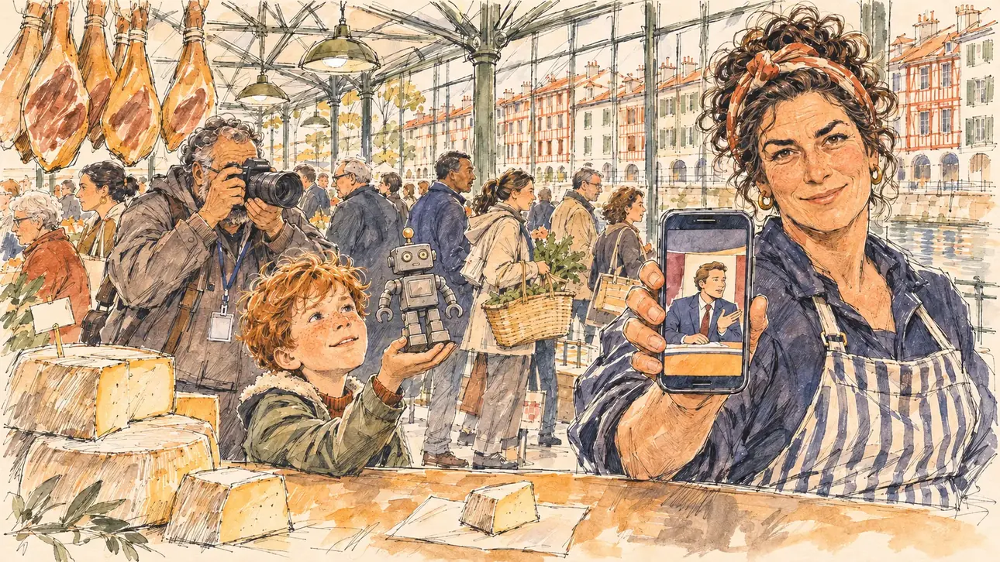

# `heartlessRobot` · Un robot sans cœur

**Validée par le PO le 10/11/2026**, au premier essai. Elle sert telle quelle en clair et en sombre.



| Champ | Valeur |
| --- | --- |
| Carte | `heartlessRobot`, catégorie `attack` (Attaque), poids 0,2 (0,45 dans les deux premiers du sondage), toute semaine ; un pari gagné sur une faiblesse (laisser parler l'émotion, sur un sang-froid bas) |
| Style | Reportage dessiné |
| Ton | Taquin, une pointe de cruauté, matin de marché |
| Date | 2026-11-10 |
| Outil | ChatGPT Images, à compléter (modèle et effort) |
| Conversation | À compléter |
| Format rendu | 1672 × 941 (16:9) : export en 1290 × 726 px, WebP de qualité 75, 250 Ko, sans recadrage, fait depuis la copie WebP de la conversation (à refaire depuis le PNG d'origine) |
| Fichier d'origine | À compléter (hors du dépôt) |
| Première édition | À compléter |

## Texte de la carte

> **Un robot sans cœur**
>
> En direct, le porte-parole d'une campagne adverse vous traite de « robot sans cœur, incapable de la moindre émotion ». La formule tourne sur toutes les chaînes.

## Le moment choisi

Les halles de Bayonne, au bord de la Nive, un samedi matin de mars, pendant une visite de marché : Bayonne n'avait encore servi à aucune carte. Le candidat reste hors champ, devant un étal : le morceau de fromage de brebis que la fromagère lui tend à goûter, sur un papier. Elle tend aussi son téléphone, où tourne l'extrait du porte-parole, et regarde le spectateur, taquine et curieuse : alors, robot ? Un petit garçon brandit un robot jouet et attend la réaction ; un photographe de presse guette l'expression du candidat. Des jambons pendent au-dessus de l'étal ; par les baies, les maisons à colombages rouges et vertes au bord de la rivière.

## Prompt complet

Dans une nouvelle conversation, avec [`primeTime.webp`](../../illustrations/media/primeTime.webp) comme seule image de référence :

```
Use the attached image as the style reference and copy its drawing: a realistic reportage drawing made on the spot for a newspaper, with quick, nervous pencil lines, often drawn twice, ink hatching in the shadows, transparent watercolour washes that spill a little over the lines, and the warm paper showing through. Not the same scene and not the same people: never reuse the face or the hair of the woman in the reference.
Like in the reference, the setting can be full when the story needs it, with the things that say where we are and what is happening, but each one is sketched with a few pencil lines and a light wash, never rendered or finished, and the drawing gets looser and paler towards the edges until it fades into the bare paper.
This must look like a drawing made by hand on paper by a press illustrator, halfway between a quick sketch and a realistic picture: never a photograph, a film poster or a digital painting, and never a cartoon, a comic strip, a caricature or a children's book illustration. Continuous lines, never dotted or dashed outlines; no uniform texture, speckles or hatching filter laid over the picture; no glossy highlights, no smooth gradients, in the sky and on the walls too. Colour can be rich in places, on a piece of clothing, a light or a flag, but it stays transparent and within the palette below. The fade into the paper at the edges stays narrow, without a wide white margin. No blur and no depth-of-field effect: everything, the foreground included, is drawn sharp, like a sketch made on the spot.
People are drawn from life with realistic anatomy and proportions, like in the reference: faces shaped with pencil lines, hatching and light washes, a little more finished than the background but never photographic (no photographic skin, no airbrushed or digital-painting look). Expressions stay natural and restrained, even in laughter or tears: no exaggerated grins, no wide-open mouths full of teeth, no rubbery or cartoonish faces.

Editorial illustration, landscape 16:9 (1536 × 864 px), the scene filling the frame, with only a light fade into the paper at the edges. The covered market of Bayonne, by the river Nive, on a Saturday morning in March 2027, during the player's candidate's market visit, the day after a rival's spokesperson called the candidate, live on air, a heartless robot incapable of the slightest emotion: market stalls, cured hams hanging above a counter, wheels of sheep's cheese, crowds with baskets, and through the large windows of the market hall the tall half-timbered houses with red and green shutters along the river. The player's candidate stays off-camera, in front of a cheese stall: in the foreground, only a small piece of sheep's cheese held out on a square of paper on the counter, for the candidate to taste. In the right third, the cheesemonger, a tall, broad-shouldered woman in her forties with dark curly hair tied up in a scarf and a striped apron, also holds out her phone, on which a clip plays: a tiny fictional spokesperson on a television set, no recognisable face; she looks at the viewer with a teasing, curious half-smile, so, robot?, her face above mid-height. Next to the stall, a little boy of six with a mop of red hair holds up a small toy robot towards the viewer, waiting for the reaction; just behind, a press photographer in his fifties, heavy-set, of Moroccan descent, with a grey beard, his camera raised, waits for the candidate's expression. Only the cheesemonger looks at the viewer. Nothing on the phone, the stalls, the price tags, the camera or the windows is readable.

Style: Reportage drawing made on the spot, like a press illustrator or courtroom sketch artist: pencil and ink with loose watercolour washes, lively unfinished lines, white paper showing through.

Palette: navy #13203F, vellum #F5EFE1, gold #A9802A, brick #B5523B, ochre #D9A441, sage #8FA58A, slate #5E7186, sand #DCC8A4, warm grey #8C8279; use 4 to 6 of them, subtle warm paper grain.

Tone: teasing with a touch of cruelty, the warm, busy light of a market morning, the red and green shutters behind and the small grey toy robot as the joke of the picture.

Constraints: realistic proportions, natural expressions, never cartoonish or caricatured faces, drawn like the rest of the illustration and never photographic; people of varied ages, genders, origins and body types (heavy, stocky, round, tall, short, wiry, not only slim), each with a distinct face and haircut (no two people alike), drawn with respect and never as a joke; each person's age, build and look plausible for their job and the scene (working people of working age), no stereotype tying an origin or a gender to a role, and no person of colour shown alone in a featured service or deferential role; no folklore costume, no beret; anatomically correct hands with exactly five fingers, few hands visible, the others in pockets, behind objects or out of frame; no readable text anywhere (the phone, the stalls, the price tags, the camera and the windows stay unreadable, no prices, no names); no captions or speech bubbles; no logos, no brand or television channel logo, no political party colours; no recognisable real person, no lookalike of a real politician or spokesperson; no explicit violence; no photographic rendering, no blur or bokeh, every outline a continuous pencil or ink line with no dotted or dashed outlines, no mottled, crackled or speckled texture over the faces, the clothes or the walls, no hatching filter over the picture, no oil-paint texture, no glow or halo around the windows or the phone, no wide white margin or frame (a light fade into the paper at the edges is fine).

Format: if 16:9 is not available, make 1536 × 1024 and keep the top 80 px and the bottom 80 px free of anything important (faces, hands, the main action): they will be cropped.
```

## Décisions prises sur cette image

Validée telle quelle par le PO (10/11/2026). Le porte-parole, sur le téléphone, est plus net que demandé (un jeune homme châtain en costume bleu, cravate rouge), mais son visage est générique et ne fait que quelques pixels à la taille de la carte ; sur le dessus de l'appareil photo, quelques lettres blanches illisibles évoquent une marque : gardés.

## Essais écartés

Aucun.

## Retouches

Aucune.

## Relecture

Faite et validée par le PO le 10/11/2026.

- [x] Aucun texte lisible : ni sur le téléphone, ni sur les étals ou les étiquettes de prix, ni sur le badge du photographe (voir les décisions pour l'appareil photo).
- [x] Aucun sosie d'une personne réelle ; ni béret ni costume folklorique.
- [x] Le candidat du joueur est hors champ : seul le morceau de fromage qu'on lui tend, au premier plan.
- [x] Mains et visages sans défaut visible à 343 px de large : la main au téléphone, celle de l'enfant sous le robot, celles du photographe sur l'appareil.
- [x] Aucune couleur ni aucun logo de parti. Des personnes variées par l'âge, le corps, l'origine et la coiffure.
- [x] En 16:9 : pas de recadrage.
- [ ] Lisible sur la page de l'événement, en clair et en sombre : à vérifier dans l'app, une fois la carte publiée.
