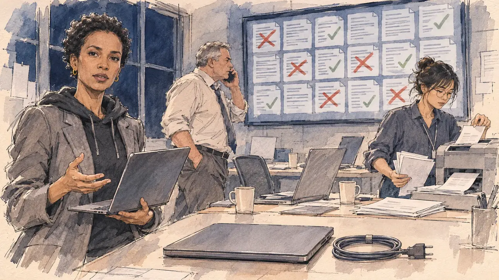

# `leakedMails` · Vos courriels dans la nature

**Validée par le PO le 10/11/2026**, au premier essai. Elle sert telle quelle en clair et en sombre.



| Champ | Valeur |
| --- | --- |
| Carte | `leakedMails`, catégorie `attack` (Attaque), poids 0,2 (0,45 dans les deux premiers du sondage), en campagne officielle |
| Style | Reportage dessiné |
| Ton | Tendu, tard le soir |
| Date | 2026-11-10 |
| Outil | ChatGPT Images, à compléter (modèle et effort) |
| Conversation | À compléter |
| Format rendu | 1672 × 941 (16:9) : export en 1290 × 726 px, WebP de qualité 75, 161 Ko, sans recadrage, fait depuis la copie WebP de la conversation (à refaire depuis le PNG d'origine) |
| Fichier d'origine | À compléter (hors du dépôt) |
| Première édition | À compléter |

## Texte de la carte

> **Vos courriels dans la nature**
>
> Des milliers de courriels internes de votre QG sont publiés en ligne, mêlés à de faux documents. L'autorité de contrôle de l'élection demande aux médias de ne pas relayer les faux.

## Le moment choisi

Le QG de campagne la nuit, en terrain neutre, devenu cellule de crise : sur un grand écran, une grille de pages de courriels en lignes grises, barrées de croix rouges ou cochées en vert, le tri du vrai et du faux. Le candidat reste hors champ : son propre ordinateur, refermé et débranché, par précaution, le câble enroulé à côté. La responsable de la sécurité informatique, l'ordinateur ouvert sur le bras, regarde le spectateur, concentrée : ils ont glissé des faux au milieu. L'avocat de la campagne parle au téléphone, une jeune collaboratrice récupère les pages à l'imprimante. [`leakedChat`](../team/leakedChat.md) se passe dans un café ; celle-ci reste au QG.

## Prompt complet

Dans une nouvelle conversation, avec [`primeTime.webp`](../../illustrations/media/primeTime.webp) comme seule image de référence :

```
Use the attached image as the style reference and copy its drawing: a realistic reportage drawing made on the spot for a newspaper, with quick, nervous pencil lines, often drawn twice, ink hatching in the shadows, transparent watercolour washes that spill a little over the lines, and the warm paper showing through. Not the same scene and not the same people: never reuse the face or the hair of the woman in the reference.
Like in the reference, the setting can be full when the story needs it, with the things that say where we are and what is happening, but each one is sketched with a few pencil lines and a light wash, never rendered or finished, and the drawing gets looser and paler towards the edges until it fades into the bare paper.
This must look like a drawing made by hand on paper by a press illustrator, halfway between a quick sketch and a realistic picture: never a photograph, a film poster or a digital painting, and never a cartoon, a comic strip, a caricature or a children's book illustration. Continuous lines, never dotted or dashed outlines; no uniform texture, speckles or hatching filter laid over the picture; no glossy highlights, no smooth gradients, in the sky and on the walls too. Colour can be rich in places, on a piece of clothing, a light or a flag, but it stays transparent and within the palette below. The fade into the paper at the edges stays narrow, without a wide white margin. No blur and no depth-of-field effect: everything, the foreground included, is drawn sharp, like a sketch made on the spot.
People are drawn from life with realistic anatomy and proportions, like in the reference: faces shaped with pencil lines, hatching and light washes, a little more finished than the background but never photographic (no photographic skin, no airbrushed or digital-painting look). Expressions stay natural and restrained, even in laughter or tears: no exaggerated grins, no wide-open mouths full of teeth, no rubbery or cartoonish faces.

Editorial illustration, landscape 16:9 (1536 × 864 px), the scene filling the frame, with only a light fade into the paper at the edges. The player's campaign headquarters in an ordinary French city, late at night in April 2027, turned into a crisis room after thousands of its internal emails were published online, mixed with fake documents: desks pushed together, laptops, coffee cups, a printer spitting pages, a dark window with no recognisable city. On a large wall screen, a grid of email pages shown as grey blocks of unreadable lines, some crossed with a red stroke, others ticked in green: the sorting of the real from the fake. The player's candidate stays off-camera: in the foreground, only the candidate's own laptop, closed and unplugged, its cable coiled beside it, a precaution. In the left third, the campaign's head of IT security, a slim woman in her thirties of Ethiopian descent, with short natural hair, small gold earrings, a black hoodie under a grey blazer and a laptop open on her arm, looks at the viewer, focused and calm, they slipped fakes in, her face above mid-height. Behind her, the campaign's lawyer, a stocky white man in his fifties with a grey crew cut and a loosened tie, speaks on the phone, pacing; at the printer, a young staffer of Vietnamese descent with a messy fringe and round glasses gathers printed pages. Only the head of IT security looks at the viewer. Nothing on the screen, the laptops, the printed pages or the walls is readable.

Style: Reportage drawing made on the spot, like a press illustrator or courtroom sketch artist: pencil and ink with loose watercolour washes, lively unfinished lines, white paper showing through.

Palette: navy #13203F, vellum #F5EFE1, gold #A9802A, brick #B5523B, ochre #D9A441, sage #8FA58A, slate #5E7186, sand #DCC8A4, warm grey #8C8279; use 4 to 6 of them, subtle warm paper grain.

Tone: tense, late night, the cold light of the screens on the faces, the red strokes and green ticks as the only bright colours.

Constraints: realistic proportions, natural expressions, never cartoonish or caricatured faces, drawn like the rest of the illustration and never photographic; people of varied ages, genders, origins and body types (heavy, stocky, round, tall, short, wiry, not only slim), each with a distinct face and haircut (no two people alike), drawn with respect and never as a joke; each person's age, build and look plausible for their job and the scene (working people of working age), no stereotype tying an origin or a gender to a role, and no person of colour shown alone in a featured service or deferential role; anatomically correct hands with exactly five fingers, few hands visible, the others in pockets, behind objects or out of frame; no readable text anywhere (the screen, the laptops, the printed pages and the walls stay unreadable, no email addresses, no words); no captions or speech bubbles; no logos, no political party colours; no hooded hacker cliché, no skulls or code rain on the screens; no recognisable real person, no lookalike of a real politician; no explicit violence; no photographic rendering, no blur or bokeh, no dotted outlines, no texture or hatching filter over the picture, no oil-paint texture, no glow or halo around the screens, no wide white margin or frame (a light fade into the paper at the edges is fine).

Format: if 16:9 is not available, make 1536 × 1024 and keep the top 80 px and the bottom 80 px free of anything important (faces, hands, the main action): they will be cropped.
```

## Décisions prises sur cette image

Validée telle quelle par le PO (10/11/2026). Le jeune collaborateur demandé à l'imprimante est devenu une jeune collaboratrice : gardé.

## Essais écartés

Aucun.

## Retouches

Aucune.

## Relecture

Faite et validée par le PO le 10/11/2026.

- [x] Aucun texte lisible : les pages de l'écran et de l'imprimante n'ont que des lignes, les ordinateurs sont vierges ; aucun cliché de pirate.
- [x] Aucun sosie d'une personne réelle.
- [x] Le candidat du joueur est hors champ : seuls son ordinateur refermé et son câble débranché, au premier plan.
- [x] Mains et visages sans défaut visible à 343 px de large : la main ouverte de la responsable (cinq doigts), celle qui tient l'ordinateur, la main au téléphone, celles qui prennent les pages.
- [x] Aucune couleur ni aucun logo de parti. Des personnes variées par l'âge, le corps, l'origine et la coiffure.
- [x] En 16:9 : pas de recadrage.
- [ ] Lisible sur la page de l'événement, en clair et en sombre : à vérifier dans l'app, une fois la carte publiée.
