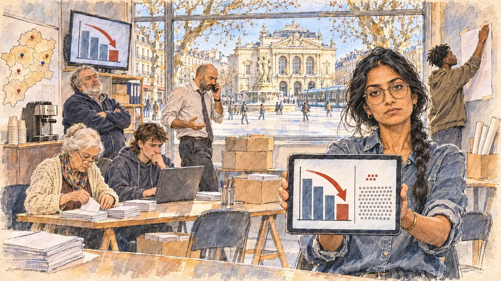

# `ordersPoll` · Un sondage commandé pour vous nuire

**Validée par le PO le 05/11/2026**, au premier essai, avec `primeTime.webp` comme référence. Elle sert telle quelle en clair et en sombre.



| Champ | Valeur |
| --- | --- |
| Carte | `ordersPoll`, catégorie `attack` (Attaque), carte ajoutée par la PR #297 de l'app |
| Style | Reportage dessiné, trait de `primeTime` |
| Ton | Ironique et tendu |
| Date | 2026-11-05 |
| Outil | ChatGPT Images |
| Conversation | À remplir (le lien ne s'ouvre qu'avec le compte qui l'a créée) |
| Format rendu | 1672 × 941 (16:9) : export en 1290 × 726 px, WebP de qualité 75, 229 Ko, sans recadrage |
| Fichier d'origine | Image de ChatGPT, chez le PO. L'export du dépôt a été fait depuis la copie partagée dans la conversation avec Claude |
| Première édition | La prochaine Release qui suit le merge de la PR #297 de l'app |

## Texte de la carte

> **Un sondage commandé pour vous nuire**
>
> Un institut inconnu publie un sondage commandé par un collectif anonyme : question orientée, échantillon minuscule, mais le titre vous donne en recul de dix points.

## Le moment choisi

La permanence de campagne du candidat à Montpellier, en fin de matinée, vue depuis la porte où le candidat (hors champ) arrive : au premier plan, une pile de tracts sur une table. La sondeuse de l'équipe tend au candidat une tablette : le titre du sondage, une barre qui chute et une flèche rouge, et à côté l'échantillon réduit à une poignée de points devant un grand champ de points gris. Autour : un porte-parole au téléphone qui fait les cent pas, une bénévole âgée qui plie des tracts, un stagiaire inquiet devant son ordinateur, un militant qui fait la moue, une carte du département piquée d'épingles. Par la vitrine : la place de la Comédie, l'opéra à la façade crème, la fontaine des Trois Grâces, les platanes et un tramway.

## Prompt complet

Dans une nouvelle conversation, avec [`primeTime.webp`](../../illustrations/media/primeTime.webp) comme seule image de référence.

```
Use the attached image as the style reference and copy its drawing: a realistic reportage drawing made on the spot for a newspaper, with quick, nervous pencil lines, often drawn twice, ink hatching in the shadows, transparent watercolour washes that spill a little over the lines, and the warm paper showing through. Not the same scene and not the same people: never reuse the face or the hair of the woman in the reference.
Like in the reference, the setting can be full when the story needs it, with the things that say where we are and what is happening, but each one is sketched with a few pencil lines and a light wash, never rendered or finished, and the drawing gets looser and paler towards the edges until it fades into the bare paper.
This must look like a drawing made by hand on paper by a press illustrator, halfway between a quick sketch and a realistic picture: never a photograph, a film poster or a digital painting, and never a cartoon, a comic strip, a caricature or a children's book illustration. Continuous lines, never dotted or dashed outlines; no uniform texture, speckles or hatching filter laid over the picture; no glossy highlights, no smooth gradients, in the sky and on the walls too. Colour can be rich in places, on a piece of clothing, a light or a flag, but it stays transparent and within the palette below. The fade into the paper at the edges stays narrow, without a wide white margin. No blur and no depth-of-field effect: everything, the foreground included, is drawn sharp, like a sketch made on the spot.
People are drawn from life with realistic anatomy and proportions, like in the reference: faces shaped with pencil lines, hatching and light washes, a little more finished than the background but never photographic (no photographic skin, no airbrushed or digital-painting look). Expressions stay natural and restrained, even in laughter or tears: no exaggerated grins, no wide-open mouths full of teeth, no rubbery or cartoonish faces.

Editorial illustration, landscape 16:9 (1536 × 864 px), the scene filling the frame, with only a light fade into the paper at the edges. The local campaign office of the player's candidate in Montpellier, in the South, at the end of a bright morning in early 2027: an unknown polling institute has published a poll commissioned by an anonymous collective, with a loaded question and a tiny sample, but the headline puts the candidate ten points down. The scene is seen from the door where the candidate arrives, who stays off-camera: in the foreground, only a stack of leaflets on the edge of a trestle table. In the right third, the team's pollster, a woman in her late twenties of Indian origin, slim, with long black hair in a loose plait, big round glasses and a denim shirt with rolled-up sleeves, holds out a tablet towards the viewer with a dry, unimpressed look, her face above mid-height. On the tablet: a big bar chart with one bar dropping and a red arrow pointing down, and beside it the sample shown as a tiny cluster of a few dots next to a huge grey field of dots, with no readable word or figure. Around her, sketched in pencil and light washes: a spokesman in his forties of Lebanese origin, tall, with a shaved head and a loosened tie, pacing on the phone; an elderly volunteer with a white bun and a cardigan folding leaflets at the table, peering over her glasses; a young intern with a mullet and a hoodie, worried in front of his laptop; a heavy-set activist in his sixties with a grey beard and a fleece, pulling a face with his arms crossed; a young volunteer of Guinean origin with short twists, sticking up a blank poster; on the wall, a big map of the département stuck with coloured pins, a coffee machine, cardboard boxes of leaflets, and a television on a shelf showing the same falling bar. Through the big front window, the place de la Comédie in Montpellier: the cream stone façade of the opera house, the fountain of the Three Graces, plane trees, café terraces, people crossing the wide pale square in the winter sun, and a tram gliding past. Only the pollster looks straight at the viewer. Nothing on the tablet, the television, the laptop, the leaflets, the posters, the map or the boxes is readable, there is no poster or photo of the candidate, and no party colour or logo of a real polling institute or TV channel appears.

Style: Reportage drawing made on the spot, like a press illustrator or courtroom sketch artist: pencil and ink with loose watercolour washes, lively unfinished lines, white paper showing through.

Palette: navy #13203F, vellum #F5EFE1, gold #A9802A, brick #B5523B, ochre #D9A441, sage #8FA58A, slate #5E7186, sand #DCC8A4, warm grey #8C8279; use 4 to 6 of them, subtle warm paper grain.

Tone: ironic and tense, the bright low winter sun of the South through the front window, the cool glow of the screens on the faces, and the red arrow of the poll as the loudest note.

Constraints: realistic proportions, natural expressions, never cartoonish or caricatured faces, drawn like the rest of the illustration and never photographic; people of varied ages, genders, origins and body types (heavy, stocky, round, tall, short, wiry, not only slim), each with a distinct face and haircut (no two people alike), drawn with respect and never as a joke; anatomically correct hands with exactly five fingers, few hands visible, the others in pockets, behind objects or out of frame; no readable text anywhere (the tablet, the television, the laptop, the leaflets, the posters, the map and the boxes stay unreadable); no captions or speech bubbles; no logos or political party colours; no recognisable real person, no lookalike of a real politician, and no logo of a real polling institute or TV channel; no explicit violence; no photographic rendering, no blur or bokeh, no dotted outlines, no texture or hatching filter over the picture, no oil-paint texture, no wide white margin or frame (a light fade into the paper at the edges is fine).

Format: if 16:9 is not available, make 1536 × 1024 and keep the top 80 px and the bottom 80 px free of anything important (faces, hands, the main action): they will be cropped.
```

## Décisions prises sur cette image

Aucune.

## Essais écartés

Aucun.

## Retouches

Aucune.

## Relecture

Faite et validée par le PO le 05/11/2026.

- [x] Aucun texte lisible : la tablette et la télévision n'ont que des barres, une flèche rouge et des points ; rien n'est lisible sur l'ordinateur, les tracts, l'affiche vierge, la carte ni les cartons.
- [x] Aucun sosie d'une personne réelle.
- [x] Le candidat du joueur est hors champ.
- [x] Mains, visages et foules sans défaut visible à 343 px de large.
- [x] Aucune couleur ni aucun logo de parti. Des personnes variées par l'âge, le corps, l'origine et la coiffure.
- [x] En 3:2 : sans objet, l'image est en 16:9.
- [x] Lisible sur la page de l'événement, en clair et en sombre.

Ce que la relecture a accepté : les épingles de la carte sont rouges et bleues, sans lien avec un parti ; la bénévole qui colle l'affiche est de dos.
