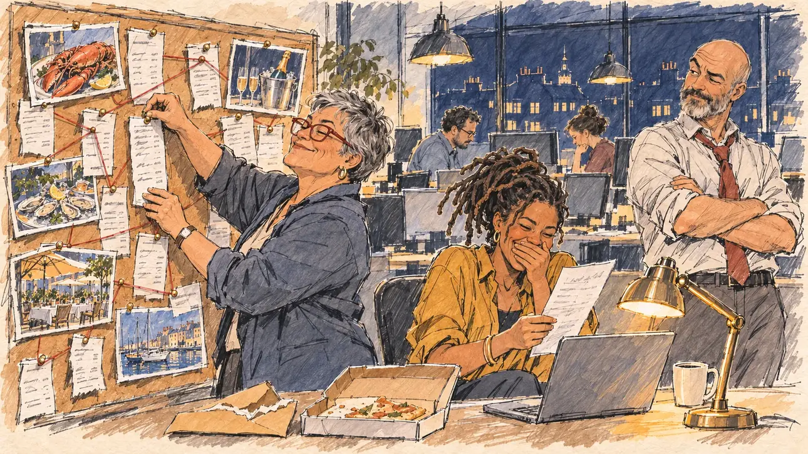

# `rivalLeak` · Une fuite venue d'en face

**Validée par le PO le 31/10/2026**, au premier essai. Elle sert telle quelle en clair et en sombre.



| Champ | Valeur |
| --- | --- |
| Carte | `rivalLeak`, catégorie `attack` (Attaque) |
| Style | Reportage dessiné ; visages dessinés comme le reste |
| Ton | Ironique |
| Date | 2026-10-31 |
| Outil | ChatGPT avec le modèle GPT Sol 6.1 en effort « light », et ChatGPT Images 2.5 |
| Conversation | À remplir (le lien ne s'ouvre qu'avec le compte qui l'a créée) |
| Format rendu | 1672 × 941 (16:9) : export en 1290 × 726 px depuis le PNG d'origine, WebP de qualité 75, 218 Ko, sans recadrage ; réexportée le 01/11/2026, après une première version en qualité 55 pour tenir 180 Ko |
| Fichier d'origine | PNG de ChatGPT, chez le PO, partagé aussi dans la conversation avec Claude |
| Première édition | `kit-france-2611-0001` |

## Texte de la carte

> **Une fuite venue d'en face**
>
> Un conseiller d'une équipe adverse fait fuiter les notes de frais de votre ancien mandat local. Rien d'illégal, mais les additions de restaurant font jaser.

## Le moment choisi

La rédaction d'un quotidien régional, tard le soir. Sur un tableau de liège, les additions et les photos de homard, de champagne et d'huîtres, reliées au fil rouge comme dans une enquête policière. Une journaliste épingle une addition de plus, une stagiaire pouffe, le rédacteur en chef hausse un sourcil ; sur le bureau, l'enveloppe anonyme et des boîtes de pizza. Le candidat n'apparaît pas.

## Prompt complet

Dans une nouvelle conversation, avec [`oldTweet.webp`](../../illustrations/polemic/oldTweet.webp) comme seule image de référence :

```
Use the attached image as the style reference: the same pencil and ink drawing with loose watercolour washes and warm paper grain. Not the same scene.
Faces are drawn exactly like the clothes and the background: ink outlines, a few hatching strokes and flat watercolour washes for the skin, with the same level of detail as the rest of the drawing. No photographic skin, no realistic shading, no airbrushed or digital-painting look on the faces.

Editorial illustration, landscape 16:9 (1536 × 864 px), filling the whole frame edge to edge. The newsroom of a regional daily paper, late in the evening in 2027, the day an adviser from a rival team leaked the expense claims from the player's candidate's former local mandate: nothing illegal, but the restaurant bills are the talk of the town. The candidate does not appear. On a large corkboard, enlarged copies of restaurant receipts and photos of a lobster, a champagne bucket and a seafood platter are pinned and linked with red string, like a parody of a police investigation board. In the left third, an investigative journalist, a stout woman in her fifties with cropped grey hair and red glasses, pins one more receipt with a satisfied grin, her face above mid-height. Next to her, a young intern with short dreadlocks reads a printout and bursts out laughing; the editor-in-chief, a tall bald man in rolled-up shirtsleeves, raises an eyebrow, arms crossed. On the desk in front of them: an anonymous brown envelope torn open and two open boxes of cheap pizza. Nobody looks at the viewer. Nothing on the receipts, the envelope, the screens or the board is readable.

Style: Reportage drawing made on the spot, like a press illustrator or courtroom sketch artist: pencil and ink with loose watercolour washes, lively unfinished lines, white paper showing through.

Palette: navy #13203F, vellum #F5EFE1, gold #A9802A, brick #B5523B, ochre #D9A441, sage #8FA58A, slate #5E7186, sand #DCC8A4, warm grey #8C8279; use 4 to 6 of them, subtle warm paper grain.

Tone: gently ironic, postures slightly exaggerated but never the faces, warm desk lamps in the dark newsroom.

Constraints: realistic proportions, expressive but not caricatured faces, drawn like the rest of the illustration and never photographic; people of varied ages, genders, origins and body types (heavy, stocky, round, tall, short, wiry, not only slim), each with a distinct face and haircut (no two people alike), drawn with respect and never as a joke; anatomically correct hands with exactly five fingers, few hands visible, the others in pockets, behind objects or out of frame; no readable text anywhere (receipts, envelopes, boards and screens stay unreadable); no captions or speech bubbles; no logos or political party colours; no recognisable real person, no lookalike of a real politician or journalist; no explicit violence; no oil-paint texture, no white or ragged border.

Format: if 16:9 is not available, make 1536 × 1024 and keep the top 80 px and the bottom 80 px free of anything important (faces, hands, the main action): they will be cropped.
```

## Essais écartés

Aucun.

## Retouches

Aucune.

## Relecture

Faite et validée par le PO le 31/10/2026.

- [x] Aucun texte lisible : les additions et l'enveloppe n'ont que du faux texte.
- [x] Aucun sosie d'une personne réelle.
- [x] Le candidat du joueur n'apparaît pas.
- [x] Mains, visages et foules sans défaut visible à 343 px de large.
- [x] Aucune couleur de parti, aucun symbole officiel. Des personnes variées.
- [x] En 3:2 : rien d'important dans les 80 px du haut et du bas. Sans objet ici : l'image est en 16:9.
- [x] Lisible sur la page de l'événement, en clair et en sombre.

## Régénération demandée (04/11/2026)

**Pourquoi.** La revue de la première série note le style à 2/3 et les détails à 3/3 : peinture numérique finie sous un filtre de hachures au crayon, visages modelés, lumière dorée dense. Le cadre est saturé : un tableau de liège couvert d'une vingtaine de feuilles, un bureau chargé de deux boîtes de pizza, de piles, de livres, de portables, de mugs, d'un pot à crayons et d'une lampe, et derrière une rédaction entière. Le PO a décidé de régénérer l'image, avec ce commentaire : « Le tableau est bien, c'est le gag de l'illustration ; on peut alléger le bureau ».

**Ce qui reste.** Le tableau de liège avec ses additions, ses photos de homard, de champagne et de plateau de fruits de mer reliés au fil rouge, et les trois personnages : la journaliste aux lunettes rouges qui épingle, la stagiaire qui rit, le rédacteur en chef chauve au sourcil levé. Personne ne regarde le spectateur, le candidat n'apparaît pas.

**Ce qui change.** Le rendu, dans le trait d'[`oldTweet`](../polemic/oldTweet.md) (PO, 04/11/2026). Le tableau garde tout ce qui fait le gag : une quinzaine de feuilles, les tickets agrandis et les photos du homard, du seau à champagne, du plateau de fruits de mer, d'une terrasse de restaurant et d'un port, reliés au fil rouge, esquissés mais reconnaissables. Le bureau est allégé comme l'a voulu le PO : l'enveloppe brune déchirée, une seule boîte de pizza ouverte, un portable, un mug et la lampe de bureau ; sortent la seconde boîte de pizza, les piles de livres et de papiers, le pot à crayons, le thermos et la plante. La rédaction du fond reste, esquissée au crayon et pâle : quelques bureaux avec leurs écrans, deux collègues penchés sur leur travail, des suspensions et la grande baie sur la ville de nuit. Une première version de cette section, écrite avec la règle de « trois ou quatre objets au plus », vidait le bureau et la rédaction ; elle a été reprise quand le PO a demandé de ne pas trop simplifier les scènes.

### Prompt de régénération

Dans une nouvelle conversation, avec [`oldTweet.webp`](../../illustrations/polemic/oldTweet.webp) comme seule image de référence.

```
Use the attached image as the style reference and copy its drawing: quick, nervous pencil lines, often drawn twice, loose ink hatching in the shadows, transparent watercolour washes that spill a little over the lines, and the warm paper showing through everywhere. Not the same scene.
Like in the reference, the setting can be full when the story needs it, with the things that say where we are and what is happening, but each one is sketched with a few pencil lines and a light wash, never rendered or finished, and the drawing gets looser and paler towards the edges until it fades into the bare paper.
This must look like a drawing made by hand on paper, never like a photograph, a film poster or a digital painting: the people are drawn with pencil and ink lines and washes, not modelled; continuous lines, never dotted or dashed outlines; no uniform texture, speckles or hatching filter laid over the picture; no dense colour, no glossy highlights, no smooth gradients, in the sky and on the walls too. The fade into the paper at the edges stays narrow, without a wide white margin. No blur and no depth-of-field effect: everything, the foreground included, is drawn sharp, like a sketch made on the spot.
Faces are drawn exactly like the clothes and the background: ink outlines, a few hatching strokes and flat watercolour washes for the skin, with the same level of detail as the rest of the drawing. No photographic skin, no realistic wrinkles or pores, no airbrushed or digital-painting look on the faces.

Editorial illustration, landscape 16:9 (1536 × 864 px), the scene filling the frame, with only a light fade into the paper at the edges. The newsroom of a regional daily paper, late in the evening in 2027, the day an adviser from a rival team leaked the expense claims from the player's candidate's former local mandate: nothing illegal, but the restaurant bills are the talk of the town. The candidate does not appear. On the left, filling the left half of the frame, a large corkboard on which about fifteen sheets are pinned and linked with red string, like a parody of a police investigation board: enlarged copies of restaurant receipts and sketched photos of a lobster, a champagne bucket, a seafood platter, a restaurant terrace and a harbour view. This board is the joke of the picture: drawn with care and recognisable, but sketched in pencil with light washes, never finished. In front of the board, an investigative journalist, a stout woman in her fifties with cropped grey hair and red glasses, pins one more receipt with a satisfied grin, her face above mid-height. In the centre, a young intern with short dreadlocks, seated, reads a printout and bursts out laughing behind her hand. In the right third, the editor-in-chief, a tall bald man with a grey beard, in rolled-up shirtsleeves and a loosened tie, raises an eyebrow, arms crossed. On the desk in front of them, only a few things: an anonymous brown envelope torn open, one open pizza box, a laptop, a mug and a desk lamp with warm light. Behind them, the rest of the newsroom at night, sketched loosely in pencil and pale washes: a few desks with screens, two colleagues bent over their work, hanging lamps and a large window on the city at night. Nobody looks at the viewer. Nothing on the receipts, the envelope, the screens or the board is readable.

Style: Reportage drawing made on the spot, like a press illustrator or courtroom sketch artist: pencil and ink with loose watercolour washes, lively unfinished lines, white paper showing through.

Palette: navy #13203F, vellum #F5EFE1, gold #A9802A, brick #B5523B, ochre #D9A441, sage #8FA58A, slate #5E7186, sand #DCC8A4, warm grey #8C8279; use 4 to 6 of them, subtle warm paper grain.

Tone: gently ironic, postures slightly exaggerated but never the faces, one warm desk lamp glow in the dark newsroom, soft light.

Constraints: realistic proportions, expressive but not caricatured faces, drawn like the rest of the illustration and never photographic; people of varied ages, genders, origins and body types (heavy, stocky, round, tall, short, wiry, not only slim), each with a distinct face and haircut (no two people alike), drawn with respect and never as a joke; anatomically correct hands with exactly five fingers, few hands visible, the others in pockets, behind objects or out of frame; no readable text anywhere (the receipts, the envelope, the screens and the board stay unreadable); no captions or speech bubbles; no logos or political party colours; no recognisable real person and no lookalike of a real politician or journalist; no explicit violence; no photographic rendering, no blur or bokeh, no dotted outlines, no texture or hatching filter over the picture, no oil-paint texture, no wide white margin or frame (a light fade into the paper at the edges is fine).

Format: if 16:9 is not available, make 1536 × 1024 and keep the top 80 px and the bottom 80 px free of anything important (faces, hands, the main action): they will be cropped.
```
