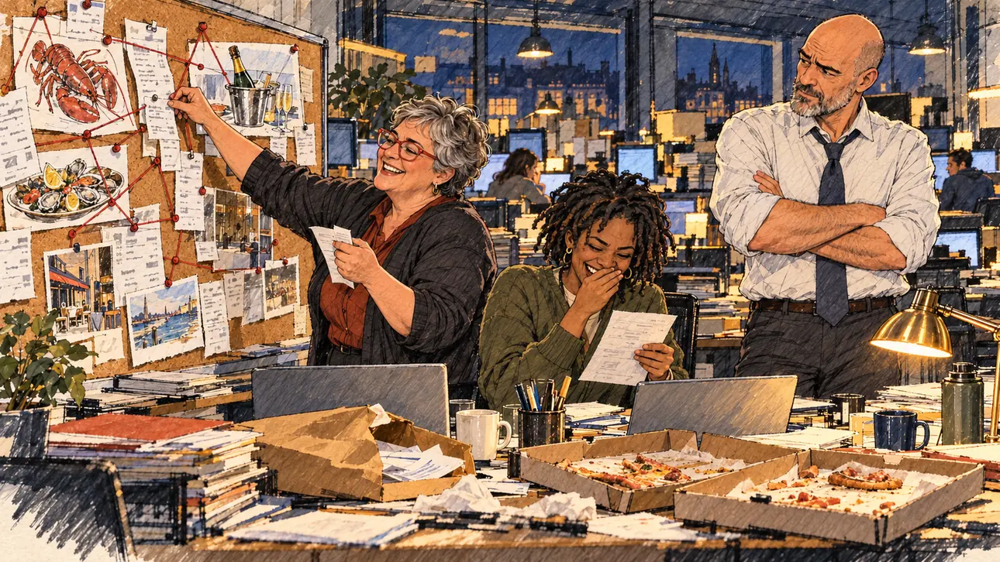

# `rivalLeak` · Une fuite venue d'en face

**Validée par le PO le 31/10/2026**, au premier essai. Elle sert telle quelle en clair et en sombre.



| Champ | Valeur |
| --- | --- |
| Carte | `rivalLeak`, catégorie `attack` (Attaque) |
| Style | Reportage dessiné ; visages dessinés comme le reste |
| Ton | Ironique |
| Date | 2026-10-31 |
| Outil | ChatGPT avec le modèle GPT Sol 6.1 en effort « light », et ChatGPT Images 2.5 |
| Conversation | À remplir (le lien ne s'ouvre qu'avec le compte qui l'a créée) |
| Format rendu | 1672 × 941 (16:9) : export en 1290 × 726 px depuis le PNG d'origine, WebP de qualité 75, 218 Ko, sans recadrage ; réexportée le 01/11/2026, après une première version en qualité 55 pour tenir 180 Ko |
| Fichier d'origine | PNG de ChatGPT, chez le PO, partagé aussi dans la conversation avec Claude |
| Première édition | À remplir |

## Texte de la carte

> **Une fuite venue d'en face**
>
> Un conseiller d'une équipe adverse fait fuiter les notes de frais de votre ancien mandat local. Rien d'illégal, mais les additions de restaurant font jaser.

## Le moment choisi

La rédaction d'un quotidien régional, tard le soir. Sur un tableau de liège, les additions et les photos de homard, de champagne et d'huîtres, reliées au fil rouge comme dans une enquête policière. Une journaliste épingle une addition de plus, une stagiaire pouffe, le rédacteur en chef hausse un sourcil ; sur le bureau, l'enveloppe anonyme et des boîtes de pizza. Le candidat n'apparaît pas.

## Prompt complet

Dans une nouvelle conversation, avec [`oldTweet.webp`](../../illustrations/polemic/oldTweet.webp) comme seule image de référence :

```
Use the attached image as the style reference: the same pencil and ink drawing with loose watercolour washes and warm paper grain. Not the same scene.
Faces are drawn exactly like the clothes and the background: ink outlines, a few hatching strokes and flat watercolour washes for the skin, with the same level of detail as the rest of the drawing. No photographic skin, no realistic shading, no airbrushed or digital-painting look on the faces.

Editorial illustration, landscape 16:9 (1536 × 864 px), filling the whole frame edge to edge. The newsroom of a regional daily paper, late in the evening in 2027, the day an adviser from a rival team leaked the expense claims from the player's candidate's former local mandate: nothing illegal, but the restaurant bills are the talk of the town. The candidate does not appear. On a large corkboard, enlarged copies of restaurant receipts and photos of a lobster, a champagne bucket and a seafood platter are pinned and linked with red string, like a parody of a police investigation board. In the left third, an investigative journalist, a stout woman in her fifties with cropped grey hair and red glasses, pins one more receipt with a satisfied grin, her face above mid-height. Next to her, a young intern with short dreadlocks reads a printout and bursts out laughing; the editor-in-chief, a tall bald man in rolled-up shirtsleeves, raises an eyebrow, arms crossed. On the desk in front of them: an anonymous brown envelope torn open and two open boxes of cheap pizza. Nobody looks at the viewer. Nothing on the receipts, the envelope, the screens or the board is readable.

Style: Reportage drawing made on the spot, like a press illustrator or courtroom sketch artist: pencil and ink with loose watercolour washes, lively unfinished lines, white paper showing through.

Palette: navy #13203F, vellum #F5EFE1, gold #A9802A, brick #B5523B, ochre #D9A441, sage #8FA58A, slate #5E7186, sand #DCC8A4, warm grey #8C8279; use 4 to 6 of them, subtle warm paper grain.

Tone: gently ironic, postures slightly exaggerated but never the faces, warm desk lamps in the dark newsroom.

Constraints: realistic proportions, expressive but not caricatured faces, drawn like the rest of the illustration and never photographic; people of varied ages, genders, origins and body types (heavy, stocky, round, tall, short, wiry, not only slim), each with a distinct face and haircut (no two people alike), drawn with respect and never as a joke; anatomically correct hands with exactly five fingers, few hands visible, the others in pockets, behind objects or out of frame; no readable text anywhere (receipts, envelopes, boards and screens stay unreadable); no captions or speech bubbles; no logos or political party colours; no recognisable real person, no lookalike of a real politician or journalist; no explicit violence; no oil-paint texture, no white or ragged border.

Format: if 16:9 is not available, make 1536 × 1024 and keep the top 80 px and the bottom 80 px free of anything important (faces, hands, the main action): they will be cropped.
```

## Essais écartés

Aucun.

## Retouches

Aucune.

## Relecture

Faite et validée par le PO le 31/10/2026.

- [x] Aucun texte lisible : les additions et l'enveloppe n'ont que du faux texte.
- [x] Aucun sosie d'une personne réelle.
- [x] Le candidat du joueur n'apparaît pas.
- [x] Mains, visages et foules sans défaut visible à 343 px de large.
- [x] Aucune couleur de parti, aucun symbole officiel. Des personnes variées.
- [x] En 3:2 : rien d'important dans les 80 px du haut et du bas. Sans objet ici : l'image est en 16:9.
- [x] Lisible sur la page de l'événement, en clair et en sombre.
