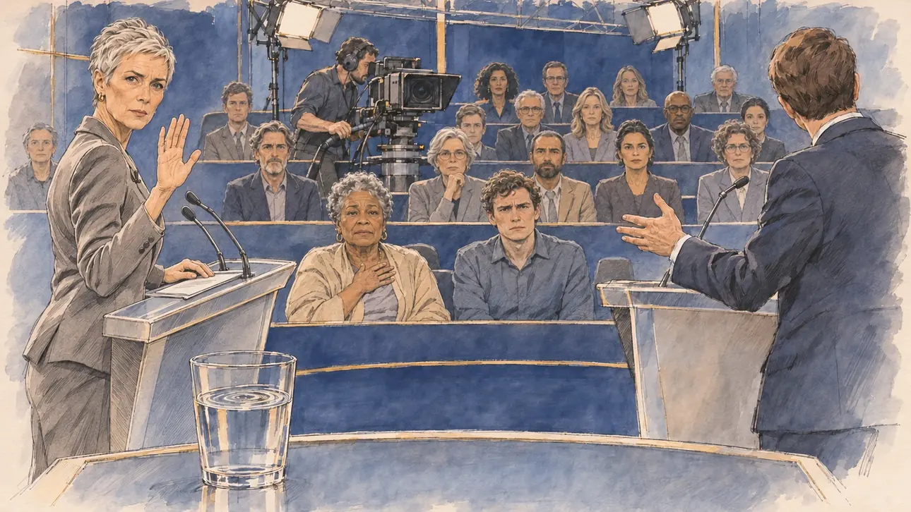

# `tremolo` · Le trémolo

**Retenue par le PO le 16/11/2026**, au premier essai. Elle sert telle quelle en clair et en sombre.



| Champ | Valeur |
| --- | --- |
| Carte | `tremolo`, catégorie `attack` (Attaque), poids 0,15, toute semaine ; une leçon gagnée sur une faiblesse (sang-froid +3, jet inversé), une seule de la série par partie (Mitchnsun/moi-president, PO, 16/11/2026) |
| Style | Reportage dessiné |
| Ton | Tendu et intime, silence suspendu |
| Date | 2026-11-16 |
| Outil | ChatGPT Images, modèle GPT 6.2, effort Light |
| Conversation | À compléter |
| Format rendu | 1672 × 941 (16:9) : export en 1290 × 726 px, WebP de qualité 75, 120 Ko, sans recadrage, fait depuis la copie WebP de la conversation |
| Fichier d'origine | Image de ChatGPT, chez le PO. L'export du dépôt a été fait depuis la copie partagée dans la conversation avec Claude |
| Première édition | À compléter |

## Texte de la carte

> **Le trémolo**
>
> En plein débat, un adversaire évoque une épreuve de votre vie pour vous déstabiliser. Votre voix tremble pendant dix longues secondes.

## Le moment choisi

Le plateau d'un débat télévisé, un soir de mars : pupitres, sol bleu nuit, public en gradins, projecteurs et caméra. Le candidat est à son pupitre, hors champ : seuls le bord du pupitre et un verre d'eau dont la surface frémit. La modératrice lève la main pour proposer une pause et le regarde avec inquiétude ; l'adversaire, de dos, vient de finir sa phrase, la main encore ouverte ; au premier rang, une spectatrice porte la main à sa poitrine, un jeune homme fronce les sourcils ; un cadreur pousse sa caméra. Le précédent est une voix qui tremble la veille d'une primaire, gagnée le lendemain (New Hampshire, janvier 2008), l'effet des larmes incertain : personne n'y ressemble à un responsable politique, et l'adversaire n'a pas de visage.

## Prompt complet

Dans une nouvelle conversation, avec [`primeTime.webp`](../../illustrations/media/primeTime.webp) comme seule image de référence :

```
Use the attached image as the style reference and copy its drawing: a realistic reportage drawing made on the spot for a newspaper, with quick, nervous pencil lines, often drawn twice, ink hatching in the shadows, transparent watercolour washes that spill a little over the lines, and the warm paper showing through. Not the same scene and not the same people: never reuse the face or the hair of the woman in the reference.
Like in the reference, the setting can be full when the story needs it, with the things that say where we are and what is happening, but each one is sketched with a few pencil lines and a light wash, never rendered or finished, and the drawing gets looser and paler towards the edges until it fades into the bare paper.
This must look like a drawing made by hand on paper by a press illustrator, halfway between a quick sketch and a realistic picture: never a photograph, a film poster or a digital painting, and never a cartoon, a comic strip, a caricature or a children's book illustration. Continuous lines, never dotted or dashed outlines; no uniform texture, speckles or hatching filter laid over the picture; no glossy highlights, no smooth gradients, in the sky and on the walls too. Colour can be rich in places, on a piece of clothing, a light or a flag, but it stays transparent and within the palette below. The fade into the paper at the edges stays narrow, without a wide white margin. No blur and no depth-of-field effect: everything, the foreground included, is drawn sharp, like a sketch made on the spot.
People are drawn from life with realistic anatomy and proportions, like in the reference: faces shaped with pencil lines, hatching and light washes, a little more finished than the background but never photographic (no photographic skin, no airbrushed or digital-painting look). Expressions stay natural and restrained, even in laughter or tears: no exaggerated grins, no wide-open mouths full of teeth, no rubbery or cartoonish faces.

Editorial illustration, landscape 16:9 (1536 × 864 px), the scene filling the frame, with only a light fade into the paper at the edges. The set of a televised debate, on an evening in March 2027: two lecterns facing each other on a midnight-blue floor, an audience on tiered seats in the half-light, spotlights and cameras. The player's candidate stands at a lectern and stays off-camera: in the foreground, only the edge of the candidate's lectern and a glass of water whose surface ripples. In the left third, the moderator, a tall woman in her fifties with very short silver hair, in a grey suit, half raises a hand to offer a pause and looks at the viewer with concern, her face above mid-height. At the opposite lectern, seen from three-quarters behind, the rival, a man in a dark suit with short brown hair, his face not visible, has just finished his sentence, one hand still open. In the front row of the audience, a short, round woman in her sixties of Caribbean descent puts a hand to her chest, moved; a young man beside her frowns. A camera operator pushes his camera in for a close-up. Only the moderator looks at the viewer. Nothing on the lecterns, the set, the screens or the cameras is readable.

Style: Reportage drawing made on the spot, like a press illustrator or courtroom sketch artist: pencil and ink with loose watercolour washes, lively unfinished lines, white paper showing through.

Palette: navy #13203F, vellum #F5EFE1, gold #A9802A, brick #B5523B, ochre #D9A441, sage #8FA58A, slate #5E7186, sand #DCC8A4, warm grey #8C8279; use 4 to 6 of them, subtle warm paper grain.

Tone: tense and intimate, the cold light of the spotlights, a suspended silence, the trembling glass of water as the quiet centre of the picture.

Constraints: realistic proportions, natural expressions, never cartoonish or caricatured faces, drawn like the rest of the illustration and never photographic; people of varied ages, genders, origins and body types (heavy, stocky, round, tall, short, wiry, not only slim), each with a distinct face and haircut (no two people alike), drawn with respect and never as a joke; each person's age, build and look plausible for their job and the scene (working people of working age), no stereotype tying an origin or a gender to a role, and no person of colour shown alone in a featured service or deferential role; anatomically correct hands with exactly five fingers, few hands visible, the others in pockets, behind objects or out of frame; no readable text anywhere (the lecterns, the set, the screens and the cameras stay unreadable, no names, no on-air caption); no captions or speech bubbles; no logos, no television channel logo, no political party colours, no flags; no recognisable real person, no lookalike of a real politician or of a known television moderator, the rival's face never shown; no image of the candidate on the screens; no explicit violence; no photographic rendering, no blur or bokeh, every outline a continuous pencil or ink line with no dotted or dashed outlines, no mottled, crackled or speckled texture over the faces, the clothes or the set, no hatching filter over the picture, no oil-paint texture, no glow, halo or lens flare around the spotlights, no wide white margin or frame (a light fade into the paper at the edges is fine).

Format: if 16:9 is not available, make 1536 × 1024 and keep the top 80 px and the bottom 80 px free of anything important (faces, hands, the main action): they will be cropped.
```

## Décisions prises sur cette image

Retenue telle quelle par le PO (16/11/2026). La modératrice a son propre pupitre ; une bonne part du public regarde le spectateur, c'est le candidat qu'il attend. L'adversaire reste de dos, sans visage.

## Essais écartés

Aucun.

## Retouches

Aucune.

## Relecture

Faite le 16/11/2026, à confirmer par le PO.

- [x] Aucun texte lisible : rien sur les pupitres, le décor ni la caméra.
- [x] Aucun sosie d'une personne réelle ; l'adversaire n'a pas de visage.
- [x] Le candidat du joueur est hors champ : seuls le bord de son pupitre et son verre d'eau.
- [x] Mains et visages sans défaut visible à 343 px de large : la main levée de la modératrice (cinq doigts), la main ouverte de l'adversaire, la main sur la poitrine de la spectatrice.
- [x] Aucune couleur, aucun logo ni aucun drapeau de parti ou de chaîne. Des personnes variées par l'âge, le corps, l'origine et la coiffure.
- [x] En 16:9 : pas de recadrage.
- [ ] Lisible sur la page de l'événement, en clair et en sombre : à vérifier dans l'app, une fois la carte publiée.
