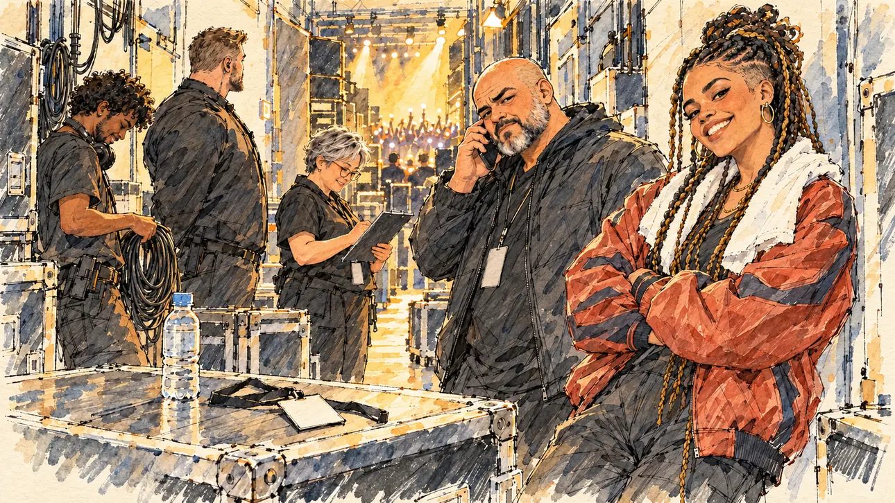

# `starEndorsement` · Une star vous soutient

**Validée par le PO le 31/10/2026**, à l'essai 2. Elle sert telle quelle en clair et en sombre.



| Champ | Valeur |
| --- | --- |
| Carte | `starEndorsement`, catégorie `breakthrough` (Coup de projecteur) |
| Style | Reportage dessiné ; visages dessinés comme le reste |
| Ton | Énergique et chaleureux |
| Date | 2026-10-31 |
| Outil | ChatGPT avec le modèle GPT Sol 6.1 en effort « light », et ChatGPT Images 2.5 |
| Conversation | À remplir (le lien ne s'ouvre qu'avec le compte qui l'a créée) |
| Format rendu | 1672 × 941 (16:9) : export en 1290 × 726 px depuis le PNG d'origine, WebP de qualité 75, 254 Ko (au-delà de 180 Ko, choix du PO), sans recadrage |
| Fichier d'origine | PNG de ChatGPT, chez le PO, partagé aussi dans la conversation avec Claude |
| Première édition | À remplir |

## Texte de la carte

> **Une star vous soutient**
>
> Une star du rap, idole des plus jeunes, propose de vous soutenir publiquement et de monter sur scène à votre prochain meeting.

## Le moment choisi

Le couloir des coulisses d'une grande salle de concert, juste après un concert de rap à guichets fermés. Le candidat, petit dans les sondages, a été invité en coulisses et reste hors champ : sur une caisse de matériel, sa bouteille d'eau et un pass vierge. La star, serviette sur les épaules, s'adosse au mur, bras croisés, et lui sourit : c'est elle qui propose le marché. Son manager, téléphone à l'oreille, jauge l'affaire. Autour, l'équipe range ; au bout du couloir, la lumière de la scène et les téléphones levés du public.

## Prompt complet

Dans une nouvelle conversation, avec [`oldTweet.webp`](../../illustrations/polemic/oldTweet.webp) comme seule image de référence :

```
Use the attached image as the style reference: the same pencil and ink drawing with loose watercolour washes and warm paper grain. Not the same scene.
Faces are drawn exactly like the clothes and the background: ink outlines, a few hatching strokes and flat watercolour washes for the skin, with the same level of detail as the rest of the drawing. No photographic skin, no realistic shading, no airbrushed or digital-painting look on the faces.

Editorial illustration, landscape 16:9 (1536 × 864 px), filling the whole frame edge to edge. The backstage corridor of a big concert hall in a French city, late in the evening in 2027, just after a sold-out rap concert. The player's candidate, a small candidate low in the polls, has been invited backstage and stays off-camera: in the foreground, on a black flight case, only a bottle of water and a blank laminated backstage pass on a lanyard. In the right third, the rap star, the idol of teenagers, a woman in her late twenties with long box braids gathered high on her head and a shaved undercut, in an oversized satin bomber jacket and a thin gold chain, a towel over her shoulders, still out of breath from the show, leans against the wall with her arms crossed and looks straight at the viewer with a broad, confident grin, as if offering a deal, her face above mid-height. Next to her, her manager, a heavy-set man in his forties with a shaved head, a short grey beard and a black puffer jacket, a phone pressed to his ear, also looks at the viewer, weighing up the deal. Further back: a very tall, broad bodyguard with a neat high-top fade and an earpiece, impassive, his hands behind his back; a wiry young sound technician with a curly mullet and headphones around the neck, coiling a cable, who glances at the scene with amusement; a round, short woman in her fifties with a silver pixie cut and a production badge, checking a clipboard. At the end of the corridor, through a half-open door, the hot stage lights, a haze of smoke and the blurred glow of the crowd's raised phones. Nothing on the pass, the badge, the clipboard, the flight cases or the walls is readable.

Style: Reportage drawing made on the spot, like a press illustrator or courtroom sketch artist: pencil and ink with loose watercolour washes, lively unfinished lines, white paper showing through.

Palette: navy #13203F, vellum #F5EFE1, gold #A9802A, brick #B5523B, ochre #D9A441, sage #8FA58A, slate #5E7186, sand #DCC8A4, warm grey #8C8279; use 4 to 6 of them, subtle warm paper grain.

Tone: energetic and warm, a little unexpected, hot golden stage light spilling into the dim corridor.

Constraints: realistic proportions, expressive but not caricatured faces, drawn like the rest of the illustration and never photographic; people of varied ages, genders, origins and body types (heavy, stocky, round, tall, short, wiry, not only slim), each with a distinct face and haircut (no two people alike), drawn with respect and never as a joke; anatomically correct hands with exactly five fingers, few hands visible, the others in pockets, behind objects or out of frame; no readable text anywhere (passes, badges, clipboards, cases and walls stay unreadable); no captions or speech bubbles; no logos, brand names or political party colours; no recognisable real person, no lookalike of a real rapper, musician or politician; no explicit violence; no oil-paint texture, no white or ragged border.

Format: if 16:9 is not available, make 1536 × 1024 and keep the top 80 px and the bottom 80 px free of anything important (faces, hands, the main action): they will be cropped.
```

### Message de correction

Envoyé après l'essai 1 :

```
Keep the same scene, the same people, the same places and the same poses, but match the rendering of the reference image much more closely:
- a quick reportage drawing on warm paper: pencil and ink lines, loose watercolour washes, plenty of white paper showing through, lighter and less saturated overall, with the golden glow of the stage still at the end of the corridor; no dark digital painting, no hatching filter over a finished image;
- every face, the rap star's included, is drawn like the clothes: an ink outline, a few hatching strokes and flat watercolour washes; no smooth or photographic skin, no glossy highlights;
- only the rap star and her manager look at the viewer; the sound technician looks down at the cable he is coiling, the woman with the clipboard reads it, the bodyguard watches the far end of the corridor.
Everything else stays the same: nothing readable, exactly five fingers on every visible hand, 16:9 filling the whole frame.
```

## Décisions prises sur cette image

- **La qualité reste à 75, même au-delà de 180 Ko** (PO, 31/10/2026). Pour tenir 180 Ko, cette image serait descendue en qualité 43 : le grain du papier se lissait et les hachures fines s'adoucissaient. Le PO préfère une image un peu plus lourde.

## Essais écartés

- **Essai 1** (31/10/2026) : la scène et les personnages étaient justes, mais le rendu tenait de la peinture numérique sous un filtre de hachures : noirs épais, couleurs saturées, ni lavis ni papier blanc. Le visage de la star était lisse, presque photographique, et les cinq personnages regardaient l'objectif comme pour une photo de groupe.

## Retouches

Aucune.

## Relecture

Faite et validée par le PO le 31/10/2026, sur l'essai 2.

- [x] Aucun texte lisible : ni sur le pass, ni sur les badges, ni sur la bouteille.
- [x] Aucun sosie d'une personne réelle.
- [x] Le candidat du joueur est hors champ.
- [x] Mains, visages et foules sans défaut visible à 343 px de large.
- [x] Aucune couleur de parti, aucun symbole officiel. Des personnes variées par l'âge, le corps, l'origine et la coiffure.
- [x] En 3:2 : rien d'important dans les 80 px du haut et du bas. Sans objet ici : l'image est en 16:9.
- [x] Lisible sur la page de l'événement, en clair et en sombre.
