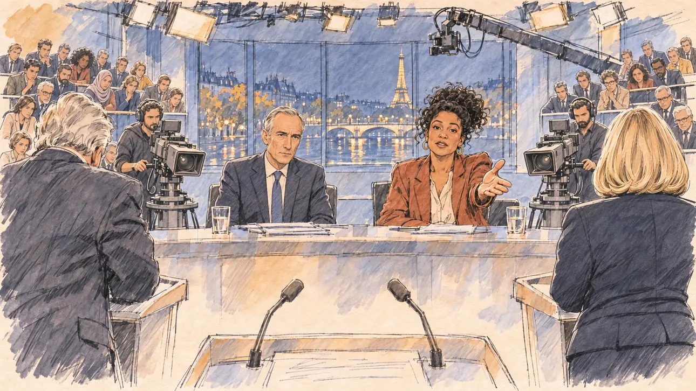

# `televisedDebate` · Le grand débat télévisé

**Validée par le PO le 30/10/2026**, à l'essai 2. Elle sert telle quelle en clair et en sombre.



| Champ | Valeur |
| --- | --- |
| Carte | `televisedDebate`, catégorie `breakthrough` (Coup de projecteur) |
| Style | Reportage dessiné (style unique pour le moment) |
| Ton | Observateur, avec un peu de tension |
| Date | 2026-10-30 |
| Outil | ChatGPT avec le modèle GPT Sol 6.1 en effort « light », et ChatGPT Images 2.5 |
| Conversation | À remplir (le lien ne s'ouvre qu'avec le compte qui l'a créée) |
| Format rendu | 1672 × 941 (16:9) : export en 1290 × 726 px, WebP de qualité 75, 124 Ko, sans recadrage |
| Fichier d'origine | PNG de ChatGPT, chez le PO. L'export du dépôt a été fait depuis la copie partagée dans la conversation avec Claude |
| Première édition | `kit-france-2611-0001` |

## Texte de la carte

> **Le grand débat télévisé**
>
> Pour la première fois, un débat réunit toutes les candidatures sur un même plateau. Quelques minutes de parole par camp : c'est le moment d'exister.

## Le moment choisi

Le plateau vu depuis le pupitre du candidat, qui reste hors champ : au premier plan, le haut de son pupitre et ses deux micros. En face, les deux présentateurs lui donnent la parole, avec derrière eux les caméras, le public et une baie vitrée sur Paris la nuit. Les adversaires ne sont que sur les côtés, au bord de l'image.

## Prompt complet

Envoyé dans la même conversation que l'essai 1, sans la première ligne : le style y était déjà installé. Dans une nouvelle conversation, joindre [`marketGaffe.webp`](../../illustrations/polemic/marketGaffe.webp) et garder la ligne.

```
Use the attached image as the style reference: same line, paper grain and palette, not the same scene.

Editorial illustration, landscape 16:9 (1536 × 864 px). A television studio in Paris in 2027, on the evening of the first debate that brings every presidential candidate together on one set. The scene is seen from the lectern of the player's candidate, who stays off-camera: in the foreground, only the top of that lectern and its two microphones. Facing the viewer, behind a long central desk, sit the two presenters, a man and a woman. In the right third, the woman turns towards the viewer and gives them the floor with an open hand, her face above mid-height; next to her, the man looks at the viewer, his notes flat on the desk. Behind the presenters, studio cameras on pedestals and a camera crane point at the viewer, and the audience sits in dim tiers, watching the viewer, under a wide window onto Paris at night. The rival candidates are only at the sides, at the left and right edges of the frame: their lecterns seen in profile, two of them partly cut by the frame, one turning to look at the viewer, the other reading their notes; they are invented people, none of them resembling a real politician. A warm spotlight falls towards the viewer. The desk, lecterns, screens and set carry no names, logos or readable text.

Style: Reportage drawing made on the spot, like a press illustrator or courtroom sketch artist: pencil and ink with loose watercolour washes, lively unfinished lines, white paper showing through.

Palette: navy #13203F, vellum #F5EFE1, gold #A9802A, brick #B5523B, ochre #D9A441, sage #8FA58A, slate #5E7186, sand #DCC8A4, warm grey #8C8279; use 4 to 6 of them, subtle warm paper grain.

Tone: observant with some tension, bright studio light and one warm spotlight.

Constraints: realistic proportions, expressive but not caricatured faces, people of varied ages, genders and origins; anatomically correct hands with exactly five fingers, few hands visible, the others in pockets, behind objects or out of frame; no readable text anywhere (signs, banners, price tags and screens stay blank); no captions or speech bubbles; no logos, flags or political party colours; no recognisable real person, no lookalike of a real politician; no explicit violence.

Format: if 16:9 is not available, make 1536 × 1024 and keep the top 80 px and the bottom 80 px free of anything important (faces, hands, the main action): they will be cropped.
```

## Essais écartés

- **Essai 1** (30/10/2026) : les adversaires étaient alignés face au candidat, à la place des présentateurs. Le pupitre au premier plan, la main tendue de la présentatrice et la vue sur Paris ont été gardés pour l'essai 2.

## Retouches

Aucune.

## Relecture

Faite et validée par le PO le 30/10/2026, sur l'essai 2.

- [x] Aucun texte lisible : pancartes, banderoles, étiquettes, écrans. Ici surtout : le bureau, les pupitres et les écrans.
- [x] Aucun sosie d'une personne réelle. Ici surtout : les présentateurs et les deux adversaires vus de dos, au bord de l'image.
- [x] Le candidat du joueur est hors champ, ou une silhouette lointaine de dos, sans genre marqué.
- [x] Mains, visages et foules sans défaut visible à 343 px de large.
- [x] Aucune couleur de parti, aucun logo, aucun symbole officiel. Des personnes variées.
- [x] En 3:2 : rien d'important dans les 80 px du haut et du bas. Sans objet ici : l'image est en 16:9.
- [x] Lisible sur la page de l'événement, en clair et en sombre.

## Régénération demandée (04/11/2026)

**Pourquoi.** La revue de la première série note le style à 3/3 et les détails à 2/3 : l'image ressemble à une affiche de film, presque photographique. Les visages des présentateurs sont modelés, la table et les pupitres dorés brillent, les lumières de Paris sont en halos, avec un contre-jour doré et un bleu nuit dense. Des gradins d'une trentaine de spectateurs dessinés un à un, trois caméras, une grue, la Seine, la tour Eiffel et un dôme forment un fond complet. La présentatrice brune reprend aussi le type des présentatrices de `primeTime` et de `pundit`. Le PO a décidé de régénérer l'image, avec ce commentaire : « Le style est à améliorer, mais on garde les deux adversaires, qui doivent rappeler justement Mélenchon et Le Pen : ressemblance assumée, on ne voit pas leur visage car ils sont de dos » (décision du 04/11/2026, écrite dans la règle 5 du gabarit).

**Ce qui reste.** Le plateau vu du pupitre du candidat, hors champ, avec ses deux micros au premier plan ; les deux présentateurs derrière la table, la présentatrice qui donne la parole d'une main ouverte ; la vue sur Paris la nuit ; les deux adversaires au bord de l'image, de dos, dont la silhouette, la coupe et l'allure rappellent les candidats parodiés du jeu, sans jamais montrer le visage.

**Ce qui change.** Le rendu, qui passe de l'affiche de film au dessin de reportage, sans reflets dorés ni halos. Le public est suggéré par des rangées de petites têtes sans visages, une seule caméra reste, la grue et le dôme sortent, la Seine et la tour Eiffel sont en quelques traits. Les deux présentateurs reçoivent d'autres visages : la présentatrice a des boucles serrées noires en chignon haut, le présentateur a le crâne rasé, le menton nu et des lunettes rectangulaires, pour ne reprendre ni `primeTime` ni `pundit`. La fiche ne nomme pas les personnes réelles : l'adversaire de gauche est trapu, aux cheveux gris-blanc rejetés en arrière, celle de droite droite et blonde, mi-longue.

### Prompt de régénération

Dans une nouvelle conversation, avec [`oldTweet.webp`](../../illustrations/polemic/oldTweet.webp) comme seule image de référence.

```
Use the attached image as the style reference and copy its drawing: quick, nervous pencil lines, often drawn twice, loose ink hatching in the shadows, transparent watercolour washes that spill a little over the lines, and the warm paper showing through everywhere. Not the same scene.
Like in the reference, the setting can be full when the story needs it, with the things that say where we are and what is happening, but each one is sketched with a few pencil lines and a light wash, never rendered or finished, and the drawing gets looser and paler towards the edges until it fades into the bare paper.
This must look like a drawing made by hand on paper, never like a photograph, a film poster or a digital painting: the people are drawn with pencil and ink lines and washes, not modelled; continuous lines, never dotted or dashed outlines; no uniform texture, speckles or hatching filter laid over the picture; no dense colour, no glossy highlights, no smooth gradients, in the sky and on the walls too. The fade into the paper at the edges stays narrow, without a wide white margin. No blur and no depth-of-field effect: everything, the foreground included, is drawn sharp, like a sketch made on the spot.
Faces are drawn exactly like the clothes and the background: ink outlines, a few hatching strokes and flat watercolour washes for the skin, with the same level of detail as the rest of the drawing. No photographic skin, no realistic wrinkles or pores, no airbrushed or digital-painting look on the faces.

Editorial illustration, landscape 16:9 (1536 × 864 px), the scene filling the frame, with only a light fade into the paper at the edges. A television studio in Paris in 2027, on the evening of the first debate that brings every presidential candidate together on one set. The scene is seen from the lectern of the player's candidate, who stays off-camera: in the foreground, only the top of that lectern and its two microphones. Facing the viewer, behind a long central desk, sit the two presenters. In the right third, a woman in her late thirties with tight black curls gathered in a high puff, a round face and a rust-coloured jacket turns towards the viewer and gives them the floor with an open hand, her face above mid-height; next to her, a heavy-set man in his fifties, with a shaved head, clean-shaven, and rectangular glasses, looks at the viewer, his notes flat on the desk. Behind them, only suggested with a few lines and light washes: one studio camera on a pedestal, and a wide window with the Eiffel Tower in a few pencil strokes and some dots of light; the audience is a pale band of tiers drawn as rows of small simple head shapes, with no individual faces. At the left and right edges of the frame stand the two rival candidates at their lecterns, seen from behind, partly cut by the frame, their faces never visible, not even in profile. On the left, a stocky man in his seventies with thick grey-white hair brushed back, in a rumpled dark suit, one shoulder pushed forward, a build and a bearing of a fiery speaker about to thunder. On the right, a woman in her fifties with blonde shoulder-length hair, in a dark tailored jacket, standing very straight and composed. Their silhouette, haircut and bearing may recall the two parodied candidates of the game, never their faces. Nothing on the desk, the lecterns or the screens is readable.

Style: Reportage drawing made on the spot, like a press illustrator or courtroom sketch artist: pencil and ink with loose watercolour washes, lively unfinished lines, white paper showing through.

Palette: navy #13203F, vellum #F5EFE1, gold #A9802A, brick #B5523B, ochre #D9A441, sage #8FA58A, slate #5E7186, sand #DCC8A4, warm grey #8C8279; use 4 to 6 of them, subtle warm paper grain.

Tone: observant with some tension, bright even studio light and one soft warm spotlight, the paper left bare around the lecterns.

Constraints: realistic proportions, expressive but not caricatured faces, drawn like the rest of the illustration and never photographic; people of varied ages, genders, origins and body types (heavy, stocky, round, tall, short, wiry, not only slim), each with a distinct face and haircut (no two people alike), drawn with respect and never as a joke; anatomically correct hands with exactly five fingers, few hands visible, the others in pockets, behind objects or out of frame; no readable text anywhere (the desk, the lecterns and the screens stay unreadable); no captions or speech bubbles; no logos or political party colours; apart from the two rival candidates seen from behind, whose silhouette, haircut and bearing may recall the game's parodied candidates but whose faces never appear, no recognisable real person, and no lookalike of a real politician or of a TV presenter; no explicit violence; no photographic rendering, no blur or bokeh, no dotted outlines, no texture or hatching filter over the picture, no oil-paint texture, no wide white margin or frame (a light fade into the paper at the edges is fine).

Format: if 16:9 is not available, make 1536 × 1024 and keep the top 80 px and the bottom 80 px free of anything important (faces, hands, the main action): they will be cropped.
```
