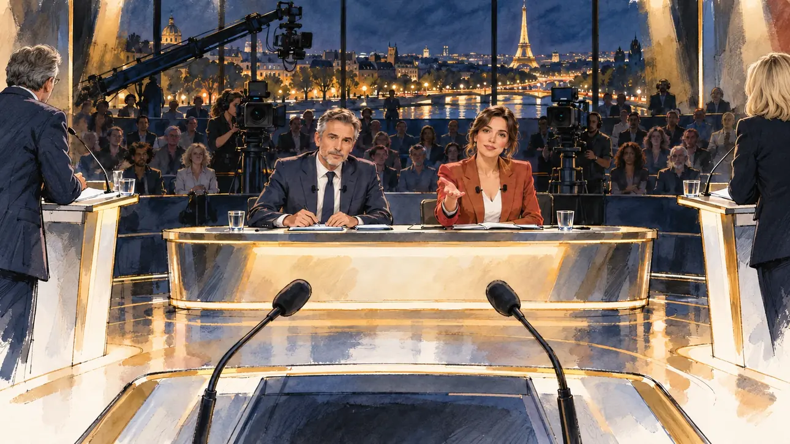

# `televisedDebate` · Le grand débat télévisé

**Validée par le PO le 30/10/2026**, à l'essai 2. Elle sert telle quelle en clair et en sombre.



| Champ | Valeur |
| --- | --- |
| Carte | `televisedDebate`, catégorie `breakthrough` (Coup de projecteur) |
| Style | Reportage dessiné (style unique pour le moment) |
| Ton | Observateur, avec un peu de tension |
| Date | 2026-10-30 |
| Outil | ChatGPT avec le modèle GPT Sol 6.1 en effort « light », et ChatGPT Images 2.5 |
| Conversation | À remplir (le lien ne s'ouvre qu'avec le compte qui l'a créée) |
| Format rendu | 1672 × 941 (16:9) : export en 1290 × 726 px, WebP de qualité 75, 124 Ko, sans recadrage |
| Fichier d'origine | PNG de ChatGPT, chez le PO. L'export du dépôt a été fait depuis la copie partagée dans la conversation avec Claude |
| Première édition | À remplir |

## Texte de la carte

> **Le grand débat télévisé**
>
> Pour la première fois, un débat réunit toutes les candidatures sur un même plateau. Quelques minutes de parole par camp : c'est le moment d'exister.

## Le moment choisi

Le plateau vu depuis le pupitre du candidat, qui reste hors champ : au premier plan, le haut de son pupitre et ses deux micros. En face, les deux présentateurs lui donnent la parole, avec derrière eux les caméras, le public et une baie vitrée sur Paris la nuit. Les adversaires ne sont que sur les côtés, au bord de l'image.

## Prompt complet

Envoyé dans la même conversation que l'essai 1, sans la première ligne : le style y était déjà installé. Dans une nouvelle conversation, joindre [`marketGaffe.webp`](../../illustrations/polemic/marketGaffe.webp) et garder la ligne.

```
Use the attached image as the style reference: same line, paper grain and palette, not the same scene.

Editorial illustration, landscape 16:9 (1536 × 864 px). A television studio in Paris in 2027, on the evening of the first debate that brings every presidential candidate together on one set. The scene is seen from the lectern of the player's candidate, who stays off-camera: in the foreground, only the top of that lectern and its two microphones. Facing the viewer, behind a long central desk, sit the two presenters, a man and a woman. In the right third, the woman turns towards the viewer and gives them the floor with an open hand, her face above mid-height; next to her, the man looks at the viewer, his notes flat on the desk. Behind the presenters, studio cameras on pedestals and a camera crane point at the viewer, and the audience sits in dim tiers, watching the viewer, under a wide window onto Paris at night. The rival candidates are only at the sides, at the left and right edges of the frame: their lecterns seen in profile, two of them partly cut by the frame, one turning to look at the viewer, the other reading their notes; they are invented people, none of them resembling a real politician. A warm spotlight falls towards the viewer. The desk, lecterns, screens and set carry no names, logos or readable text.

Style: Reportage drawing made on the spot, like a press illustrator or courtroom sketch artist: pencil and ink with loose watercolour washes, lively unfinished lines, white paper showing through.

Palette: navy #13203F, vellum #F5EFE1, gold #A9802A, brick #B5523B, ochre #D9A441, sage #8FA58A, slate #5E7186, sand #DCC8A4, warm grey #8C8279; use 4 to 6 of them, subtle warm paper grain.

Tone: observant with some tension, bright studio light and one warm spotlight.

Constraints: realistic proportions, expressive but not caricatured faces, people of varied ages, genders and origins; anatomically correct hands with exactly five fingers, few hands visible, the others in pockets, behind objects or out of frame; no readable text anywhere (signs, banners, price tags and screens stay blank); no captions or speech bubbles; no logos, flags or political party colours; no recognisable real person, no lookalike of a real politician; no explicit violence.

Format: if 16:9 is not available, make 1536 × 1024 and keep the top 80 px and the bottom 80 px free of anything important (faces, hands, the main action): they will be cropped.
```

## Essais écartés

- **Essai 1** (30/10/2026) : les adversaires étaient alignés face au candidat, à la place des présentateurs. Le pupitre au premier plan, la main tendue de la présentatrice et la vue sur Paris ont été gardés pour l'essai 2.

## Retouches

Aucune.

## Relecture

Faite et validée par le PO le 30/10/2026, sur l'essai 2.

- [x] Aucun texte lisible : pancartes, banderoles, étiquettes, écrans. Ici surtout : le bureau, les pupitres et les écrans.
- [x] Aucun sosie d'une personne réelle. Ici surtout : les présentateurs et les deux adversaires vus de dos, au bord de l'image.
- [x] Le candidat du joueur est hors champ, ou une silhouette lointaine de dos, sans genre marqué.
- [x] Mains, visages et foules sans défaut visible à 343 px de large.
- [x] Aucune couleur de parti, aucun logo, aucun symbole officiel. Des personnes variées.
- [x] En 3:2 : rien d'important dans les 80 px du haut et du bas. Sans objet ici : l'image est en 16:9.
- [x] Lisible sur la page de l'événement, en clair et en sombre.
