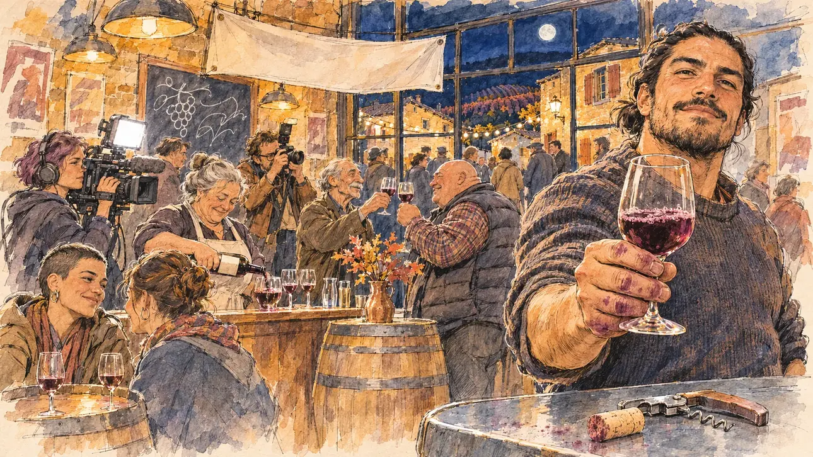

# `beaujolais` · Le Beaujolais nouveau

**Validée par le PO le 05/11/2026**, au premier essai, avec `primeTime.webp` comme référence. Elle sert telle quelle en clair et en sombre.



| Champ | Valeur |
| --- | --- |
| Carte | `beaujolais`, catégorie `buzz` (Buzz), carte ajoutée par la PR #297 de l'app |
| Style | Reportage dessiné, trait de `primeTime` |
| Ton | Festif et chaleureux |
| Date | 2026-11-05 |
| Outil | ChatGPT Images |
| Conversation | À remplir (le lien ne s'ouvre qu'avec le compte qui l'a créée) |
| Format rendu | 1672 × 941 (16:9) : export en 1290 × 726 px, WebP de qualité 75, 248 Ko, sans recadrage |
| Fichier d'origine | Image de ChatGPT, chez le PO. L'export du dépôt a été fait depuis la copie partagée dans la conversation avec Claude |
| Première édition | La prochaine Release qui suit le merge de la PR #297 de l'app |

## Texte de la carte

> **Le Beaujolais nouveau**
>
> Troisième jeudi de novembre : à minuit, bars et caves de tout le pays débouchent le vin nouveau. Dans un café de village, un vigneron venu présenter sa cuvée vous tend un verre devant les caméras.

## Le moment choisi

Le café d'un village des Pierres Dorées, dans le Beaujolais, à minuit, le troisième jeudi de novembre, vu depuis le comptoir où le candidat (hors champ) vient d'arriver : au premier plan, le coin du zinc avec un tire-bouchon et un bouchon. Un jeune vigneron tend au candidat un verre de vin nouveau devant les caméras. Autour : la patronne qui remplit les verres, les habitués au comptoir, une cadreuse et sa lampe, un photographe, une saisonnière des vendanges, des tonneaux en guise de tables, une banderole sans mots. Par la fenêtre : la rue de nuit, les maisons de pierre dorée, des guirlandes lumineuses et les vignes rousses sur les coteaux.

## Prompt complet

Dans une nouvelle conversation, avec [`primeTime.webp`](../../illustrations/media/primeTime.webp) comme seule image de référence.

```
Use the attached image as the style reference and copy its drawing: a realistic reportage drawing made on the spot for a newspaper, with quick, nervous pencil lines, often drawn twice, ink hatching in the shadows, transparent watercolour washes that spill a little over the lines, and the warm paper showing through. Not the same scene and not the same people: never reuse the face or the hair of the woman in the reference.
Like in the reference, the setting can be full when the story needs it, with the things that say where we are and what is happening, but each one is sketched with a few pencil lines and a light wash, never rendered or finished, and the drawing gets looser and paler towards the edges until it fades into the bare paper.
This must look like a drawing made by hand on paper by a press illustrator, halfway between a quick sketch and a realistic picture: never a photograph, a film poster or a digital painting, and never a cartoon, a comic strip, a caricature or a children's book illustration. Continuous lines, never dotted or dashed outlines; no uniform texture, speckles or hatching filter laid over the picture; no glossy highlights, no smooth gradients, in the sky and on the walls too. Colour can be rich in places, on a piece of clothing, a light or a flag, but it stays transparent and within the palette below. The fade into the paper at the edges stays narrow, without a wide white margin. No blur and no depth-of-field effect: everything, the foreground included, is drawn sharp, like a sketch made on the spot.
People are drawn from life with realistic anatomy and proportions, like in the reference: faces shaped with pencil lines, hatching and light washes, a little more finished than the background but never photographic (no photographic skin, no airbrushed or digital-painting look). Expressions stay natural and restrained, even in laughter or tears: no exaggerated grins, no wide-open mouths full of teeth, no rubbery or cartoonish faces.

Editorial illustration, landscape 16:9 (1536 × 864 px), the scene filling the frame, with only a light fade into the paper at the edges. The café of a small village of golden stone in the Beaujolais, north of Lyon, at midnight on the third Thursday of November 2026: all over the country, bars and wine cellars uncork the new wine at the stroke of midnight, and in this village café a winemaker who has come to present his cuvée holds out a glass to the player's candidate in front of the cameras. The scene is seen from the bar where the candidate has just arrived, who stays off-camera: in the foreground, only the corner of the zinc bar with a corkscrew and a cork. In the right third, a young winemaker in his thirties of Chilean origin, broad-shouldered, with thick black hair tied in a short ponytail, a short black beard and a wool jumper with its sleeves pushed up, his hands stained purple, holds out a glass of the purple-red new wine towards the viewer with a proud, warm, slightly challenging smile, his face above mid-height. Around him, sketched in pencil and light washes: the café owner, a round woman in her sixties with a grey bun and an apron, filling glasses from a bottle with a plain label; regulars at the bar raising their glasses: a thin old man, bare-headed, with a grey moustache, and a heavy, bald man in a padded vest; a TV camerawoman with short purple hair and the bright white light of her camera; a lanky press photographer with a flash; a seasonal grape picker in her twenties of Romanian origin with a buzz cut and earrings, laughing with a friend; wooden barrels used as tables, glasses everywhere, a blank banner hung above the bar, a slate board with only chalk doodles, old posters with no readable words. Through the big window, the village street at night: houses of warm golden stone with wooden shutters, strings of small lights, people arriving in coats, and on the dark hillsides above the village the rows of vines in their russet autumn colours under the moon. Only the winemaker looks straight at the viewer. Nothing on the bottles, the labels, the banner, the slate board, the posters, the camera or the shop fronts is readable, and no logo of a real wine estate, brand or TV channel appears.

Style: Reportage drawing made on the spot, like a press illustrator or courtroom sketch artist: pencil and ink with loose watercolour washes, lively unfinished lines, white paper showing through.

Palette: navy #13203F, vellum #F5EFE1, gold #A9802A, brick #B5523B, ochre #D9A441, sage #8FA58A, slate #5E7186, sand #DCC8A4, warm grey #8C8279; use 4 to 6 of them, subtle warm paper grain.

Tone: festive and warm, the amber light of the café at midnight, the deep purple-red of the new wine, the cold blue night through the window, and the white light of the TV camera as the one hard note.

Constraints: realistic proportions, natural expressions, never cartoonish or caricatured faces, drawn like the rest of the illustration and never photographic; people of varied ages, genders, origins and body types (heavy, stocky, round, tall, short, wiry, not only slim), each with a distinct face and haircut (no two people alike), drawn with respect and never as a joke; anatomically correct hands with exactly five fingers, few hands visible, the others in pockets, behind objects or out of frame; no readable text anywhere (the bottles, the labels, the banner, the slate board, the posters, the camera and the shop fronts stay unreadable); no captions or speech bubbles; no logos or political party colours; no recognisable real person, no lookalike of a real politician, and no logo of a real wine estate, brand or TV channel; no explicit violence; no photographic rendering, no blur or bokeh, no dotted outlines, no texture or hatching filter over the picture, no oil-paint texture, no wide white margin or frame (a light fade into the paper at the edges is fine).

Format: if 16:9 is not available, make 1536 × 1024 and keep the top 80 px and the bottom 80 px free of anything important (faces, hands, the main action): they will be cropped.
```

## Décisions prises sur cette image

Aucune.

## Essais écartés

Aucun.

## Retouches

Aucune.

## Relecture

Faite et validée par le PO le 05/11/2026.

- [x] Aucun texte lisible : la banderole et les étiquettes sont vides, l'ardoise n'a qu'une grappe et une feuille à la craie ; rien n'est lisible sur les affiches, la caméra ni les façades.
- [x] Aucun sosie d'une personne réelle.
- [x] Le candidat du joueur est hors champ.
- [x] Mains, visages et foules sans défaut visible à 343 px de large.
- [x] Aucune couleur ni aucun logo de parti. Des personnes variées par l'âge, le corps, l'origine et la coiffure.
- [x] En 3:2 : sans objet, l'image est en 16:9.
- [x] Lisible sur la page de l'événement, en clair et en sombre.

Ce que la relecture a accepté : le vigneron porte les cheveux mi-longs détachés plutôt qu'en queue de cheval ; quelques silhouettes coiffées d'un chapeau dans la rue, derrière la vitre.
