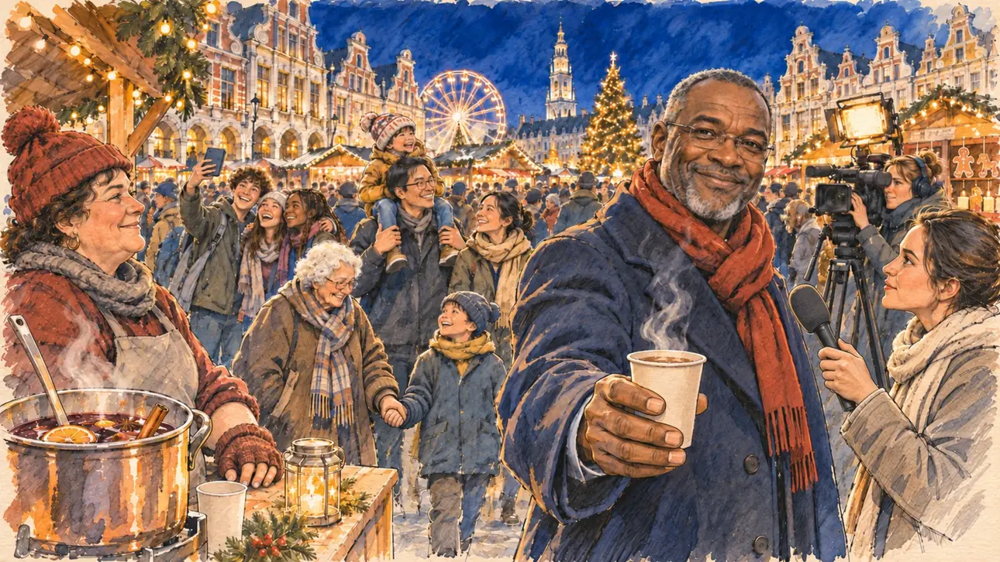

# `christmasMarket` · Le marché de Noël

**Validée par le PO le 05/11/2026**, au premier essai, avec `primeTime.webp` comme référence. Elle sert telle quelle en clair et en sombre.



| Champ | Valeur |
| --- | --- |
| Carte | `christmasMarket`, catégorie `buzz` (Buzz), carte ajoutée par la PR #297 de l'app |
| Style | Reportage dessiné, trait de `primeTime` |
| Ton | Festif et chaleureux |
| Date | 2026-11-05 |
| Outil | ChatGPT Images |
| Conversation | À remplir (le lien ne s'ouvre qu'avec le compte qui l'a créée) |
| Format rendu | 1672 × 941 (16:9) : export en 1290 × 726 px, WebP de qualité 75, 181 Ko, sans recadrage |
| Fichier d'origine | Image de ChatGPT, chez le PO. L'export du dépôt a été fait depuis la copie partagée dans la conversation avec Claude |
| Première édition | La prochaine Release qui suit le merge de la PR #297 de l'app |

## Texte de la carte

> **Le marché de Noël**
>
> Sur la place d'une ville moyenne, le marché de Noël attire des milliers de visiteurs, et le maire vous glisse un vin chaud dans la main devant les caméras.

## Le moment choisi

Le marché de Noël sur la Grand-Place d'Arras, un samedi soir de décembre, vu depuis l'allée où le candidat (hors champ) passe entre les chalets : au premier plan, une marmite de vin chaud fumante et sa louche sur le comptoir d'un chalet. Le maire, écharpe rouge et long manteau, glisse au candidat un gobelet de vin chaud devant les caméras. Autour : la foule entre les chalets de bois illuminés, une marchande de vin chaud, une famille avec deux enfants, des collégiens qui se prennent en photo, une grand-mère et son petit-fils, une équipe de télévision avec sa lampe. Derrière : la grande roue, le sapin et les façades flamandes à pignons de la Grand-Place sur leurs arcades, et le beffroi illuminé.

## Prompt complet

Dans une nouvelle conversation, avec [`primeTime.webp`](../../illustrations/media/primeTime.webp) comme seule image de référence.

```
Use the attached image as the style reference and copy its drawing: a realistic reportage drawing made on the spot for a newspaper, with quick, nervous pencil lines, often drawn twice, ink hatching in the shadows, transparent watercolour washes that spill a little over the lines, and the warm paper showing through. Not the same scene and not the same people: never reuse the face or the hair of the woman in the reference.
Like in the reference, the setting can be full when the story needs it, with the things that say where we are and what is happening, but each one is sketched with a few pencil lines and a light wash, never rendered or finished, and the drawing gets looser and paler towards the edges until it fades into the bare paper.
This must look like a drawing made by hand on paper by a press illustrator, halfway between a quick sketch and a realistic picture: never a photograph, a film poster or a digital painting, and never a cartoon, a comic strip, a caricature or a children's book illustration. Continuous lines, never dotted or dashed outlines; no uniform texture, speckles or hatching filter laid over the picture; no glossy highlights, no smooth gradients, in the sky and on the walls too. Colour can be rich in places, on a piece of clothing, a light or a flag, but it stays transparent and within the palette below. The fade into the paper at the edges stays narrow, without a wide white margin. No blur and no depth-of-field effect: everything, the foreground included, is drawn sharp, like a sketch made on the spot.
People are drawn from life with realistic anatomy and proportions, like in the reference: faces shaped with pencil lines, hatching and light washes, a little more finished than the background but never photographic (no photographic skin, no airbrushed or digital-painting look). Expressions stay natural and restrained, even in laughter or tears: no exaggerated grins, no wide-open mouths full of teeth, no rubbery or cartoonish faces.

Editorial illustration, landscape 16:9 (1536 × 864 px), the scene filling the frame, with only a light fade into the paper at the edges. The Christmas market on the Grand-Place of Arras, a mid-sized town in the Pas-de-Calais, in the North, on a cold, dry Saturday evening in mid-December 2026: the market draws thousands of visitors, and the mayor slips a cup of mulled wine into the player's candidate's hand in front of the cameras. The scene is seen from the aisle where the candidate walks between the chalets, who stays off-camera: in the foreground, only a steaming pot of mulled wine with a ladle on the counter of a wooden chalet. In the right third, the mayor of the town, a man in his fifties of Malian origin, tall and solid, with close-cropped greying hair, a short grey beard and rimless glasses, in a long navy wool coat with a red scarf, holds out a steaming cup of mulled wine towards the viewer with a broad, satisfied, knowing smile, glancing at the cameras, his face above mid-height. Around him, sketched in pencil and light washes: the crowd between the lit wooden chalets hung with greenery and small lights; the mulled-wine seller, a stout woman in her forties with a red pompom hat and fingerless gloves; a family with two small children in bobble hats, the father of Vietnamese origin carrying the smaller one on his shoulders; three teenagers taking a selfie; a grandmother with white curls holding her grandson's hand; a TV crew, a camerawoman with a bright camera light and a young reporter with a plain foam microphone; stalls of gingerbread, wooden toys and candles. Behind them, a big lit Ferris wheel, a tall Christmas tree, and around the vast square the tall Flemish baroque façades of the Grand-Place with their curved stepped gables and their arcades on stone columns, and above the roofs the tall lit belfry of the town hall against the deep blue night sky. Only the mayor looks straight at the viewer. Nothing on the chalets, the signs, the cups, the camera, the microphone or the shop fronts is readable, and no logo of a real brand or TV channel appears.

Style: Reportage drawing made on the spot, like a press illustrator or courtroom sketch artist: pencil and ink with loose watercolour washes, lively unfinished lines, white paper showing through.

Palette: navy #13203F, vellum #F5EFE1, gold #A9802A, brick #B5523B, ochre #D9A441, sage #8FA58A, slate #5E7186, sand #DCC8A4, warm grey #8C8279; use 4 to 6 of them, subtle warm paper grain.

Tone: festive and warm, the deep blue of a cold December evening, the golden glow of the chalets and the strings of lights, the red of the mayor's scarf and the steam of the mulled wine.

Constraints: realistic proportions, natural expressions, never cartoonish or caricatured faces, drawn like the rest of the illustration and never photographic; people of varied ages, genders, origins and body types (heavy, stocky, round, tall, short, wiry, not only slim), each with a distinct face and haircut (no two people alike), drawn with respect and never as a joke; anatomically correct hands with exactly five fingers, few hands visible, the others in pockets, behind objects or out of frame; no readable text anywhere (the chalets, the signs, the cups, the camera, the microphone and the shop fronts stay unreadable); no captions or speech bubbles; no logos or political party colours; no recognisable real person, no lookalike of a real politician, and no logo of a real brand or TV channel; no explicit violence; no photographic rendering, no blur or bokeh, no dotted outlines, no texture or hatching filter over the picture, no oil-paint texture, no wide white margin or frame (a light fade into the paper at the edges is fine).

Format: if 16:9 is not available, make 1536 × 1024 and keep the top 80 px and the bottom 80 px free of anything important (faces, hands, the main action): they will be cropped.
```

## Décisions prises sur cette image

Aucune.

## Essais écartés

Aucun.

## Retouches

Aucune.

## Relecture

Faite et validée par le PO le 05/11/2026.

- [x] Aucun texte lisible : rien n'est lisible sur les chalets, les enseignes, les gobelets, la caméra, le micro ni les façades.
- [x] Aucun sosie d'une personne réelle.
- [x] Le candidat du joueur est hors champ.
- [x] Mains, visages et foules sans défaut visible à 343 px de large.
- [x] Aucune couleur ni aucun logo de parti. Des personnes variées par l'âge, le corps, l'origine et la coiffure.
- [x] En 3:2 : sans objet, l'image est en 16:9.
- [x] Lisible sur la page de l'événement, en clair et en sombre.

Ce que la relecture a accepté : des couleurs plus saturées et plus lumineuses que dans `primeTime`, pour un soir de fête ; plusieurs visages de la foule rient franchement ; le père porte l'enfant sur les épaules, mais la mère qui le suit n'était pas demandée.
