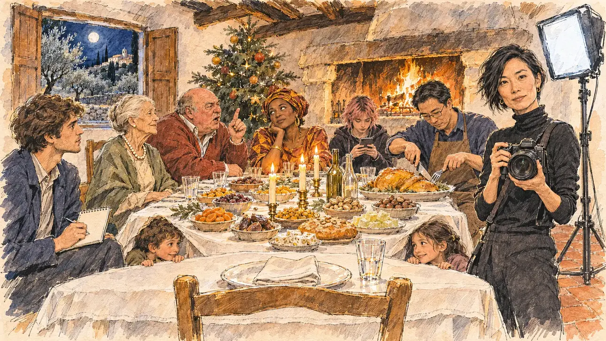

# `christmasTable` · Le repas de Noël

**Validée par le PO le 05/11/2026**, au premier essai, avec `primeTime.webp` comme référence. Elle sert telle quelle en clair et en sombre.



| Champ | Valeur |
| --- | --- |
| Carte | `christmasTable`, catégorie `buzz` (Buzz), carte ajoutée par la PR #297 de l'app |
| Style | Reportage dessiné, trait de `primeTime` |
| Ton | Chaleureux et un peu gêné |
| Date | 2026-11-05 |
| Outil | ChatGPT Images |
| Conversation | À remplir (le lien ne s'ouvre qu'avec le compte qui l'a créée) |
| Format rendu | 1672 × 941 (16:9) : export en 1290 × 726 px, WebP de qualité 75, 259 Ko, sans recadrage |
| Fichier d'origine | Image de ChatGPT, chez le PO. L'export du dépôt a été fait depuis la copie partagée dans la conversation avec Claude |
| Première édition | La prochaine Release qui suit le merge de la PR #297 de l'app |

## Texte de la carte

> **Le repas de Noël**
>
> Un magazine du week-end prépare un dossier sur les repas de Noël des candidats : on vous demande une photo de votre tablée et les sujets dont vous parlerez en famille.

## Le moment choisi

La salle à manger d'un mas de famille en Provence, près d'Avignon, le soir du 24 décembre, vue depuis la place du candidat (hors champ) en bout de table : au premier plan, son assiette, sa serviette pliée et sa chaise reculée. La photographe du magazine, appareil à la main, demande du regard au candidat si la famille est prête. Autour de la table aux trois nappes blanches et aux treize desserts : la grand-mère, un oncle qui parle déjà politique, sa femme qui lève les yeux au ciel, une cousine sur son téléphone, des enfants sous la table, un beau-frère qui découpe le chapon, la journaliste et son carnet. Derrière : la cheminée, les poutres, le sapin, et par la fenêtre les oliviers, les cyprès et un village perché sous la lune.

## Prompt complet

Dans une nouvelle conversation, avec [`primeTime.webp`](../../illustrations/media/primeTime.webp) comme seule image de référence.

```
Use the attached image as the style reference and copy its drawing: a realistic reportage drawing made on the spot for a newspaper, with quick, nervous pencil lines, often drawn twice, ink hatching in the shadows, transparent watercolour washes that spill a little over the lines, and the warm paper showing through. Not the same scene and not the same people: never reuse the face or the hair of the woman in the reference.
Like in the reference, the setting can be full when the story needs it, with the things that say where we are and what is happening, but each one is sketched with a few pencil lines and a light wash, never rendered or finished, and the drawing gets looser and paler towards the edges until it fades into the bare paper.
This must look like a drawing made by hand on paper by a press illustrator, halfway between a quick sketch and a realistic picture: never a photograph, a film poster or a digital painting, and never a cartoon, a comic strip, a caricature or a children's book illustration. Continuous lines, never dotted or dashed outlines; no uniform texture, speckles or hatching filter laid over the picture; no glossy highlights, no smooth gradients, in the sky and on the walls too. Colour can be rich in places, on a piece of clothing, a light or a flag, but it stays transparent and within the palette below. The fade into the paper at the edges stays narrow, without a wide white margin. No blur and no depth-of-field effect: everything, the foreground included, is drawn sharp, like a sketch made on the spot.
People are drawn from life with realistic anatomy and proportions, like in the reference: faces shaped with pencil lines, hatching and light washes, a little more finished than the background but never photographic (no photographic skin, no airbrushed or digital-painting look). Expressions stay natural and restrained, even in laughter or tears: no exaggerated grins, no wide-open mouths full of teeth, no rubbery or cartoonish faces.

Editorial illustration, landscape 16:9 (1536 × 864 px), the scene filling the frame, with only a light fade into the paper at the edges. The dining room of an old family mas, a Provençal farmhouse, near Avignon, in Provence, on the evening of 24 December 2026: a weekend magazine is preparing a feature on the candidates' Christmas dinners and has asked the player's candidate for a photo of the family table and the topics they will talk about. The scene is seen from the candidate's own place at the end of the table, who stays off-camera: in the foreground, only the candidate's place setting, a plate, a folded napkin and a glass, and the chair pulled back. In the right third, the magazine photographer, a woman in her thirties of Japanese origin, small and wiry, with a short asymmetric black haircut and a black turtleneck, a camera in her hands at chest height and a softbox light on a stand beside her, glances at the viewer with a patient, amused, questioning look, as if asking whether the family is ready, her face above mid-height. Around the long table laid in the Provençal way with three white tablecloths, three candles and the thirteen Christmas desserts, dried fruits, nougats, dates, a flat sweet bread and winter melons, beside a capon and plain unlabelled bottles, sketched in pencil and light washes, the candidate's family, of mixed origins: a grandmother in her eighties with white hair in a neat bun and a pearl necklace, sitting very straight; an uncle in his sixties, heavy and red-faced, bare-headed, already arguing politics with a raised finger; his wife of Senegalese origin, in a bright wrap dress, rolling her eyes; a teenage cousin with dyed pink hair scrolling her phone; two small children peeking out from under the table; a brother-in-law of Chinese origin with glasses carving the capon; at the corner of the table, the magazine journalist, a lanky young man with a notebook, waiting for the topics of conversation. Behind them, the big stone fireplace with a fire, whitewashed walls, dark beams, a floor of red terracotta tiles, a decorated Christmas tree, and through the deep window with its wooden shutters, in the moonlight, silver olive trees, a row of dark cypresses, dry-stone walls and, on a hill in the distance, a perched village of pale stone with its round-tiled roofs. There is no framed photo anywhere in the room. Only the photographer looks straight at the viewer. Nothing on the place cards, the notebook, the camera, the bottles, the wrapping paper or the window is readable, and no logo of a real magazine or brand appears.

Style: Reportage drawing made on the spot, like a press illustrator or courtroom sketch artist: pencil and ink with loose watercolour washes, lively unfinished lines, white paper showing through.

Palette: navy #13203F, vellum #F5EFE1, gold #A9802A, brick #B5523B, ochre #D9A441, sage #8FA58A, slate #5E7186, sand #DCC8A4, warm grey #8C8279; use 4 to 6 of them, subtle warm paper grain.

Tone: warm and a little awkward, the golden light of the candles and the fire, the hard white light of the photographer's softbox as the one cold note, and the ochre and red of the terracotta tiles and the Christmas tree baubles.

Constraints: realistic proportions, natural expressions, never cartoonish or caricatured faces, drawn like the rest of the illustration and never photographic; people of varied ages, genders, origins and body types (heavy, stocky, round, tall, short, wiry, not only slim), each with a distinct face and haircut (no two people alike), drawn with respect and never as a joke; anatomically correct hands with exactly five fingers, few hands visible, the others in pockets, behind objects or out of frame; no readable text anywhere (the place cards, the notebook, the camera, the bottles, the wrapping paper and the window stay unreadable); no captions or speech bubbles; no logos or political party colours; no recognisable real person, no lookalike of a real politician, and no logo of a real magazine or brand; no explicit violence; no photographic rendering, no blur or bokeh, no dotted outlines, no texture or hatching filter over the picture, no oil-paint texture, no wide white margin or frame (a light fade into the paper at the edges is fine).

Format: if 16:9 is not available, make 1536 × 1024 and keep the top 80 px and the bottom 80 px free of anything important (faces, hands, the main action): they will be cropped.
```

## Décisions prises sur cette image

Aucune.

## Essais écartés

Aucun.

## Retouches

Aucune.

## Relecture

Faite et validée par le PO le 05/11/2026.

- [x] Aucun texte lisible : rien n'est lisible sur le carnet, l'appareil, les bouteilles ni la fenêtre ; aucun cadre photo dans la pièce.
- [x] Aucun sosie d'une personne réelle.
- [x] Le candidat du joueur est hors champ.
- [x] Mains, visages et foules sans défaut visible à 343 px de large.
- [x] Aucune couleur ni aucun logo de parti. Des personnes variées par l'âge, le corps, l'origine et la coiffure.
- [x] En 3:2 : sans objet, l'image est en 16:9.
- [x] Lisible sur la page de l'événement, en clair et en sombre.

Ce que la relecture a accepté : la table paraît ronde plutôt que longue, et les trois nappes se lisent comme une seule ; le journaliste est au bord gauche, la photographe au bord droit.
