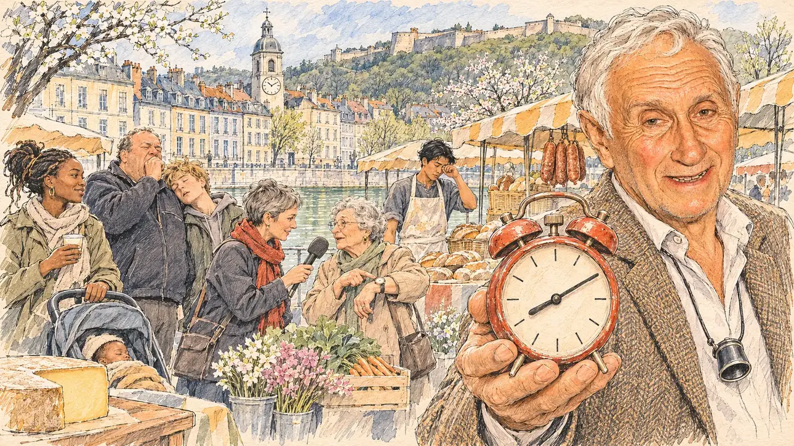

# `clockChange` · Une heure de moins

**À générer.** Prompt prêt le 05/11/2026, pas encore d'image validée.



| Champ | Valeur |
| --- | --- |
| Carte | `clockChange`, catégorie `buzz` (Buzz), carte ajoutée par la PR #297 de l'app |
| Style | Reportage dessiné, trait de `primeTime` |
| Ton | Amusé et chaleureux |
| Date | À remplir |
| Outil | ChatGPT Images |
| Conversation | À remplir (le lien ne s'ouvre qu'avec le compte qui l'a créée) |
| Format rendu | À remplir |
| Fichier d'origine | À remplir |
| Première édition | À remplir |

## Texte de la carte

> **Une heure de moins**
>
> Dans la nuit de samedi à dimanche, les Français ont perdu une heure de sommeil. Les journaux relancent le vieux débat : faut-il supprimer le changement d'heure, et quelle heure garder ?

## Le moment choisi

Le marché du dimanche matin sur les quais du Doubs, à Besançon, le lendemain du passage à l'heure d'été, fin mars, vu depuis l'allée où le candidat (hors champ) traverse le marché : au premier plan, le coin d'un étal de fromager avec une meule de comté entamée. Un horloger à la retraite tend au candidat un vieux réveil rouge, aiguilles avancées d'une heure, avec un sourire malicieux. Autour : les habitants qui bâillent, une jeune mère décoiffée son café à la main, un ado endormi debout, un boulanger qui se frotte les yeux, une journaliste de radio qui interroge les passants. Derrière : le Doubs, les façades de pierre grise et ocre du quartier Battant, un clocher à horloge et, sur la colline, la citadelle de Vauban.

## Prompt complet

Dans une nouvelle conversation, avec deux images jointes, dans cet ordre : [`primeTime.webp`](../../illustrations/media/primeTime.webp) pour le style, puis le portrait dessiné fourni par le PO pour la ressemblance de l'horloger à la retraite. Le portrait n'est pas dans ce dépôt.

```
Use the first attached image as the style reference and copy its drawing: a realistic reportage drawing made on the spot for a newspaper, with quick, nervous pencil lines, often drawn twice, ink hatching in the shadows, transparent watercolour washes that spill a little over the lines, and the warm paper showing through. Not the same scene and not the same people: never reuse the face or the hair of the woman in the reference.
Like in the reference, the setting can be full when the story needs it, with the things that say where we are and what is happening, but each one is sketched with a few pencil lines and a light wash, never rendered or finished, and the drawing gets looser and paler towards the edges until it fades into the bare paper.
Use the second attached image, a drawn portrait, only as the likeness reference for the retired watchmaker: give him this man's features, his thick, wavy white hair swept back from a high forehead, his brown eyes, his deep wrinkles and his ruddy cheeks, with light white stubble and no beard, at the same age as in the portrait, and draw his face with the same pencil lines and washes as the other people in the scene. Keep the likeness through the drawing, never through photographic detail.
This must look like a drawing made by hand on paper by a press illustrator, halfway between a quick sketch and a realistic picture: never a photograph, a film poster or a digital painting, and never a cartoon, a comic strip, a caricature or a children's book illustration. Continuous lines, never dotted or dashed outlines; no uniform texture, speckles or hatching filter laid over the picture; no glossy highlights, no smooth gradients, in the sky and on the walls too. Colour can be rich in places, on a piece of clothing, a light or a flag, but it stays transparent and within the palette below. The fade into the paper at the edges stays narrow, without a wide white margin. No blur and no depth-of-field effect: everything, the foreground included, is drawn sharp, like a sketch made on the spot.
People are drawn from life with realistic anatomy and proportions, like in the reference: faces shaped with pencil lines, hatching and light washes, a little more finished than the background but never photographic (no photographic skin, no airbrushed or digital-painting look). Expressions stay natural and restrained, even in laughter or tears: no exaggerated grins, no wide-open mouths full of teeth, no rubbery or cartoonish faces.

Editorial illustration, landscape 16:9 (1536 × 864 px), the scene filling the frame, with only a light fade into the paper at the edges. The Sunday-morning market on the quays of the Doubs in Besançon, in Franche-Comté, the French capital of watchmaking, on the last Sunday of March 2027, the morning after the switch to summer time: during the night the French lost an hour of sleep, and the papers revive the old debate on whether to abolish the clock change and which time to keep. The scene is seen from the aisle where the player's candidate walks through the market, who stays off-camera: in the foreground, only the corner of a cheese stall with a cut wheel of Comté on its wooden board. In the right third, a retired watchmaker, the man from the portrait, in his late seventies, bare-headed, with a watchmaker's loupe hanging on a cord round his neck and a tweed jacket over a white open-collar shirt, holds out towards the viewer an old red bell alarm clock, its hands pushed one hour forward, with the warm, sly smile of the portrait, his mouth only slightly open, his face above mid-height. The clock face has only hour marks, no numerals. Around him, sketched in pencil and light washes: people at the market yawning in the still-low light: a young mother of Cameroonian origin with her braids tied up in a hurry, a coffee in one hand and a pushchair in the other; a bare-headed man in his fifties, heavy-set, in a fleece, stifling a yawn behind his fist; a teenage boy with messy blond hair asleep on his feet, leaning on his father's shoulder; the baker at his stall, a tall young man of Laotian origin with a flour-dusted apron, rubbing his eyes; a radio journalist in her forties with short grey hair and a red scarf, holding a microphone with a plain foam cover out to an elderly woman who points at her wristwatch; stalls of vegetables, flowers and Morteau sausages, wicker baskets, a few blossoming trees. Behind them, the green water of the Doubs, the tall façades of blue-grey and ochre limestone of the Battant quarter with their tall windows, a church bell tower with a big clock face, and on the wooded hill above the town the long walls of Vauban's citadel in the pale morning sky. Only the watchmaker looks straight at the viewer. Nothing on the clock faces, the stalls, the price tags, the newspapers, the microphone or the shop fronts is readable, and no logo of a real newspaper, radio, watch brand or company appears.

Style: Reportage drawing made on the spot, like a press illustrator or courtroom sketch artist: pencil and ink with loose watercolour washes, lively unfinished lines, white paper showing through.

Palette: navy #13203F, vellum #F5EFE1, gold #A9802A, brick #B5523B, ochre #D9A441, sage #8FA58A, slate #5E7186, sand #DCC8A4, warm grey #8C8279; use 4 to 6 of them, subtle warm paper grain.

Tone: amused and warm, the soft, still-low light of an early spring morning on the Doubs, the pale gold of the Comté and the blue-grey and ochre stone of Besançon, and the red alarm clock as the bright note.

Constraints: realistic proportions, natural expressions, never cartoonish or caricatured faces, drawn like the rest of the illustration and never photographic; people of varied ages, genders, origins and body types (heavy, stocky, round, tall, short, wiry, not only slim), each with a distinct face and haircut (no two people alike), drawn with respect and never as a joke; anatomically correct hands with exactly five fingers, few hands visible, the others in pockets, behind objects or out of frame; no readable text anywhere (the clock faces, the stalls, the price tags, the newspapers, the microphone and the shop fronts stay unreadable); no captions or speech bubbles; no logos or political party colours; apart from the watchmaker, no recognisable real person, no lookalike of a real politician, and no logo of a real newspaper, radio, watch brand or company; no explicit violence; no photographic rendering, no blur or bokeh, no dotted outlines, no texture or hatching filter over the picture, no oil-paint texture, no wide white margin or frame (a light fade into the paper at the edges is fine).

Format: if 16:9 is not available, make 1536 × 1024 and keep the top 80 px and the bottom 80 px free of anything important (faces, hands, the main action): they will be cropped.
```

## Décisions prises sur cette image

- **L'horloger à la retraite reprend les traits d'un portrait dessiné fourni par le PO** (05/11/2026) : ses cheveux blancs épais et ondulés, ses yeux bruns, ses rides, une barbe blanche de quelques jours, à la place du bouc blanc et de l'origine arménienne du premier prompt, et le sourire du portrait, la bouche à peine ouverte. L'accord de la personne est à confirmer par le PO avant la validation de l'image. Le portrait n'est pas dans ce dépôt, et la fiche ne nomme personne.

## Essais écartés

Aucun pour l'instant.

## Retouches

Aucune.

## Relecture

À faire sur l'image validée.
