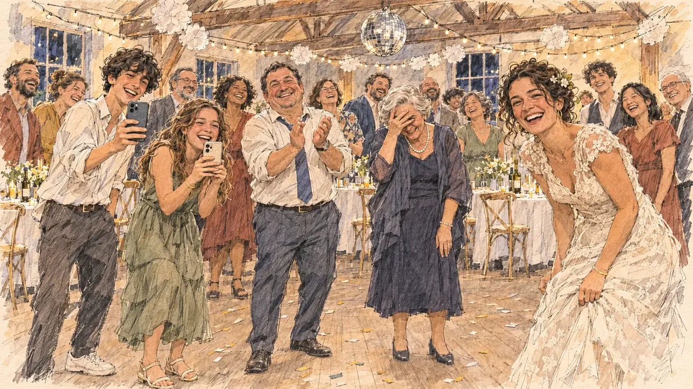

# `danceVideo` · Une danse virale

**Validée par le PO le 31/10/2026**, à l'essai 2. Elle sert telle quelle en clair et en sombre.



| Champ | Valeur |
| --- | --- |
| Carte | `danceVideo`, catégorie `buzz` (Buzz) |
| Style | Reportage dessiné |
| Ton | Chaleureux et ironique |
| Date | 2026-10-31 |
| Outil | ChatGPT avec le modèle GPT Sol 6.1 en effort « light », et ChatGPT Images 2.5 |
| Conversation | À remplir (le lien ne s'ouvre qu'avec le compte qui l'a créée) |
| Format rendu | 1672 × 941 (16:9) : export en 1290 × 726 px depuis le PNG d'origine, WebP de qualité 75, 143 Ko, sans recadrage |
| Fichier d'origine | PNG de ChatGPT, chez le PO, partagé aussi dans la conversation avec Claude |
| Première édition | `kit-france-2611-0001` |

## Texte de la carte

> **Une danse virale**
>
> Une vidéo de vous dansant, très maladroitement, au mariage d'un cousin devient virale. Des millions de vues en une nuit.

## Le moment choisi

Le candidat ne peut pas apparaître : la scène est vue depuis la piste de danse, à sa place, au moment où la vidéo se tourne. La mariée, sa cousine, rit aux éclats ; deux ados filment, un oncle applaudit, une vieille tante se cache les yeux, et toute la salle rit. Ici, que tout le monde regarde le candidat est naturel : ils regardent la danse.

## Prompt complet

Dans une nouvelle conversation, avec [`oldTweet.webp`](../../illustrations/polemic/oldTweet.webp) comme seule image de référence :

```
Use the attached image as the style reference: the same pencil and ink drawing with loose watercolour washes and warm paper grain. Faces, hands and objects are drawn with visible ink lines, never photographic. Not the same scene.

Editorial illustration, landscape 16:9 (1536 × 864 px), filling the whole frame edge to edge. A family wedding party in a village hall in France, late at night in 2027. The scene is seen from the middle of the dance floor, where the player's candidate is dancing very clumsily and stays off-camera: in the foreground, only the wooden floor and a few scattered confetti. In the right third, the bride, the candidate's cousin, in her thirties, laughs out loud and looks at the viewer, her face above mid-height. Around the dance floor, the guests form a circle: two teenagers film the viewer with their smartphones, an uncle with his tie loosened claps, an elderly aunt hides her eyes in mock embarrassment, and a few guests laugh at their tables. String lights, a small disco ball and paper garlands hang above them. Nothing on the screens, banners or decorations is readable.

Style: Reportage drawing made on the spot, like a press illustrator or courtroom sketch artist: pencil and ink with loose watercolour washes, lively unfinished lines, white paper showing through.

Palette: navy #13203F, vellum #F5EFE1, gold #A9802A, brick #B5523B, ochre #D9A441, sage #8FA58A, slate #5E7186, sand #DCC8A4, warm grey #8C8279; use 4 to 6 of them, subtle warm paper grain.

Tone: warm and gently ironic, festive night light from string lights and a disco ball, warm pastels.

Constraints: realistic proportions, expressive but not caricatured faces, people of varied ages, genders and origins; anatomically correct hands with exactly five fingers, few hands visible, the others in pockets, behind objects or out of frame; no readable text anywhere (signs, banners, labels and screens stay blank or unreadable); no captions or speech bubbles; no logos, flags or political party colours; no recognisable real person, no lookalike of a real politician; no explicit violence; no oil-paint texture, no white or ragged border.

Format: if 16:9 is not available, make 1536 × 1024 and keep the top 80 px and the bottom 80 px free of anything important (faces, hands, the main action): they will be cropped.
```

## Essais écartés

- **Essai 1** (31/10/2026) : la même scène, mais le premier plan montrait une estrade ronde en bois au lieu du parquet de la piste. L'essai 2, refait par le PO, montre la piste en entier.

## Retouches

Aucune.

## Relecture

Faite et validée par le PO le 31/10/2026, sur l'essai 2.

- [x] Aucun texte lisible : ni sur les téléphones, ni dans les décorations.
- [x] Aucun sosie d'une personne réelle.
- [x] Le candidat du joueur est hors champ.
- [x] Mains, visages et foules sans défaut visible à 343 px de large. Il y a beaucoup de mains, toutes correctes.
- [x] Aucune couleur de parti, aucun symbole officiel. Des personnes variées.
- [x] En 3:2 : rien d'important dans les 80 px du haut et du bas. Sans objet ici : l'image est en 16:9.
- [x] Lisible sur la page de l'événement, en clair et en sombre.

## Régénération demandée (04/11/2026)

**Pourquoi.** La revue de la première série note le style à 3/3 et les détails à 3/3 : c'est un autre style, une peinture numérique finie aux visages photographiques (la mariée, les deux ados), une lumière dorée saturée, des halos de guirlandes et des confettis lumineux en bokeh, des reflets brillants sur la robe et le parquet, sans trait d'encre visible ni papier. Le cadre est plein : une quinzaine d'invités, guirlandes et fleurs au plafond, boule à facettes, tables dressées avec bougies, parquet couvert de confettis. Avec `donorsDinner`, c'est l'image la plus loin du style. Le PO a décidé de régénérer l'image.

**Ce qui reste.** Le moment et les quatre personnages que la revue veut garder : la mariée à droite qui rit aux éclats en regardant le spectateur, les deux ados qui filment, l'oncle qui applaudit, la tante qui se cache les yeux. Le candidat reste hors champ, la scène vue de la piste.

**Ce qui change.** Le rendu, dans le trait d'[`oldTweet`](../polemic/oldTweet.md) (PO, 04/11/2026) : plus de halos ni de bokeh, les lumières sont de petits points d'encre, les confettis quelques taches dessinées. La fête reste pleine, esquissée : un cercle d'invités qui rient et applaudissent autour de la piste, quelques tables rondes aux nappes blanches avec bouteilles et bougies, les guirlandes lumineuses et de fleurs en papier sous les poutres, la boule à facettes et le parquet. Chaque personnage du premier plan est redécrit (coiffure, robe, âge) pour des visages dessinés et distincts. Une première version de cette section, écrite avec la règle de « trois ou quatre objets au plus », réduisait la salle à une guirlande et à des silhouettes pâles ; elle a été reprise quand le PO a demandé de ne pas trop simplifier les scènes.

### Prompt de régénération

Dans une nouvelle conversation, avec [`oldTweet.webp`](../../illustrations/polemic/oldTweet.webp) comme seule image de référence.

```
Use the attached image as the style reference and copy its drawing: a realistic reportage drawing made on the spot for a newspaper, with quick, nervous pencil lines, often drawn twice, ink hatching in the shadows, transparent watercolour washes that spill a little over the lines, and the warm paper showing through. Not the same scene.
Like in the reference, the setting can be full when the story needs it, with the things that say where we are and what is happening, but each one is sketched with a few pencil lines and a light wash, never rendered or finished, and the drawing gets looser and paler towards the edges until it fades into the bare paper.
This must look like a drawing made by hand on paper by a press illustrator, halfway between a quick sketch and a realistic picture: never a photograph, a film poster or a digital painting, and never a cartoon, a comic strip, a caricature or a children's book illustration. Continuous lines, never dotted or dashed outlines; no uniform texture, speckles or hatching filter laid over the picture; no dense colour, no glossy highlights, no smooth gradients, in the sky and on the walls too. The fade into the paper at the edges stays narrow, without a wide white margin. No blur and no depth-of-field effect: everything, the foreground included, is drawn sharp, like a sketch made on the spot.
People are drawn from life with realistic anatomy and proportions, like in the reference: faces shaped with pencil lines, hatching and light washes, a little more finished than the background but never photographic (no photographic skin, no airbrushed or digital-painting look). Expressions stay natural and restrained, even in laughter or tears: no exaggerated grins, no wide-open mouths full of teeth, no rubbery or cartoonish faces.

Editorial illustration, landscape 16:9 (1536 × 864 px), the scene filling the frame, with only a light fade into the paper at the edges. A family wedding party in a village hall in France, late at night in 2027. The scene is seen from the middle of the dance floor, where the player's candidate is dancing very clumsily and stays off-camera: in the foreground, only the plain wooden floor drawn with a few long lines and a few scattered confetti. In the right third, the bride, the candidate's cousin, a woman in her thirties with dark curly hair pinned up with a few small flowers, in a simple lace wedding dress, laughs out loud and looks at the viewer, her face above mid-height. On the left, two teenagers film the viewer with their smartphones: a lanky boy of sixteen with a mop of black curls and a loose white shirt, and a round-faced girl of fifteen with long wavy light-brown hair in a green dress, both laughing. In the middle, an uncle in his fifties, stocky, with short black hair, a white shirt with rolled sleeves and a loosened blue tie, claps and looks at the viewer; next to him, an elderly aunt in her seventies with a silver wave of hair, a pearl necklace and a navy dress hides her eyes behind one hand in mock embarrassment, peeking between her fingers. Behind them, the wedding party in full swing, sketched loosely in pencil and light washes: a ring of guests laughing and clapping around the dance floor, their faces drawn quickly; a few round tables with white tablecloths, bottles and candles at the back; strings of lights and garlands of white paper flowers under the wooden beams; a disco ball. The lights are small ink dots and the confetti a few drawn specks, never glowing halos or bokeh. Nothing on the phones is readable.

Style: Reportage drawing made on the spot, like a press illustrator or courtroom sketch artist: pencil and ink with loose watercolour washes, lively unfinished lines, white paper showing through.

Palette: navy #13203F, vellum #F5EFE1, gold #A9802A, brick #B5523B, ochre #D9A441, sage #8FA58A, slate #5E7186, sand #DCC8A4, warm grey #8C8279; use 4 to 6 of them, subtle warm paper grain.

Tone: warm and gently ironic, festive night light from the string of lights and the disco ball, warm pastels.

Constraints: realistic proportions, natural expressions, never cartoonish or caricatured faces, drawn like the rest of the illustration and never photographic; people of varied ages, genders, origins and body types (heavy, stocky, round, tall, short, wiry, not only slim), each with a distinct face and haircut (no two people alike), drawn with respect and never as a joke; anatomically correct hands with exactly five fingers, few hands visible, the others in pockets, behind objects or out of frame; no readable text anywhere (the phones and the decorations stay unreadable); no captions or speech bubbles; no logos or political party colours; no recognisable real person, no lookalike of a real politician; no explicit violence; no photographic rendering, no blur or bokeh, no dotted outlines, no texture or hatching filter over the picture, no oil-paint texture, no wide white margin or frame (a light fade into the paper at the edges is fine).

Format: if 16:9 is not available, make 1536 × 1024 and keep the top 80 px and the bottom 80 px free of anything important (faces, hands, the main action): they will be cropped.
```

### Essais de la régénération

- **Essai 1** (04/11/2026), avec `oldTweet.webp` comme référence : la fête et les personnages étaient justes, mais le dessin avait basculé dans la BD, loin du reportage de presse : visages hilares aux bouches grandes ouvertes, corps caoutchouteux, contours en pointillés et hachures régulières sur les vêtements. Écarté par le PO ; les lignes communes du prompt demandent depuis un dessin de presse réaliste et des expressions naturelles.
