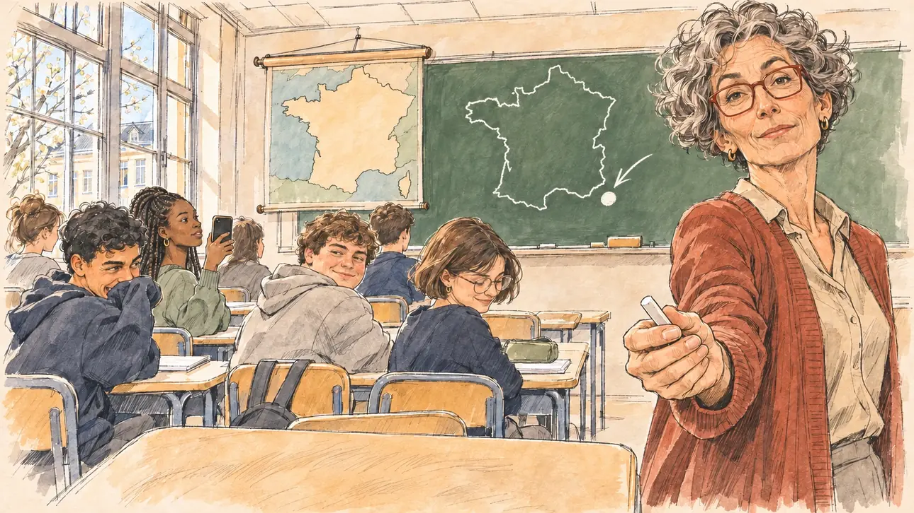

# `geographyMeme` · Votre erreur de géographie

**Validée par le PO le 10/11/2026**, au premier essai. Elle sert telle quelle en clair et en sombre.



| Champ | Valeur |
| --- | --- |
| Carte | `geographyMeme`, catégorie `buzz` (Buzz), poids 0,25, toute semaine ; un pari gagné sur une faiblesse (aller faire campagne dans la ville déplacée, sur une expertise basse) |
| Style | Reportage dessiné |
| Ton | Léger et espiègle, matin de classe |
| Date | 2026-11-10 |
| Outil | ChatGPT Images, à compléter (modèle et effort) |
| Conversation | À compléter |
| Format rendu | 1672 × 941 (16:9) : export en 1290 × 726 px, WebP de qualité 75, 152 Ko, sans recadrage, fait depuis la copie WebP de la conversation (à refaire depuis le PNG d'origine) |
| Fichier d'origine | À compléter (hors du dépôt) |
| Première édition | À compléter |

## Texte de la carte

> **Votre erreur de géographie**
>
> En meeting, vous placez une grande ville dans la mauvaise région. L'extrait devient un mème : des cartes de France farfelues fleurissent partout.

## Le moment choisi

Une salle de classe de lycée, en terrain neutre, le lendemain matin, pendant une visite du candidat prévue de longue date. Au tableau, la professeure d'histoire-géographie a dessiné la France à la craie, une flèche vers un gros point à sa mauvaise place ; la vieille carte murale, sans un nom, pend à côté. Le candidat reste hors champ, devant le tableau. La professeure lui tend un morceau de craie et regarde le spectateur, mi-sérieuse, mi-amusée : on révise ? Les élèves rient sous cape, l'un dans sa manche, une autre téléphone levé.

## Prompt complet

Dans une nouvelle conversation, avec [`primeTime.webp`](../../illustrations/media/primeTime.webp) comme seule image de référence :

```
Use the attached image as the style reference and copy its drawing: a realistic reportage drawing made on the spot for a newspaper, with quick, nervous pencil lines, often drawn twice, ink hatching in the shadows, transparent watercolour washes that spill a little over the lines, and the warm paper showing through. Not the same scene and not the same people: never reuse the face or the hair of the woman in the reference.
Like in the reference, the setting can be full when the story needs it, with the things that say where we are and what is happening, but each one is sketched with a few pencil lines and a light wash, never rendered or finished, and the drawing gets looser and paler towards the edges until it fades into the bare paper.
This must look like a drawing made by hand on paper by a press illustrator, halfway between a quick sketch and a realistic picture: never a photograph, a film poster or a digital painting, and never a cartoon, a comic strip, a caricature or a children's book illustration. Continuous lines, never dotted or dashed outlines; no uniform texture, speckles or hatching filter laid over the picture; no glossy highlights, no smooth gradients, in the sky and on the walls too. Colour can be rich in places, on a piece of clothing, a light or a flag, but it stays transparent and within the palette below. The fade into the paper at the edges stays narrow, without a wide white margin. No blur and no depth-of-field effect: everything, the foreground included, is drawn sharp, like a sketch made on the spot.
People are drawn from life with realistic anatomy and proportions, like in the reference: faces shaped with pencil lines, hatching and light washes, a little more finished than the background but never photographic (no photographic skin, no airbrushed or digital-painting look). Expressions stay natural and restrained, even in laughter or tears: no exaggerated grins, no wide-open mouths full of teeth, no rubbery or cartoonish faces.

Editorial illustration, landscape 16:9 (1536 × 864 px), the scene filling the frame, with only a light fade into the paper at the edges. A classroom in a state lycée in an ordinary French city, on a bright morning in March 2027, during a visit of the player's candidate planned long before, the morning after the candidate placed a big city in the wrong region during a rally and the clip became a meme of absurd maps of France: rows of desks, tall windows, a green chalkboard on which the history and geography teacher has drawn the outline of France in chalk with one big dot in a plainly wrong place and an arrow pointing at it, and next to the board an old pull-down wall map of France with no names on it. The player's candidate stays off-camera, standing at the front of the class: in the foreground, only a pupil's desk with a phone lying on it, its screen showing one of the meme's absurd maps, a distorted outline of France with no words. In the right third, the teacher, a wiry white woman in her fifties with short curly grey hair, red-rimmed glasses and a long cardigan, holds out a stick of chalk towards the viewer and looks at the viewer, half stern, half amused, shall we revise?, her face above mid-height. Around her, the pupils of sixteen and seventeen hold back their laughter: a boy of Algerian descent hides his giggles in his sleeve, a tall girl with box braids holds up her phone, a stocky boy in a hoodie grins at his neighbour, a girl with glasses and a short bob looks down to keep a straight face. Only the teacher looks at the viewer. Nothing on the board, the wall map, the phones, the exercise books or the walls is readable.

Style: Reportage drawing made on the spot, like a press illustrator or courtroom sketch artist: pencil and ink with loose watercolour washes, lively unfinished lines, white paper showing through.

Palette: navy #13203F, vellum #F5EFE1, gold #A9802A, brick #B5523B, ochre #D9A441, sage #8FA58A, slate #5E7186, sand #DCC8A4, warm grey #8C8279; use 4 to 6 of them, subtle warm paper grain.

Tone: light and mischievous, the bright morning light of a classroom, the sage green of the chalkboard and the white chalk dot in the wrong place as the joke of the picture.

Constraints: realistic proportions, natural expressions, never cartoonish or caricatured faces, drawn like the rest of the illustration and never photographic; people of varied ages, genders, origins and body types (heavy, stocky, round, tall, short, wiry, not only slim), each with a distinct face and haircut (no two people alike), drawn with respect and never as a joke; each person's age, build and look plausible for their job and the scene, no stereotype tying an origin or a gender to a role, and no person of colour shown alone in a featured service or deferential role; anatomically correct hands with exactly five fingers, few hands visible, the others in pockets, behind objects or out of frame; no readable text anywhere (the board, the wall map, the phones, the exercise books and the walls stay unreadable, no city names, no letters, no numbers); no captions or speech bubbles; no logos, no political party colours; no recognisable real person, no lookalike of a real politician or teacher; no explicit violence; no photographic rendering, no blur or bokeh, every outline a continuous pencil or ink line with no dotted or dashed outlines, no mottled, crackled or speckled texture over the faces, the clothes or the walls, no chalk-dust speckles over the picture, no hatching filter over the picture, no oil-paint texture, no glow or halo around the windows or the phones, no wide white margin or frame (a light fade into the paper at the edges is fine).

Format: if 16:9 is not available, make 1536 × 1024 and keep the top 80 px and the bottom 80 px free of anything important (faces, hands, the main action): they will be cropped.
```

## Décisions prises sur cette image

Validée telle quelle par le PO (10/11/2026), avec deux écarts gardés :

- le point de craie est en pleine Méditerranée, hors de la France : l'erreur n'est plus de région mais de mer, ce qui renforce le gag ;
- le téléphone du premier plan, avec la carte du mème, n'est pas venu : la table d'élève est vide. Le candidat reste hors champ sans objet à lui ; la craie tendue vers le spectateur dit sa place devant le tableau, comme pour [`collectiveSuspends`](../affair/collectiveSuspends.md).

## Essais écartés

Aucun.

## Retouches

Aucune.

## Relecture

Faite et validée par le PO le 10/11/2026.

- [x] Aucun texte lisible : ni au tableau, ni sur la carte murale, ni sur les téléphones et les cahiers.
- [x] Aucun sosie d'une personne réelle.
- [x] Le candidat du joueur est hors champ, devant le tableau ; son objet du premier plan manque (voir les décisions).
- [x] Mains et visages sans défaut visible à 343 px de large : la main qui tend la craie, celle au téléphone, la main dans la manche.
- [x] Aucune couleur ni aucun logo de parti. Des personnes variées par l'âge, le corps, l'origine et la coiffure.
- [x] En 16:9 : pas de recadrage.
- [ ] Lisible sur la page de l'événement, en clair et en sombre : à vérifier dans l'app, une fois la carte publiée.
