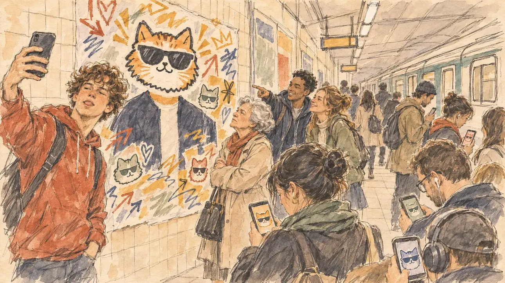

# `sloganMeme` · Votre slogan devient un mème

**Validée par le PO le 31/10/2026**, après une retouche par commentaire. Elle sert telle quelle en clair et en sombre.



| Champ | Valeur |
| --- | --- |
| Carte | `sloganMeme`, catégorie `buzz` (Buzz) |
| Style | Reportage dessiné |
| Ton | Ironique |
| Date | 2026-10-31 |
| Outil | ChatGPT avec le modèle GPT Sol 6.1 en effort « light », et ChatGPT Images 2.5 |
| Conversation | À remplir (le lien ne s'ouvre qu'avec le compte qui l'a créée) |
| Format rendu | 1672 × 941 (16:9) : export en 1290 × 726 px depuis le PNG d'origine, WebP de qualité 75, 162 Ko, sans recadrage |
| Fichier d'origine | PNG de ChatGPT, chez le PO, partagé aussi dans la conversation avec Claude |
| Première édition | `kit-france-2611-0001` |

## Texte de la carte

> **Votre slogan devient un mème**
>
> Internet s'empare de votre slogan et le détourne dans tous les sens. Le mème est partout, et pas toujours à votre avantage.

## Le moment choisi

Le slogan est du texte : il ne peut pas apparaître. Le mème se voit dans la rue, sur un quai de métro parisien à l'heure de pointe : l'affiche de campagne du candidat, dont un autocollant de chat à lunettes noires cache la tête, et dont le slogan disparaît sous les gribouillis. Un ado fait un selfie devant, des étudiants rient, et les voyageurs voient le même chat sur leur téléphone.

## Prompt complet

Dans une nouvelle conversation, avec [`oldTweet.webp`](../../illustrations/polemic/oldTweet.webp) comme seule image de référence :

```
Use the attached image as the style reference: the same pencil and ink drawing with loose watercolour washes and warm paper grain. Faces, hands and objects are drawn with visible ink lines, never photographic. Not the same scene.

Editorial illustration, landscape 16:9 (1536 × 864 px), filling the whole frame edge to edge. A Paris metro platform in the morning rush hour in 2027, the day the candidate's slogan has become a meme. On the tiled wall, a large campaign poster of the player's candidate: the candidate's face is entirely covered by a sticker of a cartoon cat wearing sunglasses, and the slogan band at the bottom is covered with doodles, arrows and stickers, so that no word can be read. In the left third, a teenager in a hoodie takes a selfie in front of the poster, pulling a face, his face above mid-height. Around him, commuters of all ages glance at their smartphones, whose screens show the same cartoon cat in different colours; a woman in her seventies looks at the poster and shakes her head; two students laugh, one pointing at the poster. A train pulls in on the right in a blur. Nothing on the poster, the screens or the station signs is readable.

Style: Reportage drawing made on the spot, like a press illustrator or courtroom sketch artist: pencil and ink with loose watercolour washes, lively unfinished lines, white paper showing through.

Palette: navy #13203F, vellum #F5EFE1, gold #A9802A, brick #B5523B, ochre #D9A441, sage #8FA58A, slate #5E7186, sand #DCC8A4, warm grey #8C8279; use 4 to 6 of them, subtle warm paper grain.

Tone: gently ironic, postures slightly exaggerated but never the faces, cool underground light on warm cream tiles.

Constraints: realistic proportions, expressive but not caricatured faces, people of varied ages, genders and origins; anatomically correct hands with exactly five fingers, few hands visible, the others in pockets, behind objects or out of frame; no readable text anywhere (posters, signs, labels and screens stay unreadable); no captions or speech bubbles; no logos, flags or political party colours; no recognisable real person, no lookalike of a real politician; no explicit violence; no oil-paint texture, no white or ragged border.

Format: if 16:9 is not available, make 1536 × 1024 and keep the top 80 px and the bottom 80 px free of anything important (faces, hands, the main action): they will be cropped.
```

## Retouches

Commentaire posé sur l'affiche de l'essai 1 :

```
On this poster, cover the whole head, hair included, with the cat sticker, and replace the suit and tie with a plain dark collarless jacket, so that nothing shows whether the candidate is a man or a woman. Keep everything else in the image unchanged.
```

L'essai 1 montrait un costume, une cravate et des cheveux gris au-dessus de l'autocollant : l'affiche donnait un genre au candidat, ce que la règle interdit (#161). La retouche n'a changé que l'affiche.

## Relecture

Faite et validée par le PO le 31/10/2026, après la retouche.

- [x] Aucun texte lisible : ni slogan, ni panneaux de la station, ni écrans.
- [x] Aucun sosie d'une personne réelle.
- [x] Le candidat du joueur n'a ni visage ni genre : sur l'affiche, la tête est cachée et la veste est neutre.
- [x] Mains, visages et foules sans défaut visible à 343 px de large.
- [x] Aucune couleur de parti, aucun symbole officiel. Des personnes variées.
- [x] En 3:2 : rien d'important dans les 80 px du haut et du bas. Sans objet ici : l'image est en 16:9.
- [x] Lisible sur la page de l'événement, en clair et en sombre.

## Régénération demandée (04/11/2026)

**Pourquoi.** La revue de la première série note le style à 2/3 et les détails à 3/3 : peinture numérique finie, visages modelés, lumière chaude dense, quai brillant aux reflets mouillés, rame floue et lumineuse comme en mouvement. Une quinzaine de voyageurs, plusieurs téléphones avec le chat, des panneaux de station et du carrelage remplissent la moitié droite. Le PO a décidé de régénérer l'image, avec ce commentaire : « on garde la densité de la foule, ça reste le métro parisien ».

**Ce qui reste.** L'idée du mème : l'affiche au chat à lunettes noires qui cache la tête, la veste sombre sans col, les gribouillis qui couvrent le slogan. L'ado au selfie dans le tiers gauche, la vieille dame qui secoue la tête, les deux étudiants qui rient, et la foule dense du quai, avec les téléphones qui montrent le chat.

**Ce qui change.** Le rendu, en dessin de presse réaliste dans le trait d'[`oldTweet`](../polemic/oldTweet.md) (PO, 04/11/2026), et le dessin de la foule : elle reste dense, comme le PO l'a voulu, mais dessinée plus vite que les quatre personnages du premier plan, visages esquissés et réalistes, jamais simplifiés en bonshommes. Le chat de l'affiche est un autocollant de dessin animé, la seule chose « cartoon » de l'image, pour que le générateur ne tire pas toute la scène vers la BD. La rame est dessinée nette, sans flou, et le quai sans reflets mouillés.

### Prompt de régénération

Dans une nouvelle conversation, avec [`oldTweet.webp`](../../illustrations/polemic/oldTweet.webp) comme seule image de référence.

```
Use the attached image as the style reference and copy its drawing: a realistic reportage drawing made on the spot for a newspaper, with quick, nervous pencil lines, often drawn twice, ink hatching in the shadows, transparent watercolour washes that spill a little over the lines, and the warm paper showing through. Not the same scene.
Like in the reference, the setting can be full when the story needs it, with the things that say where we are and what is happening, but each one is sketched with a few pencil lines and a light wash, never rendered or finished, and the drawing gets looser and paler towards the edges until it fades into the bare paper.
This must look like a drawing made by hand on paper by a press illustrator, halfway between a quick sketch and a realistic picture: never a photograph, a film poster or a digital painting, and never a cartoon, a comic strip, a caricature or a children's book illustration. Continuous lines, never dotted or dashed outlines; no uniform texture, speckles or hatching filter laid over the picture; no glossy highlights, no smooth gradients, in the sky and on the walls too. Colour can be rich in places, on a piece of clothing, a light or a flag, but it stays transparent and within the palette below. The fade into the paper at the edges stays narrow, without a wide white margin. No blur and no depth-of-field effect: everything, the foreground included, is drawn sharp, like a sketch made on the spot.
People are drawn from life with realistic anatomy and proportions, like in the reference: faces shaped with pencil lines, hatching and light washes, a little more finished than the background but never photographic (no photographic skin, no airbrushed or digital-painting look). Expressions stay natural and restrained, even in laughter or tears: no exaggerated grins, no wide-open mouths full of teeth, no rubbery or cartoonish faces.

Editorial illustration, landscape 16:9 (1536 × 864 px), the scene filling the frame, with only a light fade into the paper at the edges. A Paris metro platform in the morning rush hour in 2027, the day the candidate's slogan has become a meme. On the tiled wall, a large campaign poster of the player's candidate: the candidate's whole head, hair included, is covered by a flat cartoon sticker of a cat wearing sunglasses, the only cartoon thing in the picture, the body under it wears a plain dark collarless jacket with nothing that shows a man or a woman, and the slogan band at the bottom is covered with doodles, arrows and stickers, so that no word can be read. In the left third, a teenager in a red hoodie takes a selfie in front of the poster, sticking his tongue out for the photo, his face above mid-height. Next to him, a woman in her seventies in a beige coat looks up at the poster and shakes her head; two students laugh behind her, one pointing at the poster. These four are drawn a little more finished than the rest, realistic people drawn from life. The platform stays crowded, because this is the Paris metro at rush hour: commuters of all ages stand shoulder to shoulder all the way to the right half of the frame, but they are sketched more quickly, heads, shoulders and backpacks in a few pencil lines and pale washes, their faces realistic but only roughed in, some glancing at smartphones whose screens show the same cartoon cat in different colours. At the far right, a metro train stands at the platform, drawn sharp with a few straight lines, no motion blur. Nothing on the poster, the screens or the station signs is readable.

Style: Reportage drawing made on the spot, like a press illustrator or courtroom sketch artist: pencil and ink with loose watercolour washes, lively unfinished lines, white paper showing through.

Palette: navy #13203F, vellum #F5EFE1, gold #A9802A, brick #B5523B, ochre #D9A441, sage #8FA58A, slate #5E7186, sand #DCC8A4, warm grey #8C8279; use 4 to 6 of them, subtle warm paper grain.

Tone: gently ironic, postures slightly exaggerated but never the faces, cool underground light on warm cream tiles.

Constraints: realistic proportions, natural expressions, never cartoonish or caricatured faces, drawn like the rest of the illustration and never photographic; people of varied ages, genders, origins and body types (heavy, stocky, round, tall, short, wiry, not only slim), each with a distinct face and haircut (no two people alike), drawn with respect and never as a joke; anatomically correct hands with exactly five fingers, few hands visible, the others in pockets, behind objects or out of frame; no readable text anywhere (the poster, the screens and the station signs stay unreadable); no captions or speech bubbles; no logos or political party colours; no recognisable real person and no lookalike of a real politician; no explicit violence; no photographic rendering, no blur or bokeh, no dotted outlines, no texture or hatching filter over the picture, no oil-paint texture, no wide white margin or frame (a light fade into the paper at the edges is fine).

Format: if 16:9 is not available, make 1536 × 1024 and keep the top 80 px and the bottom 80 px free of anything important (faces, hands, the main action): they will be cropped.
```
