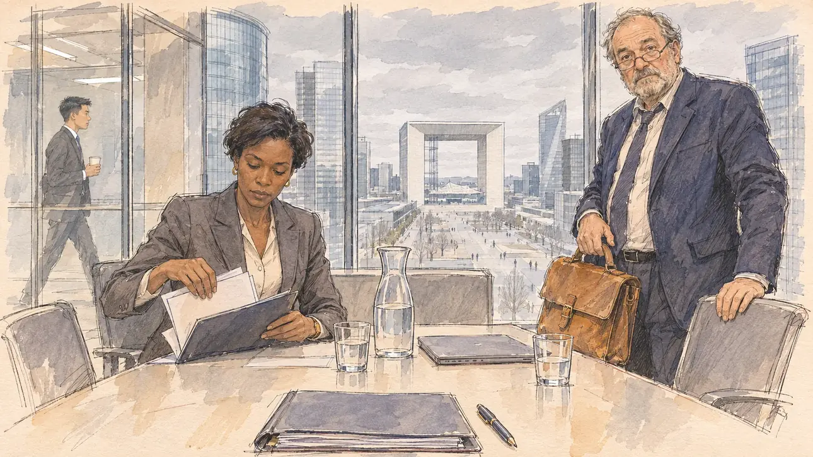

# `banksRefuse` · Les banques disent non

**Validée par le PO le 09/11/2026**, au premier essai. Elle sert telle quelle en clair et en sombre.



| Champ | Valeur |
| --- | --- |
| Carte | `banksRefuse`, catégorie `campaignFinance` (Finances de campagne), poids 0,2, semaines 1 à 5 |
| Style | Reportage dessiné |
| Ton | Tendu mais calme |
| Date | 2026-11-09 |
| Outil | ChatGPT Images, à compléter (modèle et effort) |
| Conversation | À compléter |
| Format rendu | 1672 × 941 (16:9) : export en 1290 × 726 px, WebP de qualité 75, 144 Ko, sans recadrage, fait depuis la copie WebP de la conversation (à refaire depuis le PNG d'origine) |
| Fichier d'origine | À compléter (hors du dépôt) |
| Première édition | À compléter |

## Texte de la carte

> **Les banques disent non**
>
> Trois banques refusent tour à tour le prêt de votre campagne. Votre trésorier prévient : sans argent frais, il faudra annuler des meetings.

## Le moment choisi

Une salle de réunion vitrée au trentième étage d'une tour de banque, à La Défense, un matin gris de février, à la fin du rendez-vous où la troisième banque refuse le prêt : par la baie, la Grande Arche, les tours et l'esplanade. Le candidat reste hors champ : son dossier de demande de prêt, refermé sur la table, et un stylo. Le trésorier de la campagne, sa vieille sacoche à la main, regarde le spectateur, las : c'est la troisième. En face, la chargée d'affaires de la banque range poliment les documents sans lever les yeux ; un jeune banquier passe dans le couloir. La Défense n'avait encore servi à aucune carte.

Un premier prompt plaçait la scène dans un local de campagne de Saint-Denis de La Réunion ; le PO a préféré un bureau de banque à La Défense, et garde La Réunion pour une autre carte (09/11/2026). La première carte de la catégorie `campaignFinance`.

## Prompt complet

Dans une nouvelle conversation, avec [`primeTime.webp`](../../illustrations/media/primeTime.webp) comme seule image de référence :

```
Use the attached image as the style reference and copy its drawing: a realistic reportage drawing made on the spot for a newspaper, with quick, nervous pencil lines, often drawn twice, ink hatching in the shadows, transparent watercolour washes that spill a little over the lines, and the warm paper showing through. Not the same scene and not the same people: never reuse the face or the hair of the woman in the reference.
Like in the reference, the setting can be full when the story needs it, with the things that say where we are and what is happening, but each one is sketched with a few pencil lines and a light wash, never rendered or finished, and the drawing gets looser and paler towards the edges until it fades into the bare paper.
This must look like a drawing made by hand on paper by a press illustrator, halfway between a quick sketch and a realistic picture: never a photograph, a film poster or a digital painting, and never a cartoon, a comic strip, a caricature or a children's book illustration. Continuous lines, never dotted or dashed outlines; no uniform texture, speckles or hatching filter laid over the picture; no glossy highlights, no smooth gradients, in the sky and on the walls too. Colour can be rich in places, on a piece of clothing, a light or a flag, but it stays transparent and within the palette below. The fade into the paper at the edges stays narrow, without a wide white margin. No blur and no depth-of-field effect: everything, the foreground included, is drawn sharp, like a sketch made on the spot.
People are drawn from life with realistic anatomy and proportions, like in the reference: faces shaped with pencil lines, hatching and light washes, a little more finished than the background but never photographic (no photographic skin, no airbrushed or digital-painting look). Expressions stay natural and restrained, even in laughter or tears: no exaggerated grins, no wide-open mouths full of teeth, no rubbery or cartoonish faces.

Editorial illustration, landscape 16:9 (1536 × 864 px), the scene filling the frame, with only a light fade into the paper at the edges. A glass-walled meeting room on the thirtieth floor of a bank tower at La Défense, near Paris, on a grey February morning in 2027, at the end of the appointment where a third bank turns down the campaign's loan: a long pale table, a few chairs, a water carafe and glasses, a laptop closed; through the floor-to-ceiling window, the Grande Arche, the glass towers and the esplanade far below under a low white sky. The player's candidate stays off-camera: in the foreground, only the edge of the table with a closed loan-application folder and a pen. In the right third, the campaign treasurer, a stocky white man in his sixties with a grey beard, thinning hair and half-moon glasses, in a rumpled navy suit with an old leather satchel in his hand, stands up and looks at the viewer with a weary, rueful look, the third refusal, his face above mid-height. Across the table, the bank's account manager, a tall woman in her forties of Ivorian descent, with short relaxed hair and a sharp grey suit, politely gathers the documents into a folder, her eyes on the papers. Behind the glass wall, in the corridor, a young banker of Vietnamese descent with a paper cup walks past without looking in. Only the treasurer looks at the viewer. Nothing on the folder, the documents, the laptop or the corridor walls is readable, and no bank's name, logo or colours appear anywhere.

Style: Reportage drawing made on the spot, like a press illustrator or courtroom sketch artist: pencil and ink with loose watercolour washes, lively unfinished lines, white paper showing through.

Palette: navy #13203F, vellum #F5EFE1, gold #A9802A, brick #B5523B, ochre #D9A441, sage #8FA58A, slate #5E7186, sand #DCC8A4, warm grey #8C8279; use 4 to 6 of them, subtle warm paper grain.

Tone: tense but quiet, flat grey morning light through the glass, cold slate and navy, the warm touch of the old leather satchel.

Constraints: realistic proportions, natural expressions, never cartoonish or caricatured faces, drawn like the rest of the illustration and never photographic; people of varied ages, genders, origins and body types (heavy, stocky, round, tall, short, wiry, not only slim), each with a distinct face and haircut (no two people alike), drawn with respect and never as a joke; each person's age, build and look plausible for their job and the scene (working people of working age), no stereotype tying an origin or a gender to a role, and no person of colour shown alone in a featured service or deferential role; anatomically correct hands with exactly five fingers, few hands visible, the others in pockets, behind objects or out of frame; no readable text anywhere (the folder, the documents, the laptop and the walls stay unreadable); no captions or speech bubbles; no logos, no bank name or bank colours, no political party colours; no recognisable real person, no lookalike of a real politician or banker; no explicit violence; no photographic rendering, no blur or bokeh, no dotted outlines, no texture or hatching filter over the picture, no oil-paint texture, no glow or halo around the lights, no reflections drawn as glossy surfaces on the glass, no wide white margin or frame (a light fade into the paper at the edges is fine).

Format: if 16:9 is not available, make 1536 × 1024 and keep the top 80 px and the bottom 80 px free of anything important (faces, hands, the main action): they will be cropped.
```

## Décisions prises sur cette image

Validée telle quelle par le PO (09/11/2026). La chargée d'affaires, d'origine ivoirienne, tient le rôle d'autorité, celle qui dit non. Sur le couvercle de l'ordinateur fermé, une petite tache blanche de lavis peut évoquer un logo de marque : sans forme, invisible à la taille de la carte, gardée.

## Essais écartés

Aucun.

## Retouches

Aucune.

## Relecture

Faite et validée par le PO le 09/11/2026.

- [x] Aucun texte lisible : le dossier, les documents et l'ordinateur sont vierges ; aucun nom, logo ni couleur de banque.
- [x] Aucun sosie d'une personne réelle, banquier compris.
- [x] Le candidat du joueur est hors champ : seuls son dossier refermé et un stylo, au premier plan.
- [x] Mains et visages sans défaut visible à 343 px de large : les mains de la chargée d'affaires sur les documents, celles du trésorier sur la sacoche et le dossier de la chaise, le gobelet du couloir.
- [x] Aucune couleur ni aucun logo de parti. Des personnes variées par l'âge, le corps, l'origine et la coiffure.
- [x] En 16:9 : pas de recadrage.
- [ ] Lisible sur la page de l'événement, en clair et en sombre : à vérifier dans l'app, une fois la carte publiée.
