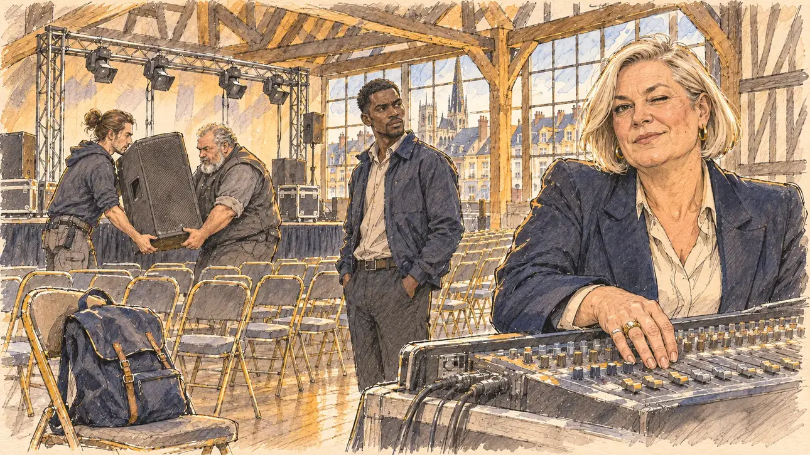

# `favourDone` · Le service rendu

**Retenue par le PO le 16/11/2026**, au premier essai. Elle sert telle quelle en clair et en sombre.



| Champ | Valeur |
| --- | --- |
| Carte | `favourDone`, catégorie `campaignFinance` (Finances de campagne), poids 0,15, toute semaine ; une leçon de la seconde série, à rebours : accepter discrètement fait perdre 3 d'intégrité quelle que soit l'issue, une seule de la série par partie (Mitchnsun/moi-president, PO, 16/11/2026) |
| Style | Reportage dessiné |
| Ton | Feutré et un peu trouble, après-midi doré |
| Date | 2026-11-16 |
| Outil | ChatGPT Images, modèle GPT 6.2, effort Light |
| Conversation | À compléter |
| Format rendu | 1672 × 941 (16:9) : export en 1290 × 726 px, WebP de qualité 75, 231 Ko, sans recadrage, fait depuis la copie WebP de la conversation |
| Fichier d'origine | Image de ChatGPT, chez le PO. L'export du dépôt a été fait depuis la copie partagée dans la conversation avec Claude |
| Première édition | À compléter |

## Texte de la carte

> **Le service rendu**
>
> Un entrepreneur local propose de financer la salle et la sono de votre prochain meeting, « en échange d'un coup de pouce plus tard ».

## Le moment choisi

Une salle de réception à Rouen, la veille d'un meeting, un après-midi de mars : charpente apparente, colombages, grandes fenêtres sur les toits et la cathédrale ; des techniciens montent la scène, les projecteurs et les rangées de chaises. Le candidat visite la salle, hors champ : seul son sac à dos, sur une chaise pliante. La patronne de l'événementiel, accoudée à la console de son, lui fait un clin d'œil : entre nous, on se rendra service ; deux techniciens portent une enceinte ; le coordinateur des bénévoles la regarde, méfiant. Le jeu ne récompense jamais une intégrité faible : cette carte fait payer la tentation en intégrité.

## Prompt complet

Dans une nouvelle conversation, avec [`primeTime.webp`](../../illustrations/media/primeTime.webp) comme seule image de référence :

```
Use the attached image as the style reference and copy its drawing: a realistic reportage drawing made on the spot for a newspaper, with quick, nervous pencil lines, often drawn twice, ink hatching in the shadows, transparent watercolour washes that spill a little over the lines, and the warm paper showing through. Not the same scene and not the same people: never reuse the face or the hair of the woman in the reference.
Like in the reference, the setting can be full when the story needs it, with the things that say where we are and what is happening, but each one is sketched with a few pencil lines and a light wash, never rendered or finished, and the drawing gets looser and paler towards the edges until it fades into the bare paper.
This must look like a drawing made by hand on paper by a press illustrator, halfway between a quick sketch and a realistic picture: never a photograph, a film poster or a digital painting, and never a cartoon, a comic strip, a caricature or a children's book illustration. Continuous lines, never dotted or dashed outlines; no uniform texture, speckles or hatching filter laid over the picture; no glossy highlights, no smooth gradients, in the sky and on the walls too. Colour can be rich in places, on a piece of clothing, a light or a flag, but it stays transparent and within the palette below. The fade into the paper at the edges stays narrow, without a wide white margin. No blur and no depth-of-field effect: everything, the foreground included, is drawn sharp, like a sketch made on the spot.
People are drawn from life with realistic anatomy and proportions, like in the reference: faces shaped with pencil lines, hatching and light washes, a little more finished than the background but never photographic (no photographic skin, no airbrushed or digital-painting look). Expressions stay natural and restrained, even in laughter or tears: no exaggerated grins, no wide-open mouths full of teeth, no rubbery or cartoonish faces.

Editorial illustration, landscape 16:9 (1536 × 864 px), the scene filling the frame, with only a light fade into the paper at the edges. A reception hall in Rouen, in Normandy, on an afternoon in March 2027, the day before a campaign rally: exposed timber beams, half-timbered walls, tall windows on the roofs and the spire of the cathedral; technicians set up the stage, speakers, spotlights and rows of chairs. The player's candidate is visiting the hall and stays off-camera: in the foreground, only the candidate's backpack on a folding chair. In the right third, the entrepreneur who offers to pay for the hall and the sound system, the owner of an events company, a stocky white woman in her fifties with a sleek platinum-blond bob, a fitted blazer and rings, leans on the sound console and looks at the viewer with a knowing wink, as if saying they will do each other a favour, her face above mid-height. On the stage, two technicians lift a speaker: a slim young man with long hair tied back and a heavy-set older man with a grey beard. A little apart, the campaign's volunteer coordinator, a tall young man of Senegalese descent with short hair, watches the entrepreneur with suspicion. Only the entrepreneur looks at the viewer. Nothing on the console, the speakers, the backpack, the chairs or the windows is readable.

Style: Reportage drawing made on the spot, like a press illustrator or courtroom sketch artist: pencil and ink with loose watercolour washes, lively unfinished lines, white paper showing through.

Palette: navy #13203F, vellum #F5EFE1, gold #A9802A, brick #B5523B, ochre #D9A441, sage #8FA58A, slate #5E7186, sand #DCC8A4, warm grey #8C8279; use 4 to 6 of them, subtle warm paper grain.

Tone: hushed and a little murky, the golden afternoon light through the windows, the gleam of the new spotlights, a wink too many.

Constraints: realistic proportions, natural expressions, never cartoonish or caricatured faces, drawn like the rest of the illustration and never photographic; people of varied ages, genders, origins and body types (heavy, stocky, round, tall, short, wiry, not only slim), each with a distinct face and haircut (no two people alike), drawn with respect and never as a joke; each person's age, build and look plausible for their job and the scene (working people of working age), no stereotype tying an origin or a gender to a role, and no person of colour shown alone in a featured service or deferential role; anatomically correct hands with exactly five fingers, few hands visible, the others in pockets, behind objects or out of frame; no readable text anywhere (the console, the speakers, the backpack, the chairs and the windows stay unreadable, no company name, no brand on the equipment); no captions or speech bubbles; no logos, no company logo, no political party colours, no flags; no recognisable real person, no lookalike of a real politician or of a known business leader; no explicit violence, no money or envelope visible; no photographic rendering, no blur or bokeh, every outline a continuous pencil or ink line with no dotted or dashed outlines, no mottled, crackled or speckled texture over the faces, the clothes, the timber or the walls, no hatching filter over the picture, no oil-paint texture, no glow, halo or lens flare around the spotlights, no wide white margin or frame (a light fade into the paper at the edges is fine).

Format: if 16:9 is not available, make 1536 × 1024 and keep the top 80 px and the bottom 80 px free of anything important (faces, hands, the main action): they will be cropped.
```

## Décisions prises sur cette image

Retenue telle quelle par le PO (16/11/2026). La cathédrale de Rouen se voit par les fenêtres, un monument que le gabarit permet. Le coordinateur regarde dans le vide plutôt que vers l'entrepreneuse ; la méfiance se lit tout de même.

## Essais écartés

Aucun.

## Retouches

Aucune.

## Relecture

Faite le 16/11/2026, à confirmer par le PO.

- [x] Aucun texte lisible : rien sur la console, les enceintes, le sac ni les fenêtres ; aucune marque sur le matériel.
- [x] Aucun sosie d'une personne réelle.
- [x] Le candidat du joueur est hors champ : seul son sac à dos, sur la chaise.
- [x] Mains et visages sans défaut visible à 343 px de large : la main baguée de l'entrepreneuse sur la console, celles des techniciens sous l'enceinte.
- [x] Aucune couleur, aucun logo ni aucun drapeau de parti ou d'entreprise ; ni argent ni enveloppe. Des personnes variées par l'âge, le corps, l'origine et la coiffure.
- [x] En 16:9 : pas de recadrage.
- [ ] Lisible sur la page de l'événement, en clair et en sombre : à vérifier dans l'app, une fois la carte publiée.
