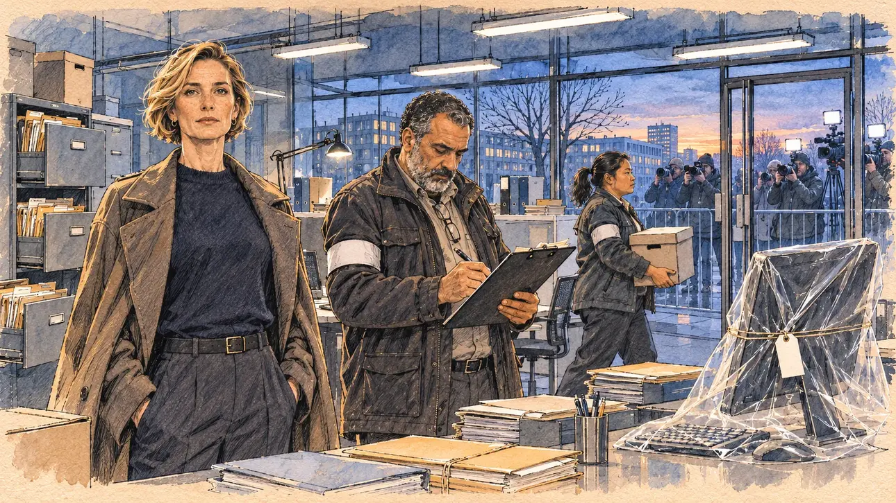

# `foreignInquiry` · Le parquet ouvre une enquête

**Validée le 22/11/2026**, au premier essai. Elle sert telle quelle en clair et en sombre.



| Champ | Valeur |
| --- | --- |
| Carte | `foreignInquiry`, catégorie `campaignFinance` (Finances de campagne), jamais tirée par son poids : l'enquête de la banque lointaine découverte, imposée comme carte suivante ; carte ajoutée par la PR #464 de l'app (Mitchnsun/moi-president#267) |
| Style | Reportage dessiné |
| Ton | Tendu, une matinée de perquisition |
| Date | 2026-11-22 |
| Outil | ChatGPT Images, modèle GPT 6.2 Astra (effort à compléter) |
| Conversation | À compléter |
| Format rendu | 1672 × 941 (16:9) : export en 1290 × 726 px, WebP de qualité 75, sans recadrage, fait depuis la copie WebP de la conversation (à refaire depuis le PNG d'origine) |
| Fichier d'origine | À compléter (hors du dépôt) |
| Première édition | À compléter |

## Texte de la carte

> **Le parquet ouvre une enquête**
>
> Le parquet ouvre une enquête sur le prêt de la banque étrangère : financement interdit et soupçons d'ingérence font la une.

## Le moment choisi

Le siège de la campagne à Nanterre, à l'aube, un matin d'avril : des enquêteurs en civil, brassard au bras, sortent des cartons d'archives et un ordinateur sous scellés ; dehors, derrière la vitre, des photographes attendent. La directrice de campagne, en manteau sur un pull, regarde le spectateur, livide mais droite ; l'enquêtrice qui dirige l'opération coche une liste sans la regarder. Le candidat est hors champ. Nanterre n'avait encore servi à aucune carte.

## Prompt complet

Dans une nouvelle conversation, avec [`primeTime.webp`](../../illustrations/media/primeTime.webp) comme seule image de référence :

```
Use the attached image as the style reference and copy its drawing: a realistic reportage drawing made on the spot for a newspaper, with quick, nervous pencil lines, often drawn twice, ink hatching in the shadows, transparent watercolour washes that spill a little over the lines, and the warm paper showing through. Not the same scene and not the same people: never reuse the face or the hair of the woman in the reference.
Like in the reference, the setting can be full when the story needs it, with the things that say where we are and what is happening, but each one is sketched with a few pencil lines and a light wash, never rendered or finished, and the drawing gets looser and paler towards the edges until it fades into the bare paper.
This must look like a drawing made by hand on paper by a press illustrator, halfway between a quick sketch and a realistic picture: never a photograph, a film poster or a digital painting, and never a cartoon, a comic strip, a caricature or a children's book illustration. Continuous lines, never dotted or dashed outlines; no uniform texture, speckles or hatching filter laid over the picture; no glossy highlights, no smooth gradients, in the sky and on the walls too. Colour can be rich in places, on a piece of clothing, a light or a flag, but it stays transparent and within the palette below. The fade into the paper at the edges stays narrow, without a wide white margin. No blur and no depth-of-field effect: everything, the foreground included, is drawn sharp, like a sketch made on the spot.
People are drawn from life with realistic anatomy and proportions, like in the reference: faces shaped with pencil lines, hatching and light washes, a little more finished than the background but never photographic (no photographic skin, no airbrushed or digital-painting look). Expressions stay natural and restrained, even in laughter or tears: no exaggerated grins, no wide-open mouths full of teeth, no rubbery or cartoonish faces.

Editorial illustration, landscape 16:9 (1536 × 864 px), the scene filling the frame, with only a light fade into the paper at the edges. The campaign headquarters in an office building in Nanterre, west of Paris, at dawn on an April morning in 2027, during a search by financial investigators: open filing cabinets, archive boxes being carried out, a desktop computer wrapped in clear plastic with a seal tag. The player's candidate stays off-camera. In the left third, the campaign director, a tall white woman in her forties with a short blond bob, a coat thrown over a jumper, stands very straight and looks at the viewer, pale but composed, her face above mid-height. In the centre, the lead investigator, a stocky man in his fifties of Algerian descent with a salt-and-pepper beard, plain clothes and an armband, ticks a list on a clipboard without looking at her. Behind them, a younger investigator, a short, round woman of Cambodian descent with a ponytail and an armband, carries an archive box towards the door. Outside, beyond the glass front, a few press photographers wait in the blue dawn. Only the campaign director looks at the viewer. Nothing on the armbands, the boxes, the clipboard, the seal tag or the windows is readable, and no police or court emblem appears.

Style: Reportage drawing made on the spot, like a press illustrator or courtroom sketch artist: pencil and ink with loose watercolour washes, lively unfinished lines, white paper showing through.

Palette: navy #13203F, vellum #F5EFE1, gold #A9802A, brick #B5523B, ochre #D9A441, sage #8FA58A, slate #5E7186, sand #DCC8A4, warm grey #8C8279; use 4 to 6 of them, subtle warm paper grain.

Tone: tense, a search at dawn, cold blue light from outside against the harsh white of the office ceiling lights.

Constraints: realistic proportions, natural expressions, never cartoonish or caricatured faces, drawn like the rest of the illustration and never photographic; people of varied ages, genders, origins and body types (heavy, stocky, round, tall, short, wiry, not only slim), each with a distinct face and haircut (no two people alike), drawn with respect and never as a joke; each person's age, build and look plausible for their job and the scene (working people of working age), no stereotype tying an origin or a gender to a role, and no person of colour shown alone in a featured service or deferential role; anatomically correct hands with exactly five fingers, few hands visible, the others in pockets, behind objects or out of frame; no readable text anywhere (the armbands, the boxes, the clipboard, the seal tag and the windows stay unreadable); no captions or speech bubbles; no logos, no police, court or justice emblem, no political party colours; no recognisable real person, no lookalike of a real politician; no explicit violence; no photographic rendering, no blur or bokeh, no dotted outlines, no texture or hatching filter over the picture, no oil-paint texture, no wide white margin or frame (a light fade into the paper at the edges is fine).

Format: if 16:9 is not available, make 1536 × 1024 and keep the top 80 px and the bottom 80 px free of anything important (faces, hands, the main action): they will be cropped.
```

## Décisions prises sur cette image

Les brassards des enquêteurs sont blancs et vierges, l'étiquette du scellé aussi ; dehors, derrière les barrières, les photographes et une caméra attendent sous les cités de Nanterre, dans une aube orangée.

## Essais écartés

Aucun.

## Retouches

Aucune.

## Relecture

Faite le 22/11/2026.

- [x] Aucun texte lisible : brassards, cartons, tiroirs, porte-documents et scellé sans inscription ; aucun emblème de police ni de justice.
- [x] Aucun sosie d'une personne réelle.
- [x] Le candidat du joueur est hors champ.
- [x] Mains et visages sans défaut visible à 343 px de large : les mains de la directrice dans ses poches, le stylo et le porte-documents de l'enquêteur, le carton porté.
- [x] Aucune couleur ni aucun logo de parti. Des personnes variées par l'âge, le corps, l'origine et la coiffure.
- [x] En 16:9 : pas de recadrage.
- [ ] Lisible sur la page de l'événement, en clair et en sombre : à vérifier dans l'app, une fois la carte publiée.
