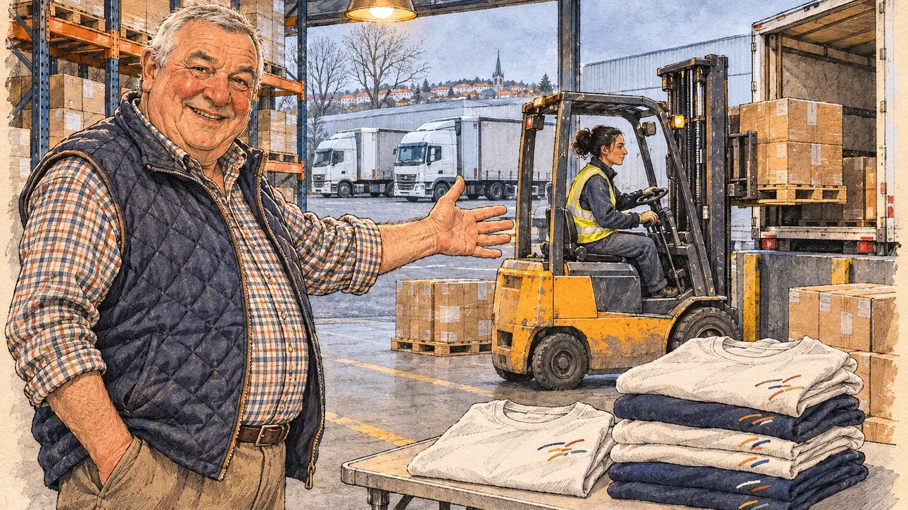

# `friendlyCompany` · L'industriel sympathisant

**Validée par le PO le 22/11/2026**, au premier essai. Elle sert telle quelle en clair et en sombre.



| Champ | Valeur |
| --- | --- |
| Carte | `friendlyCompany`, catégorie `campaignFinance` (Finances de campagne), poids 0,25, de la précampagne à la campagne officielle ; une offre piège (un concours en nature interdit, L.52-8), carte ajoutée par la PR #464 de l'app (Mitchnsun/moi-president#267) |
| Style | Reportage dessiné |
| Ton | Chaleureux en surface, une générosité qui met mal à l'aise |
| Date | 2026-11-22 |
| Outil | ChatGPT Images, modèle GPT 6.2 Astra (effort à compléter) |
| Conversation | À compléter |
| Format rendu | 1536 × 1024 (3:2) : 80 px retirés en haut et en bas (1536 × 864), export en 1290 × 726 px, WebP de qualité 75, 254 Ko, fait depuis la copie WebP de la conversation (à refaire depuis le PNG d'origine) |
| Fichier d'origine | À compléter (hors du dépôt) |
| Première édition | À compléter |

## Texte de la carte

> **L'industriel sympathisant**
>
> Un industriel de la région, qui vous soutient, propose de vous prêter son hangar et ses camions pour la semaine, et d'offrir cinq mille tee-shirts brodés à votre boutique. « Entre amis, on ne compte pas. »

## Le moment choisi

Le hangar d'une entreprise de transport et de confection aux Herbiers, dans le bocage vendéen, un matin de février : des camions blancs à quai, des palettes de cartons, et sur une table de pliage une pile de tee-shirts brodés tout juste sortis de l'atelier. L'industriel, bras ouverts vers son hangar, regarde le spectateur, grand sourire de générosité ; derrière lui, un cariste charge une palette sans s'arrêter. Le candidat reste hors champ. La Vendée n'avait encore servi à aucune carte.

## Prompt complet

Dans une nouvelle conversation, avec [`primeTime.webp`](../../illustrations/media/primeTime.webp) comme seule image de référence :

```
Use the attached image as the style reference and copy its drawing: a realistic reportage drawing made on the spot for a newspaper, with quick, nervous pencil lines, often drawn twice, ink hatching in the shadows, transparent watercolour washes that spill a little over the lines, and the warm paper showing through. Not the same scene and not the same people: never reuse the face or the hair of the woman in the reference.
Like in the reference, the setting can be full when the story needs it, with the things that say where we are and what is happening, but each one is sketched with a few pencil lines and a light wash, never rendered or finished, and the drawing gets looser and paler towards the edges until it fades into the bare paper.
This must look like a drawing made by hand on paper by a press illustrator, halfway between a quick sketch and a realistic picture: never a photograph, a film poster or a digital painting, and never a cartoon, a comic strip, a caricature or a children's book illustration. Continuous lines, never dotted or dashed outlines; no uniform texture, speckles or hatching filter laid over the picture; no glossy highlights, no smooth gradients, in the sky and on the walls too. Colour can be rich in places, on a piece of clothing, a light or a flag, but it stays transparent and within the palette below. The fade into the paper at the edges stays narrow, without a wide white margin. No blur and no depth-of-field effect: everything, the foreground included, is drawn sharp, like a sketch made on the spot.
People are drawn from life with realistic anatomy and proportions, like in the reference: faces shaped with pencil lines, hatching and light washes, a little more finished than the background but never photographic (no photographic skin, no airbrushed or digital-painting look). Expressions stay natural and restrained, even in laughter or tears: no exaggerated grins, no wide-open mouths full of teeth, no rubbery or cartoonish faces.

Editorial illustration, landscape 16:9 (1536 × 864 px), the scene filling the frame, with only a light fade into the paper at the edges. A large transport and garment company's warehouse in Les Herbiers, in the Vendée countryside of western France, on a February morning in 2027: white lorries backed up to the loading docks, stacks of cardboard boxes on pallets, a hanging work light, and on a folding table in the foreground a neat pile of freshly embroidered T-shirts still smelling of the workshop. The player's candidate stays off-camera. In the left third, the company's owner, a broad, heavy white man in his sixties with a ruddy face, a grey crew cut and a quilted gilet over a checked shirt, sweeps one open hand towards his warehouse and looks at the viewer with a big, generous, slightly insistent smile, his face above mid-height. Behind him, a forklift driver, a wiry woman in her thirties of Moroccan descent with a hi-vis vest and her hair tied back, loads a pallet without stopping, her eyes on the forks. Only the owner looks at the viewer. Nothing on the lorries, the boxes, the T-shirts' embroidery or the warehouse walls is readable: the embroidery is a loose shape of colour with no lettering.

Style: Reportage drawing made on the spot, like a press illustrator or courtroom sketch artist: pencil and ink with loose watercolour washes, lively unfinished lines, white paper showing through.

Palette: navy #13203F, vellum #F5EFE1, gold #A9802A, brick #B5523B, ochre #D9A441, sage #8FA58A, slate #5E7186, sand #DCC8A4, warm grey #8C8279; use 4 to 6 of them, subtle warm paper grain.

Tone: warm on the surface, a generosity that feels a little too much, cold grey daylight from the open docks and the warm glow of the work light.

Constraints: realistic proportions, natural expressions, never cartoonish or caricatured faces, drawn like the rest of the illustration and never photographic; people of varied ages, genders, origins and body types (heavy, stocky, round, tall, short, wiry, not only slim), each with a distinct face and haircut (no two people alike), drawn with respect and never as a joke; each person's age, build and look plausible for their job and the scene (working people of working age), no stereotype tying an origin or a gender to a role, and no person of colour shown alone in a featured service or deferential role; anatomically correct hands with exactly five fingers, few hands visible, the others in pockets, behind objects or out of frame; no readable text anywhere (the lorries, the boxes, the embroidery and the walls stay unreadable); no captions or speech bubbles; no logos, no company name or brand, no political party colours; no recognisable real person, no lookalike of a real politician; no explicit violence; no photographic rendering, no blur or bokeh, no dotted outlines, no texture or hatching filter over the picture, no oil-paint texture, no wide white margin or frame (a light fade into the paper at the edges is fine).

Format: if 16:9 is not available, make 1536 × 1024 and keep the top 80 px and the bottom 80 px free of anything important (faces, hands, the main action): they will be cropped.
```

## Décisions prises sur cette image

Le hangar s'ouvre sur un parking de camions et, au loin, un clocher et les toits d'un bourg vendéen. Sur la calandre d'un camion, une petite forme claire peut évoquer l'emblème d'une marque : sans dessin lisible, invisible à la taille de la carte, gardée. Les broderies des tee-shirts sont des traits de couleur, sans lettre.

## Essais écartés

Aucun.

## Retouches

Aucune.

## Relecture

Faite le 22/11/2026.

- [x] Aucun texte lisible : cartons, camions, broderies et murs sans inscription.
- [x] Aucun sosie d'une personne réelle.
- [x] Le candidat du joueur est hors champ.
- [x] Mains et visages sans défaut visible à 343 px de large : la main ouverte de l'industriel a ses cinq doigts, l'autre dans la poche ; la cariste, mains sur le volant.
- [x] Aucune couleur ni aucun logo de parti. Des personnes variées par l'âge, le corps, l'origine et la coiffure.
- [x] En 3:2 : 80 px retirés en haut et en bas, rien d'important perdu (le haut de la lampe).
- [ ] Lisible sur la page de l'événement, en clair et en sombre : à vérifier dans l'app, une fois la carte publiée.
