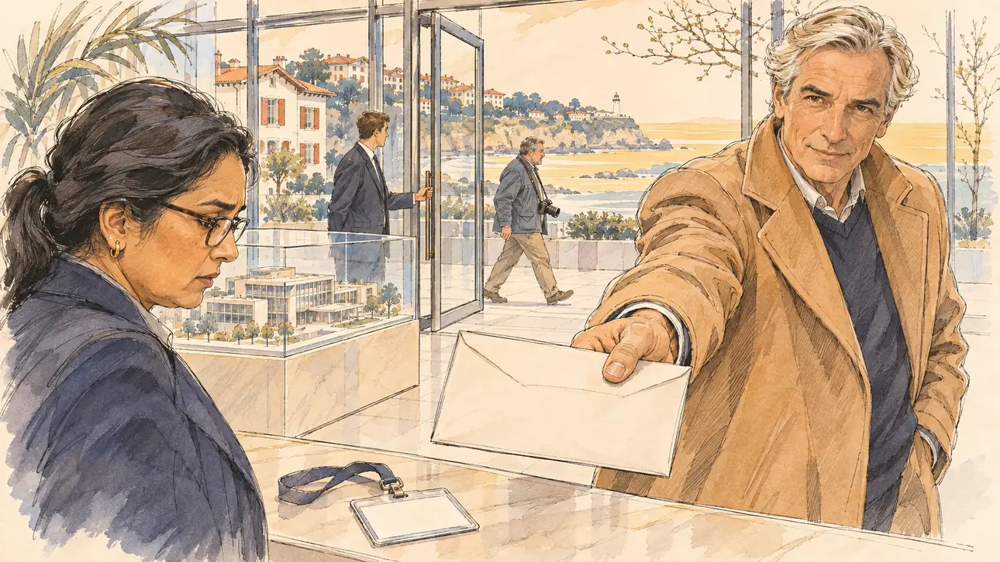

# `generousCheque` · Le cercle des donateurs

**Retenue par le PO le 16/11/2026**, au premier essai. Elle sert telle quelle en clair et en sombre.



| Champ | Valeur |
| --- | --- |
| Carte | `generousCheque`, catégorie `campaignFinance` (Finances de campagne), poids 0,12, toute semaine ; une leçon de la campagne (intégrité +2 sur le refus public), une seule des six par partie (Mitchnsun/moi-president, PO, 14/11/2026) |
| Style | Reportage dessiné |
| Ton | Tendu et feutré, lumière du soir sur l'océan |
| Date | 2026-11-16 |
| Outil | ChatGPT Images, à compléter (modèle et effort) |
| Conversation | À compléter |
| Format rendu | 1672 × 941 (16:9) : export en 1290 × 726 px, WebP de qualité 75, 152 Ko, sans recadrage, fait depuis la copie WebP de la conversation (à refaire depuis le PNG d'origine) |
| Fichier d'origine | À compléter (hors du dépôt) |
| Première édition | À compléter |

## Texte de la carte

> **Le cercle des donateurs**
>
> Un chef d'entreprise propose de réunir les dons de tout son cercle, le maximum légal chacun. En vous raccompagnant, il glisse qu'il compte sur vous pour « ne pas toucher » à son secteur.

## Le moment choisi

Le hall du siège d'une entreprise à Biarritz, une fin d'après-midi de mars : baies vitrées sur l'océan, les villas blanches aux volets rouges et le phare, une maquette d'architecte sous verre. Le chef d'entreprise raccompagne le candidat, hors champ : seul son badge de visiteur, blanc, sur le comptoir d'accueil. Il lui tend une épaisse enveloppe avec un sourire entendu ; la trésorière de la campagne la regarde, inquiète ; un assistant tient la porte ; dehors passe un photographe, sans viser. Le précédent est le financement par petits dons d'une campagne de primaire de 2016, l'inverse des gros donateurs : personne n'y ressemble à un patron connu.

## Prompt complet

Dans une nouvelle conversation, avec [`primeTime.webp`](../../illustrations/media/primeTime.webp) comme seule image de référence :

```
Use the attached image as the style reference and copy its drawing: a realistic reportage drawing made on the spot for a newspaper, with quick, nervous pencil lines, often drawn twice, ink hatching in the shadows, transparent watercolour washes that spill a little over the lines, and the warm paper showing through. Not the same scene and not the same people: never reuse the face or the hair of the woman in the reference.
Like in the reference, the setting can be full when the story needs it, with the things that say where we are and what is happening, but each one is sketched with a few pencil lines and a light wash, never rendered or finished, and the drawing gets looser and paler towards the edges until it fades into the bare paper.
This must look like a drawing made by hand on paper by a press illustrator, halfway between a quick sketch and a realistic picture: never a photograph, a film poster or a digital painting, and never a cartoon, a comic strip, a caricature or a children's book illustration. Continuous lines, never dotted or dashed outlines; no uniform texture, speckles or hatching filter laid over the picture; no glossy highlights, no smooth gradients, in the sky and on the walls too. Colour can be rich in places, on a piece of clothing, a light or a flag, but it stays transparent and within the palette below. The fade into the paper at the edges stays narrow, without a wide white margin. No blur and no depth-of-field effect: everything, the foreground included, is drawn sharp, like a sketch made on the spot.
People are drawn from life with realistic anatomy and proportions, like in the reference: faces shaped with pencil lines, hatching and light washes, a little more finished than the background but never photographic (no photographic skin, no airbrushed or digital-painting look). Expressions stay natural and restrained, even in laughter or tears: no exaggerated grins, no wide-open mouths full of teeth, no rubbery or cartoonish faces.

Editorial illustration, landscape 16:9 (1536 × 864 px), the scene filling the frame, with only a light fade into the paper at the edges. The lobby of a company's headquarters in Biarritz, in the French Basque Country, at the end of an afternoon in March 2027: large windows on the ocean and on the white villas with red shutters along the coast, a pale stone floor, an architect's model under glass; the business owner is walking the player's candidate out. The player's candidate stays off-camera: in the foreground, only the candidate's blank visitor badge lying on the reception counter. In the right third, the business owner, a tall, lean man in his sixties with silver hair swept back, tanned, in a camel cashmere coat, holds a thick envelope and leans towards the viewer with a knowing smile, as if letting slip a confidence, his face above mid-height. Near the viewer, the campaign's treasurer, a woman in her forties of Indian descent with glasses and her hair in a ponytail, looks at the envelope with worry. In the background, a slim young assistant in a suit holds the glass door open. Outside, on the forecourt, a passing photographer with a camera on a strap, not aiming. Only the business owner looks at the viewer. Nothing on the envelope, the badge, the counter, the model or the windows is readable.

Style: Reportage drawing made on the spot, like a press illustrator or courtroom sketch artist: pencil and ink with loose watercolour washes, lively unfinished lines, white paper showing through.

Palette: navy #13203F, vellum #F5EFE1, gold #A9802A, brick #B5523B, ochre #D9A441, sage #8FA58A, slate #5E7186, sand #DCC8A4, warm grey #8C8279; use 4 to 6 of them, subtle warm paper grain.

Tone: tense and hushed, the golden evening light on the ocean, the envelope at the centre of the scene.

Constraints: realistic proportions, natural expressions, never cartoonish or caricatured faces, drawn like the rest of the illustration and never photographic; people of varied ages, genders, origins and body types (heavy, stocky, round, tall, short, wiry, not only slim), each with a distinct face and haircut (no two people alike), drawn with respect and never as a joke; each person's age, build and look plausible for their job and the scene (working people of working age), no stereotype tying an origin or a gender to a role, and no person of colour shown alone in a featured service or deferential role; anatomically correct hands with exactly five fingers, few hands visible, the others in pockets, behind objects or out of frame; no readable text anywhere (the envelope, the badge, the counter, the model and the windows stay unreadable, no company name, no figures, no banknotes visible); no captions or speech bubbles; no logos, no company logo, no political party colours, no flags; no recognisable real person, no lookalike of a real politician or of a known business leader; no explicit violence; no photographic rendering, no blur or bokeh, every outline a continuous pencil or ink line with no dotted or dashed outlines, no mottled, crackled or speckled texture over the faces, the clothes, the stone or the sea, no hatching filter over the picture, no oil-paint texture, no glow or halo, no wide white margin or frame (a light fade into the paper at the edges is fine).

Format: if 16:9 is not available, make 1536 × 1024 and keep the top 80 px and the bottom 80 px free of anything important (faces, hands, the main action): they will be cropped.
```

## Décisions prises sur cette image

Retenue telle quelle par le PO (16/11/2026). Le chef d'entreprise tend l'enveloppe vers le spectateur plutôt que de la garder contre lui : l'offre est plus lisible. Le phare de Biarritz se voit au fond, un monument que le gabarit permet.

## Essais écartés

Aucun.

## Retouches

Aucune.

## Relecture

Faite le 16/11/2026, à confirmer par le PO.

- [x] Aucun texte lisible : l'enveloppe et le badge sont blancs ; rien sur la maquette, le comptoir ni les vitres.
- [x] Aucun sosie d'une personne réelle.
- [x] Le candidat du joueur est hors champ : seul son badge de visiteur, sur le comptoir.
- [x] Mains et visages sans défaut visible à 343 px de large : la main qui tend l'enveloppe, celle de l'assistant sur la poignée.
- [x] Aucune couleur, aucun logo ni aucun drapeau de parti ou d'entreprise. Des personnes variées par l'âge, le corps, l'origine et la coiffure.
- [x] En 16:9 : pas de recadrage.
- [ ] Lisible sur la page de l'événement, en clair et en sombre : à vérifier dans l'app, une fois la carte publiée.
