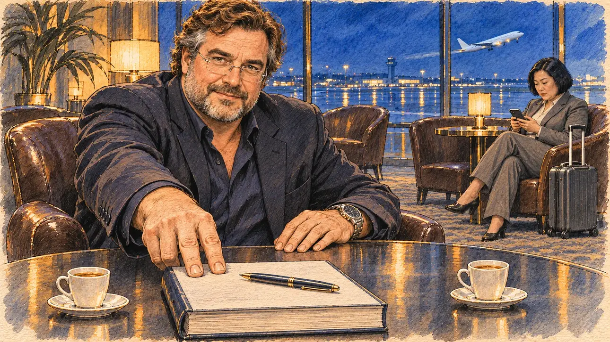

# `offshoreBank` · La banque lointaine

**Validée par le PO le 22/11/2026**, au deuxième essai, telle quelle en clair et en sombre : une texture craquelée régulière et des reflets sur la table, acceptés : invisibles ou presque à la taille de la carte.



| Champ | Valeur |
| --- | --- |
| Carte | `offshoreBank`, catégorie `campaignFinance` (Finances de campagne), poids 0,6, après deux refus de la banque ; une offre piège (une banque hors de l'Union européenne, interdite aux partis depuis 2017), carte ajoutée par la PR #464 de l'app (Mitchnsun/moi-president#267) |
| Style | Reportage dessiné |
| Ton | Lisse et inquiétant |
| Date | 2026-11-22 |
| Outil | ChatGPT Images, modèle GPT 6.2 Astra, effort Light |
| Conversation | À compléter |
| Format rendu | 1672 × 941 (16:9) : export en 1290 × 726 px, WebP de qualité 75, 217 Ko, sans recadrage, fait depuis la copie WebP de la conversation |
| Fichier d'origine | Image de ChatGPT, chez le PO. L'export du dépôt a été fait depuis la copie partagée dans la conversation avec Claude |
| Première édition | À compléter |

## Texte de la carte

> **La banque lointaine**
>
> Après deux refus, un intermédiaire vous présente une banque d'un pays lointain : un million d'euros, en une fois, sans garantie, signés en une semaine.

## Le moment choisi

Le salon d'un hôtel d'affaires près de l'aéroport de Roissy-Charles-de-Gaulle, tard le soir : fauteuils de cuir, moquette épaisse, une baie sur les pistes où un avion décolle. L'intermédiaire fait glisser vers le spectateur un épais contrat et un stylo de luxe, sourire lisse ; à la table voisine, son associé, valise à roulettes au pied, ne lève pas les yeux de son téléphone. Le candidat est hors champ, à la place du spectateur. Roissy n'avait encore servi à aucune carte.

## Prompt complet

Dans une nouvelle conversation, avec [`primeTime.webp`](../../illustrations/media/primeTime.webp) comme seule image de référence :

```
Use the attached image as the style reference and copy its drawing: a realistic reportage drawing made on the spot for a newspaper, with quick, nervous pencil lines, often drawn twice, ink hatching in the shadows, transparent watercolour washes that spill a little over the lines, and the warm paper showing through. Not the same scene and not the same people: never reuse the face or the hair of the woman in the reference.
Like in the reference, the setting can be full when the story needs it, with the things that say where we are and what is happening, but each one is sketched with a few pencil lines and a light wash, never rendered or finished, and the drawing gets looser and paler towards the edges until it fades into the bare paper.
This must look like a drawing made by hand on paper by a press illustrator, halfway between a quick sketch and a realistic picture: never a photograph, a film poster or a digital painting, and never a cartoon, a comic strip, a caricature or a children's book illustration. Continuous lines, never dotted or dashed outlines; no uniform texture, speckles or hatching filter laid over the picture; no glossy highlights, no smooth gradients, in the sky and on the walls too. Colour can be rich in places, on a piece of clothing, a light or a flag, but it stays transparent and within the palette below. The fade into the paper at the edges stays narrow, without a wide white margin. No blur and no depth-of-field effect: everything, the foreground included, is drawn sharp, like a sketch made on the spot.
People are drawn from life with realistic anatomy and proportions, like in the reference: faces shaped with pencil lines, hatching and light washes, a little more finished than the background but never photographic (no photographic skin, no airbrushed or digital-painting look). Expressions stay natural and restrained, even in laughter or tears: no exaggerated grins, no wide-open mouths full of teeth, no rubbery or cartoonish faces.

Editorial illustration, landscape 16:9 (1536 × 864 px), the scene filling the frame, with only a light fade into the paper at the edges. The lounge of a business hotel next to Roissy-Charles-de-Gaulle airport, near Paris, late on a February evening in 2027: deep leather armchairs, a thick carpet, a low table with two untouched espressos, and behind a floor-to-ceiling window the runways at night with the lights of a plane taking off; every plane is plain white, with no airline colours, stripes or tail design. The player's candidate stays off-camera, in the viewer's seat. Facing the viewer across the low table, in the centre-left, the go-between, a heavy-set white man in his fifties with thick wavy chestnut hair going grey at the temples, a short trimmed beard and rimless glasses, a dark suit, an open collar and a heavy watch, slides a thick bound contract and an expensive pen towards the viewer with two fingers, with a smooth, patient smile, his face above mid-height. At the next table, his associate, a stout woman in her forties of Chinese descent with a sleek black bob and a grey trouser suit, a rolling suitcase at her feet, looks at her phone without raising her eyes. Only the go-between looks at the viewer. Nothing on the contract, the phone, the suitcase tag or the window is readable, and no country, bank, flag or currency symbol appears anywhere.

Style: Reportage drawing made on the spot, like a press illustrator or courtroom sketch artist: pencil and ink with loose watercolour washes, lively unfinished lines, white paper showing through.

Palette: navy #13203F, vellum #F5EFE1, gold #A9802A, brick #B5523B, ochre #D9A441, sage #8FA58A, slate #5E7186, sand #DCC8A4, warm grey #8C8279; use 4 to 6 of them, subtle warm paper grain.

Tone: smooth and uneasy, dim amber lounge light against the cold blue of the runways at night.

Constraints: realistic proportions, natural expressions, never cartoonish or caricatured faces, drawn like the rest of the illustration and never photographic; people of varied ages, genders, origins and body types (heavy, stocky, round, tall, short, wiry, not only slim), each with a distinct face and haircut (no two people alike), drawn with respect and never as a joke; each person's age, build and look plausible for their job and the scene (working people of working age), no stereotype tying an origin or a gender to a role, and no person of colour shown alone in a featured service or deferential role; anatomically correct hands with exactly five fingers, few hands visible, the others in pockets, behind objects or out of frame; no readable text anywhere (the contract, the phone, the luggage tag and the window stay unreadable); no captions or speech bubbles; no logos, no bank name, no airline colours on the planes, no country flag or currency symbol, no political party colours; no recognisable real person, no lookalike of a real politician; no explicit violence; no photographic rendering, no blur or bokeh, no dotted outlines, no texture or hatching filter over the picture, no oil-paint texture, no wide white margin or frame (a light fade into the paper at the edges is fine).

Format: if 16:9 is not available, make 1536 × 1024 and keep the top 80 px and the bottom 80 px free of anything important (faces, hands, the main action): they will be cropped.
```

## Essais écartés

- **Premier essai (22/11/2026)**, écarté : l'intermédiaire, maigre, crâne rasé, chemise ouverte sous un costume sombre, rappelait trop un ancien ministre des Finances européen, réel et connu ; les avions portaient des dérives aux couleurs de compagnies. Le prompt décrit maintenant un homme corpulent, aux cheveux châtains ondulés, barbe courte et lunettes, et des avions tout blancs ; « d'origine indéterminée » a disparu.

## Retouches

Aucune.

## Relecture

Faite et validée par le PO le 22/11/2026.

- [x] Aucun texte lisible.
- [x] Aucun sosie d'une personne réelle.
- [x] Le candidat du joueur est hors champ.
- [x] Mains et visages sans défaut visible à 343 px de large.
- [x] Aucune couleur ni aucun logo de parti. Des personnes variées par l'âge, le corps, l'origine et la coiffure.
- [x] En 16:9 : pas de recadrage.
- [ ] Lisible sur la page de l'événement, en clair et en sombre : à vérifier dans l'app, une fois la carte publiée.
